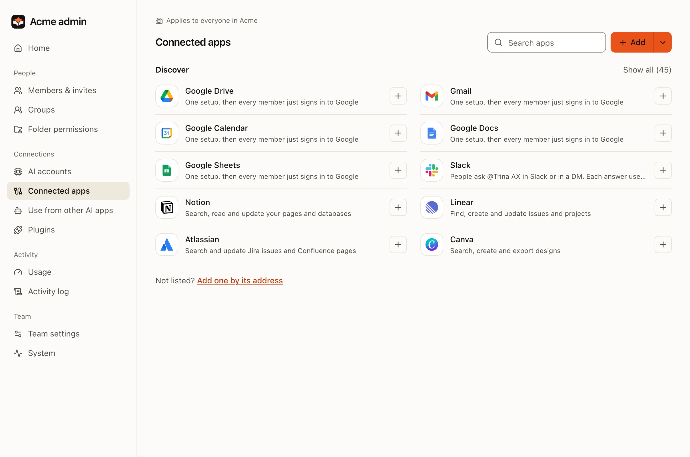
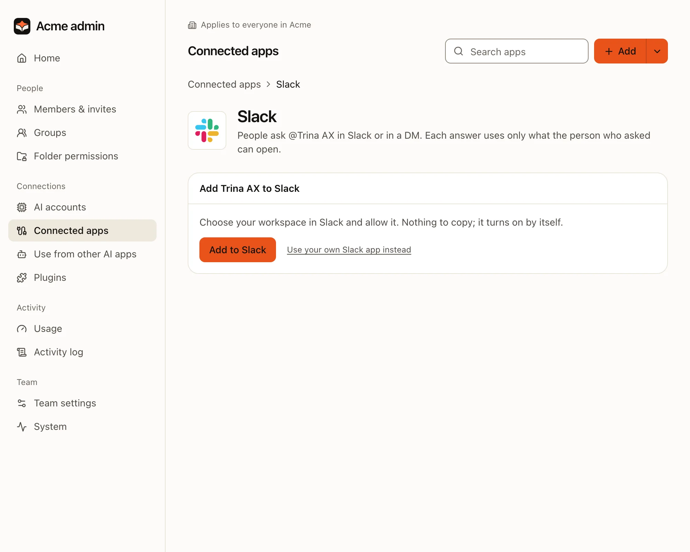
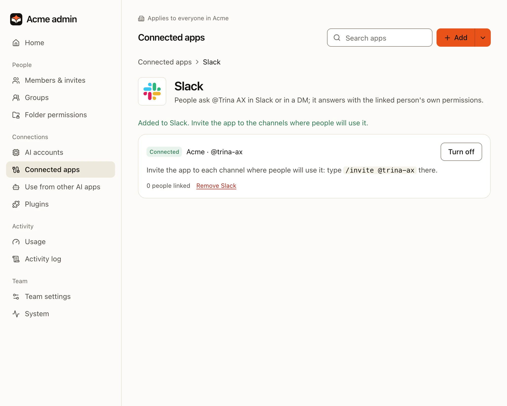
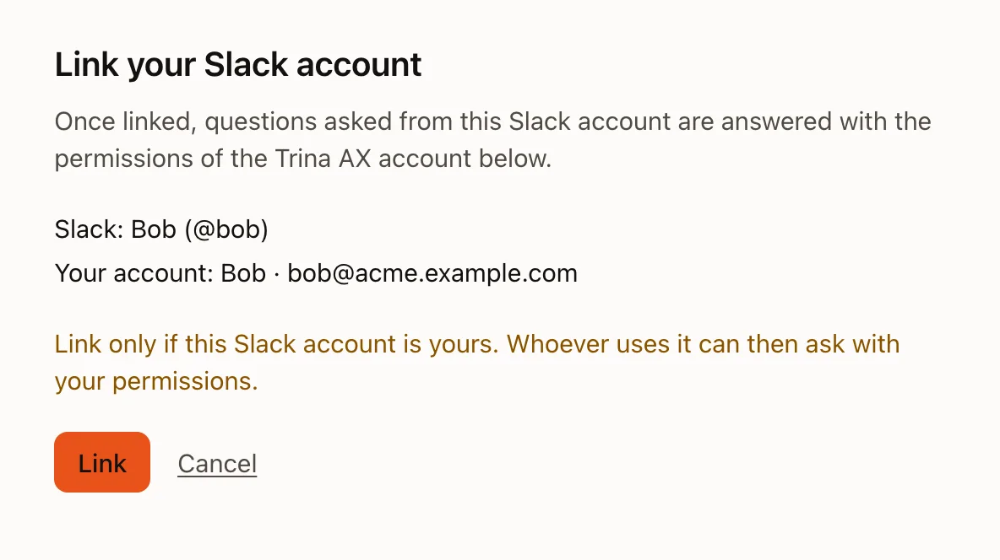
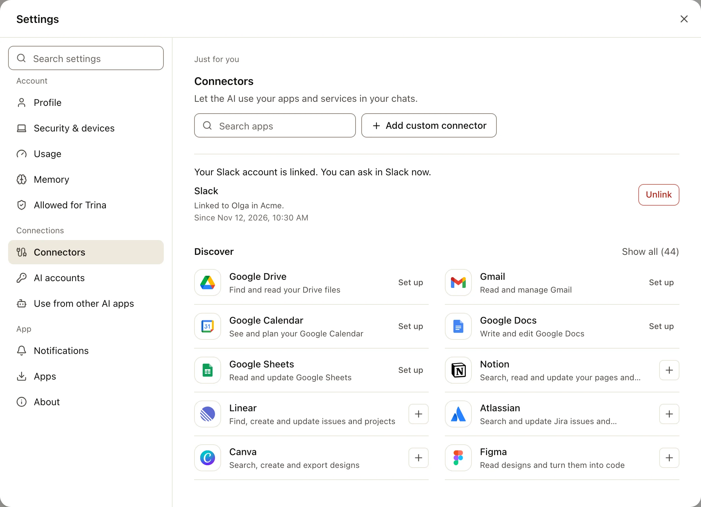
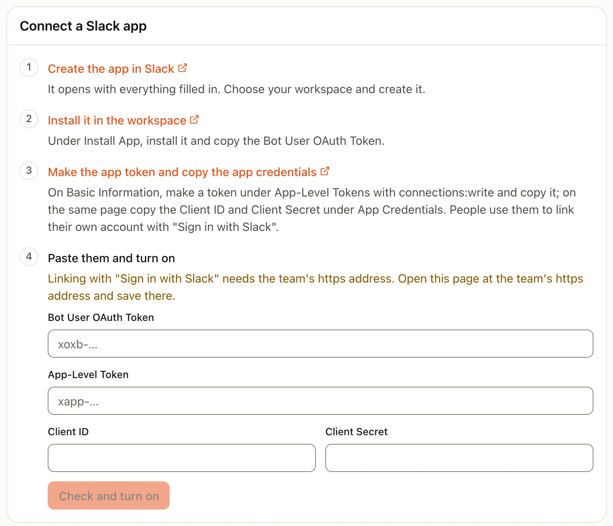
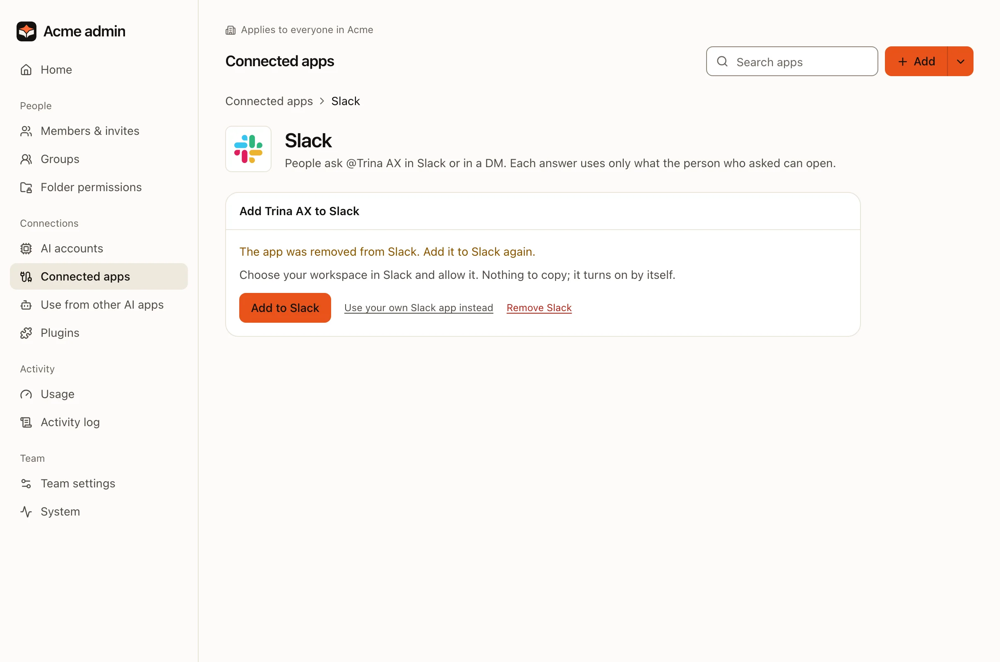

Slack をつなぐと、Slack を離れずに Trina AX に質問できます。チャンネルで **@Trina AX** をメンションするか、DM を送ります。質問は質問した本人として実行され、その人のフォルダーの権限、AI エンジン、上限がそのまま使われます。回答の全文は Trina AX にもチャットとして残ります。

手順は短いものが 2 つです。チームのオーナーまたは管理者がアプリを Slack に 1 回追加し、各自が自分の Slack アカウントを 1 回連携します。

:::tip
**必要なもの**

- **アプリの追加**（1 回）：Trina AX でのチームのオーナーまたは管理者と、Slack ワークスペースでアプリを承認できる人（Slack ワークスペースの管理者またはオーナー）。コピーや貼り付けはありません。
- **アカウントの連携**（各自 1 回）：自分の Slack アカウント。コピーや貼り付けはありません。
- **「Slackに追加」がないサーバーの場合のみ**：自分たちの Slack アプリの 4 つの値。[下記](#slackに追加がない場合) を見てください。
:::

:::note
このページのスクリーンショットには、架空のチームとワークスペース「Acme」を使っています。
:::

## Trina AX を Slack に追加する（オーナーまたは管理者）

:::steps
#### 管理 › 連携サービスで Slack を開く
**管理** で **連携サービス** を選びます。Slack はそこにあるサービスの 1 つで、追加するまでは **見つける** に、追加後は **接続済み** に表示されます。チームのオーナーと管理者に表示されます。



**Slack** を選びます。ページに **Trina AXをSlackに追加** が表示されます。



#### Slackに追加を押す
**Slackに追加** を押すと、Slack 自身のページが開きます。スマートフォンでも使えます。

#### ワークスペースを選んで許可する
Slack のページの右上にワークスペースの名前が表示され、Trina AX がそこで見られること、できることが一覧になっています。まずワークスペースを確かめてください。Slack は最後に使ったワークスペースで開くので、意図したものと違うことがあります。必要ならその角で切り替えて、**許可する** を選びます。

#### Trina AX の Slack のページに戻る
「Slackに追加しました。使うチャンネルにアプリを招待してください。」と表示されます。ワークスペースとアプリが表示され、数秒間 **接続中** になってから **接続済み** になります。コピーや貼り付けはありません。Trina AX が Slack のウィンドウを待っている間は **再試行** と **キャンセル** があり、5 分たつと待機は自動で終わります。


:::

アプリを追加できるのは、Slack ワークスペースの管理者またはオーナーだけです。それ以外の人には「Slackワークスペースの管理者が追加する必要があります。管理者に依頼してください。」と表示され、アプリはワークスペースから再び外されます。

### アプリをチャンネルに招待する

Slack が Trina AX に知らせるのは、アプリが参加しているチャンネルのことだけです。これはどの Slack アプリでも同じです。
質問に使う各チャンネルで、次のようにします。

1. Slack でそのチャンネルを開きます。
2. メッセージ欄に `/invite @trina-ax` と入力して Enter を押します。（入力中に Slack がアプリを候補に出したら、それを選びます。）
3. アプリが追加されたことを知らせる行が、Slack からチャンネルに投稿されます。それ以降、チャンネルの誰でもアプリをメンションできます。

```
/invite @trina-ax
```

DM には招待は不要です。Slack のサイドバーの **アプリ**（Apps）で **Trina AX** を探して、メッセージを送ります。

## アカウントを連携して質問する（全員）

各自が自分の Slack アカウントを自分の Trina AX アカウントに 1 回連携します。他の人の連携はできません。

:::steps
#### Slack で質問する
招待済みのチャンネルで **@Trina AX** をメンションするか、DM を送ります。たとえば「@Trina AX shared/sales にある先週のメモをまとめて」。

#### 初回はアカウントをつなぐ
初回は、Trina AX はあなただけに返信します。「ここでTrina AXに質問するには、まずTrina AXアカウントを連携してください。このリンクは10分間・1回だけ、あなただけが使えます。」

1. そのメッセージの **Trina AXアカウントを連携** を選びます。
2. ブラウザーで Trina AX が開きます（求められたらログインします）。**Slackアカウントの連携** のページに、両方のアカウントが
   表示されます。Slack の名前と、Trina AX の名前とメールアドレスです。
3. Slack アカウントが自分のものであることを確かめて、**連携する** を選びます。ページに「連携しました。Slackに戻ってもう一度質問してください。」と表示されます。

**連携する** が表示されるのは、Slack アカウントのメールアドレスが Trina AX アカウントと同じときです。違う場合は、ページに
理由が表示され、代わりに **Slackでサインインして連携** が表示されます。



#### または Trina AX から連携する
**設定 › コネクター** に **Slack** の行があります。「（ワークスペース）のSlackアカウントでサインインすると連携されます。」**連携** を選ぶと Slack に移動して戻ってきます。そのあと、行に連携したアカウントが表示されます。



#### もう一度質問する
Slack に戻って、もう一度質問します。これからは Trina AX がすぐに回答します。
:::

### 回答が届く場所

| 質問した場所 | 届くもの |
|---|---|
| **チャンネル** | 「回答を作成しています…」のあとに回答が届きます。あなたにだけ表示され、**チャンネルに投稿** が付いています。押すと、「（名前）さんの質問」という表示付きで回答がスレッドに投稿されます。 |
| **DM** | 回答がメッセージのスレッドに届きます。 |

- **同じスレッドで続ける。** そのスレッドでもう一度アプリをメンションするか、DM のスレッドで返信すると、同じチャットが続きます。新しいスレッドでは新しいチャットになります。
- **あなたの言語で。** Slack に出る Trina AX 自身の文言（「回答を作成しています…」「（名前）として回答します。」「Trina AXで開く」）は、Trina AX で設定した言語で表示されます。回答そのものは、AI の回答用に選んだ言語に従います。
- **回答の全文は Trina AX にもあります。** 長い回答は Slack では短くなり、続きへのリンクが付きます。「回答を作成しています…」には回答に使うアカウントも表示されるので、自分のものだとわかります。
- **投稿する前に。** グループのフォルダーや自分の個人フォルダーなど、チームの全員が見られるわけではない場所を回答が使った場合、**チャンネルに投稿** はまず確認を求め、**それでも投稿** と **投稿しない** を表示します。他の組織と共有しているチャンネルには、回答は投稿されません。

## 「Slackに追加」がない場合

**Slackに追加** は、Trina のホスティングサービスがサーバーを提供している場合に表示されます。つまり、ホスト型のチームか、自分でインストールしてホスティングサービスに登録されたサーバーです。それ以外では、**管理 › 連携サービス** の Slack のページに、代わりに **Slackアプリを接続** が表示されます。こちらのマニフェストからチーム独自の Slack アプリを作り、そのキーを貼り付ける 4 つの手順です。アプリのキーを貼り付けることになるため、これができるのはチームのオーナーだけです。管理者には「ここでSlackを連携できるのはチームのオーナーだけです。」と表示されます。このページはチームの `https://` アドレスで開いてください。各自の **Slackでサインイン** のリンクはそこに戻ってきます。



:::tip
**必要なもの（すべて api.slack.com/apps の Slack アプリの設定から）**

| Trina AX の欄 | Slack での場所 | 形 |
|---|---|---|
| **Bot User OAuth Token** | **Install to Workspace** のあとの **Install App**（または **OAuth & Permissions**） | `xoxb-…` |
| **App-Level Token** | **Basic Information › App-Level Tokens › Generate Token and Scopes**（スコープ `connections:write` 付き） | `xapp-…` |
| **Client ID** | **Basic Information › App Credentials** | 点の入った数字 |
| **Client Secret** | **Basic Information › App Credentials** の **Show** | 英字と数字 |
:::

:::steps
#### Slackでアプリを作成
**Slackでアプリを作成** を選びます。Slack の「Create an app」が、こちらのマニフェストの内容がすべて入った状態で開きます。ワークスペースを選び、**Create** を選びます。あなたのワークスペース専用のアプリが作られます。

#### ワークスペースにインストール
**ワークスペースにインストール**（Slack の **Install App** ページ）を選び、**Install to Workspace**、**Allow** の順に選びます。`xoxb-` で始まる **Bot User OAuth Token** をコピーします。

#### アプリトークンを作成し、アプリの認証情報をコピー
**アプリトークンを作成し、アプリの認証情報をコピー**（Slack の **Basic Information** ページ）を選びます。**App-Level Tokens** で **Generate Token and Scopes** を選び、名前は何でもよいので付けて、スコープ `connections:write` を追加し、**Generate** を選びます。`xapp-` で始まるトークンをコピーします。同じページの **App Credentials** で、**Client ID** と **Client Secret**（先に **Show** を選びます）をコピーします。

#### 貼り付けてオンにする
4 つの値をそれぞれの欄に貼り付け、**確認してオンにする** を選びます。Trina AX が Slack に値を確認します。Slack が受け付けなかった値は、その欄の下に、直す場所の Slack のページとともに表示されます。
:::

そのあと、上と同じようにアプリをチャンネルに招待します。運用担当者向けの詳細：[Setting up the team's own app](../../../SLACK.md#setting-up-the-teams-own-app-the-owner)（英語）。

| 表示 | 対処 |
|---|---|
| 「ボットトークンではありません。」または「Slackがこのトークンを受け付けません。」 | **Install App** から、Slack のコピーボタンで **Bot User OAuth Token**（`xoxb-`）をもう一度コピーしてください。 |
| 「Slackがこのアプリトークンを受け付けません。」 | スコープ `connections:write` 付きの新しい App-Level Token を作って貼り付けてください。 |
| 「2つのトークンが別々のSlackアプリのものです。」 | 2 つのトークンは同じ Slack アプリのものである必要があります。 |
| 「Client IDではありません。」または「Client Secretではありません。」 | **Basic Information › App Credentials** からもう一度コピーしてください。2 つの欄が入れ替わっているかもしれません。 |
| 「Slackアプリの設定 › Socket Modeをオンにしてください。」 | マニフェストではオンになっています。誰かがオフにした場合は、Slack でもう一度オンにしてください。 |
| **Slackでサインイン** がリダイレクトのエラーで失敗する | チームの `https://` 以外のアドレスでページを保存しています。チームのアドレスで開いて、もう一度保存してください。 |

チーム独自の Slack アプリがすでに設定されている場合にも、この 4 つの手順が表示されます。切り替えるには、オーナーが先にそれを削除し（**トークンを変更**、続いて **Slack連携を削除**）、そのあと **Slackに追加** を押します。管理者はチーム独自のアプリをオフにしたりオンにしたりできますが、変更や削除はオーナーにしかできません。管理 › 連携サービスに Slack がまったく表示されない場合、あなたはチームのオーナーでも管理者でもありません。オーナーか管理者に頼んでください。

## Slackチャンネルをトークにつなぐ

お客さまとはSlackのチャンネルで話しているけれど、チームはTrina AXで仕事をしている、という場合は、そのチャンネルをチームのトークかプロジェクト1つにつなぎます。チャンネルのメッセージは書かれるとすぐトークに表示され、チームがトークに書いた内容はチャンネルに戻ります。お客さまはSlackのままで、何も変わりません。

#### トークのメニュー › アプリを追加 › Slack を開く

トークにいるチームのオーナーか管理者だけが行えます。最初は、あなたのSlackアカウントを確認するため “Slackでサインイン” を求められます。

#### チャンネルを選んで「接続」を押す

あなたとTrina AXアプリの両方が参加しているチャンネルが表示されます。見当たらない場合は、先にSlackでアプリを招待してください（`/invite @trina-ax`）。ボタンの上の一文を読んでください：“これからこのトークの全員がチャンネルのメッセージを見られます”。書いた内容はそれぞれの名前でSlackに送られます。“接続” を押します。

#### 表示されるもの

- トークでは、Slackのメッセージに送った人のSlackの名前と写真、小さなSlackマークが付きます。スレッド、メンション、編集、削除も反映されます。ヘッダーに “#チャンネル · Slack” が表示されます。
- Slackでは、トークのメッセージが “Mina (Trina AX)” のように表示されます。書くのにSlackアカウントは要りません。
- AIの回答とファイルはSlackに送られません。そのメッセージには “Slackに送っていません” と表示されます。Slackが受け付けなかったときは “再試行” も表示されます。
- ゲストがいるトークはまだつなげません。つないでいる間はゲストを招待できません。

やめるときは、もう一度ダイアログを開いて（ヘッダーの “#チャンネル · Slack” を押しても開きます）“接続を解除” を押します。それまでのやり取りはトークに残ります。

## 削除またはつなぎ直し

**管理 › 連携サービス** の Slack のページには、常に現在の状態が表示されます。一覧の行にも同じ状態（**オン**、**接続中**、**オフ**、または対応が必要なこと）が表示されます。Slack から数分間応答がないと、ページに **応答なし** と対処方法が表示されます。Slack でアプリが削除された場合、行には **再接続** と表示され、ページには再び **Slackに追加** が、戻す必要がなければ **Slack連携を削除** が表示されます。



| 起きたこと | 対処 |
|---|---|
| **誰かが Slack でアプリを削除した** | Slack のページに「Slackからアプリが削除されました。もう一度Slackに追加してください。」と表示されます。もう一度 **Slackに追加** を押してください。各自の連携は残ります。同じワークスペースに追加すれば、誰も連携し直す必要はありません。戻す必要がなければ、代わりに **Slack連携を削除** を押します。Slack は **見つける** に戻り、全員のアカウント連携が削除されます。 |
| **しばらく止めたい** | **オフにする** を押します。Trina AX は Slack で回答しなくなりますが、連携は残ります。**オンにする** で元に戻ります。 |
| **完全になくしたい** | **Slack連携を削除** を押して確定します。アプリは Slack ワークスペースから外され、全員のアカウント連携が削除されます。あとでもう一度追加した場合は、全員が連携し直します。 |

自分の Slack アカウントの連携は、誰でもいつでも **設定 › コネクター** の Slack の行で **連携を解除** できます。

## よくある質問

### Trina AX を Slack に追加できるのは誰ですか？

チームのオーナーまたは管理者が Trina AX で **Slackに追加** を押し、Slack 側ではワークスペースの管理者またはオーナーが許可する必要があります。管理者は、オフとオン、再追加、削除もできます。チーム独自の Slack アプリの設定（キーの貼り付け）は、チームのオーナーだけができます。メンバーには管理は表示されません。メンバーは **設定 › コネクター** で自分の Slack アカウントを連携します。

### 各自がログインする必要がありますか？

はい、1 回だけです。Slack アカウントを連携するまで、Trina AX はその人に連携用のリンクしか送りません。Trina AX アカウントが無効化または削除された人は、すぐに連携が解除されます。

### Trina AX は Slack で何を見ますか？

招待されたチャンネルで @Trina AX をメンションしたメッセージと、Trina AX に送られた DM です。スレッドで質問すると、AI はそのスレッドも読みます。頼めば、アプリが招待されていてあなたも参加しているチャンネルやスレッドを読むこともできます。そこにある他のアプリのメッセージ（フォームや監視のアラートなど）も、詳細ごと読みます。ファイルは読まず、アプリが招待されていないチャンネルも読めません。アカウントの連携と、誰が質問したかを示すために、ワークスペースの人の名前とメールアドレスを読みます。チャンネルでは、回答は質問した人が投稿するまで、その人にだけ表示されます。

### 回答には誰の権限が使われますか？

質問した人の権限です。その人のフォルダーの権限、AI エンジン、上限が使われます。回答は、ほかのチャットと同じようにその人の使用量に数えられます。

### 複数のワークスペースをつなげますか？

いいえ、1 チームにつき 1 ワークスペースです。すでに別のチームにつながっているワークスペースは拒否されます。「このSlack ワークスペースは別のチームに接続されています。そちらで削除するか、Slackでアプリを削除してから、もう一度お試しください。」共有チャンネルにいる他の組織の人やボットには、回答しません。

詳しくは：[Slack connector](../../../SLACK.md)（英語）。
