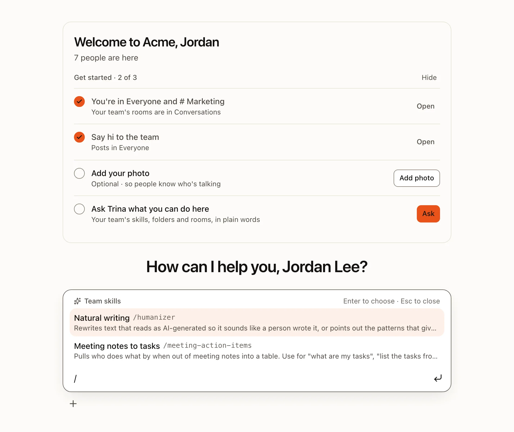
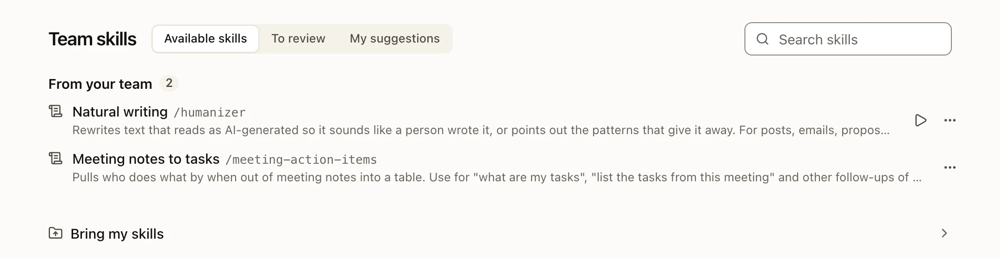

スキルは、`SKILL.md` ファイルに書いた、繰り返し使える手順です。チームがある作業をどう進めるかを AI に伝えます。モデルを学習させるものではなく、アクセスできる範囲が広がることもありません。

## スキルを使う

- チャットで `/` を入力してスキルを選ぶか、メッセージに `/skill-name` と書きます。
- 依頼に合っていれば、AI が自分でスキルを見つけて読み込むこともあります。
- トリナの一覧の上のほうにある行 **チームスキル**（スマートフォンでは **トリナ** タブの **☰** メニューの中）に、使えるスキルが一覧で表示されます。





## おすすめのスキル

製品には、すぐに使えるスキルが 4 つ、チームの言語（韓国語または英語。そのほかの言語では英語の文章）で入っています。自動では追加されません。どのスキルも、その名前が書かれたボタンを誰かが押したときにだけ追加されます。

| フォルダー | スキル | 追加のされ方 |
|---|---|---|
| `skills/general/` | Company profile、Promo cards、Promo video | オーナーが初期設定の手順 **チームで使うスキルを選んでください** で選ぶか、あとでオーナーか管理者が **使えるスキル** で追加します |
| `skills/work/` | Natural writing | 同じです |

- **初期設定の手順** では、スキルごとに 1 行の説明と **例** があります。会社紹介が保存されていれば、Company profile、Promo cards、Promo video には最初からチェックが入っています（会社紹介をもとに作られるためです）。Natural writing は、最初はチェックが入っていません。ボタンには、追加されるものの名前が表示されます。たとえば **Company profile·Promo cards·Promo videoを追加** です。
- **使えるスキル** では、オーナーと管理者に、一覧の下に折りたたまれた 1 行 **Trina AXが用意したスキル · あと2個** が表示されます。チームにまだないスキルが入っています。開いて、必要なものにチェックを入れ（最初は何もチェックされていません）、**チームに追加** を押します。この行は、検索している間は隠れ、チームにすべて入ると表示されなくなります。あとのバージョンで追加されたスキルは、数が増えるだけです。お知らせは届きません。
- **例** では、架空の会社 Example Coffee 向けにそのスキルが作るものと、スキルの出どころが表示されます。

初期設定の手順の最後にチームにこれらのスキルのどれかがあれば、最後の画面で、それを使って最初の成果物を作るよう勧められます（Promo cards が先）。押すとスキルのフォームが開き、**実行** を押すまでは何も実行されません。

これらはチーム自身のファイルです。スキル管理者は編集、移動、削除ができます。もう一度追加しても、足りないものだけが追加されます。編集したスキルが置き換えられることはなく、ほかのチームスキルがすでに使っている名前のものは飛ばされます。削除したスキルは、誰かがもう一度名前を指定して追加したときにだけ戻ります。

**Natural writing** は、AI が書いたように読める文章を、事実を変えずに、人が書いたように書き直します。韓国語版は会社が書いたもので、韓国語の文章の種類（ブログ、ショート動画のタイトル、Instagram、提案書、お知らせ）を知っています。英語版は、オープンソースの「humanizer」スキル（MIT License。表示はスキルの中にあります）をもとにしています。

製品に入るのは、出どころが分かっているスキルだけです。以前のバージョンでは、会議の作業、資料の要約、マーケティング、日常業務、韓国の人事書類のスキルも追加していました。それらがあるチームは、自分たちのファイルとしてそのまま持っています。

## スキルの置き場所

| 場所 | 見える人 |
|---|---|
| `skills/<name>/SKILL.md` | `skills/` を読めるすべての人（ふつうはチーム全員） |
| `skills/<folder>/<name>/SKILL.md` | そのフォルダーを読める人だけ。たとえば `skills/finance/` |
| `groups/<group>/skills/<name>/SKILL.md` | そのグループのメンバーだけ。グループに入っていないオーナーや管理者には見えません。 |
| `projects/<project>/skills/<name>/SKILL.md` | そのプロジェクトのチャットの中だけで、プロジェクトのフォルダーを読める人に使われます。 |
| `users/<you>/skills/<name>/SKILL.md` | 自分だけ。オーナーや管理者にも見えません。 |

2 つのスキルが同じ名前のときは、自分にとっていちばん近いものが使われます。自分の個人スキル、グループのスキル、チームのスキル、プロジェクトのスキルの順です。プロジェクトのスキルは、新しい名前を追加するだけです。自分が入っている 2 つのグループに同じ名前のスキルがある場合は、両方がフォルダーつきで表示され、`/name` では名前が先に来るグループのものが使われます。

## グループのスキル

どのグループにも、自分のフォルダーの中に専用のスキルがあります。グループのファイルの隣の `groups/<group>/skills/` です。それを見て使えるのは、グループのメンバーだけです。**チームスキル**（グループごとに 1 つ、グループ名の下に表示）、`/` メニュー（グループ名の印つき）、そして AI が知っていることに含まれます。オーナーと管理者には、自分がグループに入っていない限り、グループのスキルは使われません。

- グループのメンバーなら誰でも、グループのほかのファイルと同じように、スキルを追加したり変更したりできます。チームスキルと同じく、AI はそこに保存する前にカードで確認し、変更はすべてグループ名つきで記録されます。
- メンバーはグループにスキルを提案できます（**スキルとして提案** を押して、グループのフォルダーを選びます）。グループのメンバーが審査します。
- グループの名前を変えても、フォルダーはそのままです。**チームスキル** の部分には、すぐに新しい名前が表示されます。グループを削除すると、メンバーの一覧からそのスキルが消えます。

グループのスキルは、チームのスキル管理者ではなく、グループのメンバーが書きます。メンバーの 1 人がそこに保存したものに、メンバー全員の AI が従います。

## プロジェクトのスキル

`projects/<project>/` にあるチームのプロジェクトは、その `skills/` フォルダーに専用のスキルを持てます。スキルごとに、`SKILL.md` が入ったフォルダーを 1 つ作ります。AI がそれを使うのはそのプロジェクトのチャット（自分のチャット、共有チャット、プロジェクトの中の定期タスク）だけで、トークや自分のほかのチャットでは使いません。**チームスキル** には、プロジェクトごとに **プロジェクト「<プロジェクト>」のスキル** の部分が表示され、`/` メニューではプロジェクトの中でそれらに印がつきます。

- プロジェクトのフォルダーに書き込める人なら誰でも、追加や変更ができます。AI はプロジェクト名つきのカードで先に確認し、変更はすべてプロジェクト名つきで記録されます。
- プロジェクトのスキルは、新しい名前を追加するだけです。チーム、グループ、自分がすでに使っている名前には、ページに **同じ名前：チーム全体** のような印がつきます。AI のカードでは、実行されることのない名前で保存する代わりに、別の名前が提案されます。
- スキルをチーム、グループ、プロジェクト、自分のスキルの間で移すには、スキルのメニューの **移動** を使います。それぞれのレベルで誰が使えるようになり、誰が使えなくなるかと、より多くの人に渡る前の全文が表示されます。プロジェクトのチャットで AI に頼むこともできます。AI がスキルを移すのは、使える人が減る場所だけで、すべてのファイルを並べたカードで確認したあとです。

## スキルを書く

:::steps
#### フォルダーを作る
ファイル画面で `skills/<name>/` を作ります。名前には `a`〜`z`、`0`〜`9`、ハイフンを使い、フォルダー名と同じにします。

#### SKILL.md を書く
最初にヘッダーを書き、そのあとに手順を書きます。
```markdown
---
name: meeting-summary
description: Summarize permitted meeting notes into decisions, actions and open questions.
---

# Inputs
Ask for the source paths before reading.

# Procedure and output
Return decisions, an action table and open questions. Cite the source paths.
```

#### 読み込めるか確かめる
スキルを読み込めないときは、**チームスキル** に分かりやすい理由が表示されます。ヘッダーを直して、もう一度試してください。
:::

[SKILL.md の形式をすべて読む](../../agents/skills-format.md)（英語）。

## Claude Code や Codex のスキルを持ち込む

オーナーと管理者は、すでに使っているスキルを、**使えるスキル** の一覧の下にある **自分のスキルを持ってくる** か、提案のリンクからチームに持ち込めます。初期設定の手順で選べるのは、用意されたスキルだけです。スマートフォンでは、パソコンで行うよう表示されます。

| 持ち込み元 | 選ぶ・ドロップするもの | 読まれるもの |
|---|---|---|
| Claude Code | `~/.claude`（またはプロジェクトの `.claude`） | `skills/`、`commands/*.md`、`CLAUDE.md` |
| Codex | `~/.codex`、現在の個人スキルは `~/.agents` | `skills/`（`.system` は除く）、`prompts/*.md`、`AGENTS.md`、`config.toml` のリモートサーバー |

または、Claude Code や Codex をチームに接続したあと（[MCP コネクター](../../agents/mcp-connector.md)（英語））、そこに 1 行貼り付けると、提案が送られます。

- それらのフォルダーのほかのものは開きません。キーやトークンを含むスキルは、パソコンから出ません。一覧に載るのは名前だけです。
- サーバーがすべてのスキルを改めて確認し、チーム全体で使えるものを提案します。この確認に 30 秒以上かかった場合は、何もチェックされていない一覧が表示され、自分で選びます。追加するボタンを押すまで、チームには何も届きません。
- ルールのファイルは、1 つのチームのルールになります。リモートの MCP サーバーは、キーのない接続のテンプレートになります。メンバーはそれぞれ自分のキーで接続します。
- チームスキルと同じ名前のスキルは、自分が確認したあと、その 2 つを読んでチームスキルを保存することしかできないチャットでまとめられます。
- **自分のグループに入れることもできます。** 提案のページの **共有先** で、チーム全体（標準）か自分のグループの 1 つを選びます。Claude Code と Codex からもグループを指定できます。グループへの提案で追加されるのはスキルだけ（チームのルールや接続はなし）で、チームスキルが変わることはありません。グループのスキルと同じ名前のスキルはそれにまとめられるか隣に置かれ、チームスキルと同じ名前のスキルはグループ専用のコピーになります。グループのメンバーには **チームスキル › 審査**（グループ向けのものだけ）に表示され、メンバーなら誰でもグループに追加できます。

## スキルを変更できる人

チームスキルを変更できるのは **スキル管理者** です。オーナー、管理者、そして管理者が追加した人やグループです。仕組みとしては、`skills/` かその中のフォルダーへの書き込み権限があるということです。

オーナーと管理者には、**チームスキル** の見出しの下に、それが誰かが表示されます。「編集できる人: オーナー・管理者、Sales: 3人、Alex [変更]」。この一覧は、フォルダーの権限で `skills/` について設定されている内容なので、グループ、全員へのルール、チームのフォルダー全体へのルールによって編集できる人も含まれます。中にあるフォルダーで、独自の書き込みのルール（人、グループ、全員向け）があるものは、最後に数えて表示されます（「個別に任せたフォルダー2件」）。**変更** を押すと、ウィンドウが 1 つ開きます。

- オーナーと管理者（常に表示）と、`skills/` に独自の書き込みのルールがあるすべての人とグループが一覧で表示されます。ルールが `skills/finance/` のようなサブフォルダーにある場合は、そのフォルダーも表示されます。**外す** を押して確認すると、そのルールが外れます。ほかのルール（グループのルール、全員へのルール、`skills/` へのその人自身のルール）でまだ編集できる場合は、そのことが表示されます。
- **人またはグループを追加** で、名前で探します。注意をよく読んでから **有効にする** を押します。その人やグループは `skills/` のすべてを編集できるようになります。
- 1 つのフォルダーだけを任せるには、**フォルダーごとに任せるには「フォルダーの権限」で** を押して、そこでそのフォルダーへの書き込み権限を与えます。

メンバーやほかのスキル管理者には、この行は表示されません。

- メンバーは、個人のスキルをチームに **提案** できます。提案先のフォルダーのスキル管理者が審査します。
- `skills/` への変更はすべて記録され、オーナーと管理者には、バージョン履歴へのリンクつきのお知らせが届きます。
- グループのスキルを変更するのは、そのグループのメンバーです（[グループのスキル](#グループのスキル)を参照）。その変更も、同じように記録され、知らされます。

## メンバーが自分のスキルを持ち込む

メンバーは、**使えるスキル** の一覧の下にある **自分のスキルを持ってくる**（パソコンで）か、最初によい結果が出たあとに回答の下に表示される 1 行を使います。この 1 行では、自分が使っているスキルやファイルもチームに持ち込みたいかを聞かれます。どちらも同じ画面が開きます。

- メンバーは、自分の `.claude`、`.codex`、`.agents` フォルダーを選ぶかドロップします。読まれ方は上と同じです。キーを含むスキルは、パソコンから出ません。
- 最初は何もチェックされていません。チェックできるのは 10 件までで、提案として送ります。同時に待てる提案は 20 件までです。ルールのファイルと MCP サーバーは送られません。
- サーバーがすべてのスキルを改めて確認し（キー、スクリプト、サイズ、名前、パソコン上のパス）、チームのファイルの外に置きます。AI が判断することはありません。
- チームのフォルダーに書き込める場合は、ファイル用にそのフォルダーへのリンクも表示されます。スマートフォンでは、その 1 行で選べるのはそのフォルダーだけで、書き込めるフォルダーがない場合は何も表示されません。

オーナーと管理者には、送られるたびに **アクティビティ** にお知らせが 1 件届き（「Minaさんがスキル2件をチームに出したいそうです」）、押すと人ごとにまとまった **審査** が開きます。このスキルを見て承認できるのは、オーナーと管理者だけです。承認すると、ファイルごと `skills/<フォルダー名>/` として保存され、メンバーに知らされ、一覧のスキルに「Minaさんが提案」と表示されます。承認しても、招待で開くスキルや 7 日間の目標で名前が出ているスキルが変わることはありません。この 1 行は ✕ で閉じると、二度と表示されません。

## スターターのスキル

リポジトリには、架空の入力を使ったスターターのスキルが 6 つあります。週報、営業のフォローアップ、ブランドの概要、経費の確認、新入社員のガイド、会議のまとめです。[例を見る](../../../../examples/README.md)（英語）。
