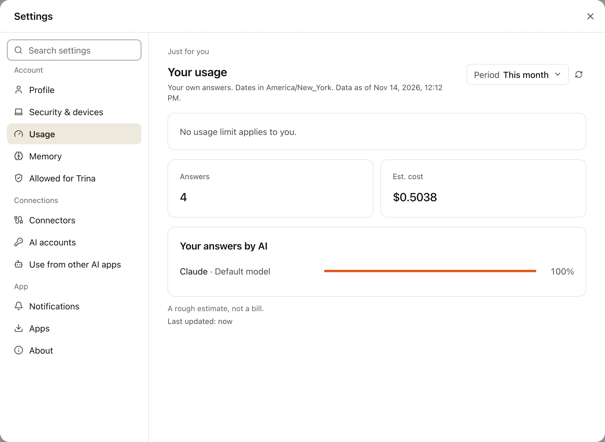
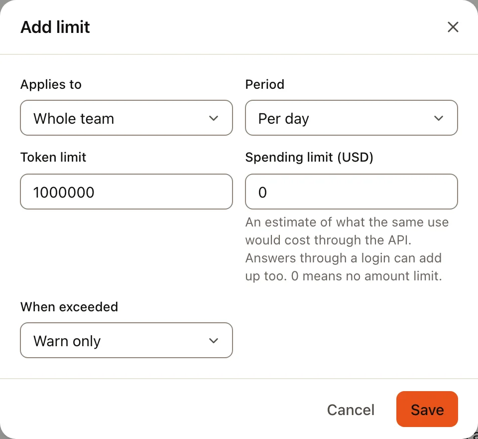

Trina AX は、すべての回答を記録します。誰が聞いたか、どのエンジンとモデルか、トークン数、そして推定コストです。

:::note
コストは API 料金に換算した推定値で、請求額ではありません。サブスクリプションの接続はリクエストごとの金額が 0 になりますが、トークン数は数えられます。
:::

## 自分の使用量

**設定 › 使用量** を開きます（左のバーのいちばん下にある自分の写真 › **設定**。スマートフォンでは **自分** タブ）。自分の回答数と推定コスト、どの AI が答えたか、自分にかかる上限をそれぞれどれだけ使ったかが表示されます。見られるのは自分の数字だけです。

:::note
個人の使用量は 0.4.0 で追加されました。それより前は、管理者だけが **管理 › 使用量** で使用量を見られます。
:::

## チームの使用量

管理者は **管理 › 使用量** を開きます。Claude Console の使用量ページと同じような画面です。

- 上にある **フィルター**。それぞれ小さなボタンで、選んでいるものが表示されます。
  - **グループ**（チームにグループがあるときだけ）と **期間**：今日、過去 7 日間または 30 日間、今月、または期間を指定。
  - **個人**、**エンジン**、**モデル**、**AI接続**：どれか 1 つに絞って見ます。**フィルターをクリア** を押すと、すべて表示に戻ります。
  - **集計単位**：個人、グループ、エンジン、モデル、日、AI 接続、スキルごと。
- 合計を示す **カード**：入力トークン、出力トークン、回答数、推定コスト。
- **トークン使用量**：1 日ごとのトークン数を積み上げ棒グラフで表示します。集計単位の値ごとに 1 色です（上位 5 つ、残りは「その他」）。日にちにポインターを合わせるか、グラフにフォーカスして矢印キーを使うと、その日の数字が見られます。
- **内訳**：集計単位の値ごとに 1 行で、回答数、トークン数、割合、推定コストを表示します。
- **ダウンロード** ボタンで、内訳を CSV として保存します。

個人のスキルは名前で数えられることはないため、誰かが個人で持っているものを管理者が知ることはありません。グループのスキルは、チームスキルと同じように数えられます。

## 上限を設定する

最初は上限はありません。上限は **トークン** で数えます。トークンは文章の小さなかけらで、英語ならおよそ 1 単語の
4 分の 3 ほどです。AI が読むもの（質問や、AI が開くファイル）と書くものがすべて数えられるので、長いファイルを読む
回答は、短い返事よりずっと多くのトークンを使います。スマートフォンの月々のデータ容量のように、上限は 1 日または
1 か月に使える量に枠をはめます。

上限を追加するには（オーナーと管理者）：

1. **管理 › チーム設定** を開き、**使用量の上限** までスクロールします。
2. **上限を追加** を押します。ウィンドウが開きます。
3. **適用対象**：**チーム全体**、グループ、または 1 人。**期間**：**1日ごと** または **1か月ごと**。
4. **トークン数の上限**：トークンの数です。たとえば 100 万なら 1000000 と入れます。**支出上限（USD）** は任意です。
   同じ使い方を API で使った場合の費用の目安で、0 は金額の上限なしという意味です。
5. **超過時の動作**：**警告のみ** は回答を続けたまま通知を送ります。**ブロック** は、次の期間が始まるまで新しい回答を
   止めます。
6. **保存** を押します。

上限は **使用量の上限** の下に 1 行として表示されます。1 人、1 つのグループ、チーム全体には、期間ごとに 1 つずつ上限を
設定できます。

1 人だけに設定するなら、**管理 › メンバーと招待** からのほうが早くできます。その人の **…** メニューを開き、**利用上限…** を選びます。ダイアログはすでにその人向けになっていて、今の上限と、そのうちどれだけ使ったかが表示されます。**1日ごと** または **1か月ごと** を選ぶと、それぞれを確認・設定できます。**上限を削除** で上限を外せます。上限がある人は、名前の下に目立たない 1 行で表示され、使い切ると **上限超過** と表示されます。スマートフォンでは、その人を開いて **利用上限** をタップします。

| 上限の対象 | 期間 |
|---|---|
| 1 人 | 1 日ごと、または 1 か月ごと |
| グループ | 1 日ごと、または 1 か月ごと |
| チーム全体 | 1 日ごと、または 1 か月ごと |

上限に達したときの動きは、**超過時の動作** によって変わります。

- **ブロック**：オーナーと管理者に、80% と 100% のときに通知が届きます（上限がその人のものなら、本人にも届きます）。
  100% になると、対象の人は期間がリセットされるまで新しい回答を始められません。リセットは、1 日の上限なら午前 0 時、
  1 か月の上限なら毎月 1 日で、どちらもチームのタイムゾーンです。いつリセットされるかは、その人の使用量ページに
  表示されます。
- **警告のみ**：回答は続きます。使い切ったときに、オーナーと管理者（上限がその人のものなら本人にも）に通知が 1 回
  届きます。
