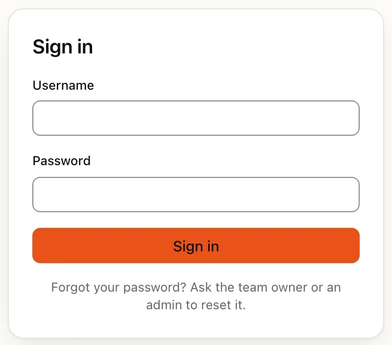
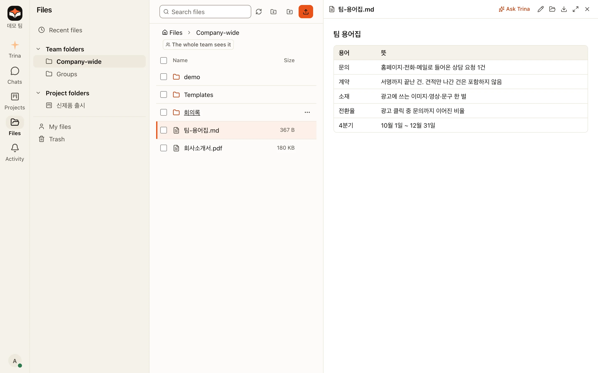

데모를 실행하면 시작용 스킬 6개가 들어 있는 가상의 팀이 만들어져요. AI는 꺼 둔 상태라 AI 계정이 없어도 돼요.

:::warning
데모는 실제 운영용 설치가 아니에요. OS 격리가 없어요. 가상의 데이터만 써야 해요.
:::

## 시작하기 전에

| 필요한 것 | 버전 |
|---|---|
| macOS 또는 Linux | Windows 사용자는 준비된 서버를 브라우저로 열어요 |
| Git | 최근 버전이면 돼요 |
| Bun | 1.3.12 (CI에 고정된 버전) |
| Go | 1.27 이상 |
| 네이티브 빌드 도구 | macOS에서는 Xcode 명령줄 도구 |
| 비어 있는 포트 | 19760 |

## 데모 시작하기

:::steps
#### 내려받고 설치하기
```sh
git clone https://github.com/trina-app/trina-ax.git
cd trina-ax
bun install --frozen-lockfile
```

#### 데모 시작하기
```sh
bun run demo
```
이 터미널은 켜 둔 채로 둬요. 빌드한 뒤 http://127.0.0.1:19760 에서 시작하고, 가상의 팀을 채워 넣어요.

#### 로그인하기
http://127.0.0.1:19760 을 열고 `alice` / `teamax-demo-1`로 로그인해요. 다른 계정은 `bob`, `admin1`, 그리고 팀장 `dion`이에요. 비밀번호는 일부러 공개해 둔 거예요.



#### 폴더 권한 확인하기
1. 왼쪽 막대에서 **파일**을 고르고, **전사 공유** 폴더, **팀-용어집.md**(데모 팀의 용어집) 순서로 골라요. 옆 패널에
   열려요.
2. 시크릿 창을 열고(Chrome에서는 Mac은 ⌘⇧N, Linux는 Ctrl+Shift+N) 같은 주소를 연 다음 `bob`으로 로그인해요.
3. 다시 **파일**을 골라요. Bob에게는 재무 부서 폴더는 보이지만 마케팅 부서 폴더는 안 보여요. Google Drive처럼, 열 수
   없는 폴더는 흐리게 보이는 게 아니라 아예 없어요.


:::

:::tip
`localhost` 대신 `127.0.0.1`을 써요. 둘은 쿠키 출처가 달라서 로그인을 또 해야 해요.
:::

## 더 해 보기

가장 빨리 시작하는 방법은 데모예요. 더 해 보고 싶으면 아래에서 골라요.

:::tabs
@tab 포트와 언어
다른 포트, 새 데이터 폴더, 한국어 화면으로 띄워요.

```sh
bun run demo --port 19761 --data "$HOME/.trina-evaluation-new" --locale ko
```

데이터 폴더는 아직 없는 폴더여야 해요. 포트가 이미 쓰이고 있거나 폴더가 이미 있으면 거절해요.

@tab AI 써 보기
데모는 AI를 부를 수 없어요. 내 Claude Code나 Codex 로그인을 쓰는 개발 서버를 띄우려면, 먼저 데모를 멈추고 이렇게 실행해요.

```sh
TEAM_AX_DEV_DIR="$HOME/.trina-ai-evaluation-new" TEAM_AX_DEV_PORT=19761 bun run dev --no-relay
# In a second terminal, before you create a team:
TEAM_AX_DEV_DIR="$HOME/.trina-ai-evaluation-new" bun run demo:seed --base http://127.0.0.1:19761
```

:::warning
개발 모드에서는 엔진이 내 OS 사용자로 돌아가고, 운영용 격리가 없어요. 이렇게 써도 되는 계정만 연결해야 해요.
:::

@tab tailnet에 공유하기
Tailscale 네트워크에 있는 동료가 미리보기를 눌러 볼 수 있게 하려면, AI를 끄고 허용 출처를 하나 더 넣은 개발 서버를 띄워요.

:::steps
#### AI를 끈 설정 파일 만들기
`~/.trina-preview`처럼 짧은 새 폴더에 `preview.json`으로 저장해요. 데모가 쓰는 설정과 똑같아요.
```json
{"mode":"dev","listen":{"host":"127.0.0.1","port":19780},
 "engine":{"authMode":"local-login","claudeBin":"/nonexistent/trina-demo-no-ai","codexBin":""},
 "relay":{"url":null,"officialAvailable":false},"update":{"feedUrl":null,"auto":false}}
```

#### tailnet 출처를 넣어 서버 시작하기
`<your-tailnet-host>`를 이 컴퓨터의 Tailscale 이름으로 바꿔요.
```sh
MYCEL_CONFIG="$HOME/.trina-preview/preview.json" MYCEL_HOST=127.0.0.1 \
TEAM_AX_DEV_DIR="$HOME/.trina-preview" TEAM_AX_DEV_PORT=19780 \
MYCEL_PUBLIC_ORIGINS="https://<your-tailnet-host>:8443,http://127.0.0.1:19780" \
bun scripts/dev.ts --no-relay
```

#### 가상의 팀 채우기
```sh
TEAM_AX_DEV_DIR="$HOME/.trina-preview" bun run demo:seed --base http://127.0.0.1:19780
```

#### tailnet 안에서만 열기
```sh
tailscale serve --bg --https=8443 http://127.0.0.1:19780
```
`tailscale funnel`은 절대 쓰지 말고 `tailscale serve`를 써요. funnel은 인터넷 전체에 공개해요.

#### 데모 비밀번호 바꾸기
데모 비밀번호는 공개돼 있어요. 주소를 공유하기 전에 모든 계정의 비밀번호를 바꿔야 해요.
:::

멈추려면 서버 터미널에서 Ctrl-C를 누르고 `tailscale serve --https=8443 off`를 실행해요.
:::

## 다음 단계

:::cards cols=2
- icon=book-open | [기본 개념](key-concepts.md) | 이 문서 전체에서 쓰는 용어.
- icon=terminal | [로컬 개발 (영어)](../../develop/local-development.md) | 코드를 빌드하고, 테스트하고, 바꿔요.
:::
