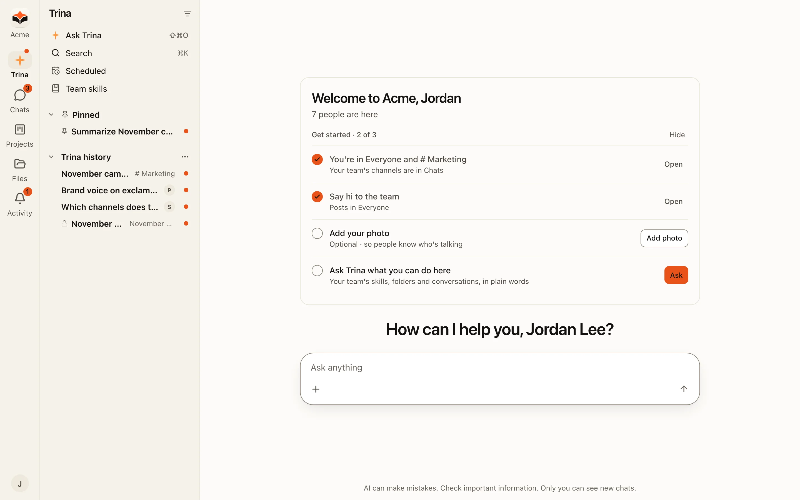

:::note
먼저 보고 싶나요? [가입 없이 1분 만에 써 보기](https://demo.trina.app).

먼저 써 보고 싶나요? [로컬 데모](get-started/quickstart.md)를 실행해 보세요. AI 계정이 없어도 돼요.
:::

Trina AX는 회사용 AI 작업 공간이에요. 서버에 Claude Code를 한 번 설정해 두면, 모두가 브라우저에서 같이 써요.

| | 뜻 |
|---|---|
| **서버 한 대** | Claude Code와 Codex가 각자 노트북이 아니라 회사 서버에서 돌아가요. |
| **회사 파일** | AI는 팀 폴더(`shared/`, `groups/`, `projects/`, 개인 폴더)의 파일을 보고 일해요. |
| **팀 스킬** | `SKILL.md` 파일 하나에 팀이 일하는 방식을 적어 두면, 몇 번이고 다시 쓸 수 있는 지시가 돼요. |
| **권한** | AI가 여는 파일마다 서버가 물어본 사람의 권한으로 확인해요. |

---

## 회사에서 Trina AX 쓰기

개발자가 아니라면 여기서 시작하세요. 페이지마다 정확한 버튼 이름과 화면 사진이 담긴 순서대로의 단계가 있어요.

:::cards cols=2
- icon=message-square | [채팅과 프로젝트](use/chats-and-projects.md) | AI에게 묻고, 채팅을 Google Drive 파일처럼 공유하고, 한 가지 일을 프로젝트에 모아요.
- icon=folder-lock | [파일과 권한](use/files-and-permissions.md) | 파일이나 폴더를 공유하고, 폴더 하나를 더 적은 사람만 보게 해요.
- icon=bell | [설정과 검색](use/settings-and-search.md) | 내 프로필, 언어, 알림, 그리고 ⌘K 검색.
- icon=clock | [예약 작업](use/scheduled-tasks.md) | 매주 월요일 같은 일을 AI에게 맡겨요. 몇 번만 누르면 돼요.
:::

## 처음 온 개발자에게 권하는 순서

:::steps
#### 데모 실행하기
가상의 팀을 내 컴퓨터에서 10분쯤이면 띄울 수 있어요. [빠른 시작으로 가기](get-started/quickstart.md).

#### 용어 익히기
팀, 부서, 폴더, 스킬, 엔진, MCP를 한 페이지에 모았어요. [기본 개념 읽기](get-started/key-concepts.md).

#### 전체 구조 보기
서버, 웹 앱, 엔진, 권한 확인이 어떻게 맞물리는지 봐요. [아키텍처 읽기](../develop/architecture.md) (영어).

#### 처음으로 고쳐 보기
개발 서버를 띄우고, 검사를 돌리고, 풀 리퀘스트를 열어요. [로컬 개발 가이드 읽기](../develop/local-development.md) (영어).

#### 팀에게 열어 주기
호스팅, Linux 서버, 사무실 Mac 중에서 골라요. [설치 방식 비교하기](../operate/install.md) (영어).
:::

---

## Trina AX로 개발하기

:::cards cols=3
- icon=code | [개발자 가이드 (영어)](../develop/architecture.md) | 아키텍처, 저장소 구조, 테스트와 규칙.
- icon=bot | [AI 에이전트용 (영어)](../agents/overview.md) | 코딩 에이전트가 지킬 규칙과 Trina AX 안에서 AI가 일하는 방식.
- icon=braces | [HTTP API (영어)](../reference/http-api.md) | 모든 엔드포인트를 영역별로 묶고, 누가 부를 수 있는지 적었어요.
:::

## 주요 기능

:::cards cols=2
- icon=folder-lock | [파일과 권한](use/files-and-permissions.md) | 사람도, 그 사람의 AI도 열 수 있는 폴더만 봐요.
- icon=book-open | [팀 스킬](use/team-skills.md) | 다시 쓰는 지시를 파일처럼 관리해요.
- icon=plug | [MCP 연결](use/mcp.md) | AI가 Notion, Linear 같은 서비스를 쓰게 해요.
- icon=clock | [예약 작업](use/scheduled-tasks.md) | 한 번 부탁하면 AI가 같은 일을 반복해요.
:::

## 지원

:::cards cols=2
- icon=life-buoy | [지원 (영어)](../resources/support.md) | 질문, 버그 신고, 보안 제보는 여기로.
- icon=wrench | [문제 해결 (영어)](../operate/troubleshooting.md) | 자주 생기는 문제를 증상별로 정리했어요.
:::
