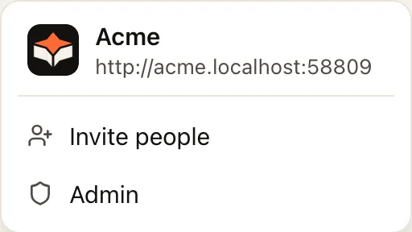
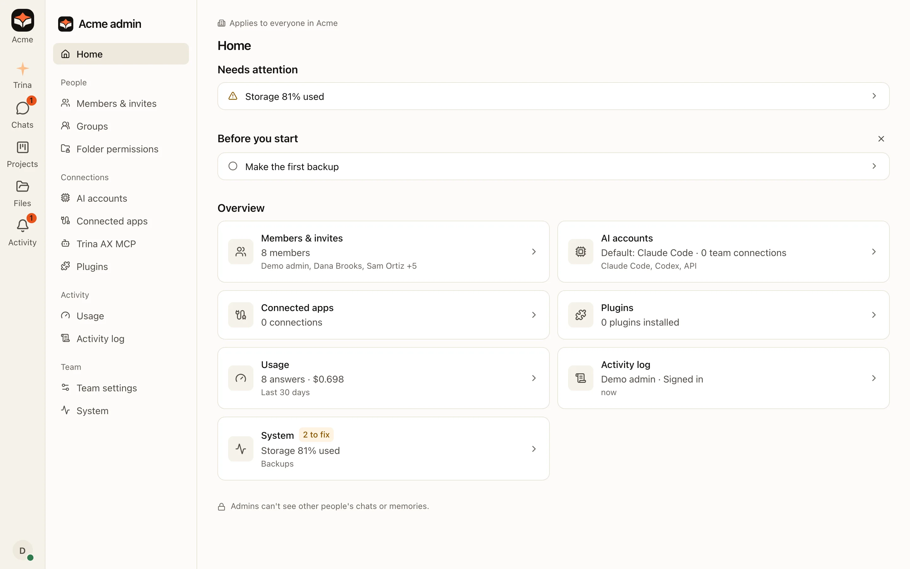
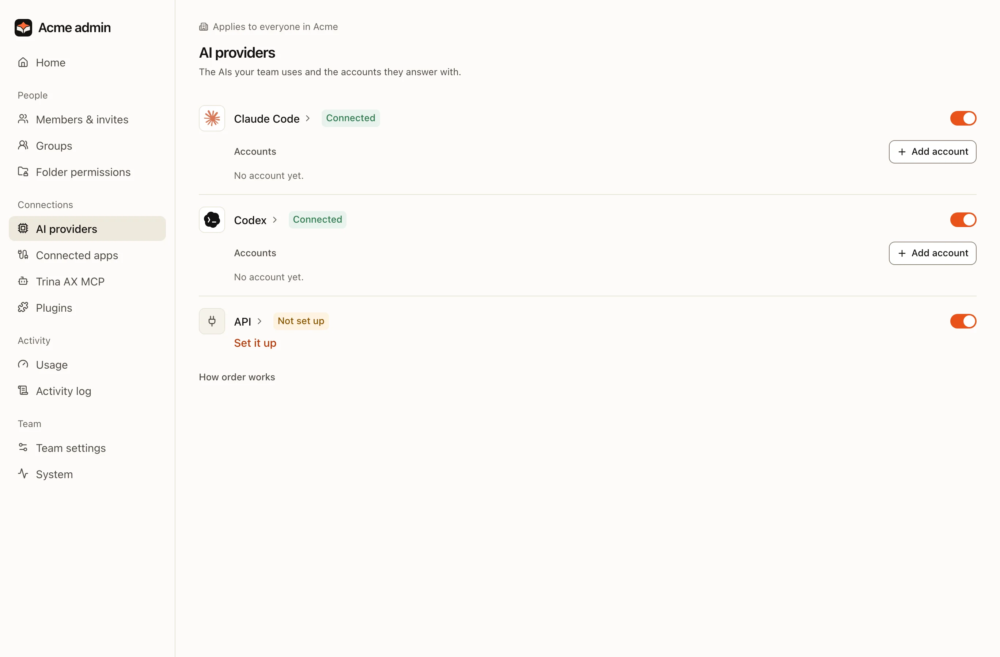
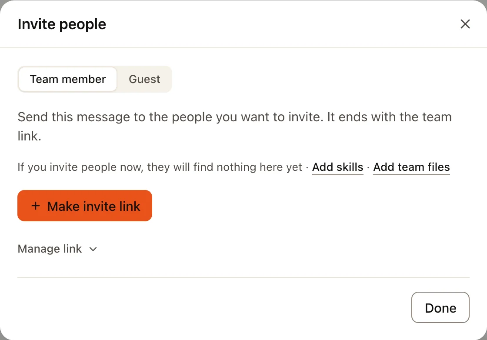
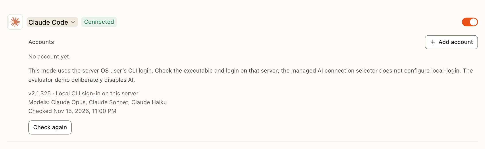
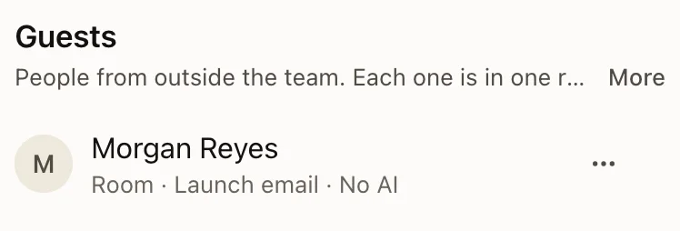
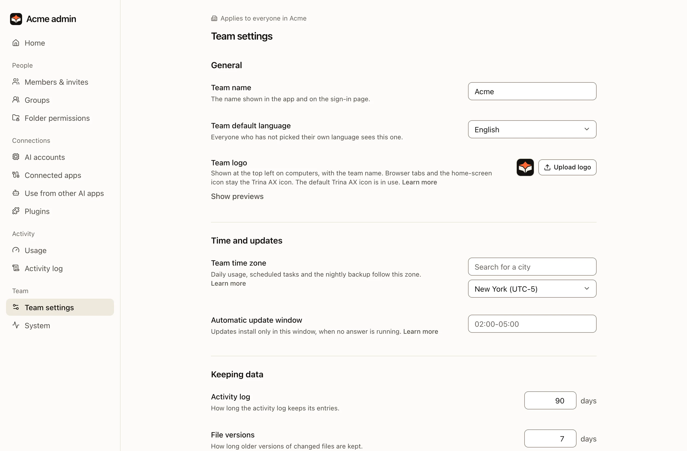
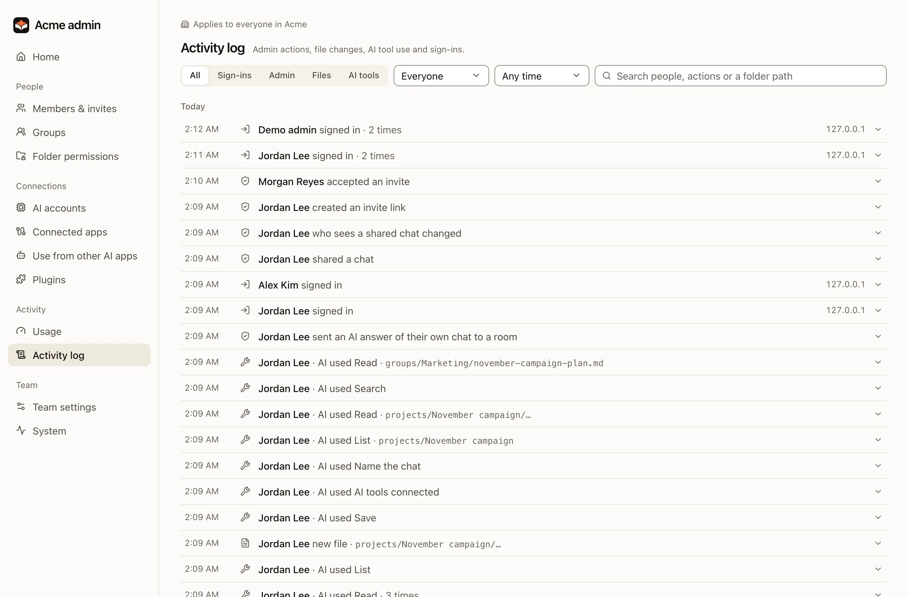
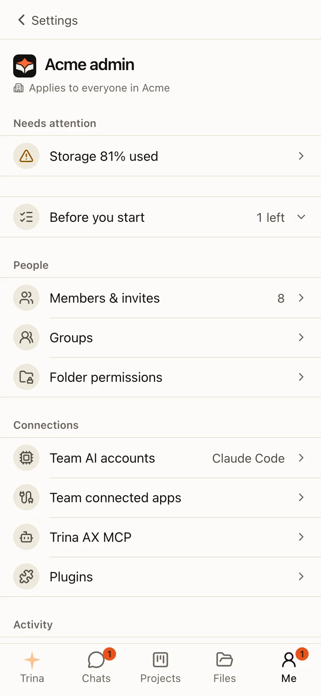

**관리자**는 팀장과 관리자를 위한 곳이에요. 여기 있는 페이지는 모두 팀 전체에 적용돼요. 메뉴 제목에는 팀 이름과
로고("Acme 관리")가 나오고, 페이지마다 제목 위에 "Acme 전체에 적용돼요"가 떠요. 내 설정은 **설정**에 그대로 있고,
페이지 이름도 같아요. 관리자 › 연결한 서비스는 팀의 연결이고, 내 연결은 **설정 › 커넥터**에 있어요.

컴퓨터에서 관리자를 여는 방법은 이래요.

1. 왼쪽 막대 맨 위의 팀 로고를 눌러요. 팀 메뉴가 열리고 팀 주소, **팀원 초대**, **관리자**, **다른 팀으로 전환**이 나와요.
   (팀원에게는 팀 주소와 **다른 팀으로 전환**만 나와요.)
2. **관리자**를 눌러요. 처음에는 **홈**이 열리고, 먼저 확인할 일이 나와요.

⌘K(Windows에서는 Ctrl+K)를 누르고 "관리자"를 입력해도 찾을 수 있어요. 폰에서는 **나** 탭을 열고 **관리자**를 눌러요.

팀장에게는 홈에 아직 끝내지 않은 첫 설정 단계도 보여요. AI 연결 확인, 폴더 권한 정하기, 팀원 초대, 팀 스킬 준비, 첫
백업이에요. 끝낸 단계는 목록에서 빠져요.

## 관리자 메뉴

| 묶음 | 페이지 |
|---|---|
| **사람** | 멤버·초대, 부서, 폴더 권한 |
| **연결** | AI 제공사, 연결한 서비스 (Google 앱, [Slack](slack.md), Notion 같은 다른 서비스), Trina AX MCP, 플러그인 |
| **활동** | 사용량, 활동 로그 |
| **팀** | 팀 설정, 시스템 |

**멤버·초대**에는 게스트도 나와요. 게스트는 팀 밖에서 온 사람으로, 비공개 채널이나 그룹 대화 하나와 프로젝트 하나까지 들어올 수 있어요. [게스트 알아보기](guests.md).

:::note
예전 버전에서는 AI 계정이 **AI 엔진** 옆의 별도 페이지 **AI 연결**에 있었어요. 지금은 둘이 **AI 제공사** 페이지
하나로 합쳐졌고(한동안 **AI 계정**이라고 불렀어요), 예전 주소로 가도 이 페이지가 열려요. 팀의 AI 설정(기본값, 엔진을
누가 고르는지, 멤버 개인 계정, 사용 한도)은 **팀 설정**에 있어요. **Slack**도 예전에는 메뉴 항목이 따로 있었는데, 지금은
**연결한 서비스**의 한 줄이고 예전 주소로 가면 거기서 열려요.
:::

Google Workspace를 쓰는 회사라면 Google 앱이 회사의 Google 앱으로 로그인하게 할 수 있어요. 다섯 앱에 한 번만 설정하면 돼요. 방법은 [회사의 Google 앱 쓰기](google-own-app.md)에 있어요.

## 첫 주에 할 일

:::steps
#### 권한 정하기
부서에 폴더를 맡기고, 테스트 계정 두 개로 접근을 확인해요. [권한 알아보기](files-and-permissions.md).

#### AI 연결하기
**AI 제공사**에서 팀장이나 관리자가 Claude Code나 Codex 줄의 **계정 추가**를 누르고, 허가받은 Claude나 OpenAI 계정을
연결해요. 줄마다 그 엔진이 준비됐는지 나와요.

#### 팀 초대하기
작은 시범 그룹부터 시작하고, 역할과 폴더 접근을 확인해요.

1. 팀 로고를 누르고 **팀원 초대**를 골라요.
2. **팀원**을 그대로 두고(**게스트**는 팀 밖의 사람을 초대할 때 써요) **초대 링크 만들기**를 눌러요.
3. **메시지 복사**를 누르고 Slack, Teams나 이메일에 붙여 넣어요. 메시지 끝에 링크가 있어요. 링크를 연 사람은 계정을
   만들고 바로 팀에 들어와요.

**멤버·초대**에는 팀의 [게스트](#게스트)도 나와요.
목록 아래의 **초대 링크**에는 아직 쓸 수 있는 링크만 보여요. 팀 초대 링크와 아직 아무도 쓰지 않은 초대 링크예요. 이미
썼거나 만료된 링크, 비공개 채널, 그룹 대화나 프로젝트가 없어진 게스트 링크는 목록에서 빠져요. 누가 들어왔는지는 멤버 목록과
[활동 로그](#활동-로그)에서 볼 수 있어요.

#### 첫 스킬 추가하기
시작용 스킬을 복사하고, 결과를 원본 자료와 맞춰 봐요. [스킬 알아보기](team-skills.md).

#### 첫 백업 만들기
백업하고, IT 담당자와 복원을 연습해 봐요. [백업 알아보기](../../operate/backups.md) (영어).
:::

## 관리자가 할 수 없는 일

- 다른 사람의 채팅 읽기. 활동 로그에는 AI가 읽은 파일이 나오고, 대화 내용은 나오지 않아요.
- `users/<id>/`에 있는 개인 폴더나 개인 스킬 보기.
- 규칙에 이름이 없는 팀 MCP 연결 쓰기.

:::warning
서버나 서버 OS, 저장소를 운영하는 사람은 저장된 파일과 채팅을 읽을 수 있어요. 호스팅 요금제에서는 Trina 운영자도 여기에 들어가요.
:::

## AI 제공사

연결 묶음 맨 위의 **관리자 › AI 제공사**에는 엔진(Claude Code, Codex, API)마다 줄이 하나씩 있고, 로고, 상태, 켜고 끄는
스위치가 붙어 있어요. 문제가 있으면 이름 아래에 고치는 방법이 짧게 한 줄 나와요. Claude Code와 Codex 아래에는 팀이 답할 때
쓰는 계정이 시도하는 순서대로 나오고, 계정마다 로고, 플랜, 상태가 있어요. 팀장과 관리자에게는 **계정 추가**도 보여요.
위에 있는 계정부터 쓰고, 거절되거나 한도에 닿으면 다음 계정으로 넘어가요. 순서를 바꾸려면 팀장과 관리자가 계정 왼쪽의
손잡이(⠿)를 끌어서 옮겨요. 컴퓨터와 휴대폰 모두 돼요. 키보드로는 Tab으로 손잡이에 가서 스페이스로 집고, 화살표로 옮기고,
스페이스로 놓아요. Esc를 누르면 취소돼요.

엔진 이름을 누르면 자세한 내용이 열려요. 로그인 방식, 모든 모델, 마지막으로 확인한 때, **다시 확인**, 그리고 팀장과
관리자에게는 API 엔진 양식이 있어요. 계정 이름을 누르면 누가 쓰는지, 이번 달 사용량, 마지막으로 쓴 때가 나와요. 계정의
**⋯** 메뉴에는 다시 확인, 위로·아래로, 이름 바꾸기, 바꾸기, 끄기, 삭제가 있어요.

## 게스트

**관리자 › 멤버·초대** 맨 아래에 **게스트**가 있어요. 팀 밖에서 온 사람으로, 각자 비공개 채널이나 그룹 대화 하나와 프로젝트 하나까지 있을 수 있고
팀 인원에 들어가지 않아요. 줄마다 게스트가 있는 곳과 쓰는 AI가 나와요. **⋯** 메뉴에는 **AI 바꾸기**(AI 없음, 본인 계정으로
로그인, 또는 월 한도가 있는 팀 AI 계정), **팀원으로 바꾸기**, **게스트 내보내기**가 있어요. 멤버는 비공개 채널, 그룹 대화나
프로젝트에서 직접 게스트를 초대해요([게스트](chats-and-projects.md#게스트)). 팀장과 관리자는 여기서 **팀에 초대** ›
**게스트**를 고르고 비공개 채널, 그룹 대화나 프로젝트 하나를 고를 수도 있어요([게스트: 관리자 페이지에서](guests.md#관리자-페이지에서)). 게스트가 없는 팀에는
**게스트** 영역이 없어요. 확인하려면 역할 목록에서 **게스트**를 골라요.

## 연결한 서비스

**관리자 › 연결한 서비스**에는 팀의 연결이 **연결됨** 아래에, 추가할 수 있는 서비스가 **둘러보기** 아래에 나와요. 줄마다
앱 상태(예: **켜짐**, **연결 중**, **확인 필요**)가 보이고, 줄 전체를 누르면 같은 상태가 보이는 앱 페이지가 열려요.
브라우저 창이 열리는 연결(Google 앱, 서비스 로그인, **Slack에 추가**)은 언제든 그만둘 수 있어요. 기다리는 동안 **다시
시도**와 **취소**가 있고, 창을 닫았다면 5분 뒤에 기다리기가 저절로 끝나요. Slack은 따로 안내가 있어요. [Slack](slack.md).

## 팀의 AI 설정

**관리자 › 팀 설정** 맨 아래에 팀의 AI 설정이 있어요.

| 묶음 | 들어 있는 것 |
|---|---|
| **AI 기본값** | 기본 엔진과 모델, 동시에 만들 수 있는 답변 수. |
| **엔진 선택 권한** | 멤버가 다른 엔진을 고를 수 있는지, Claude 한도에 닿으면 Codex로 바꿀지. |
| **멤버 개인 계정** | 멤버가 자기 계정을 추가할 수 있는지, 구독을 같이 써도 되는지, 멤버가 추가한 계정. |
| **사용 한도** | 사람, 부서, 팀별로 하루나 한 달에 쓸 수 있는 토큰이나 금액(달러) 한도. |

취소와 저장은 그 묶음에서 뭔가를 바꿨을 때만 보여요. 묶음마다 따로 저장돼요.

:::note
0.4.0부터예요. 0.3.0 이하에서는 이 내용과 엔진이 모두 **AI 엔진** 페이지 하나에 있어요.
:::

## 활동 로그

**관리자 › 활동 로그**에는 로그인, 관리자 작업, 파일 변경, AI 도구 사용이 날짜별로 묶여 나와요. 스크롤해도 필터는 맨 위에 그대로 있어요. 채팅 내용은 절대 나오지 않아요.

## 시스템

**관리자 › 시스템**에는 팀 저장 공간, 버전과 업데이트, 서버 상태, 팀이 서버에 연결하는 방식, 연결한 폴더, 백업과 내보내기가 섹션별로 나와요. 저장 공간에는 대화에서 주고받은 파일이 **대화에 보낸 파일** 한 줄로 따로 나와요. 팀 전체의 숫자 하나이고, 사람별·대화별로 나누지 않아요. 삭제한 채팅과 대화의 파일은 **팀 파일**에 들어가요("팀 파일에 삭제한 채팅과 대화의 파일 120 MB가 포함돼 있어요. 30일 뒤에 지워져요"). 되살릴 수 있게 30일 동안 보관하기 때문이에요. 디스크가 80% 찼을 때와 95% 찼을 때 팀장과 관리자의 **활동**에 알림이 남고(각각 하루에 한 번까지), 누르면 이 카드가 열려요. 대화에 보낸 파일이 들어갈 자리가 없으면, 멤버와 게스트에게는 공간이 부족하니 관리자에게 말해 달라는 안내와 **내가 보낸 파일 보기**가 나오고, 팀장과 관리자에게는 **무엇이 공간을 쓰는지 보기**가 나와요. 항목 아래 **정리 요청하기**를 누르면 대화에 보낸 파일이 공간을 가장 많이 차지하는 분들께 더 필요 없는 파일을 지워 달라는 알림이 가요(하루에 한 번, 누구에게 갔는지는 보이지 않아요). 상태에는 엔진이 없거나, 확인이 실패했거나, 자동 업데이트가 꺼져 있는 것처럼 먼저 볼 일이 나와요. 통과한 확인은 **자세히 보기**가 있는 한 줄로 접혀요. 팀장이 아닌 관리자는 요금제, 저장 공간, 그리고 사무실 맥이라면 자동 업데이트를 볼 수 있어요. 작은 디스크가 차지 않도록 백업에서는 자동으로 다시 만들어지는 폴더를 빼고, 14일 동안 아무도 쓰지 않은 캐시는 지워요. 내 파일은 절대 건드리지 않아요. 업데이트가 실행 중인 작업이 끝나기를 기다리고 있으면 시스템에 그렇게 나오고, **기다렸다가 업데이트**와 **그래도 지금 업데이트**를 고를 수 있어요.

상태 점검 아래의 **다시 시작…** 버튼은 비밀번호를 확인한 뒤 **AI만**(답이 안 나오거나 AI가 멈췄을 때, 10초쯤) 또는 **Trina AX 전체**(화면이 멈추거나 느릴 때, 30초쯤 모두의 연결이 끊겨요)를 다시 시작해요. **답변이 끝나면 다시 시작**은 진행 중인 답변이 끝나기를 최대 10분 기다리고, 몇 개인지만 보여 줘요(누구의 답변인지는 보여 주지 않아요). 기다리는 동안 **지금 바로**와 **그만두기**를 고를 수 있어요. **지금 바로 다시 시작**은 소유자만 고를 수 있고, 소유자가 아닌 관리자에게는 상태 점검 아래에 이 줄만 보여요. 업데이트·백업 중이거나 복원이 준비되어 있으면 다시 시작할 수 없고, 한 시간에 5번까지 할 수 있어요. 다시 시작한 기록은 활동 기록에 남아요. 서버가 여러 번 멈춰서 더는 저절로 다시 시작하지 않으면 이 줄에서 알려 줘요.

아무도 열 수 없게 된 대화(그룹 대화에서 모두 나갔거나 부서가 삭제된 경우)에 보낸 파일은 대화가 닫히고 30일 뒤에 디스크에서 지워져요. 메시지는 남지만 아무도 읽을 수 없어요.
