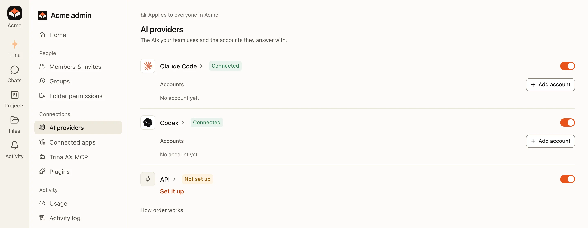
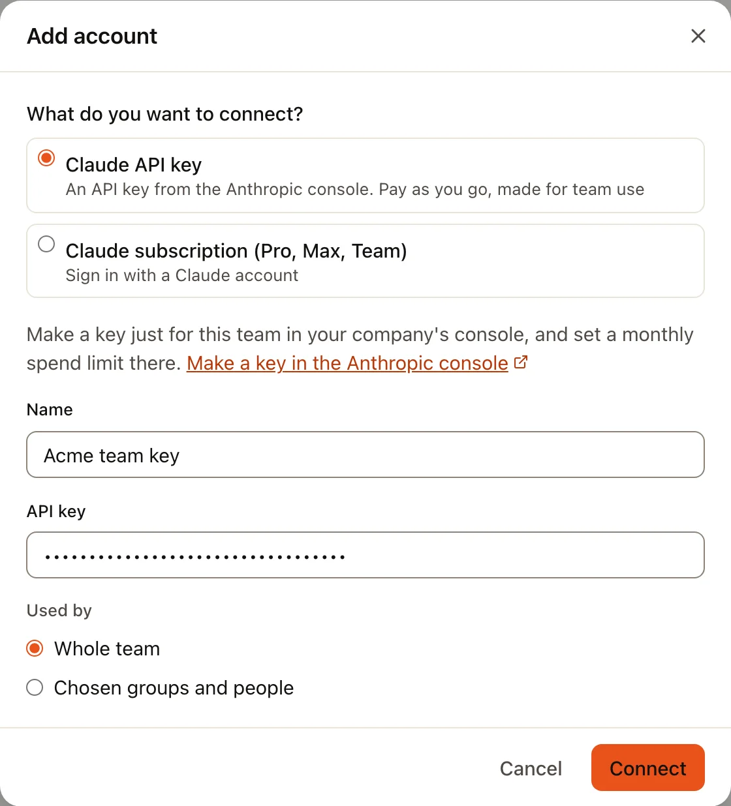
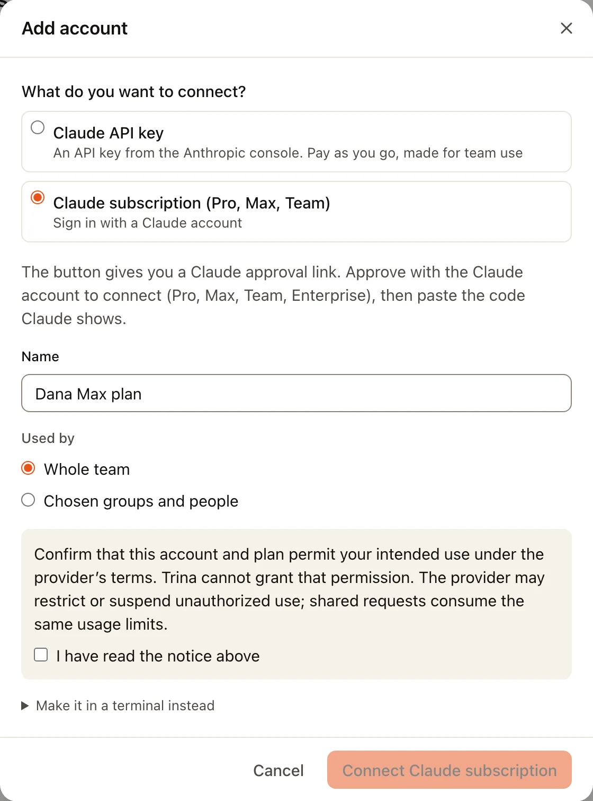
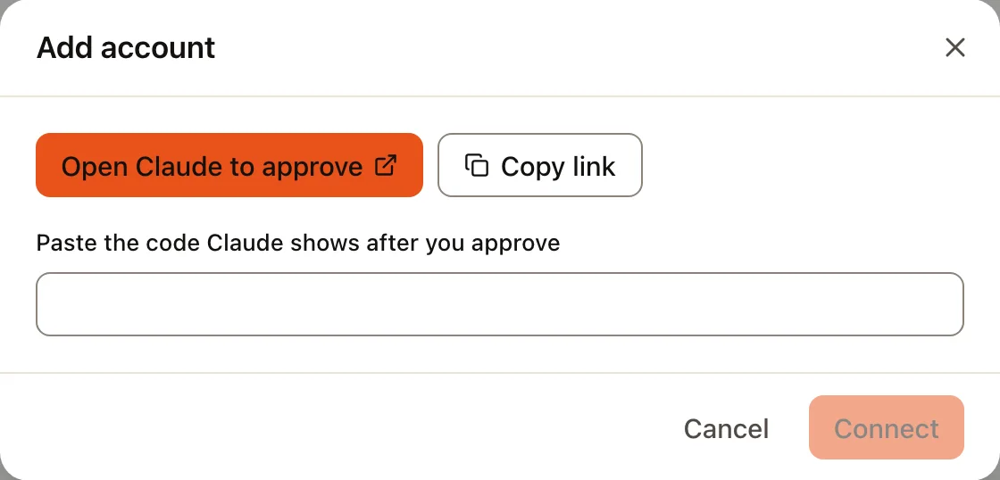
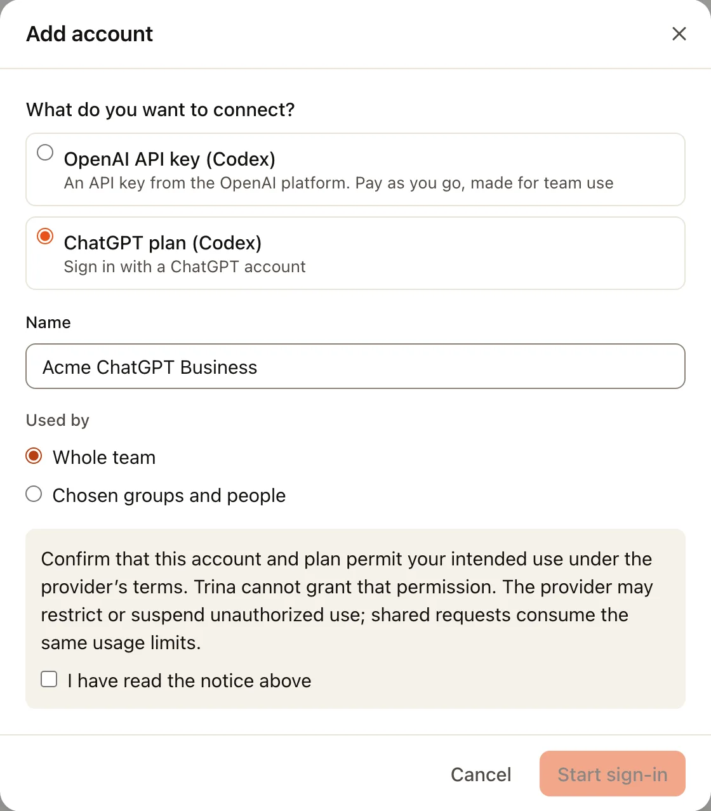
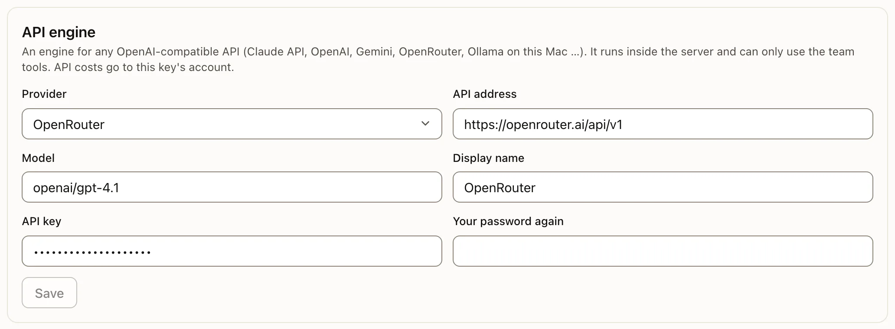
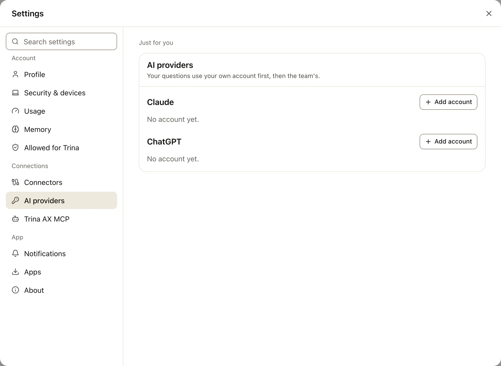

Trina AX는 팀이 연결한 AI 계정으로 답해요. Claude나 ChatGPT 계정, 또는 API 키를 쓸 수 있어요. Trina AX 요금에는 AI
사용료가 들어 있지 않아요. 연결한 계정이나 키의 요금은 Anthropic, OpenAI 같은 그 AI 회사가 자기 약관에 따라 청구해요.

팀 계정은 팀장이나 관리자가 **관리자 › AI 제공사**에서 연결해요. 팀이 허용하면 각자 **설정 › AI 제공사**에 자기 계정도
추가할 수 있어요. 그러면 내 질문에는 내 계정을 먼저 써요.

## 무엇을 고르면 되나요

| Trina AX에서 고르는 것 | 필요한 것 | 청구하는 곳 | 이럴 때 좋아요 |
|---|---|---|---|
| **Claude API 키** | Claude Console에서 만든 API 키 | Anthropic, 쓴 만큼 | 팀이 쓸 때. 월 한도는 Anthropic에서 정해요 |
| **Claude 구독 (Pro·Max·Team)** | 유료 플랜인 Claude 계정 | Anthropic, 내 플랜 | 한 사람이 자기 계정을 쓸 때 |
| **OpenAI API 키 (Codex)** | OpenAI platform에서 만든 API 키 | OpenAI, 쓴 만큼 | OpenAI를 쓰는 팀 |
| **ChatGPT 플랜 (Codex)** | 유료 플랜인 ChatGPT 계정 | OpenAI, 내 플랜 | 한 사람이 자기 계정을 쓸 때 |
| **API 엔진** | OpenAI 호환 서비스의 주소, 모델, 키 | 그 서비스 | OpenRouter, Gemini, 내 컴퓨터에서 돌리는 모델 |

:::warning
구독(Claude나 ChatGPT)은 그 계정 주인이 쓰라고 만든 거예요. 다른 사람이 쓰도록 연결하기 전에 그 회사 약관이
허용하는지 먼저 확인해요. 연결 창에서 **위 안내를 확인했어요**에 체크해야 해요. 팀이 쓸 거라면 API 키가 더 안전해요.
:::

## Claude API 키 추가하기

:::tip
**필요한 것**

- **API 키**: `sk-`로 시작하는 긴 코드예요. [Claude Console](https://platform.claude.com/settings/keys)에서 만들어요.
- **이름**: 팀이 알아볼 수 있는 이름이면 돼요. 예: "Acme 팀 키"
:::

:::steps
#### Anthropic에서 키 만들기
회사 계정으로 [Claude Console](https://platform.claude.com/settings/keys)에 로그인해요. **API keys**를 열고
**Create Key**를 눌러요. "Trina AX" 같은 이름을 붙인 뒤 키를 복사해요. Anthropic은 키를 한 번만 보여 줘요. 그 김에
**Limits**에서 조직의 월 사용 한도도 정해 둬요. 자세한 내용은 Anthropic의
[API 키 안내](https://docs.claude.com/en/api/admin-api/apikeys/get-api-key)에 있어요.

#### 계정 추가 열기
Trina AX에서 **관리자 › AI 제공사**를 열어요. **Claude Code** 줄에서 **계정 추가**를 누르고 **Claude API 키**를 골라요.
창에도 Claude Console로 가는 링크 **Anthropic 콘솔에서 키 만들기**가 있어요.

#### 붙여 넣고 연결하기
**이름**을 넣고 **API 키** 칸에 키를 붙여 넣어요. **대상**은 **팀 전체**로 두거나 **부서·사람 고르기**를 골라요.
**연결**을 누르면 Trina AX가 Anthropic에 키를 확인하고, 계정에 **정상**이 떠요.

:::

## Claude 구독 추가하기

:::tip
**필요한 것**

- Pro, Max, Team, Enterprise 플랜인 **Claude 계정**. 브라우저에 로그인돼 있어야 해요.
- 콘솔에서 복사할 건 없어요. 승인하면 Claude가 **코드**를 보여 주고, 그 코드를 붙여 넣으면 돼요.
:::

:::steps
#### 계정 추가 열기
**관리자 › AI 제공사**(내 계정이면 **설정 › AI 제공사**)에서 Claude 아래 **계정 추가**를 누르고
**Claude 구독 (Pro·Max·Team)** 항목을 골라요. **이름**을 넣고 쓸 사람을 고른 뒤, 안내를 읽고 **위 안내를 확인했어요**에
체크해요.

팀용(관리자)으로는 팀장이 **관리자 › 팀 설정**의 **멤버 개인 계정** 아래에서 **구독 공유 허용**을 켜야 구독을 고를 수
있어요. 그 전에는 창에 "구독 공유가 꺼져 있어요."라고 나와요.

#### Claude에서 승인하기
1. **Claude 구독 연결**을 눌러요. 몇 초 뒤 창에 **Claude 열어서 승인하기**, **링크 복사**, 빈 칸이 나와요.
2. **Claude 열어서 승인하기**를 눌러요. 새 탭에 Claude 페이지가 열려요. (다른 브라우저에서 Claude에 로그인돼 있다면
   **링크 복사**를 눌러 그 브라우저에서 링크를 열어요.)
3. Claude 페이지에서 로그인하라고 하면 로그인하고, 내가 연결하려는 계정이 맞는지 확인한 뒤 승인해요. 그러면 Claude가
   코드를 보여 줘요.

#### 코드 붙여 넣기
1. Claude 페이지에서 복사 버튼으로 코드 전체를 복사해요(가운데에 `#`가 있어요).
2. Trina AX 탭으로 돌아와 **승인한 뒤 Claude가 보여 주는 코드를 붙여 넣어 주세요** 칸에 붙여 넣고 **연결**을 눌러요.
3. Trina AX에 **연결했어요 · Claude 구독**이 뜨고, Claude Code 줄에 그 계정이 나와요.
:::

Claude 비밀번호는 Trina AX에 오지 않아요. 로그인은 Claude 페이지에서 하고, Trina AX는 Claude가 내준 접근 권한만 보관해요.

다른 방법도 있어요. Claude Code가 설치돼 있다면 안내 아래의 **터미널로 직접 만들기**를 써요. 터미널에서
`claude setup-token`을 실행하고, 열리는 브라우저에서 승인한 뒤, 출력된 토큰 전체(어느 줄인지 터미널이 알려 줘요)를
**토큰** 칸에 붙여 넣어요. 이 토큰은 1년 동안 쓸 수 있어요.

## OpenAI API 키 추가하기

:::tip
**필요한 것**

- **API 키**: `sk-`로 시작해요. [OpenAI platform](https://platform.openai.com/api-keys)에서 만들어요.
:::

:::steps
#### OpenAI에서 키 만들기
[OpenAI platform](https://platform.openai.com/api-keys)에 로그인하고 **API keys**를 연 뒤 **Create new secret key**를
눌러요. 키가 속할 프로젝트를 고르고 키를 복사해요. OpenAI도 키를 한 번만 보여 줘요. 그 프로젝트의 **Limits**에서
예산도 정해 둬요.

#### Trina AX에 붙여 넣기
**관리자 › AI 제공사**의 **Codex** 줄에서 **계정 추가**를 누르고 **OpenAI API 키 (Codex)** 항목을 골라요. **이름**을 넣고
**API 키** 칸에 키를 붙여 넣은 뒤, 쓸 사람을 고르고 **연결**을 눌러요.
:::

## ChatGPT 플랜 추가하기

:::tip
**필요한 것**

- 유료 플랜인 **ChatGPT 계정**. 콘솔에서 복사할 건 없어요. Trina AX가 OpenAI에서 넣을 주소와 코드를 알려 줘요.
:::

:::steps
#### 로그인 시작하기
**관리자 › AI 제공사**의 **Codex** 줄에서 **계정 추가**를 누르고 **ChatGPT 플랜 (Codex)** 항목을 골라요. **이름**을 넣고
쓸 사람을 고른 뒤, **위 안내를 확인했어요**에 체크하고 **로그인 시작**을 눌러요.

#### OpenAI에서 코드 넣기
1. Trina AX에 **ChatGPT 로그인 페이지를 여세요**가 보이고, **이 코드를 넣으세요 (15분 안에)** 아래에 `WXYZ-12AB3` 같은
   짧은 코드가 복사 버튼과 함께 나와요.
2. 페이지를 열어요. OpenAI에서 ChatGPT 계정으로 로그인해요.
3. 거기에 코드를 입력하거나 붙여 넣고 승인해요. Trina AX 탭은 열어 둬요. 저절로 다음으로 넘어가요.

#### 끝
Trina AX에 플랜 이름과 함께 **연결했어요 · ChatGPT**가 떠요. 생각한 계정과 다른 계정으로 로그인했다면 chatgpt.com에서
로그아웃하고 **다시 시작**을 눌러요.
:::

## API 엔진

API 엔진은 OpenAI 호환 API를 주는 서비스라면 어디든 연결해요. 아직 **실험 기능**이에요. 답변, 도구, 비용이 Claude
Code나 Codex와 다를 수 있어요.

:::tip
**필요한 것**

- **제공자**: 하나를 고르면 Trina AX가 **API 주소**와 **모델**을 채워 줘요.
- **모델**: 그 제공자에서 쓰는 모델의 정확한 이름.
- **API 키**: 제공자의 키 페이지에서 받아요.
- **비밀번호 다시 입력**: 확인을 위해 내 Trina AX 비밀번호를 한 번 더 넣어요.
:::

| 제공자 | API 주소 | 키 만드는 곳 |
|---|---|---|
| OpenAI | `https://api.openai.com/v1` | [platform.openai.com/api-keys](https://platform.openai.com/api-keys) |
| Claude API (Anthropic) | `https://api.anthropic.com/v1` | [platform.claude.com/settings/keys](https://platform.claude.com/settings/keys) |
| Google Gemini | `https://generativelanguage.googleapis.com/v1beta/openai` | [aistudio.google.com/apikey](https://aistudio.google.com/apikey) |
| OpenRouter | `https://openrouter.ai/api/v1` | [openrouter.ai/settings/keys](https://openrouter.ai/settings/keys) |
| Ollama (서버 컴퓨터) | `http://127.0.0.1:11434/v1` | 키가 필요 없어요. 서버와 같은 컴퓨터에서 돌아가는 모델이에요. 이 주소는 팀장만 정할 수 있어요 |

:::steps
#### API 줄 열기
**관리자 › AI 제공사**에서 **API** 아래의 **설정하기**를 눌러요.

#### 양식 채우기
**제공자**를 고르고 **모델**을 확인한 뒤, **표시 이름**을 정하고 **API 키**를 붙여 넣고 **비밀번호 다시 입력**에
비밀번호를 넣어요. **저장**을 눌러요.

:::

## 내 계정

관리자가 **팀원이 자기 AI 연결을 추가할 수 있게 하기**를 켜면(**관리자 › 팀 설정**의 **멤버 개인 계정**), 모두에게
**설정 › AI 제공사**가 보여요. "내 질문에는 내 계정을 먼저 쓰고, 없으면 팀 계정을 써요." **Claude**나 **ChatGPT** 아래의
**계정 추가**를 누르고 위와 같은 순서로 연결하면 돼요. 이 계정은 내 질문에만 쓰여요. 관리자는 이 계정을 쓸 수도, 키를
볼 수도 없어요.

## 음성 입력

음성 입력은 OpenRouter로 말을 글자로 바꿔요. 직접 운영하는 서버라면 관리자가 **관리자 › 팀 설정**의 **음성 입력**에
**OpenRouter API 키**를 넣어요. 키는 [openrouter.ai/keys](https://openrouter.ai/keys)에서 만들어요.

## 문제가 생기면

| 이런 게 보이면 | 이렇게 해요 |
|---|---|
| **이 종류의 API 키가 아니에요.** | 다른 종류의 키예요(Claude 칸에 OpenAI 키를 넣었거나 그 반대). 아니면 복사할 때 공백이 들어갔어요. 다시 복사해요. |
| **코드 전체를 붙여 넣어 주세요(중간에 #가 있어요).** | Claude 코드 일부가 빠졌어요. Claude의 복사 버튼으로 다시 복사해요. |
| **코드가 맞지 않았어요. 다시 시작해서 승인한 뒤 새 코드를 붙여 넣어 주세요.** | 이미 쓴 코드이거나 너무 오래된 코드예요. **Claude 구독 연결**을 다시 눌러요. |
| **시간이 지났어요.** (ChatGPT) | 코드는 15분 동안만 쓸 수 있어요. **다시 시작**을 눌러요. |
| **보안 연결(https)에서만 연결을 추가할 수 있어요.** | Trina AX를 `https://` 주소로 열어요. |
| 계정에 **거절됨**이나 **다시 연결 필요**가 떠요 | 키가 취소됐거나 로그인이 끝났어요. 계정의 **⋯** 메뉴에서 **토큰·키 바꾸기**나 **다시 연결**을 골라요. |
| 계정에 **월 한도 다 씀**이 떠요 | **⋯** › **월 한도**에서 정한 한도에 닿았어요. 한도를 올리거나 다음 달까지 기다려요. |

계정을 쓰는 순서, 한도, 엔진은 [관리자](admin.md#ai-제공사)와 [사용량과 한도](usage-and-limits.md)에 더 자세히 있어요.
