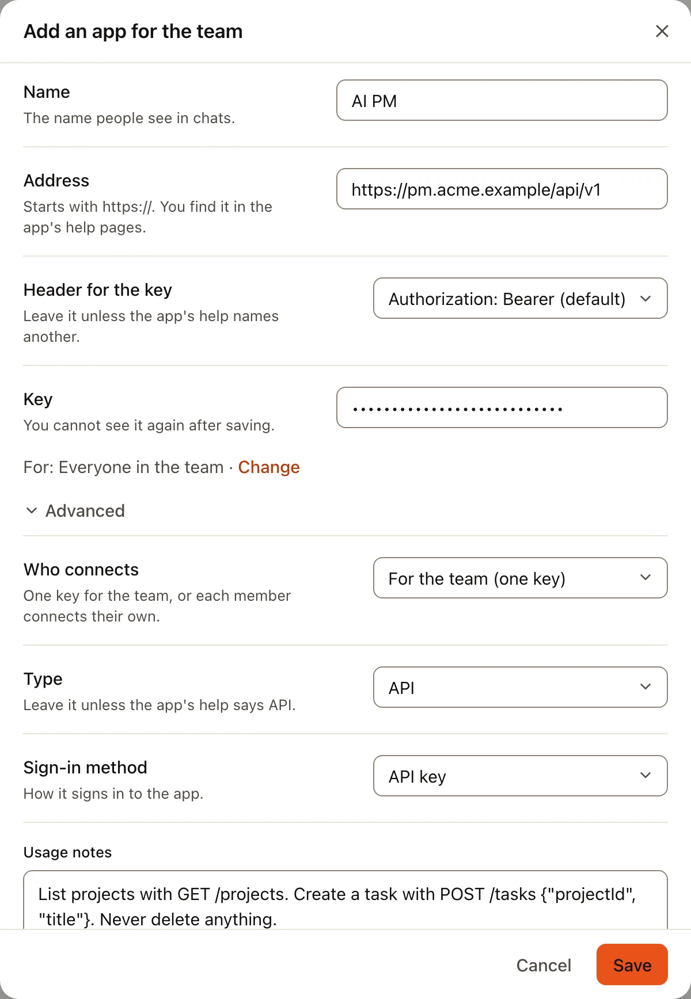
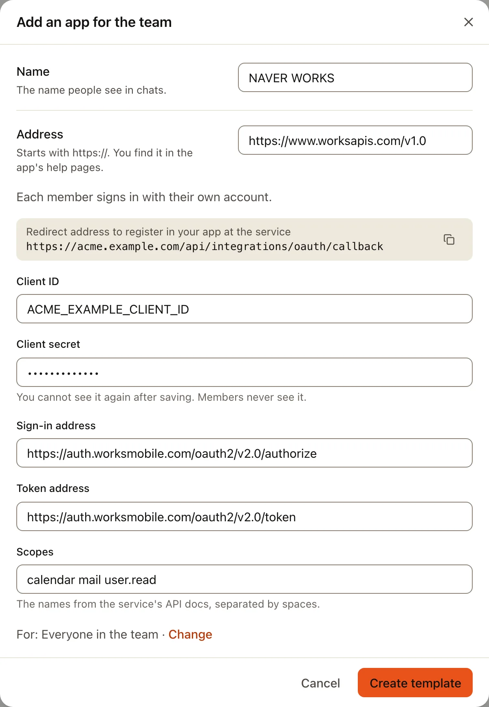

회사마다 직접 운영하는 시스템이 있어요. 프로젝트 관리 도구, 주문 시스템, 사내 도구 같은 것들이에요. 웹 API가 있다면
AI가 쓸 수 있어요. 팀장이나 관리자가 **관리자 › 연결한 서비스**에서 주소, 키, 사용법 몇 줄을 넣어 한 번 추가하면 돼요.
그러면 AI는 그 주소 아래에 있는 주소만 호출할 수 있어요.

NAVER WORKS 같은 서비스는 키를 주지 않아요. 회사가 그 서비스에 만든 로그인 앱을 거쳐 각자 로그인해요.
[이 페이지의 뒷부분](#내-앱으로-로그인하기)에서 설명해요.

아래 값을 받으려면 그 시스템을 잘 아는 사람(시스템 관리자나 개발자)이 있어야 해요. 코드를 짤 필요는 없어요.

## 키로 API 연결하기

:::tip
**필요한 것**

- **주소**: API의 기본 주소예요. 예: `https://pm.acme.example/api/v1`. 시스템 관리자에게 묻거나 API 문서("base URL")를
  찾아봐요.
- **키**: 그 시스템의 API 키나 토큰. Trina AX 전용으로 하나 만들고, AI에게 필요한 만큼만 권한을 줘요.
- **키를 보낼 헤더**: 대부분의 API는 `Authorization: Bearer <key>`를 받아요. API 문서에 `X-API-Key` 같은 다른 헤더가
  나와 있으면 정확한 이름을 적어 둬요.
- **사용법 메모**: AI가 어떤 주소를 호출해야 하는지 적은 몇 줄. 시스템의 API 문서에 나와 있어요.
:::

:::steps
#### 창 열기
**관리자 › 연결한 서비스**에서 둘러보기 아래의 **주소로 직접 추가**를 눌러요. **고급**을 열고 **종류**를 **API**로,
**인증 방식**을 **API 키**로 정해요.

#### 칸 채우기
- **이름**: 채팅에서 사람들이 보는 이름. 예: "AI PM"
- **주소**: 기본 주소. AI는 이 주소 아래의 경로만 호출할 수 있어요.
- **키를 보낼 헤더**: **Authorization: Bearer (기본)** 그대로 두거나, **다른 헤더**를 고르고 **헤더 이름**을 문서에
  적힌 그대로 입력해요.
- **키**: 키를 붙여 넣어요.
- **사용법 메모**: 주요 경로, 필요한 값, AI가 하면 안 되는 일. 4,000자까지 쓸 수 있어요.



#### 쓸 사람 고르고 저장하기
**쓸 사람: 팀 전체 · 바꾸기**에서 부서나 사람을 골라요. **쓰기·삭제·보내기**는 처음에는 **매번 묻기**로 둬요.
**저장**을 누르면 Trina AX가 주소와 키를 확인하고, 줄에 **연결됨**이 떠요.
:::

사용법 메모는 이렇게 쓰면 좋아요.

```
List projects with GET /projects.
Create a task with POST /tasks and a JSON body {"projectId", "title", "dueDate"}.
Dates are YYYY-MM-DD. Never call DELETE.
```

AI는 API를 쓸 때마다 이 메모를 읽어요. 짧고 정확하게 써야 해요.

## 내 앱으로 로그인하기

어떤 서비스는 로그인(OAuth)을 허용하지만, 그 서비스에 등록한 앱을 거쳐야만 해요. NAVER WORKS와 Google의 MCP 서버가
그래요. 서비스의 개발자 콘솔에서 앱을 한 번 만들고, 그 값을 Trina AX에 붙여 넣어요. 보통은 **템플릿**으로 추가해서
멤버가 각자 자기 계정으로 로그인하게 해요.

:::tip
**서비스의 개발자 콘솔에서 받을 것**

- 거기서 만든 앱의 **Client ID**와 **Client Secret**.
- **로그인 주소**와 **토큰 주소** (API일 때. MCP 서버는 알아서 찾아요).
- **권한 범위(scope)**: AI에게 필요한 권한. 공백으로 구분해요.

**서비스에 넣을 것**

- Trina AX가 보여 주는 **리디렉션 주소**: `https://<your team address>/api/integrations/oauth/callback`
:::

:::steps
#### Trina AX에서 창부터 열기
**관리자 › 연결한 서비스**에서 **주소로 직접 추가**를 누르고 **고급**을 열어요. **누가 연결하나요**는 **멤버마다 각자**,
**종류**는 **API**(또는 **MCP 서버**), **인증 방식**은 **로그인(OAuth)** 항목으로 정해요. MCP 서버라면
**내 앱으로 로그인**도 켜요. 그러면 창에 **서비스의 앱 설정에 등록할 리디렉션 주소**가 복사 버튼과 함께 보여요.
복사해 둬요.

#### 서비스에서 앱 만들기
서비스의 개발자 콘솔에서 앱을 만들어요("OAuth app", "client", "integration" 같은 이름일 수 있어요). 리디렉션 주소를
redirect URL 칸에 붙여 넣고, scope를 고른 뒤, **Client ID**와 **Client Secret**을 복사해요.

#### 나머지를 채우고 저장하기
Trina AX로 돌아와 **이름**, **주소**, **Client ID**, **Client Secret**, **로그인 주소**와 **토큰 주소**(API일 때),
**권한 범위(scope)** 칸을 채워요. **템플릿 만들기**를 눌러요. 그러면 멤버가 **설정 › 커넥터**에서 이 앱을 보고 자기
계정으로 로그인해요.


:::

### NAVER WORKS

| Trina AX의 칸 | 값 |
|---|---|
| **종류** | **API** |
| **주소** | `https://www.worksapis.com/v1.0` |
| **로그인 주소** | `https://auth.worksmobile.com/oauth2/v2.0/authorize` |
| **토큰 주소** | `https://auth.worksmobile.com/oauth2/v2.0/token` |
| **Client ID**, **Client Secret** | NAVER WORKS Developer Console의 내 앱에서 받아요 |
| **권한 범위(scope)** | AI에게 필요한 권한. 예: `calendar mail file user.read` |
| **사용법 메모** | AI가 호출할 API 주소. NAVER WORKS API 문서에 있어요 |

NAVER WORKS Developer Console에서 내 앱을 열고(없으면 API 2.0에서 추가해요), **Redirect URL**을 Trina AX가 보여 주는
주소로 정해요. 같은 **OAuth Scopes**에 체크하고 **Client ID**와 **Client Secret**을 복사해요. 로그인 방식은 NAVER
WORKS의 [OAuth 안내](https://developers.worksmobile.com/kr/docs/auth-oauth)에 나와 있어요.

### Google의 MCP 서버

Google도 Gmail, Calendar, Drive 등을 위한 MCP 서버(`https://gmailmcp.googleapis.com/mcp/v1` 같은 주소)를 Google의
미리보기 프로그램으로 내놓고 있어요. 이 서버를 쓰려면 Google 로그인 앱을 직접 만들어야 해요.
[회사의 Google 앱](google-own-app.md#google-cloud에서)처럼 만들되, 리디렉션 주소만 위의 주소로 넣어요. 평소에는 앱을
따로 만들 필요 없는 기본 [Google 앱](google-apps.md)을 쓰면 돼요.

## 문제가 생기면

| 이런 게 보이면 | 이렇게 해요 |
|---|---|
| **서비스가 이 앱의 Client ID나 Secret을 받아들이지 않았어요.** | Client ID나 Secret을 잘못 복사했거나, 서비스에서 Secret을 새로 만들었어요. 연결을 편집해 **고급**에서 Secret을 다시 넣고 다시 로그인해요. |
| 서비스가 리디렉션 주소가 틀렸다고 해요 (`redirect_uri_mismatch`, "invalid redirect") | 서비스 콘솔의 redirect URL이 Trina AX에 보이는 주소와 달라요. 복사 버튼으로 다시 복사하고 `https`, 팀 주소, 끝에 슬래시가 없는지 확인해요. |
| **다른 주소로 옮기면 저장된 Client Secret은 따라가지 않아요. 다시 넣어 주세요.** | 주소나 로그인 주소를 바꿨어요. 안전을 위해 Secret을 다시 쓰지 않아요. 다시 붙여 넣어요. |
| 호출하면 401이나 403이 돌아와요 | 키가 만료됐거나 권한이 모자라거나, 복사할 때 공백이 들어갔어요. 새 키를 만들거나, 서비스에서 빠진 scope를 더하고 다시 로그인해요. |
| AI가 엉뚱한 경로를 호출해요 | **사용법 메모**를 더 정확하게 써요. 경로마다 메서드를 함께 적어요. |

개발자를 위한 자세한 내용: [Integrations](../../../INTEGRATIONS.md#your-own-app-client-id) (영어).
