채팅은 AI와 나누는 대화예요. 새 채팅은 [공유](#채팅-공유하기)하기 전까지 나만 봐요. 팀 프로젝트 안의 채팅은
**나만 보기**를 고르지 않으면 프로젝트 멤버와 공유돼요. 관리자는 AI가 어떤 파일을 읽었는지만 보고, 대화 내용은 절대
보지 못해요.

## 채팅 시작하기

:::steps
#### 새 채팅 열기
트리나 목록(왼쪽 막대의 **트리나**) 맨 위에서 **트리나에게 묻기**를 고르거나, ⇧⌘O(Windows는 Ctrl+Shift+O)를 누르거나, 홈 화면 입력창에 바로 입력해요. 폰에서는 **트리나** 탭이 홈으로 열려요. 아래쪽 입력창에 입력하면 돼요. 처음에는 입력창 아래 **팀에 준비된 것**에
팀이 설정해 둔 것이 나와요. 팀 스킬은 내가 하나를 실행해 볼 때까지 보여요(**예시**는 결과를 보여 주고, **써 보기**는 스킬을 열어요).
팀 파일도 보여요(**물어보기**를 누르면 그 파일에 대한 질문이 입력창에 들어가요. 보내지는 않아요). 아직 설정된 게 없으면
**이렇게 시작해 보세요**에서 보낼 질문 하나를 권해요.

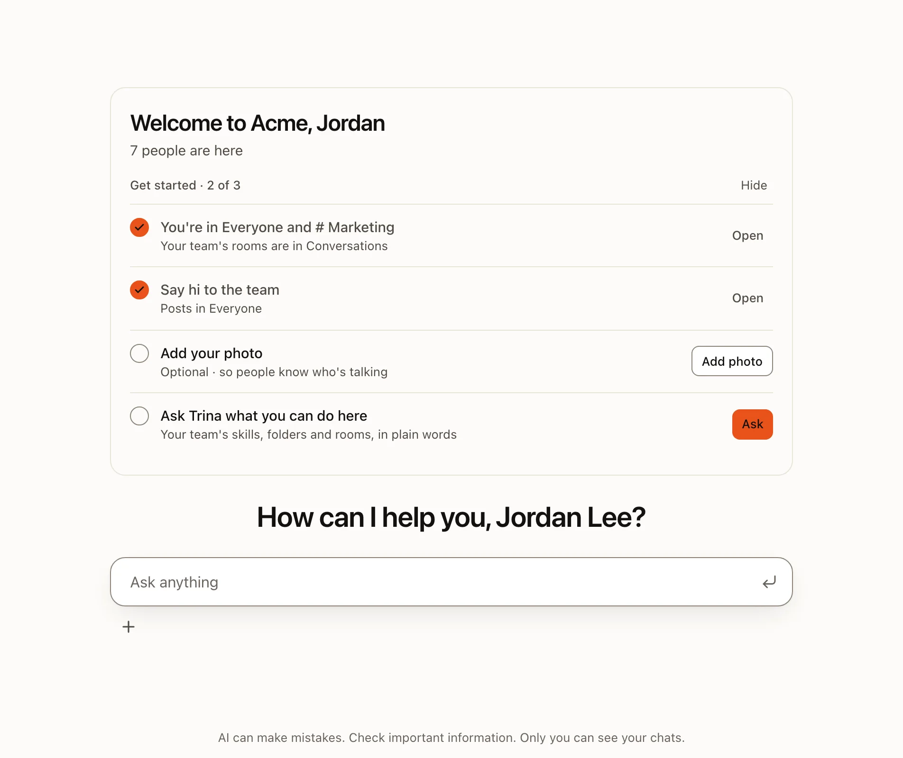

#### 평소 말로 묻기
예를 들어 "shared/sales에 있는 지난주 영업 메모를 요약해 줘"처럼요. `/`를 입력하면 팀 스킬을 고를 수 있어요.

입력창 위쪽에는 내가 쓴 글이, 그 아래에는 버튼 한 줄이 입력창 안에 있어요. 왼쪽 **+**로 파일을 더해요
(내 컴퓨터나 팀 파일에서). 오른쪽에는 AI 선택(관리자가 허용한 사람만), 켜 둔 경우 마이크, 보내기(**↑**)가 있어요. Enter를 누르면 보내져요.

#### AI가 하는 일 따라가기
답변 아래 **작업 N단계**를 열면 AI가 쓴 도구와 읽은 파일이 하나하나 보여요.
:::

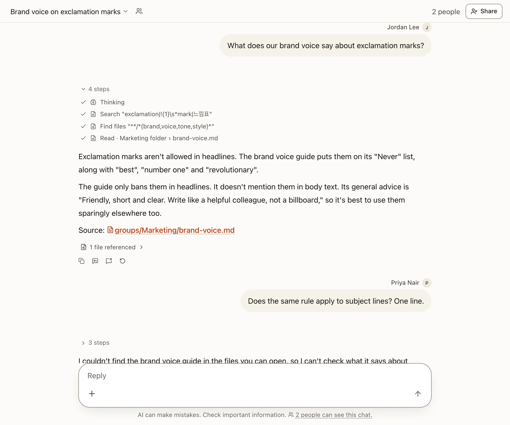

## 답변이 만들어지는 방식

| 항목 | 이렇게 돼요 |
|---|---|
| **엔진** | 팀원은 팀 기본값을 써요. 관리자가 허용한 사람은 채팅에서 엔진과 모델을 고를 수 있어요. |
| **파일** | AI는 트리나의 파일 도구를 써요. 도구를 부를 때마다 내 권한으로 확인해요. |
| **질문** | AI가 무언가를 골라야 하거나 확인받아야 하면 카드를 보여 줘요. 그 카드에 AI가 스스로 답할 수는 없어요. |
| **도우미** | 큰 요청은 AI가 하위 작업으로 나눠서, 한 번에 4개까지 함께 진행해요. 도우미도 모두 내 권한으로 일해요. |
| **길이** | 답변 하나에서 도구는 기본 500번까지 써요(관리자가 10~2,000 사이로 정해요. 예약 작업, Slack에서 온 질문, 게스트는 150번까지). 한도에 이르면 **이어서 하기**로 계속해요. |
| **웹** | AI가 웹 페이지를 열 수 있어요. 서버가 주소를 하나하나 확인하고, 위험해 보이는 주소는 먼저 물어봐요. |
| **도움말** | Trina AX 쓰는 법, 설정, 문제 해결을 물어보면 AI가 이 문서에서 찾아 답하고 끝에 페이지 링크를 붙여요. 문서는 버전에 맞게 서버에 들어 있어요. |

:::note
필요한 내용은 연결한 AI 제공사로 보내요. 직접 서버를 운영한다고 해서 오프라인으로 처리되는 건 아니에요. [데이터 흐름 읽기](../../operate/security.md) (영어).
:::

## 내 트리나 목록

컴퓨터에서는 왼쪽 막대의 **트리나**를 누르면 화면 옆에 트리나 채팅 목록이 열려요. 맨 위에는
**트리나에게 묻기**, **검색**, **예약 작업**, **팀 스킬**이 있고, 그 아래로 차례대로 이렇게 나와요.

| 부분 | 들어 있는 것 |
|---|---|
| **답을 기다려요** | 내 답을 기다리는 채팅이 있을 때만 보이고, 누르면 그 채팅이 열려요 |
| **고정됨** | 내가 고정한 채팅 |
| **트리나 기록** | 나머지 내 채팅 전부, 최신순이에요. 프로젝트 안의 채팅은 줄 끝에 프로젝트 이름이 나와요 |

누가 보는 채팅인지는 작은 표시로 알려 줘요. 팀 프로젝트 안에서 나만 보는 채팅은 제목 앞에 자물쇠가, 공유한 채팅은
사람 아이콘이 붙어요. 다른 사람이 글을 쓴 공유 채팅은 대신 줄 끝에 그 사람들의 얼굴이 나와요(최대 3명, 폰에서는
2명). 얼굴에 마우스를 올리면 이름이 보여요. 내 기록, 프로젝트 페이지, 검색에서 모두 똑같아요.

막대의 **트리나**에 물음표(**?**)가 보이는 동안에는 누르면 기다리는 채팅이 바로 열려요. 지운 채팅은 **트리나 기록** 옆 **⋯** 메뉴의
**삭제한 기록**에 있어요. 목록 위쪽의 필터 버튼으로 일부 채팅만 볼 수도 있어요. 예를 들어 답변 중이거나 내 답을
기다리는 채팅만요. 프로젝트는 따로 있어요. 막대의 **프로젝트**예요.

폰에서는 **트리나** 탭이 홈으로 열려요. 위쪽 **☰** 버튼을 누르면 기록이 열려요. **검색**, **예약 작업**, **팀
스킬**, 그다음 **트리나 기록**(고정한 채팅이 먼저, 나머지는 날짜별 최신순)이 있고, 맨 아래에 **상태 설정**과
**삭제한 기록**이 있어요.

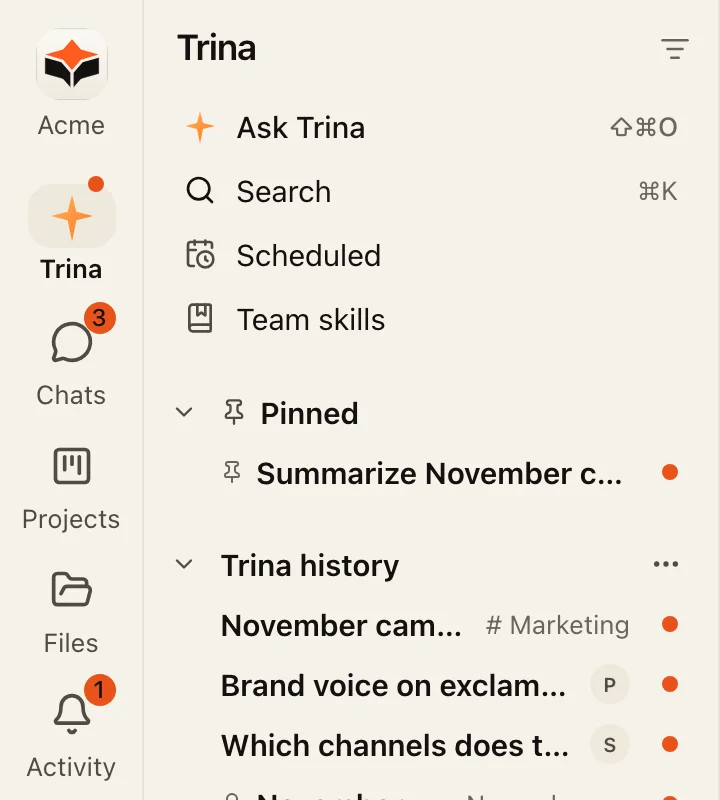

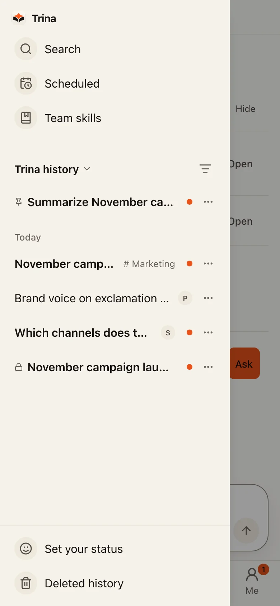

### 섹션

트리나 채팅에는 폴더가 없어요. 한 가지 일에 대한 채팅을 모아 두려면 [프로젝트](#프로젝트)에 넣으면 돼요.

**대화** 목록에서는 채널과 다이렉트 메시지를 나만의 **섹션**으로 묶을 수 있어요. Slack 사이드바의 섹션과 같아요.
섹션은 내 목록만 정리해요. 파일을 담지 않고, 다른 사람에게는 보이지 않고, 대화에 누가 있는지도 바꾸지 않아요.

1. 왼쪽 막대에서 **대화**를 열어요.
2. **채널**에 마우스를 올리고 그 줄 끝의 **+** 를 눌러요. **채널 만들기**와 **새 섹션**이 있는 작은 메뉴가 열려요.
3. **새 섹션**을 고르고 이름(예: "고객사")을 입력한 다음 **만들기**를 눌러요.
4. 내 대화 목록이 열려요. 넣을 대화에 체크하고 **대화 2개 넣기**를 눌러요(숫자는 체크한 개수를 따라가요).
   나중에 채우려면 **건너뛰기**를 눌러요.

**대화** 목록의 **채널** 위에 새 섹션이 생기고, 고른 대화가 그 안에 들어가요.

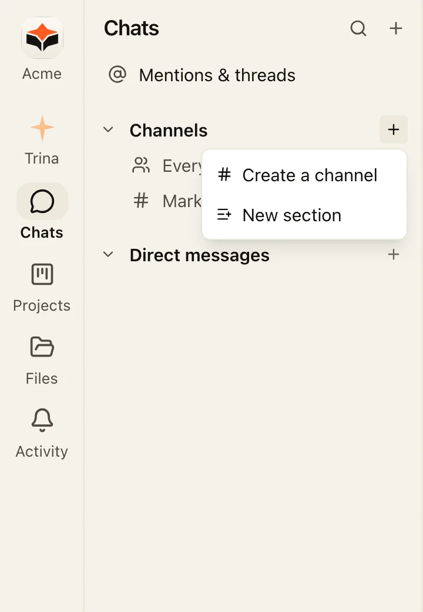

- **대화 하나 옮기기:** 그 줄의 **···** › **섹션으로 옮기기**에서 섹션을 골라요(또는 **새 섹션…**).
  컴퓨터에서는 줄을 섹션 위로 끌어다 놓아도 돼요. **섹션에서 빼기**를 누르면 원래 자리로 돌아가요.
  **채널**, **프로젝트**(프로젝트 대화방), **다이렉트 메시지** 중 원래 있던 곳이에요.
- **섹션 바꾸기:** 섹션의 **···** 메뉴에 **대화 넣기**, **섹션 이름 바꾸기**, **위로**, **아래로**, **섹션 지우기**가 있어요.
  섹션을 지우면 제목만 없어져요. 그 안의 대화는 **채널**과 **다이렉트 메시지**로 돌아가요.

## 여러 채팅을 한꺼번에

트리나 채팅 목록의 각 채팅에는 줄 오른쪽 끝에 표시가 최대 하나 붙어요.

| 표시 | 뜻 |
|---|---|
| 주황색 **?** | AI가 나를 기다려요. 질문 카드나 확인 카드가 있거나, 답변이 실패했거나 한도에서 멈췄어요. 카드의 물음표(**?**)는 내가 답할 때까지 남아요. |
| 회색 동그라미 | AI가 답하는 중이거나, 답변이 차례를 기다려요. |
| 점, 굵은 제목 | 아직 열어 보지 않은 새 답변이에요. |

채팅을 열면 점이 사라지고, 실패했거나 멈춘 답변의 물음표(**?**)도 사라져요. 모든 기기에서 똑같아요. 접어 둔 묶음에는 그 안 채팅 중 가장 강한 표시가 보여요. 대화방에서 AI가 내 답을 기다리면 그 방은 개수 대신 물음표(**?**)를 보여 줘요.

브라우저 탭이 뒤에 있을 때는 탭 제목에 나를 기다리는 채팅과 대화방 수가 나와요. 예를 들어 "(2) Trina"처럼요. 데스크톱 앱은 Mac의 Dock에 같은 숫자를 보여 주고, 다른 곳을 보는 동안 카드가 열리거나 1분 넘게 걸린 답변이 끝나면 알림을 보내요. 알림을 누르면 그 채팅이 열려요. 예약 작업은 표시만 붙어요. Slack에서 물어본 질문은 Slack에서 답하기 때문에 그 채팅에는 점이 붙지 않아요. 나를 기다리는 채팅이 있으면 왼쪽 막대의 **트리나**(폰에서는 **트리나** 탭)에 물음표(**?**)나 점이 보이고, 대화방에서 AI가 내 답을 기다리면 **대화**에 물음표(**?**)가 보여요. 폰에서는 앱 안에 **열기**가 달린 짧은 메시지가 떠요.

## 채팅 공유하기

내 채팅은 어느 것이든 Google Drive의 파일처럼 사람이나 부서와 공유할 수 있어요. 공유받은 사람은 추가되기 전에 나눈 대화까지
채팅 전체를 보고, 그 채팅에서 직접 AI에게 물어볼 수 있어요.

:::steps
#### 공유 열기
채팅 제목 메뉴나, 목록에 있는 그 채팅 줄의 **···** 메뉴에서 **공유**를 골라요.

#### 사람과 부서 추가하기
**사람이나 부서 추가**에 이름을 입력해요. 나는 목록에 **이 채팅을 시작함**으로 나와요. **✕** 버튼을 누르면 그 사람을 다시 빼요
(저장하기 전까지는 **되돌리기**로 다시 넣을 수 있어요).

#### 저장하기
**공유**를 눌러요(이미 공유한 채팅이면 **저장**). 저장하지 않은 변경이 있는데 나가려고 하면 먼저 물어봐요.
:::

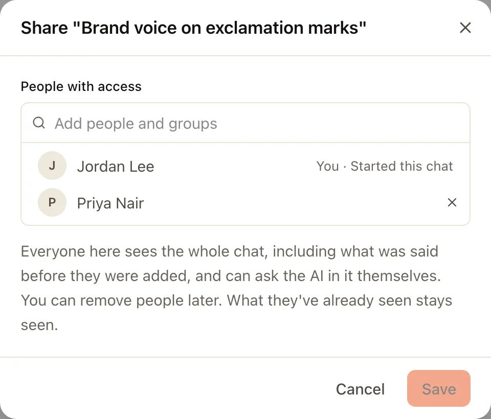

- **새 사람을 추가하기 전에** 앱이 그 사람들이 새로 보게 될 내용을 확인해요. 채팅이 그중 누군가가 열 수 없는 곳을
  참고했다면 알려 줘요. 예를 들어 "1명이 이 채팅이 참고한 일부를 열 수 없어요: groups/Marketing/"처럼요. 답변을 짚어서
  알려 줄 때("여기 있는 답 2개가 Priya가 열 수 없는 곳을 참고했어요")는 **답 보기**로 그 답변을 볼 수 있어요. **그래도 공유**를 누르면
  공유하고, **취소**를 누르면 그대로 둬요.
- **파일.** 공유하기 전에 내 컴퓨터에서 첨부한 파일은 추가한 사람들도 보게 되고, 창에 몇 개인지 나와요. 첨부한 뒤에
  내가 바꾼 파일은 내 것으로 남아요. 개수에 들어가지 않고, 다른 사람은 보지 못해요.
  공유 채팅에서는 채팅에 있는 누구나 컴퓨터에서 파일을 첨부할 수 있어요(파일당 최대 50 MB). 파일은 채팅과 함께 보관되고,
  그 채팅을 보는 사람만 열거나 트리나에게 물어볼 수 있어요. 채팅을 지우면 파일도 지워져요.
- **누가 답변을 보나요.** 공유 채팅의 답변은 나중에 추가된 사람을 포함해, 채팅에 있는 누구에게도 가려지지 않아요.
  답변은 물어본 사람의 권한으로, 그 사람이 열 수 있는 것만 써요. 채팅에 있는 누군가가 열 수 없는 것을 AI가 읽기 전에는
  먼저 나에게 물어봐요.
- **다른 사람에게는 이렇게 보여요.** 그 사람의 트리나 목록에 채팅이 생기고, **활동**에 "Jordan님이 채팅을 공유했어요"가 떠요.
  이름으로 추가한 사람은 폰과 브라우저로도 알림을 받아요(**설정 › 알림 › 나에게 공유된 채팅**에서 끌 수 있어요).
  그 사람은 자기 권한으로 채팅을 이어 가거나, 메뉴에서 **내 목록에서 숨기기**를 고를 수 있어요. 다시 열면 목록에 돌아와요.
- **볼 수 있는 사람 바꾸기.** 볼 수 있는 사람은 채팅을 시작한 사람만 바꿀 수 있어요. 다시 **공유**를 누르거나 입력창 아래
  **볼 수 있는 사람 바꾸기**를 눌러요. 뺀 사람은 그 즉시 채팅과 파일을 잃고, "이 채팅은 더 이상 나와 공유되어 있지 않아요"라는 문구를 봐요.
  나중에 링크로 열어도 마찬가지예요. 그 사람이 입력하던 글은 그대로 남고 **복사**할 수 있어요. 이름으로 뺐지만 공유한 부서에
  들어 있는 사람은 그 부서를 통해 계속 보고, 창에서 그렇게 알려 줘요. 모두 빼면 다시 나만 보는 채팅이 돼요.
- **링크 보내기.** 공유 창 왼쪽 아래 **링크 복사**를 누르면 채팅 주소가 복사돼요. 공유한 뒤에 뜨는 알림에도 **링크 복사**가
  있어요. 링크는 이미 이 채팅을 볼 수 있는 사람에게만 열려요. 볼 수 없는 팀원에게는 채팅 내용이 하나도 없는 **권한 요청**
  화면이 보여요(아래 참고). 방금 추가한 사람은 **공유**(또는 **저장**)를 누른 뒤부터 열 수 있어요. 프로젝트의 **멤버** 창에도 프로젝트
  **링크 복사**가 있어요.
- **권한 요청.** 볼 수 없는 채팅의 링크를 연 팀원에게는 **권한 요청** 버튼과 메모 칸이 보여요. 채팅 제목이나 누가
  들어 있는지는 하나도 보이지 않아요. 누르면 버튼이 **요청함**으로 바뀌어요. 요청은 내 **활동**에 **공유**, **거절** 버튼과 함께
  오고, 휴대폰과 브라우저로도 알려요(**설정 › 알림 › 공유**, 파일 열람 요청과 합쳐 하루 10개까지). **공유**를 누르면 공유 창과
  같은 확인을 거쳐 그 사람을 이름으로 추가해요. **거절**하면 그 사람에게는 승인되지 않았다는 것만 알려 주고, 다시 요청할 수
  있어요. 프로젝트 링크도 똑같아요. 멤버를 바꿀 수 있는 사람에게 요청이 가고, **추가**를 누르면 멤버가 돼요. 팀 프로젝트의 공유
  채팅 링크는 그 프로젝트에 들어가게 해 달라는 요청이 돼요. 요청할 수 없는 경우(개인 프로젝트 안의 채팅처럼 공유되지 않는
  채팅이거나 답할 사람이 없을 때)에는 이유를 말하지 않고 버튼 없이 요청할 수 없다고만 알려 줘요. 게스트는 요청할 수 없고, 이미 열 수 있는 사람은 그냥 열려요.
- **개인적인 건 빠져요.** 공유 채팅에서는 AI가 내 메모리, 내 브라우저, 내 이메일, 내 일정을 쓰지 않아요.
  그것까지 쓰려면 채팅 메뉴에서 **나만 보는 채팅에서 이어 하기**를 골라요.
- 개인 프로젝트 안의 채팅은 나만 봐요. **공유**를 누르면 먼저 프로젝트 밖으로 옮길지 물어봐요. 팀 프로젝트 안의
  채팅은 프로젝트 멤버와 공유돼요([프로젝트](#프로젝트) 참고).

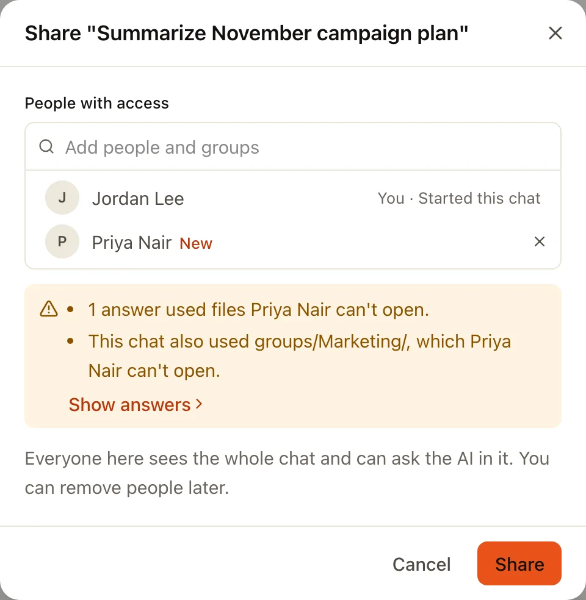

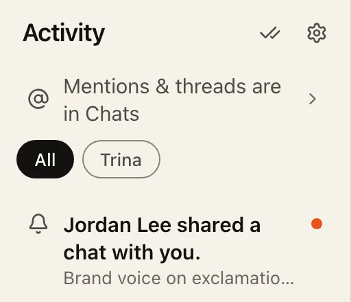

## 채팅 고정하기

트리나 채팅 목록에서 채팅의 **···**(또는 그 줄을 오른쪽 클릭, 폰에서는 길게 누르기)에 **상단에 고정**이 있어요.
고정한 채팅은 트리나 목록 맨 위에 나오고, 가장 최근에 고정한 것이 먼저예요. 컴퓨터와 폰 모두 제목 앞에 작은 핀이
붙어요. 프로젝트 페이지에서도
내가 고정한 채팅이 먼저 나와요. **고정 해제**를 누르면 원래 자리로 돌아가요. 고정은 나에게만 적용돼요. 공유된 프로젝트 채팅도 그래요.
채팅이 지워지거나 내가 더 이상 볼 수 없게 되면 고정도 사라져요. 채팅은 50개까지 고정할 수 있어요.

**대화**에 있는 채널과 다이렉트 메시지(1:1 대화와 그룹 대화)도 같은 방법으로 고정해요. 줄의 **···** 메뉴나 대화 자체의
**···** 메뉴에서 하면 돼요. 고정한 대화는 모든 대화 목록에서 맨 위에 나오고, 이름 뒤에 작은 핀이 붙어요. 컴퓨터와 폰의 **대화** 탭 모두 같아요.
고정은 나에게만 보여요. 대화에서 나가거나 대화를 숨기면 고정도 사라져요. 대화는 50개까지 고정할 수 있어요.

**대화** 목록에는 모든 대화가 나와요. 고정한 대화, 내 섹션, 그다음 **채널**(전체 채널이 먼저, 나머지는
이름순이고 비공개 채널에는 자물쇠가 붙어요), **다이렉트 메시지**(1:1 대화와 이름 없는 그룹 대화를 함께, 최근 순이고 멤버들의 얼굴이 보여요)예요. 숨긴 대화는 **숨긴 대화 N** 안에 있어요.

**채널** 옆 **+** 를 누르면 작은 메뉴가 열려요. **채널 만들기**에서 사람을 고르고 이름을 붙이면 그 사람들만 보는 비공개
채널이 돼요. **새 섹션**은 위의 '섹션'에서 설명한 나만의 섹션을 만들어요. **다이렉트 메시지** 옆
**+** 는 **새 메시지**예요. 한 명을 고르면 다이렉트 메시지, 여러 명을 고르면 그 사람들 이름으로 보이는 그룹 대화가 열려요(똑같은
사람들과의 그룹 대화가 이미 있으면 그 대화가 열려요). 그룹 대화를 비공개 채널로 바꾸려면 **···** › **비공개 채널로 바꾸기**에서 이름을 정해요.

팀을 떠난 사람과의 1:1 대화에는 "<이름>님은 팀을 떠났어요"라고 나오고 입력창이 없어요. 지난 대화는 계속 읽을 수 있어요.

## 팀 대화

왼쪽 막대의 **대화**(폰에서는 **대화** 탭)에서는 사람들끼리 이야기해요. **채널**
(팀 전체가 있는 채널, 부서마다 채널 하나, 내가 들어 있는 비공개 채널)과 **다이렉트 메시지**(1:1 대화와 그룹 대화)가 있어요.
나를 언급한 메시지와 내가 따라가는 스레드의 새 답글은 다른 알림과 함께 **활동**에 모여요.

한 사람에게 따로 말하려면 메시지 옆의 사진이나 이름을 눌러요(메시지 안의 @멘션이나 대화 멤버 목록의 줄도 돼요). 이름과 직함이 있는 작은 카드가 열리고, **메시지 보내기**를 누르면 그 사람과의 1:1 대화가 열려요. 휴대폰에서는 카드가 화면 아래에서 올라와요. 내 카드에는 **프로필 수정**이 있어요. 앱과 팀을 떠난 사람은 카드가 없고, 게스트는 자기 그룹 대화나 프로젝트에 있는 사람에게만 메시지를 보낼 수 있어요.

팀 밖의 사람을 부르려면 비공개 채널, 그룹 대화나 프로젝트에 사람을 추가할 때 **게스트 초대하기**를 골라요. [게스트 알아보기](guests.md).

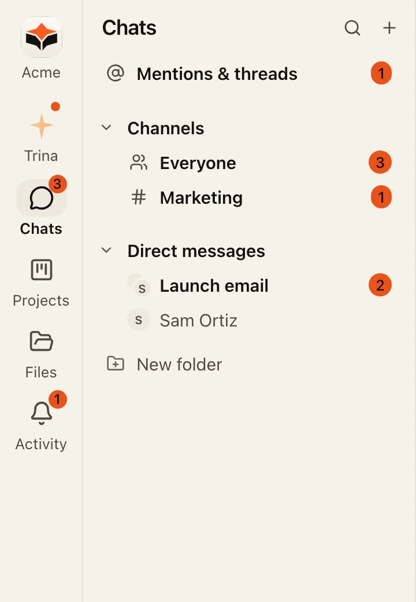

#### 대화방 옆에서 트리나에게 묻기

대화방 위쪽 **✦** 버튼을 누르면 옆에 트리나와의 사이드 채팅이 열려요. 이 채팅은 나만 보고, AI는 내가 열 수 있는
것으로 답해요. 공유할 만한 답이 나오면 그 아래 **대화방에 보내기**를 눌러 내 메시지로 대화방에 올려요(메시지 하나에
대해 물었다면 **스레드에 보내기**). 대화방의 누군가가 답변에 쓰인 파일을 열 수 없으면, 앱이 먼저 알려 주고
내가 괜찮다고 할 때까지 기다려요.

스레드가 열려 있을 때 **✦** 버튼을 누르면 사이드 채팅이 스레드 옆에 열리고, 둘 다 화면에 남아요(창이 좁으면 대화방이
두 칸에 자리를 내줘요). 이때 사이드 채팅 입력창에 **이 스레드를 보는 중**이라고 나와요. 질문은 그 스레드에 대한 것이
되고, 답을 그 스레드에 바로 보낼 수 있어요. 대화 전체에 대해 묻고 싶으면 그 줄의 **✕** 버튼을 누르세요.

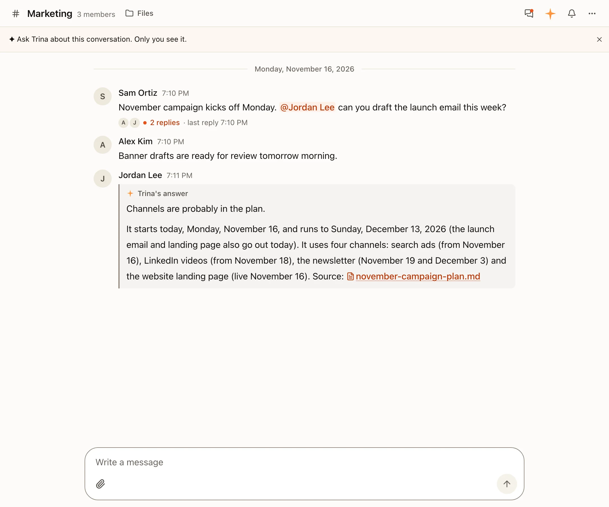

#### 스레드에서 답하기

메시지의 **스레드에서 답장**을 쓰면 그 메시지 아래에서 따로 이야기할 수 있어서 대화방이 어수선해지지 않아요. 대화방에는 스레드에
답글이 몇 개 있는지 나와요. **대화방에도 보내기**를 켜면 답글이 대화방에도 올라가요.

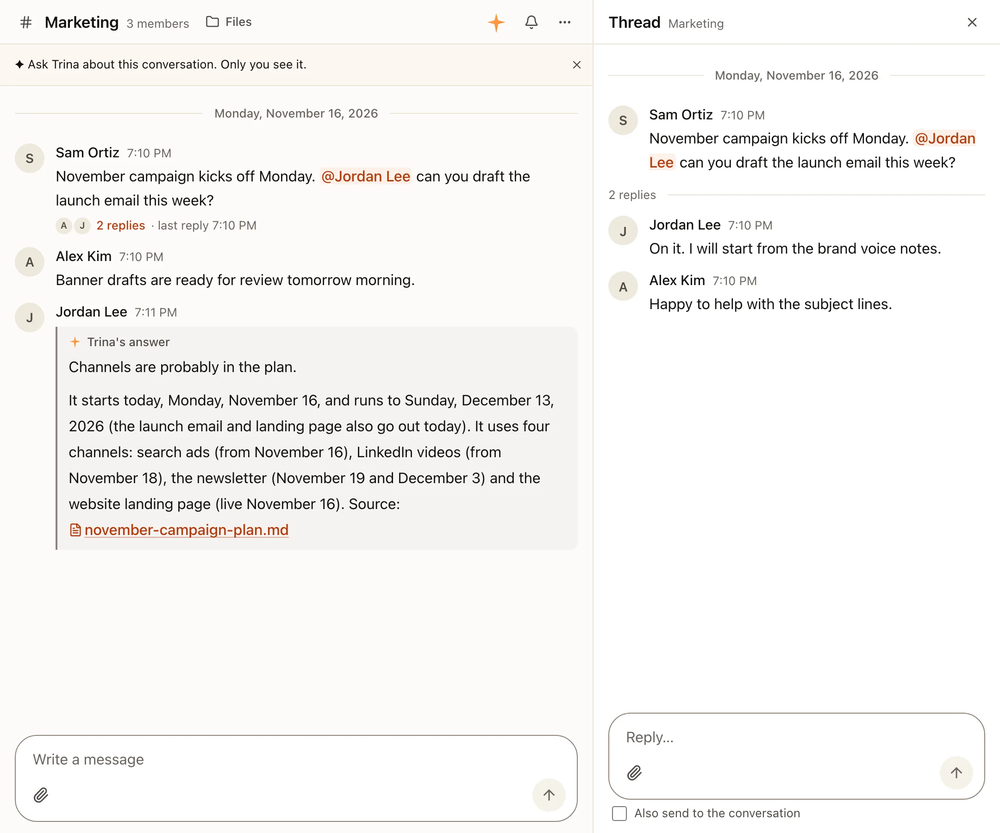

#### 메시지 링크 걸기

메시지의 **⋯** 메뉴(폰에서는 메시지를 길게 누르기)에서 **링크 복사**를 누르면 메시지 주소가 복사돼요. 채널, 그룹 대화,
다이렉트 메시지, 스레드 어디에든 붙여 넣을 수 있어요. 링크는 대화 이름으로 보이고, 그 아래에 메시지가 카드로 나와요.
누가 언제 썼는지, 내용과 파일까지 보여요. 카드를 누르면 그 메시지가 열려요.

카드는 그 메시지를 볼 수 있는 사람에게만 보여요. 나머지 사람에게는 그냥 링크로 남고, 열면
대화를 찾을 수 없다고 나와요. 대화에 있는 누군가가 그 메시지를 볼 수 없으면, 보내기 전에 입력창에서 알려 줘요.
**링크만 보이기**(기본값)는 링크만 보내요. **메시지 보이기**는 그 사람들에게 메시지 사본을 보여 주고,
내가 공유했다고 표시해요. 원래 메시지가 지워지면 사본도 사라져요. 내 메시지에 붙은 카드를 떼려면 카드에 마우스를 올리고
**✕** 버튼을 눌러요(또는 메시지 메뉴에서 **미리보기 지우기**).

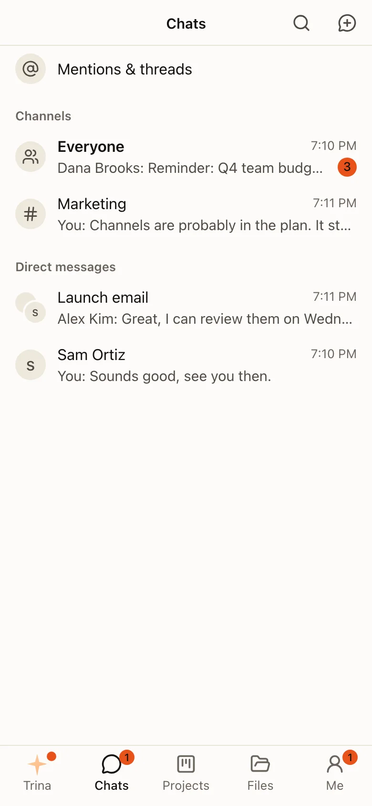

### 대화방이 나오는 곳

대화 목록은 컴퓨터와 휴대폰에서 순서가 같아요. **고정**, 내 섹션, **채널**, **프로젝트**, **다이렉트 메시지** 순이에요.

- **프로젝트**에는 팀 프로젝트마다 있는 대화방이 이름순으로, 폴더 아이콘과 함께 나와요. 누군가 처음 글을 써야 나타나고,
  그 전에는 프로젝트에서 열어요. **+** 버튼은 없어요. 프로젝트는 프로젝트 화면이나 대화방에서 만들어요
  ([대화방을 프로젝트로 만들기](#대화방을-프로젝트로-만들기) 참고).
- 대화방은 한 곳에만 나와요. 고정하거나 내 섹션으로 끌어 넣은 프로젝트 대화방은 **프로젝트**에서 빠져요. **프로젝트**
  제목으로 끌어 놓으면 다시 돌아와요.
- 프로젝트를 휴지통으로 옮기면 대화방도 목록에서 빠져요. 프로젝트를 복원하면 다시 나와요.

### 부서 대화방과 부서 폴더

부서(**관리자 › 부서**의 부서)마다 채널이 하나 있어요. 부서에 내가 열 수 있는 폴더가 있으면, 채널 위쪽에 부서 이름이 적힌
폴더 버튼이 보여요. 누르면 파일 화면에서 그 폴더가 열려요.

- **채널에 보낸 파일은 부서 폴더의 채팅 첨부 폴더에 저장돼요.** 부서 파일이 한곳에 모여요. 파일 이름 옆에 어디로
  갔는지 보여요(예: "영업 › 채팅 첨부").
- 부서 사람이 아닌 사람도 폴더를 열 수 있을 때, 채널의 누군가가 채팅 첨부 폴더를 열 수 없을 때, 내가 폴더를 보기만 할 수
  있을 때는 파일이 대화방에만 남고 **이 대화방에만 있어요**라고 표시돼요. 그러면 채널에 그 파일을 모아 보는 **파일**도
  생겨요.
- **메시지를 지우면 메시지만 지워져요.** 부서 폴더에 있는 파일은 그대로 있고, 지울 때 어디에 있는지 알려 줘요.
  파일도 없애려면 파일 화면에서 지우세요.
- 관리자는 모든 팀 폴더를 열 수 있어서, 부서 사람이 아니어도 이 파일을 파일 화면에서 열 수 있어요. 대화는 보지 못해요.
- 나중에 부서에 들어온 사람은 채팅 첨부 폴더에 있는 이전 파일을 모두 열 수 있지만, 이전 메시지는 보지 못해요. 프로젝트와
  같아요.
- 부서 폴더가 프로젝트 안에 있으면 채널에 보낸 파일은 대화방에만 남아요.
- 이 변경 전에 보낸 파일은 채널의 **파일** 목록에 그대로 있어요.

### 게스트

대행사나 고객사처럼 팀 밖의 사람도 비공개 채널, 그룹 대화나 프로젝트에 게스트로 들어올 수 있어요. 비공개 채널이나 그룹 대화 한 곳과 프로젝트 한 곳까지예요.
비공개 채널이나 그룹 대화에서는 멤버 목록(위쪽 이름)을 열고 **초대하기**, 그다음 **게스트 초대하기**를 눌러요. 프로젝트에서는
**멤버**의 **멤버 추가**를 눌러요. 링크를 누구에게 줄지, AI를 쓰게 할지 정한 뒤 **링크 만들기**를 눌러요. 링크는
한 번만 쓸 수 있어요. 받는 사람에게는 내가 직접 보내야 해요.

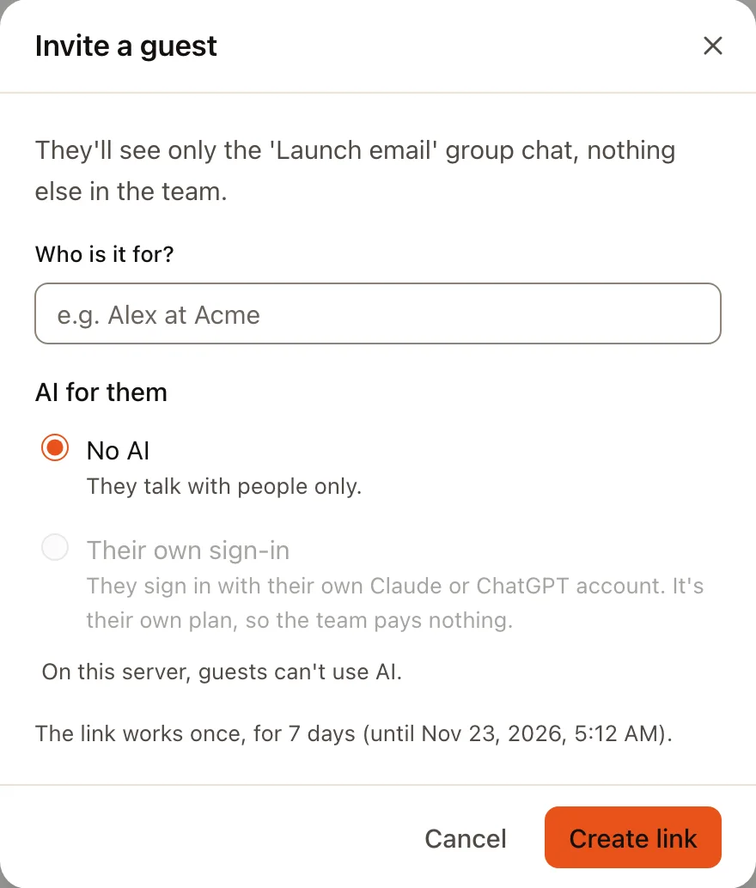

- 게스트는 그곳만 봐요. 파일 화면도, 다른 대화방이나 프로젝트도, 팀 공간도 보지 못해요.
- **본인 계정으로 로그인**을 고르거나, 관리자가 월 한도가 있는 **팀 AI** 계정을 주지 않으면 게스트는 AI를 쓰지 않아요.
- 이름 옆에 **게스트** 태그가 붙고, 위쪽에 **게스트 1명 포함**이라고 나와요.
- 관리자는 **관리자 › 멤버·초대 › 게스트**에서 모든 게스트를 봐요([관리](admin.md#게스트)).

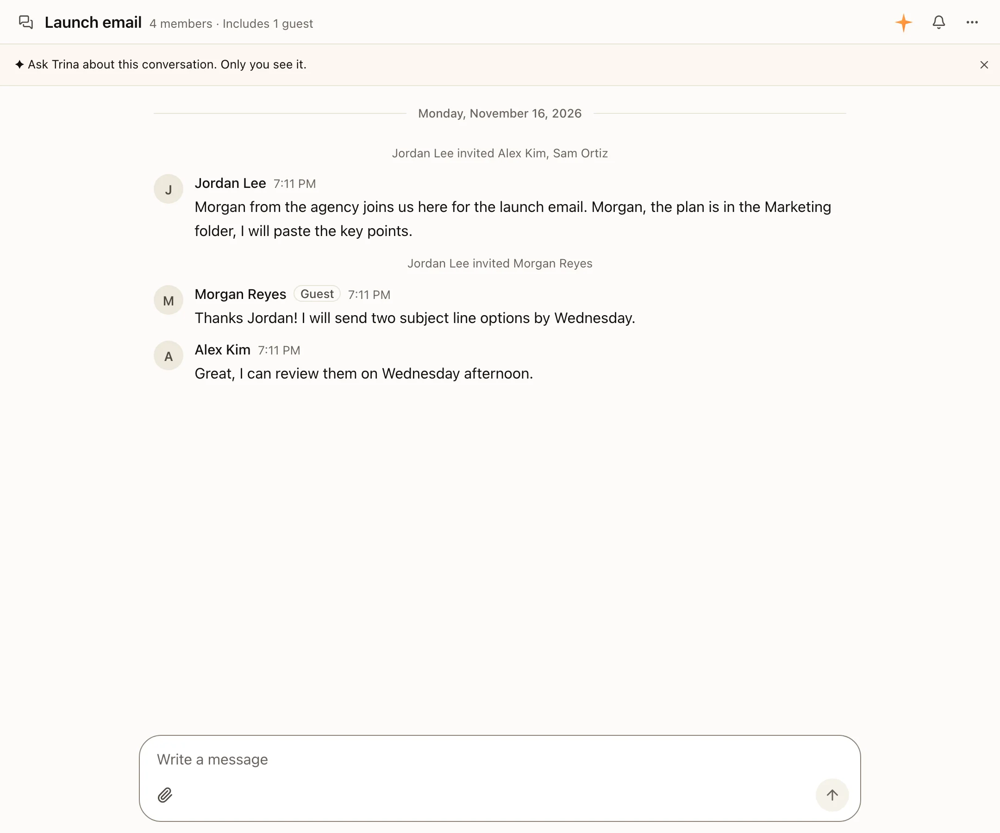

## 프로젝트

프로젝트는 한 가지 일의 채팅, 파일, 지침을 한곳에 모아 둬요. 나 혼자 쓸 수도 있고, 추가한 사람들과 같이 쓸 수도 있어요. 출시, 고객사 하나, 분기 보고서처럼 같은 파일을 두고 계속 돌아오는 일에 써요.

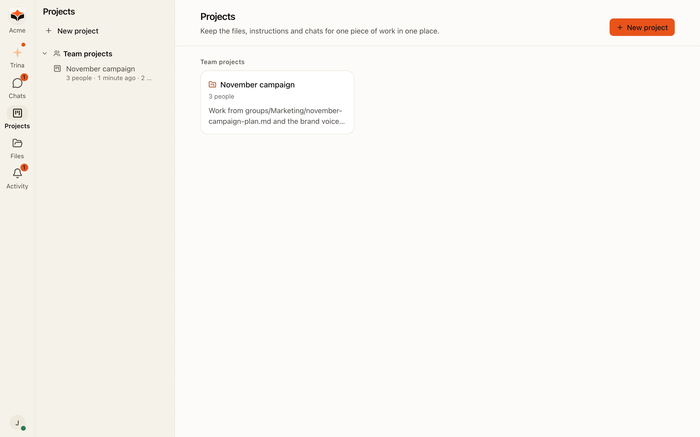

:::steps
#### 프로젝트 만들기
왼쪽 막대의 **프로젝트**(폰에서는 **프로젝트** 탭)를 열고 **새 프로젝트**를 골라요. 이름을 붙여요.
새 프로젝트는 **나만 보기**예요. 사람을 추가하기 전까지는 나만 봐요.

#### 지침 쓰기
무슨 일인지, AI가 어떻게 도와야 하는지 적어요. 첫 문단은 프로젝트 제목 아래에 보여요.

#### 프로젝트에서 채팅하기
프로젝트 페이지에서 채팅을 시작하거나, 채팅 제목 메뉴의 **프로젝트로 옮기기**로 기존 채팅을 넣어요. 그러면 AI가 프로젝트의 파일과 지침을 받아요.

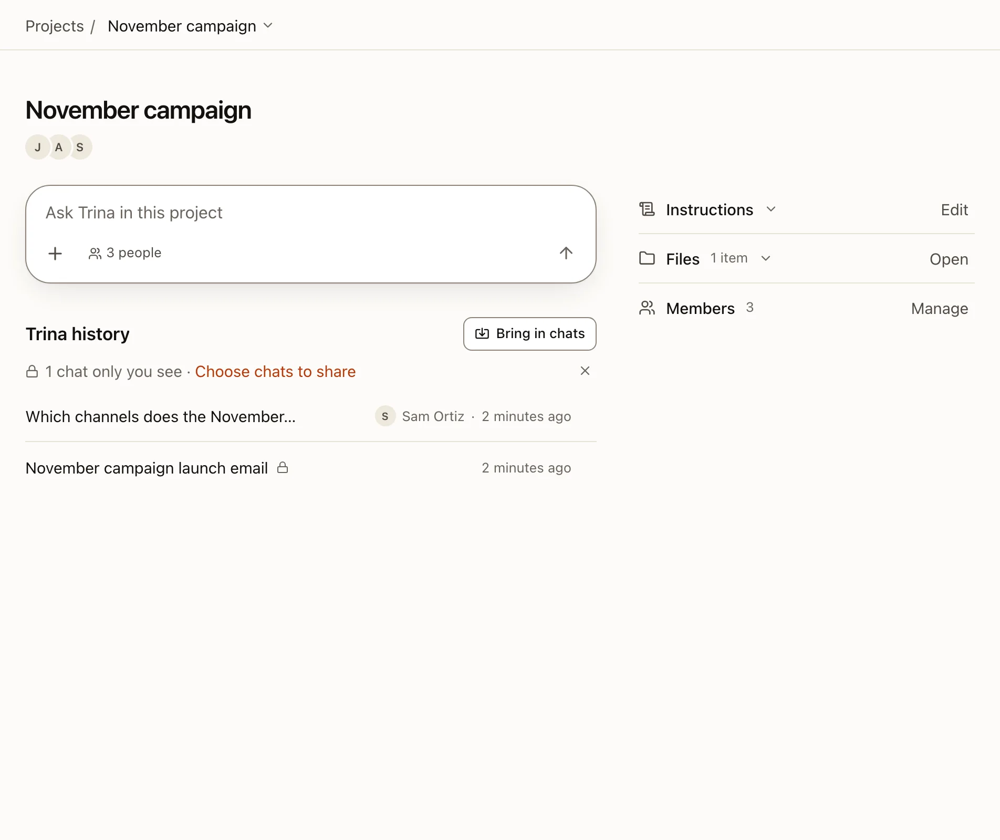
:::

- 내 프로젝트는 왼쪽 막대와 폰 **프로젝트** 탭의 **프로젝트**에 있어요. **팀 프로젝트**
  (다른 사람도 봐요)와 **내 프로젝트**(나만 봐요)로 나뉘어요. 프로젝트 이름을 누르면 프로젝트 페이지가 열려요. 프로젝트에서 연 채팅은
  그 프로젝트로 돌아가고, 프로젝트의 채팅은 트리나 목록의 **트리나 기록**에도 있어요. 팀 폴더와 휴지통은
  **파일**에 있어요.
- 프로젝트에는 멤버가 있어요. 프로젝트 페이지의 **멤버**에서 누가 있는지 보고, **멤버 추가**로 나만 보던 프로젝트를
  공유해요. 저장하기 전에 세 가지를 알려 줘요. 추가한 사람이 파일과 지침을 보고 고칠 수 있다는 것, 지금까지의 내 채팅은
  나만 본다는 것, 다시 나만 보는 프로젝트로 돌아갈 수 없다는 것이에요. 팀에 따라 팀장과 관리자만 프로젝트를
  공유할 수 있어요.
- 프로젝트에 게스트를 한 명 이상 둘 수도 있어요. 팀 밖의 사람으로, 이 프로젝트만 봐요. 프로젝트 멤버는 게스트가 거기서 나눈 채팅을 볼 수 있어요. [게스트 알아보기](guests.md).
- 프로젝트 안의 내용은 멤버만 봐요. 팀장과 관리자는 멤버를 바꿀 수 있지만, 멤버가 아니면
  채팅, 파일, 지침을 보지 못해요.
- **프로젝트 이름을 바꾸려면** 프로젝트 화면 위쪽의 이름을 클릭하고 새 이름을 입력한 뒤 Enter를 누르세요(Esc는 취소).
  **프로젝트** 목록에서 프로젝트의 **···**(또는 오른쪽 클릭)이나 화면 맨 위 이름 메뉴의 **이름 바꾸기**로도 바꿀 수 있어요.
  휴대폰에서는 위쪽 막대의 프로젝트 이름을 누르세요. 프로젝트를 만든 사람, 팀장, 관리자만 바꿀 수 있고, 다른 사람에게는
  이름이 그냥 글자로 보여요. 프로젝트 이름을 바꿔도 폴더 이름은 그대로예요.
- 폴더 하나에는 프로젝트 하나가 들어가요. 프로젝트가 된 폴더는 관리자만 옮기거나, 이름을 바꾸거나, 지울 수 있어요.
- 팀 프로젝트 메뉴의 **휴지통으로 옮기기**를 누르면 프로젝트가 파일과 함께 휴지통으로 가요. 멤버에게는 카드가 남고
  **휴지통에 있음** 표시가 붙어요. 페이지에는 누가 언제 옮겼는지, 관리자나 만든 사람이 되돌릴 수 있다는 것이 나와요.
  그때까지는 누구도 파일, 채팅, 지침을 열 수 없어요. 관리자나 만든 사람이 프로젝트 페이지나
  **파일 › 휴지통**에서 되돌려요. 휴지통에서는 프로젝트 이름으로 된 한 줄이에요. **완전히 삭제**는 관리자만 할 수 있어요.
- 내가 혼자 다 쓰지 않은 지침은 바깥에서 온 내용으로 봐요. AI는 그 지침을 읽은 뒤 무언가를 기억하기 전에 먼저 물어봐요.
- **팀 프로젝트의 채팅은 멤버와 공유돼요.** 프로젝트 입력창의 **+** 뒤에 있는 작은 칩이 지금 시작하는 채팅을
  누가 보게 되는지 알려 줘요(예: **👥 3명**). 칩을 누르면 그 채팅을 나만 보게 할 수 있어요(**🔒 나만 보기**). 다음 새
  채팅은 다시 공유 상태로 시작해요. 나만 보는 채팅에는 자물쇠가 붙어요. 질문마다 보낸 사람의 사진과 이름이 나와요.
  답변은 물어본 사람의 권한으로 만들어져요. 멤버 중 누군가가 열 수 없는 것을 AI가 읽으려 하면 먼저 나에게
  물어봐요(**읽고 공유하기** / **읽지 않기**).
- **가져오거나 옮겨 온 채팅은 나만 봐요.** 프로젝트 페이지에 몇 개인지 나오고("나만 보는 채팅 1개"),
  **공유할 채팅 고르기**(또는 채팅의 **⋯** 메뉴에서 **공유**)로 공유해요. 공유는 되돌릴 수 없어요. **기존 대화 가져오기**로 다른 채팅을
  옮겨 와요.
- **프로젝트 채팅의 파일.** 공유된 프로젝트 채팅에서 컴퓨터의 파일을 첨부하면(**+**, 붙여 넣기, 끌어다 놓기)
  프로젝트 폴더 안 **채팅 첨부** 하위 폴더(팀 언어로 이름이 붙어요)에 저장돼요. 프로젝트 사람들이 열 수 있고,
  파일 아래에 그렇게 알려 줘요. 프로젝트 폴더에 쓰기 권한이 있어야 해요(없으면 **+** 버튼에서 팀 파일만
  고를 수 있어요). 보내기 전에 **✕** 버튼을 누르면 파일이 휴지통으로 가요.

### 프로젝트 채팅을 나만 보기

팀 프로젝트에서 새로 시작한 채팅은 프로젝트의 모든 사람과 공유돼요. 공유된 Google Drive 폴더에서 만든 문서와 같아요.
나만 봐야 하는 걸 물어보려면:

1. 프로젝트 페이지를 열어요.
2. 입력창에서 **+** 바로 뒤를 봐요. 칩이 이 채팅을 누가 보게 되는지 알려 줘요(예: **👥 3명**).
3. 칩을 눌러요. **🔒 나만 보기**로 바뀌어요.
4. 질문을 입력하고 보내요.

이 채팅은 프로젝트 목록과 내 트리나 기록에서 자물쇠가 붙고, 나만 봐요. 프로젝트의 다음 새 채팅은 다시 공유 상태로
시작하니 매번 칩을 확인하세요. 나중에 공유하려면 채팅의 **⋯** 메뉴에서 **공유**를 골라요(채팅 오른쪽 위의 **공유**도 돼요).
공유하면 지금까지의 대화도 프로젝트 멤버에게 모두 보이고, 공유는 되돌릴 수 없어요.

### 프로젝트 대화방

팀 프로젝트마다 대화방이 하나 있어요. 프로젝트 사람들이 곧 대화방 사람들이고, 대화방의 파일은 프로젝트 파일이에요.
사람 목록도 하나, 파일 둘 곳도 하나예요.

- 프로젝트 페이지의 **대화방**(휴대폰에서는 프로젝트 이름 아래 줄)을 누르면 대화방이 열려요. 처음 열 때 프로젝트 이름으로
  대화방이 만들어져요. **프로젝트** 목록의 프로젝트 줄에 있는 작은 대화 아이콘(읽지 않은 메시지가 있으면 점이 붙어요)과
  프로젝트 AI 채팅 위쪽의 **대화방**으로도 열 수 있어요.
- 대화방 위쪽의 프로젝트 이름이 적힌 폴더 버튼을 누르면 프로젝트 페이지(파일과 AI 채팅)가 열려요. 누군가 처음 글을 쓰면
  대화방이 대화 목록의 **프로젝트**에 폴더 아이콘과 함께 나타나요.
- **누가 들어 있는지는 프로젝트를 따라가요.** 프로젝트에 사람을 더하면 대화방에도 들어오고, 지난 대화도 모두 봐요.
  프로젝트에서 빼면 대화방에서도 빠져요. 사람을 더하기 전에 멤버 창에서 이 점을 알려 줘요. 사람을 바꾸려면 위쪽
  대화방 이름을 누르고 **사람 관리**를 고르세요(프로젝트 사람을 바꿀 수 있는 사람에게만 보여요). **알림 끄기**로 조용히
  둘 수 있고, **프로젝트 나가기**는 프로젝트와 대화방에서 함께 나가요.
- **대화방에 보낸 파일은 프로젝트의 채팅 첨부 폴더에 저장돼요.** 프로젝트 사람들은 파일 화면에서 찾을 수 있어요.
  프로젝트를 보기만 할 수 있는 사람은 메시지는 쓸 수 있지만 파일은 올릴 수 없어요.
- **메시지를 지우면 메시지만 지워져요.** 파일은 프로젝트의 채팅 첨부 폴더에 그대로 있어요. 파일도 없애려면 파일 화면에서
  지우세요.
- 대화방 옆 트리나 대화에서 저장한 새 문서는 프로젝트 폴더에 저장되고, 프로젝트의 AI 채팅은 대화방을 읽을 수 있어요.
  둘 다 같은 사람들이 보니 누가 볼 수 있는지 따로 묻지 않아요.
- 대화방의 **✦** 옆 채팅은 나만 봐요. 비어 있을 때는 그렇다고 알려 주고, 프로젝트 사람들이 함께 트리나에게 묻는 프로젝트
  페이지로 가는 링크를 보여 줘요.
- 프로젝트 사람들이 한 부서 사람들과 똑같으면, 대화방 처음과 대화방 정보에 "#영업과 같은 사람들이에요. Atlas 이야기는
  여기서 해요."라고 나오고, 부서 채널로 가는 링크가 붙어요.

### 대화방을 프로젝트로 만들기

일이 커진 비공개 채널이나 그룹 대화는 지난 대화를 그대로 둔 채 프로젝트로 만들 수 있어요.

1. 대화방의 **⋯**(위쪽, 목록의 줄, 휴대폰에서는 줄을 길게 누르기)에서 **프로젝트로 만들기**를 고르세요. 팀 프로젝트를 만들
   수 있는 사람에게만 보여요. 관리자만 프로젝트를 만드는 팀에서는 팀원에게 보이지 않아요.
2. 이름을 확인하세요. 처음에는 대화방 이름이 들어 있어요(이름 없는 그룹 대화는 사람들 이름). 같은 이름의 프로젝트가 이미
   있으면 새 폴더 이름에 "-2"가 붙고, 창에서 알려 줘요.
3. 무엇이 바뀌는지 읽고 **프로젝트 만들기**를 누르세요.
   - 대화방의 모든 사람이 프로젝트 사람이 돼요.
   - 대화방에서 보낸 파일은 프로젝트의 **채팅 첨부** 폴더로 옮겨져요. 대화방의 모두가 볼 수 없던 파일(예: 누가 들어오기
     전에 보낸 파일)은 대화방에 남고, 몇 개가 남는지 창에서 알려 줘요.
   - 나중에 프로젝트에 들어온 사람은 그때부터의 메시지를 보고, 옮겨진 파일도 열 수 있어요.

대화방은 그대로 열려 있고 이제 프로젝트 대화방이에요. 위쪽에 프로젝트 폴더 버튼이 생기고, 누가 프로젝트로 만들었는지
한 줄이 남아요. 파일을 옮기는 동안 위쪽에 **파일 옮기는 중…** 표시가 보이고, 끝나면 몇 개를 옮기고 몇 개가 남았는지 한 줄이 더
남아요. 남은 파일에는 **이 대화방에만 있어요**가 붙고, 대화방에 그 파일을 모아 보는 **파일** 목록이 남아요.

고정, 섹션, 알림, 읽은 위치는 그대로예요. 창을 연 사이에 누가 들어오거나 나가면 **사람이 바뀌었어요**라고 알려 주고 새 인원을
보여 줘요. 이미 다른 프로젝트가 있는 게스트가 있으면 만들 수 없어요. 관리자가 먼저 그 사람을 팀원으로 바꿔야 해요.

1:1 대화의 **⋯** 메뉴에는 대신 **(이름)님과 새 프로젝트**가 있어요. 두 사람의 새 프로젝트와 그 대화방을 만들고, 1:1 대화는 그대로
둬요.

## 무엇이든 찾기

⌘K(Windows는 Ctrl+K)를 누르거나 **트리나에게 묻기** 아래 **검색**을 고르면 채팅, 대화 메시지, 프로젝트, 파일, 스킬, 예약 작업, MCP 연결을 찾을 수 있어요. [검색과 설정 알아보기](settings-and-search.md).

**내가 보낸 파일.** 검색에 "내가 보낸 파일"을 입력하거나 알림에서 열면, 내 대화에 보낸 파일이 큰 것부터 차지하는 공간과 함께 보여요. 파일을 지우면 그 파일과 함께 보낸 메시지도 대화의 모든 사람에게서 지워져요.

## 지운 채팅

채팅을 지우면 **삭제한 기록**으로 가요. iPhone의 '최근 삭제된 항목' 앨범처럼, 기본 7일 동안 되돌릴 수 있어요.
관리자가 1~365일 사이로 정할 수 있어요.

채팅을 되돌리려면:

1. 왼쪽 막대에서 **트리나**를 열어요. 폰에서는 **트리나** 탭을 열고 위쪽 **☰** 를 눌러요.
2. **트리나 기록** 제목 끝의 **⋯** 를 누르고 **삭제한 기록**을 골라요. 폰에서는 **삭제한 기록**이 메뉴 맨 아래에 있어요.
3. 채팅을 찾아(줄마다 언제 지웠는지 나와요) **되돌리기**를 눌러요.

그 줄이 목록에서 사라지고, 채팅이 내 트리나 기록으로 돌아와요.

- 공유 채팅은 만든 사람의 **삭제한 기록**으로 가요. 프로젝트를 만든 사람이나 관리자가 다른 사람의 공유 채팅을 지우면, 되돌릴 수 있는 동안에는 지운 사람의 **삭제한 기록**에도 있어요.
- 프로젝트를 완전히 삭제하면 그 프로젝트의 공유 채팅은 각자 만든 사람의 **삭제한 기록**으로 가요. 되돌리면 그 채팅은 프로젝트 없이 만든 사람만 보는 채팅이 돼요.
