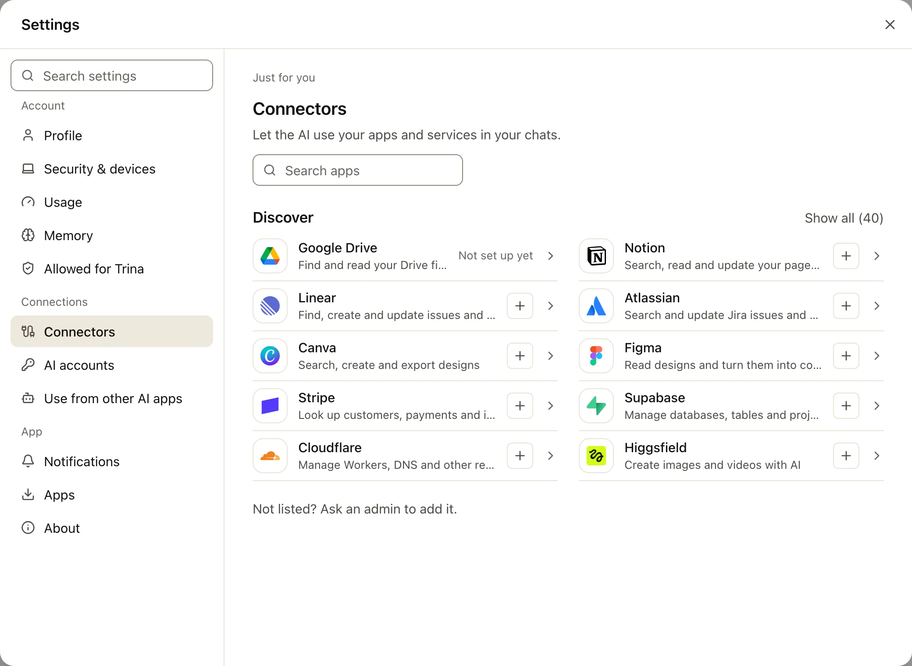
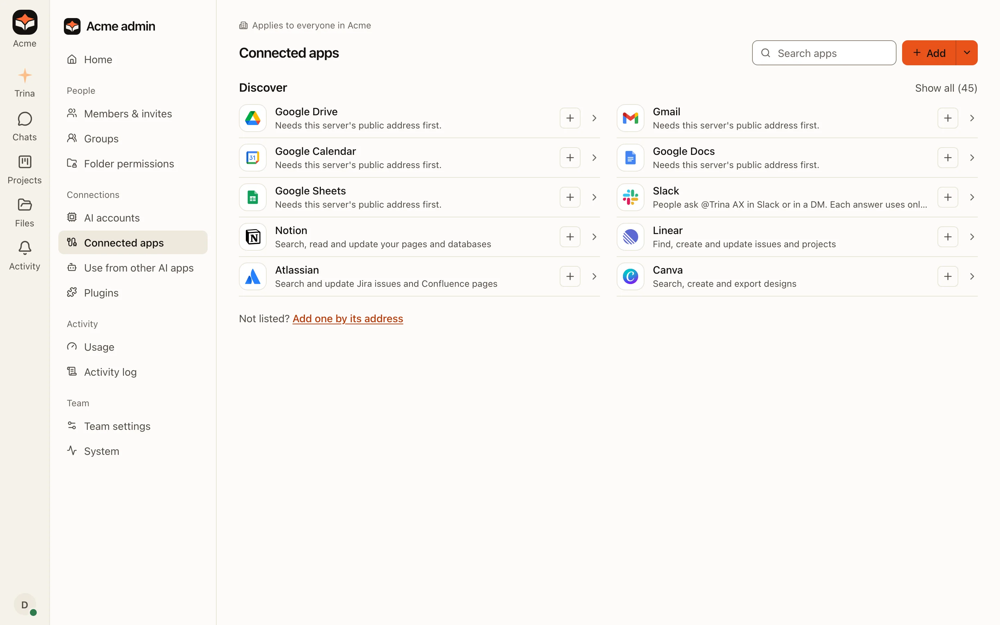

Trina AX에는 두 가지를 연결해요.

- **AI 계정**: 질문에 답하는 AI예요. Claude나 ChatGPT 계정, 또는 Anthropic, OpenAI 같은 AI 회사의 API 키를 써요.
  Trina AX에는 AI가 들어 있지 않아요. 팀이 직접 계정을 연결하고, 요금은 그 AI 회사가 연결한 계정으로 청구해요.
- **앱**: AI가 나 대신 쓰는 서비스예요. Google Drive, Gmail 같은 Google 앱, Slack, Notion, Linear, GitHub, 회사가
  직접 운영하는 시스템이 여기에 들어가요.

이 페이지에서는 어떤 안내를 보면 되는지 알려 드려요. 각 안내 맨 위에 필요한 값과 그 값을 받는 곳이 정리돼 있어요.

:::note
안내에 나오는 화면은 가상의 회사 "Acme"와 가짜 키로 찍었어요. 실제 키는 페이지에도 사진에도 나오지 않아요.
:::

## 어디로 가면 되나요

| 하고 싶은 일 | 하는 사람 | Trina AX의 위치 | 안내 |
|---|---|---|---|
| AI가 답할 수 있게 하기 | 팀장이나 관리자 | **관리자 › AI 제공사** | [AI 제공사](ai-accounts.md) |
| 내 질문에 내 Claude나 ChatGPT 계정 쓰기 | 나 (팀이 허용한 경우) | **설정 › AI 제공사** | [AI 제공사](ai-accounts.md#내-계정) |
| AI가 내 Google Drive, Gmail, Calendar, Docs, Sheets를 읽게 하기 | 나 | **설정 › 커넥터** | [Google 앱](google-apps.md) |
| Google 로그인 화면에 회사 이름 보이기 | Google Workspace를 쓰는 회사의 관리자 | **관리자 › 연결한 서비스** › Google 앱 하나 | [회사의 Google 앱 쓰기](google-own-app.md) |
| Slack에서 Trina AX에게 묻기 | 관리자가 한 번, 그다음 각자 한 번 | **관리자 › 연결한 서비스 › Slack** | [Slack](slack.md) |
| AI가 Notion, Linear, Atlassian, Figma, GitHub 같은 앱을 쓰게 하기 | 나는 나를 위해, 관리자는 팀을 위해 | **설정 › 커넥터** 또는 **관리자 › 연결한 서비스** | [Notion, Linear와 다른 앱](mcp.md) |
| AI가 회사 시스템(API)이나 NAVER WORKS처럼 내 로그인 앱이 필요한 서비스를 쓰게 하기 | 관리자 | **관리자 › 연결한 서비스** › **주소로 직접 추가** | [회사 API](api-connections.md) |
| Claude나 ChatGPT에서 Trina AX 파일 쓰기 | 나 | **설정 › Trina AX MCP** | [Trina AX MCP 커넥터](../../agents/mcp-connector.md) (영어) |

### 설정과 관리자는 어디에 있나요

- **설정**(내 연결): 왼쪽 막대 맨 아래의 내 사진을 누르고 **설정**을 골라요. 폰에서는 **나** 탭을 열어요. 설정은 페이지
  위에 열리고, 목록의 **연결** 아래에 **커넥터**와 **AI 제공사**가 있어요.
- **관리자**(팀의 연결, 팀장과 관리자용): 왼쪽 막대 맨 위의 팀 로고를 누르고 **관리자**를 골라요. [관리자](admin.md)를
  참고해요.

## 필요한 값과 받는 곳

이 값이 전부 필요한 건 아니에요. 연결할 앱을 찾으면 그 줄에 준비할 것이 적혀 있어요.

| 연결할 것 | Trina AX에 넣는 값 | 받는 곳 |
|---|---|---|
| Claude API 키 | **API 키** (`sk-`로 시작하는 긴 코드) | [Claude Console › API keys](https://platform.claude.com/settings/keys) › **Create Key** |
| Claude 구독 | 승인한 뒤 **Claude가 보여 주는 코드** (가운데에 `#`가 있어요) | claude.ai, **Claude 열어서 승인하기**를 누르면 열리는 창 |
| OpenAI API 키 | **API 키** (`sk-`로 시작) | [OpenAI platform › API keys](https://platform.openai.com/api-keys) › **Create new secret key** |
| ChatGPT 플랜 | 없어요. 코드는 **OpenAI 쪽에** 넣어요 | Trina AX가 주소와 코드를 보여 줘요 |
| API 엔진 (OpenRouter, Gemini 등) | **API 주소**, **모델**, **API 키** | 그 AI 회사의 API 페이지 ([API 엔진](ai-accounts.md#api-엔진) 참고) |
| Google Drive, Gmail, Calendar, Docs, Sheets | 없어요. Google에서 로그인해요 | 내 Google 계정 |
| 회사의 Google 앱 | Google Cloud에서 받은 **JSON 파일** (또는 **클라이언트 ID**와 **클라이언트 보안 비밀번호**) | Google Cloud › Google Auth Platform › **Clients** |
| Slack (Trina가 운영하는 팀) | 없어요. **Slack에 추가**만 누르면 돼요 | Slack 워크스페이스 관리자가 허용해요 |
| Slack (우리 팀의 Slack 앱) | **Bot User OAuth Token** (`xoxb-`), **App-Level Token** (`xapp-`), **Client ID**, **Client Secret** | api.slack.com › 내 앱 |
| Notion, Linear, Atlassian, Figma, Canva와 둘러보기에 있는 다른 앱 | 없어요. 그 앱 페이지에서 로그인해요 | 그 앱의 내 계정 |
| GitHub | 없음: GitHub에서 로그인해요 | 내 GitHub 계정 |
| Asana, HubSpot, Box | 관리자가 한 번: 팀이 그 서비스에서 만든 앱의 **클라이언트 ID**와 **클라이언트 시크릿** (창에 서비스별 안내 링크가 있어요). 그다음엔 없음: 각자 서비스에서 로그인해요 | Asana: My apps › **MCP app**. HubSpot: Development › **MCP Connectors**. Box: Admin Console › Integrations › **Box MCP server** |
| 키를 주는 다른 앱 | **주소**와 **키** (가끔 **헤더 이름**도) | 그 앱의 도움말 ("MCP server", "API keys") |
| 회사 API | **주소**, **키**, **사용법 메모** | 그 시스템을 맡은 사람 |
| NAVER WORKS처럼 내 앱으로 로그인하는 서비스 | **Client ID**, **Client Secret**, **로그인 주소**, **토큰 주소**, **권한 범위(scope)** | 그 서비스의 개발자 콘솔 |

## 나만 쓰기, 팀이 같이 쓰기

| | 나만 | 팀 |
|---|---|---|
| 만드는 곳 | **설정 › 커넥터** 또는 **설정 › AI 제공사** | **관리자 › 연결한 서비스** 또는 **관리자 › AI 제공사** |
| 쓰는 사람 | 나만, 내 채팅에서 | 관리자가 고른 사람: 팀 전체, 부서, 사람 |
| 키를 볼 수 있는 사람 | 아무도 없어요. 관리자도 못 봐요 | 아무도 없어요. 관리자는 키가 저장됐다는 것만 보고 키 자체는 못 봐요 |

키와 로그인 정보는 서버에 암호화해서 저장하고, 다시 보여 주지 않아요. 키를 바꾸려면 새 키를 넣어요.

## 자주 하는 실수

| 생긴 일 | 이유 | 해결 방법 |
|---|---|---|
| "키를 넣어 주세요." 또는 "이 종류의 API 키가 아니에요." | 키를 복사할 때 공백이나 줄바꿈이 들어갔거나 끝이 잘렸어요 | 글자를 드래그하지 말고, 그 서비스의 복사 버튼으로 다시 복사해요 |
| Google에서 `redirect_uri_mismatch`가 뜨거나, 로그인할 때 주소가 틀렸다고 나와요 | 서비스 콘솔에 넣은 돌아올 주소가 Trina AX에 보이는 주소와 글자 하나, `http`, 슬래시 하나만큼 달라요 | Trina AX 창의 복사 버튼으로 주소를 복사해 콘솔에 다시 붙여 넣어요 |
| "일부 권한에 체크하지 않았어요." | Google 화면에서 체크를 하나 풀었어요 | 다시 연결하고 모든 항목에 체크한 채로 둬요 |
| 연결에 "로그인 필요"가 떠요 | 키가 취소됐거나 만료됐거나, 로그인 기간이 끝났어요 | 연결을 열고 **다시 로그인**을 누르거나 키를 바꿔요 |
| 멤버에게 "목록에 없나요? 관리자에게 추가해 달라고 해 주세요."가 보여요 | 주소로 앱을 추가하는 건 팀장과 관리자만 할 수 있어요 | 관리자가 팀용으로 추가하거나, 멤버가 각자 연결하는 템플릿으로 추가해요 |
| 연결한 앱을 AI가 "못 쓴다"고 해요 | 다른 사람의 연결이거나, 팀 연결을 쓸 사람에 내가 들어 있지 않아요 | **설정 › 커넥터**에서 그 앱이 **내 커넥터**에 있는지 확인해요 |
