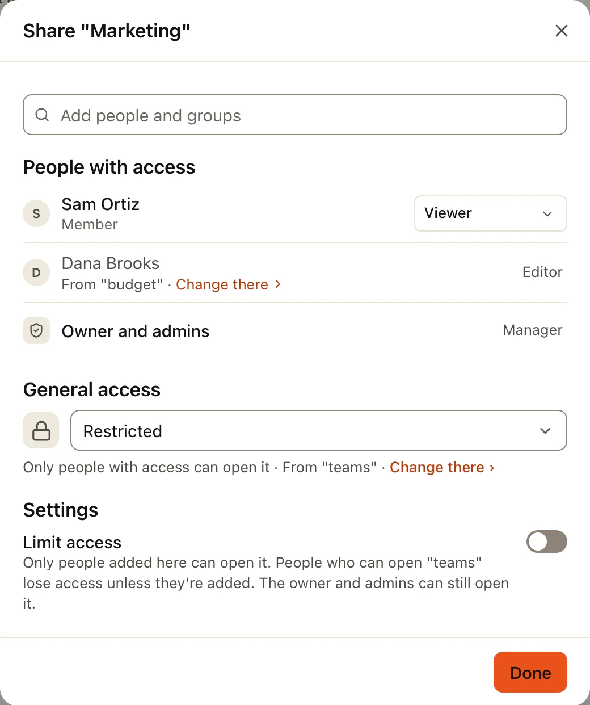
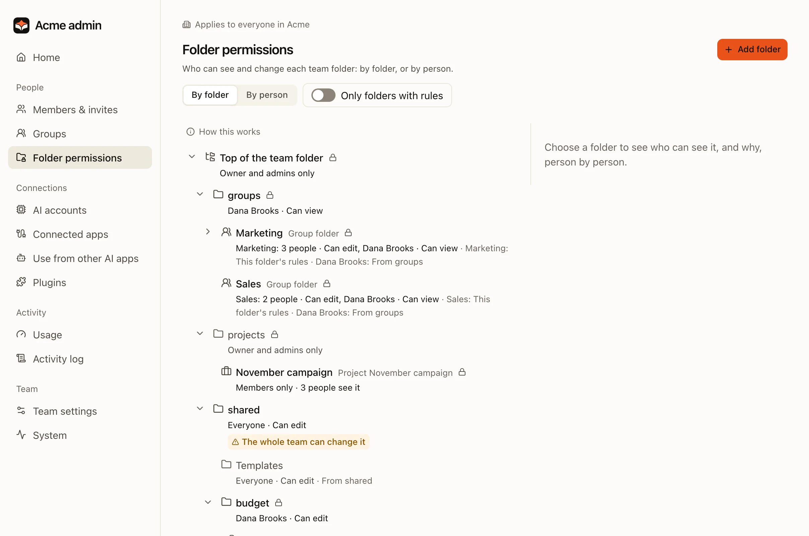
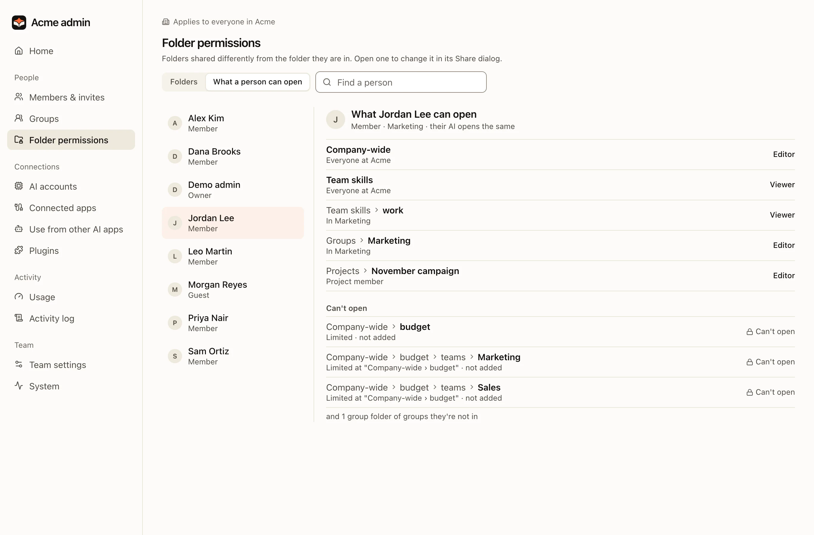
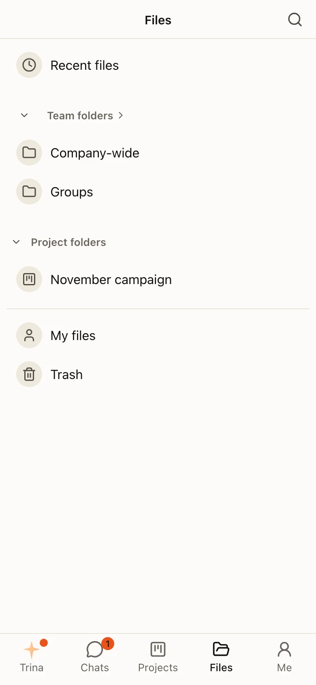

회사 자료는 서버의 팀 폴더 하나에 있어요. 누가 무엇을 보는지는 폴더 규칙이 정해요. AI는 물어본 사람보다 더 많이 보지 못해요.

## 팀 폴더

| 폴더 | 볼 수 있는 사람 | 쓰임 |
|---|---|---|
| `shared/` | 규칙대로예요. 보통은 모두 | 회사 전체 문서 |
| `groups/<group>/` | 그 부서, 그리고 규칙으로 더한 사람 | 영업, 재무 같은 부서 문서. 그 안 `skills/`에는 부서 스킬 |
| `projects/<project>/` | 규칙대로예요 | 폴더와 지침이 따로 있는 일 |
| `skills/` | 모두 읽어요. 팀 스킬 담당자가 써요 | 팀 스킬과 팀 규칙 |
| `users/<id>/` | 그 사람만 | 개인 파일과 개인 스킬 |

## 접근을 정하는 방식

서버의 권한 함수 하나가 모든 접근을 정해요. AI가 그 함수를 피해 가지 못하게 OS가 막아요.

- 열 수 없는 파일은 "거부됨"으로 나오는 게 아니라 아예 **보이지 않아요**. 파일 화면, AI 답변, 검색, 미리보기, 버전 기록, 휴지통, 실시간 업데이트가 모두 같은 규칙을 따라요.
- 한 사람의 접근 권한은 파일 위쪽에서 그 사람을 지정한 **가장 가까운 규칙**으로 정해져요. 사람 규칙이 부서 규칙보다 먼저예요. 부서가 여러 개면 가장 넓은 권한이 적용돼요.
- 바꾼 내용은 **바로** 적용돼요. AI는 도구를 부를 때마다 권한을 다시 읽어요.
- 접근 권한을 없애도, 이미 그 파일을 인용한 예전 답변은 지워지지 않아요.

## 폴더 공유하기

팀장과 관리자는 Google Drive처럼 폴더를 공유해요. **파일 › 폴더의 ⋯ › 공유**나 **관리자 › 폴더 권한 › 공유**에서 해요. 어느 쪽이든 같은 창이 열려요.

:::steps
#### 사람과 부서 추가하기
이름을 입력해요. 사람이나 부서마다 **뷰어**나 **편집자**를 줘요. 같은 메뉴에 **액세스 권한 삭제**도 있어요.

#### 일반 액세스 확인하기
**제한됨**이면 목록에 있는 사람만 열어요. 아니면 팀 전체에 **뷰어**나 **편집자**를 줘요. 따로 설정이 없는 폴더는 위 폴더에서 받은 설정을 보여 주고, **거기서 바꾸기**가 있어요.

#### 저장하기 전에 확인하기
창에 누가 접근 권한을 얻거나 잃는지 나와요. 저장하기 전에는 아무것도 바뀌지 않아요. 권한을 더 줄 때는 먼저 물어보고, 위 폴더가 들여보내는 사람을 막는 제한을 걸 때도 물어봐요.
:::

Google Drive처럼 권한은 더해져요. 폴더가 주는 권한은 위 폴더들이 주는 권한 위에 얹혀요. 그보다 낮은 역할은 고를 수 없고, 줄에 더 높은 역할을 어디서 받았는지 나와요("'전사 공유'에서 편집자").

위 폴더보다 적은 권한을 주려면 **설정 › 액세스 제한**을 켜요. 그러면 거기 추가한 사람과 부서만 열 수 있어요. **액세스 권한이 삭제됨**에는 위 폴더는 열 수 있지만 이 폴더는 못 여는 사람이 나와요. **추가**를 누르면 그 사람을 뷰어로 다시 넣어요. 제한을 다시 끄면, 위 폴더보다 낮은 역할은 위 폴더 수준으로 올라가요.

팀장과 관리자는 자기가 멤버가 아닌 프로젝트를 빼고는 팀 폴더를 언제나 열 수 있어요. 이들은 **관리 권한** 한 줄로 보여요.

:::note
권한이 더해지게 바뀐 업데이트 뒤에, 일부 폴더에는 사람이 이름으로 들어가 있고(**폴더 방식이 바뀔 때 추가됨** 표시), 폴더 권한에 그 사람들을 알려 주는 안내가 한 번 나와요. 이름으로 들어간 사람은 나중에 부서를 떠나도 접근 권한이 남아요. **관리자 › 부서**와 그 사람의 페이지에서 저장하기 전에 그렇다고 알려 주고, **지금 제외**를 누를 수 있어요.
:::

**관리자 › 폴더 권한 › 폴더**에는 상위 폴더와 다르게 공유된 폴더만, 파일 화면과 같은 이름으로 나와요. 사람을 막아 둔 폴더에는 **액세스 제한됨**이 붙어요. **공유**를 누르면 그 폴더의 공유 창이 열려요. 프로젝트 폴더는 한 줄로 나오고, 멤버는 프로젝트에서 바꿔요.

**사람이 열 수 있는 것**은 한 사람(그리고 그 사람의 AI)이 열 수 있는 폴더마다 뷰어인지 편집자인지와 그 이유, 그리고 열 수 없는 폴더를 보여 줘요.

:::warning
`skills/`에는 팀원 모두의 AI가 따르는 지시가 들어 있어요. 거기에 쓸 수 있으면 팀 스킬 담당자가 돼요. AI가 `skills/`에 저장하기 전에 서버가 사람에게 확인을 받아요. 부서의 `groups/<group>/skills/`도 마찬가지예요. 그 부서 사람 모두의 AI가 따르고, 부서 폴더에 쓸 수 있는 사람은 누구나 바꿀 수 있어요.
:::

## 파일 다루기

- **올리기**: 파일 화면에서 파일이나 폴더를 통째로 올려요.
- **버전 기록**: 바뀔 때마다 버전이 남아서 열어 보거나 되돌릴 수 있어요.
- **휴지통**: **파일 › 휴지통**에는 내가 되돌릴 수 있는 것이 이름과 원래 있던 곳으로 나와요("price-sheet.xlsx · 전사 공유 › Sales"). 여러 번 지운 파일은 사본을 모은 한 줄로 나와요. **되돌리기**는 가장 최근 것을 되돌리고, 줄을 열면 다른 사본도 되돌릴 수 있어요. 목록에 다른 사람이 지운 것이 있으면 **내가 지운 것**으로 내 것만 볼 수 있어요. 팀의 보관 기간(관리자 › 팀 설정, 기본 30일)이 지나면 완전히 지워지고, 줄마다 언제인지 나와요.
- **형식**: AI는 PDF, Office, HWP/HWPX 파일의 글을 읽고, 사진과 스캔한 페이지는 이미지로 봐요(관리자가 끌 수 있어요). Linux 서버에서는 OCR을 돌리지 않아요.
- **확인**: AI가 제한된 내용을 더 많은 사람이 볼 수 있는 곳에 쓰려고 하면 서버가 먼저 물어봐요.

## HTML을 PDF로

AI가 쓴 견적서나 보고서 같은 HTML 파일을 페이지 모양 그대로 PDF로 만들어요. 색과 배경, 병합한 표 칸, 페이지 자체의 `@page` 규칙에 있는 용지 크기와 여백(없으면 A4), 페이지 나눔까지요.

- **미리보기에서**: `.html` 파일을 열고 미리보기 위쪽의 **PDF로 저장**을 눌러요. PDF는 페이지 옆에 같은 이름으로 저장되고, 알림에 링크가 나와요. 같은 페이지로 PDF를 또 만들면 첫 PDF를 덮어쓰지 않고 `name (2).pdf`로 저장해요. 읽기만 할 수 있는 폴더에서는 PDF를 내려받아요. 폰에서는 **⋯** 메뉴에 있어요.
- **AI에게 부탁하기**: "quote.html을 PDF로 만들어 줘"처럼요. AI가 페이지를 그대로 인쇄해요. Markdown으로 다시 쓰지 않아요.
- **PDF에 쓰이는 것**: 페이지와, 팀 폴더 안에서 상대 경로로 가리킨 그 페이지의 사진, 스타일시트, 글꼴이에요. 웹 주소는 절대 불러오지 않아요. 웹에 있는 사진은 미리보기처럼 회색 상자로 보여요. 사진은 팀 폴더에 저장하고 경로로 가리키면 돼요. 페이지의 스크립트는 실행되지 않아서, 스크립트가 그리는 부분은 빠져요. 그 부분은 일반 HTML로 쓰면 돼요.
- **한도**: 200페이지, 50 MB까지이고, 페이지당 1분쯤 걸려요. 서버 한 대에서는 PDF를 몇 개씩만 만들고, 나머지는 기다려요.
- **쓸 수 있는 곳**: 서버는 네트워크가 없는 변환 샌드박스 안에서 헤드리스 Chromium으로 인쇄해요. Linux 서버는 Debian의 `chromium` 패키지가 설치돼 있으면 쓸 수 있어요(개발 환경이 설치하고, 개발 환경으로 만든 호스팅 서버 이미지에도 있어요). Linux 서버에서는 인쇄마다 다른 변환과 따로 메모리 한도를 두고, 서버에 메모리가 3 GB 이상 있어야 해요(동시에 두 건은 6 GB부터). 브라우저가 없거나 메모리가 부족한 서버에서는 이 기능이 보이지 않고, AI도 HTML을 인쇄할 수 없다고 말해요. 관리자는 `MYCEL_HTML_PDF_BROWSER`로 브라우저를 지정할 수 있어요([환경 변수](../../reference/environment.md) (영어)).

자세한 내용: [보안과 권한](../../../security-and-permissions.md) (영어), [권한 모델](../../../PERMISSIONS.md).
