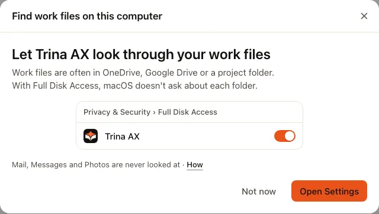

업무 파일은 컴퓨터 여기저기에 흩어져 있어요. OneDrive에도, 다운로드 폴더에도, 프로젝트 폴더에도요. **Windows**용 데스크톱 앱과 **웹사이트에서 받은 Mac 앱**은 최근에 작업한 파일을 찾아서, 그중 업무 파일 같은 것을 추천해 줘요. 양식, 보고서, 제안서, 브랜드 자료 같은 것들이요. 무엇을 넣을지는 **내가 골라요**. 내가 고르지 않으면 아무것도 넣거나 공유하거나 옮기지 않고, 컴퓨터에 있는 파일도 그대로예요.

이런 곳을 살펴봐요.

- **문서**, **데스크탑**, **다운로드**.
- 이 컴퓨터에 있는 **클라우드 드라이브 폴더**: OneDrive(SharePoint 포함), Google Drive, Dropbox, Box.
- 홈 폴더 안의 **업무 폴더**: 회사나 고객사 이름이 붙은 폴더, 또는 *업무*, *프로젝트*, *고객사* 같은 업무
  단어가 들어간 폴더.
- **메신저로 받은 파일**: 카카오톡, 텔레그램, WhatsApp, Teams 같은 앱이 받은 파일을 저장하는 폴더.
- 홈 폴더 어디에든 있는 **최근에 연 파일**. Windows에서는 다른 드라이브와 네트워크 드라이브도 살펴봐요.

보여 주는 건 **최근** 파일(대략 지난 6개월 안에 열었거나 바꾼 파일) 중 회사 파일처럼 보이거나
팀의 AI가 고른 파일이에요. 최대 50개예요. 앱이 본 다른 파일은 검색으로 찾을 수 있어요.

내 컴퓨터에 그대로 남는 것:

- 앱은 파일의 **이름, 종류, 크기, 날짜**만 읽어요. 파일을 옮기거나, 이름을 바꾸거나, 고치지 않아요.
- **클라우드에만 있는** 파일(예: OneDrive의 "온라인 전용")은 앱이 살펴보는 동안 내려받지 않아요. 목록에
  **클라우드에 있음**이라고 나오고, 넣기로 하면 그때 내려받아요.
- **메일, 메시지, 사진, Safari 같은 다른 앱의 데이터는 절대 보지 않아요.** 앱이 읽는 앱 데이터는 macOS, Windows,
  Office가 기록해 두는 최근 문서 목록뿐이에요.
- 업무 파일을 고르는 걸 돕기 위해 **파일 이름**, 파일이 든 폴더 이름, 종류, 크기, 날짜가 팀의 AI에 갈 수
  있어요. 개인 파일 같은 것(급여 명세서, 세금 서류, 신분증, 이력서, 진료 서류)은 따로 두고
  이름도 보내지 않아요.
- 파일 **내용**은 **넣기**를 누르기 전까지 내 컴퓨터에 그대로 있어요. 누르면 체크한 파일만 읽어서 넣어요.

## 시작하기

1. 데스크톱 앱에서 **파일 › 내 파일**을 열어요. 창은 컴퓨터 화면 배치가 될 만큼 넓어야 해요.
2. 도구 막대에서 폴더 올리기, 올리기 옆의 **업무 파일 찾기**를 눌러요.

최근에 팀에 들어왔다면 **홈**의 환영 카드에 같은 기능이 선택 항목 **이 컴퓨터에서 업무 파일 가져오기**로
있어요(데스크톱 앱에서만). 같은 창이 열리고, 같은 곳에 넣어요. 파일이 하나라도 들어가면 완료로 표시되고,
카드의 다른 항목을 막지 않아요.

팀장은 **시작 설정 › 팀 파일**에서도 같은 버튼을 봐요. 거기서는 그 단계의 다른 파일처럼 팀의 홈 폴더에
들어가요.

## Mac에서: 전체 디스크 접근 권한을 한 번 주기

문서, 데스크탑, 다운로드 밖까지 살펴보려면 Mac 앱에 **전체 디스크 접근 권한**이 필요해요. 그래서 Mac에서는 앱이 먼저 이 화면을 보여 줘요. **내 파일**에서 열면 제목이 **내 업무 파일 찾기**(넣은 파일은 나만 봐요)이고, **시작 설정 › 팀 파일**에서 열면 **팀에 필요한 파일 찾기**예요.

1. **설정 열기**를 눌러요. 시스템 설정이 **개인정보 보호 및 보안 › 전체 디스크 접근 권한**으로 열려요.
2. **Trina AX**는 스위치가 꺼진 채로 이미 목록에 있어요. 앱이 이 화면을 여는 순간 목록에 생기니까
   **+** 버튼은 누르지 않아도 돼요. 스위치를 켜요. macOS가 Mac 암호나 Touch ID를 물어봐요.
3. 앱으로 돌아가요. 접근 권한이 생기면 화면이 저절로 다음으로 넘어가요.

켰는데도 화면이 계속 기다리면, macOS가 앱을 다시 시작해야 스위치를 반영할 때가 있어요. **Trina AX 다시 시작**을 누르면 앱이 다시 시작되고, 같은 화면이 저절로 다시 열린 뒤 다음으로 넘어가요. (시스템 설정에서 **종료 후 다시 열기**를 눌러도 같은 곳으로 돌아와요.)

나중에 권한을 거두려면 같은 곳에서 스위치를 끄면 돼요.

**나중에**를 누르면 이 단계를 건너뛰어요. 앱은 문서, 데스크탑, 다운로드만 살펴보고, macOS가 폴더마다
물어봐요(아래 참고).

## 앱이 먼저 물어봐요

무엇이든 살펴보기 전에 앱이 자기 창에서 먼저 물어봐요. 살펴볼 곳을 모두 나열하고 무엇을 읽는지
알려 줘요. **이 위치들 살펴보기**(**나중에**를 누른 뒤에는 **이 폴더들 살펴보기**)를 누르면 진행하고,
**취소**를 누르면 멈춰요.

Windows에서는 이게 유일한 질문이에요. 앱이 바로 살펴봐요. OneDrive가 문서나 데스크탑 폴더를 관리하고 있으면
목록에 "문서 (OneDrive)"라고 나와요.

## 전체 디스크 접근 권한 없이(Mac): macOS가 폴더마다 물어봐요

**나중에**를 누르면 앱은 문서, 데스크탑, 다운로드만 살펴봐요. 그중 한 폴더를 처음 읽을 때
macOS가 그 폴더에 대해 물어봐요. "“Trina AX”이(가) 사용자의 문서 폴더에 있는 파일에 접근하려고 합니다." 그 아래에
앱의 이유가 보여요. *여기서 업무 파일을 찾아요. 파일 내용은 직접 넣기 전까지 이 Mac에 그대로 있어요.* 질문은
폴더마다 하나씩 차례로 나와요.

- **허용**: 앱이 그 폴더를 살펴봐요.
- **허용 안 함**: 앱이 그 폴더를 건너뛰고, 목록에 그렇게 나와요.

macOS는 답을 기억해서, 폴더마다 한 번만 물어봐요.

## 파일 고르기

- 파일마다 **왜** 보여 주는지와 **어디** 있는지가 나와요. "Acme 관련 · 2일 전 열어 봄 · OneDrive – Acme › Plans"처럼요.
- **업무 파일 같아요**에는 회사 파일처럼 보이는 최근 파일과 AI가 고른 파일이 가장 알맞은 것부터 나와요.
- **개인 파일일 수 있어요**는 접혀 있고, AI에 절대 보내지 않아요. 그래도 열어서 파일을 체크할 수는 있어요. 그 파일은
  나만 보는 내 파일에 들어가요.
- **아무것도 체크하지 않았어요.** 원하는 파일을 체크하거나 **모두 선택**을 써요. 한 번에 파일 100개, 1 GB까지 넣을 수 있어요.
- **파일 이름으로 찾기**는 앱이 찾은 모든 파일을 검색해요. 두 묶음 어디에도 없는 파일도요.
- 50 MB가 넘는 파일은 목록에 나오지 않아요. 그런 파일은 파일 화면에서 넣어요. 아주 큰 폴더는 일부만 살펴보고,
  목록에 그렇게 나와요.

**n개 넣기**를 눌러요. 파일은 **내 파일 › 이 컴퓨터에서**에, 원래 있던 곳의 이름을 딴 폴더로 들어가요
(문서 › Clients › …, OneDrive – Acme › …).

## 일부를 팀과 공유하기

파일이 다 들어가면 같은 창에서 **이 중에 팀과 공유할 파일이 있나요?** 하고 물어요. 방금 넣은 파일이 나와요.
**아무것도 체크되어 있지 않고**, **공유**를 누르기 전에는 아무것도 공유되지 않아요.

- **공유하기 좋은 양식**(회사 소개, 브랜드 자료, 규정·정책, 교육 자료, 회의록도 같아요)은 팀이 보통 함께 두는
  종류의 파일에 붙어요. 앞 목록과 같은 추천이나 파일 이름을 보고 붙인 힌트일 뿐이니, 원하는 파일을 체크해요.
- **사람 또는 부서 추가**에서 볼 사람을 추가해요. 맨 위의 **팀 전체**를 고르면 팀 모두가 볼 수 있어요. 나중에 들어오는 사람도 볼 수 있고,
  게스트는 볼 수 없어요. **공유**를 누르기 전에 한 줄로 알려 줘요. 팀원 이름이나 내가 속한 그룹을 넣을 수 있어요(팀장과 관리자는
  어느 그룹이든 넣을 수 있어요). 게스트는 추가할 수 없어요.
- **n개 공유**를 눌러요. 체크한 파일마다 파일 화면의 **공유**와 똑같이 공유돼요. 추가한 사람은 파일을 열고 내려받을
  수 있고(보기만 가능), **활동**에서 알림을 받아요. 체크하지 않은 파일은 나만 봐요.
- **나중에**를 누르면 아무것도 공유하지 않아요. 그다음에도 같은 창의 **팀과 공유하기**로 이 단계로 돌아갈 수 있고,
  나중에 파일 화면에서 파일의 **⋯ › 공유**로 언제든 공유하거나 권한을 없앨 수 있어요.

팀에서 **멤버가 자기 파일을 공유할 수 있음**을 꺼 두었다면(관리자 › 팀 설정) 이 단계는 나오지 않아요.

## 되돌리기

넣은 직후 같은 창에서 **되돌리기**를 누르면, 이번에 넣은 파일을 휴지통으로 옮기고, 이번에 만든 폴더도 비어 있으면
함께 옮겨요. 다른 건 건드리지 않아요. 원래 내 파일에 있던 파일은 이름이 같아도 그대로 있어요. 되돌리기를 누르면
**휴지통**에서 언제까지 되살릴 수 있는지 알려 줘요. 창을 닫은 뒤에는 파일 화면에서 평소처럼 파일을 지워요.
내 컴퓨터의 파일은 절대 바뀌지 않아요.

## 폴더를 건너뛰었다면(Mac, 전체 디스크 접근 권한 없이)

**허용 안 함**이라고 답했다면 목록에 **Trina AX에서 다운로드 폴더를 볼 수 없어요 · 직접 고르기**라는 줄이 나와요. 세 폴더를
하나도 볼 수 없으면 목록 대신 그렇게 알려 줘요.

- **직접 고르기**를 누르면 Mac의 폴더 선택 창이 그 폴더로 열려요. 거기서 고르면 앱이 그 폴더를 살펴볼 수 있어요.
- 아니면 전체 디스크 접근 권한을 주고(위 참고) 다시 살펴봐요.
- 아니면 직접 넣어요. **파일 › 폴더 올리기**를 누르고 폴더를 골라요.

**허용 안 함**이라고 답하면 macOS는 다시 묻지 않아요. 그렇게 답한 앱은 **개인정보 보호 및
보안 › 파일 및 폴더**에 나오지 않을 수도 있어서, 거기서 켜는 게 늘 되는 건 아니에요.

## 쓸 수 없는 곳

- **브라우저나 폰.** 웹 페이지는 내 폴더를 살펴볼 방법이 없어요. 파일 화면의 **폴더 올리기**를
  써요.
- **Mac App Store 버전.** macOS는 App Store 앱이 내가 고른 폴더만 읽게 해서, 이 버전에서는
  파일 화면의 **폴더 올리기**를 써요.
- **게스트**는 쓸 수 없고, Linux 앱에도 없어요.
