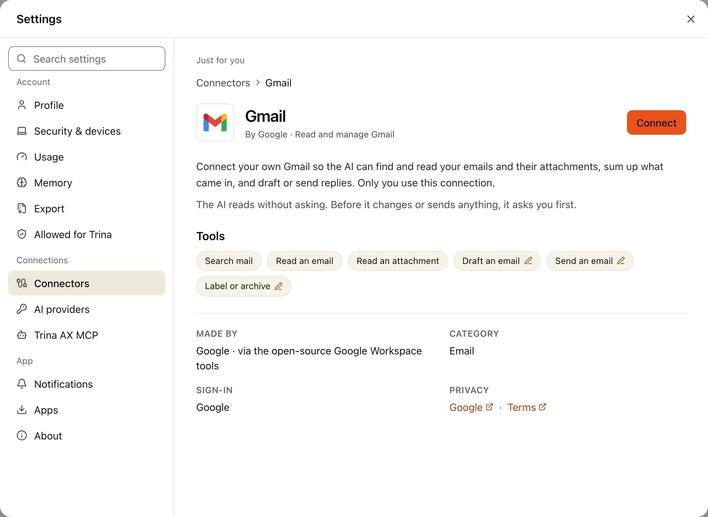
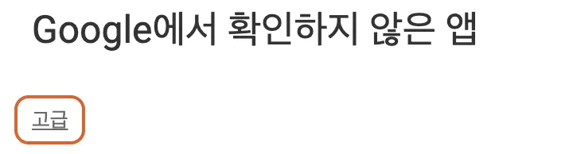
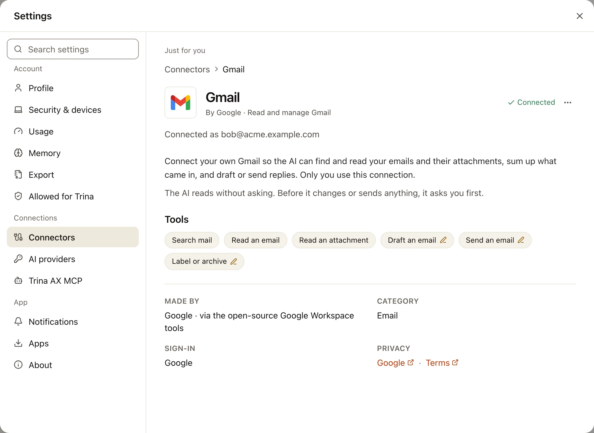
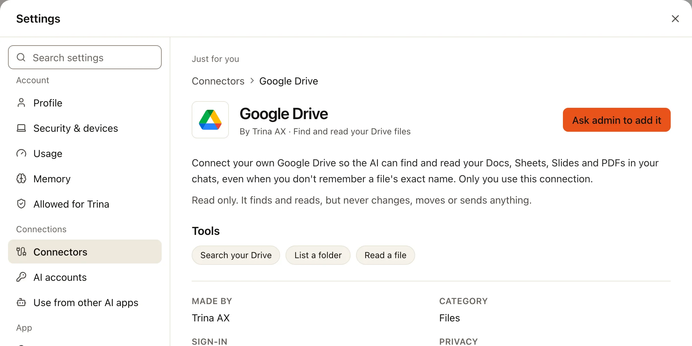
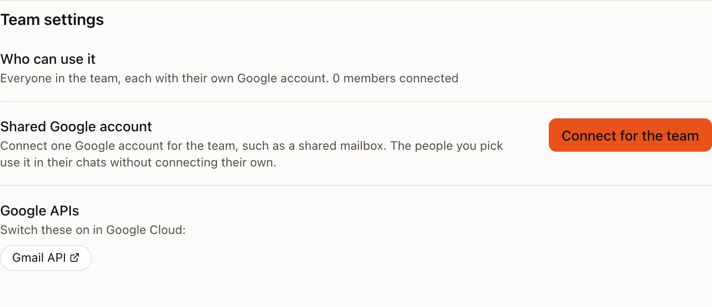
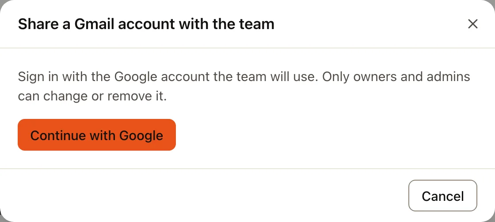
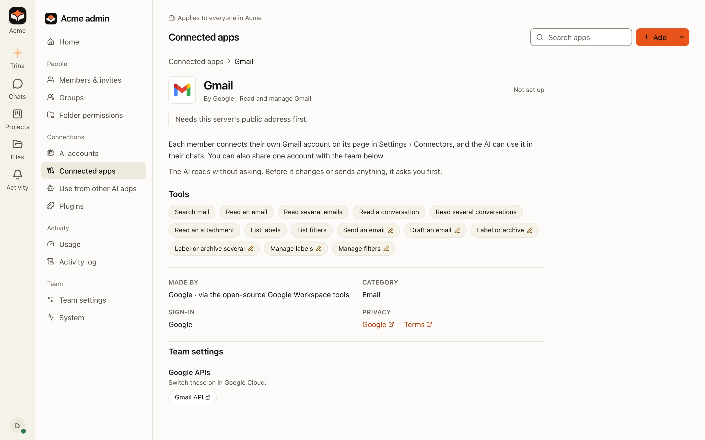

Google Drive, Gmail, Google Calendar, Google Docs, Google Sheets는 Trina AX에 처음부터 들어 있어요. 각자 자기 Google
계정을 앱마다 한 번씩 연결해요. AI는 그 사람의 채팅에서만, 그 사람의 Google 권한으로 이 계정을 써요.

복사하거나 붙여 넣을 건 없어요. Google에서 로그인하면 돼요.

## Google 앱 연결하기 (모두)

:::tip
**필요한 것**

- 브라우저에 로그인된 내 Google 계정 (회사 Google Workspace 계정이나 개인 Gmail 계정).
:::

:::steps
#### 커넥터에서 앱 열기
1. 왼쪽 막대 맨 아래의 내 사진을 누르고 **설정**을 골라요.
2. 왼쪽 목록에서 **커넥터**를 골라요.
3. **둘러보기**에서 앱을 골라요. 예를 들면 **Gmail**이에요. (안 보이면 **서비스 검색**에 이름을 입력해요.)

앱 페이지가 열려요. AI가 그 앱에서 할 수 있는 일과 도구 목록이 나오고, 무언가를 바꾸는 도구에는 연필 표시가 있어요.
**연결**은 오른쪽 위에 있어요.



#### 연결 누르기
새 창이 열려요(데스크톱 앱에서는 브라우저로 열려요). Trina가 운영하는 팀이면 먼저 Trina의 시작 페이지가 나와요. 우리
팀 이름과 Trina AX가 할 수 있는 일이 적혀 있어요. **Google로 계속**을 눌러요. 그러면 Google 로그인 페이지가 열려요.
Google 계정에 여러 개 로그인돼 있으면 Google이 어느 계정인지 물어요. 연결하려는 계정을 골라요.

#### Google 경고 넘기기
Google이 아직 Trina의 Google 앱을 검토하는 동안에는 권한 화면 전에 **Google에서 확인하지 않은 앱**이라는 화면이 떠요.
검토 중이라는 Google의 안내일 뿐, 내 계정에 문제가 있는 게 아니에요. 두 번만 누르면 돼요.

1. 글 아래의 **고급**을 눌러요.

   

2. 펼쳐진 글 맨 아래의 **Trina AX(으)로 이동(안전하지 않음)** 링크를 눌러요.

   로 이동(안전하지 않음)")

Google Workspace를 쓰는 회사는 회사의 Google 앱을 쓰면 모두가 이 경고 없이 넘어가요. 아래
[어떤 Google 로그인을 쓸까요](#어떤-google-로그인을-쓸까요)를 봐요.

#### 모든 항목에 체크한 채로 두기
Google이 Trina AX 이름과 함께, Trina AX가 할 수 있는 일을 "이메일 읽기, 작성, 보내기"처럼 권한마다 한 줄씩 보여
줘요. 체크박스가 있는 줄도 있어요. **모든** 항목에 체크한 채로 **계속**을 눌러요. 하나라도 체크를 풀면 로그인이 거절돼요. "일부 권한에 체크하지 않았어요. 다시 연결하고 모든 항목에
체크한 채로 두세요."

#### 계정 확인하기
Trina AX로 돌아오면 보이는 계정("이 계정을 연결할까요?")을 확인하고 **이 계정 연결**을 눌러요. 이제 페이지
오른쪽 위에 **연결됨**이, 이름 아래에 내 주소와 함께 **… 계정으로 연결됨**이 떠요.


:::

읽기는 묻지 않고 바로 해요. 메일을 보내거나, 일정을 추가하거나, 문서를 고치기 전에는 AI가 할 일을 모두 적은 카드를 보여 주고
내가 허락할 때까지 기다려요. 카드에서, 또는 앱의 **설정**(앱의 **⋯** 메뉴)에서 **먼저 물어보기** 대신 **항상 허용**을
고를 수도 있어요. Google Drive는 읽기만 해요. 파일을 바꾸거나 옮기거나 보내지 않아요.

### "관리자에게 추가 요청하기"가 보이면

우리 팀에 아직 그 앱이 설정되지 않은 거예요. **관리자에게 추가 요청하기**를 누르면 팀장과 관리자에게 알림이 가고,
연결할 수 있게 되면 나에게도 알려 줘요.



## 팀이 함께 쓰는 Google 계정 (관리자)

`sales@acme.com` 같은 공용 메일함이나 캘린더는 필요한 사람들을 위해 한 번만 연결하면 돼요. 여러 사람이 같이 여는
Gmail의 공용 메일함과 같아요. 고른 사람은 자기 계정을 연결하지 않아도 채팅에서 써요.

:::steps
#### 관리자에서 Google 앱 열기
왼쪽 막대 맨 위의 팀 로고를 누르고 **관리자 › 연결한 서비스**로 가서 Google 앱(예: Gmail)을 골라요. **팀 설정**까지
스크롤해요. **팀이 함께 쓰는 Google 계정** 줄 오른쪽에 **팀에 연결**이 있어요.



#### 공용 계정으로 로그인하기
**팀에 연결**을 누르면 **Gmail 계정을 팀과 함께 쓰기** 창이 열려요. **Google에서 계속**을 누르고, 내 계정이 아니라 공용
계정으로 Google에 로그인해요. 위에서처럼 모든 항목에 체크한 채로 두고, 계정을 확인한 뒤 **이 계정 연결**을 눌러요.



#### 쓸 사람을 고르고 저장하기
**누가 쓸 수 있나요**에서 모두, 부서, 사람 중에 고르고 **저장**을 눌러요. 저장하기 전에는 아무도 쓰지 않고, 저장하기
전에 창을 닫으면 연결이 다시 없어져요. 그러면 그 줄에 계정, 쓰는 사람, 연결한 사람이 **⋯** 메뉴와 함께 나와요. 메뉴에는
**쓰는 사람 바꾸기**, **다시 연결**, **없애기**가 있어요.
:::

Google Drive는 같은 자리에 **팀과 공유**가 있어요. **Google Drive를 팀과 공유**로 Google 계정 하나를 연결하고 폴더를
고르면, 고른 사람들이 채팅에서 그 폴더를 써요.

채팅에서도 같아요. 소유자나 관리자가 AI에게 Google Drive나 Gmail(또는 캘린더, 문서, 시트) 연결을 부탁하면, 카드에
**팀으로 연결**도 있어서 이 대화상자가 그대로 열려요. 멤버에게는 내 계정 연결만 보여요. 이미 팀의 공유 계정이나 공유받은
Drive를 쓰는 사람에게는 연결할 것 없이 이미 연결되어 있다고 알려 줘요.

## Google 앱 설정하기 (직접 운영하는 서버의 관리자)

Trina가 운영하는 팀은 Google 로그인이 이미 준비돼 있어서 따로 설정할 게 없어요. 회사가 직접 운영하는 서버라면 관리자가
Google Cloud에서 Google 로그인 앱을 한 번 만들고 **관리자 › 연결한 서비스**에 추가해요.

:::tip
**필요한 것**

- 팀 서버의 **공개 https 주소**. Google에서 로그인한 사람이 이 주소로 돌아와요. 주소가 없으면 Google 앱에 "먼저 이
  서버의 공개 주소가 필요해요."가 떠요. 서버를 운영하는 사람이 정해요.
  방법은 [서버 설정](../../operate/configuration.md) (영어)에 있어요.
- **Google Cloud 프로젝트**, 앱마다 필요한 **API** 켜기, 유형이 **Web application**인 **로그인 클라이언트**.
- Google Cloud에서 받는 것: 클라이언트의 **JSON 파일** (또는 **클라이언트 ID**와 **클라이언트 보안 비밀번호**).
- Google Cloud에 넣는 것: Trina AX가 보여 주는 **돌아올 주소** 두 개. 하나는 Google Drive용, 하나는 나머지 네 앱용이에요.
:::



:::steps
#### Google Cloud에서 앱 만들기
회사 앱 페이지의 [Google Cloud에서](google-own-app.md#google-cloud에서)를 따라 해요. 프로젝트, API, 앱 이름과 대상
(Google Workspace 회사는 **Internal**, 그 밖에는 **External**과 테스트 사용자), 권한, **Web application** 클라이언트를
만들어요.

#### 돌아올 주소 넣기
클라이언트의 **Authorized redirect URIs**에, 앱마다 **설정** 창에 보이는 주소를 복사 버튼으로 복사해 넣어요.

```
https://<your team address>/api/integrations/google-drive/callback
https://<your team address>/api/integrations/google-apps/callback
```

#### Trina AX에 파일 올리기
**관리자 › 연결한 서비스**에서 **Google Drive**를 열고 **설정**을 눌러요. 내려받은 JSON 파일을 올리거나
**클라이언트 ID**와 **클라이언트 보안 비밀번호**를 붙여 넣고 저장해요. 그다음 Gmail, Google Calendar, Docs, Sheets를
하나씩 열어 **설정**을 누르고 **Google Drive와 같은 Google 앱 사용**을 켜요. 더 올릴 건 없어요.
:::

각 앱 페이지의 **Google API** 아래에 그 앱에 켜야 할 API가 나와 있어요.

| 앱 | 켜야 할 Google API |
|---|---|
| Google Drive | Google Drive API |
| Gmail | Gmail API |
| Google Calendar | Google Calendar API |
| Google Docs | Google Docs API, Google Drive API |
| Google Sheets | Google Sheets API, Google Drive API |

Gmail, Calendar, Docs, Sheets 앱은 Linux 서버에서 돌아가요. 맥 앱에서는 이 앱들 페이지에 "이 팀 서버에서는 아직 못
써요"가 떠요.

## 어떤 Google 로그인을 쓸까요

Google 로그인 방법은 두 가지예요. 팀은 다섯 Google 앱 모두에 그중 하나를 써요.

| | Trina의 로그인 | 회사의 Google 앱 |
|---|---|---|
| 누가 연결할 수 있나요 | 모든 Google 계정: 회사 Google Workspace 계정이나 개인 Gmail 계정 | 회사 Google Workspace 계정만 |
| 설정 | Trina가 운영하는 팀은 할 게 없어요 | IT 관리자가 한 번, 15분쯤: [회사의 Google 앱 쓰기](google-own-app.md) |
| Google 화면 | Google이 Trina의 앱을 검토하는 동안 **Google에서 확인하지 않은 앱**이 떠요: [두 번 누르기](#google-앱-연결하기-모두) | 회사 앱 이름이 보이고 경고가 없어요 |
| 쓸 수 있는 사람 수 | 검토하는 동안은 Google이 제한해요 | 제한 없어요 |

처음에는 Trina의 로그인으로 시작해요. 회사가 Google Workspace를 쓰고 경고를 없애고 싶거나, Google이 앱의 사용자 한도에
닿았다고 하면 회사의 Google 앱으로 바꿔요. 그러면 각자 Google을 한 번 다시 연결해요.

## 문제가 생기면

| 이런 게 보이면 | 이렇게 해요 |
|---|---|
| **일부 권한에 체크하지 않았어요. 다시 연결하고 모든 항목에 체크한 채로 두세요.** | 다시 연결하고 Google 화면의 모든 항목에 체크한 채로 둬요. |
| **Google에서 다시 로그인하라고 해요.** | 앱 페이지에서 **다시 연결**을 눌러요. 비밀번호를 바꿨거나 회사 관리자가 접근 권한을 없앴을 때 생겨요. |
| Google 페이지에 **`redirect_uri_mismatch`** (직접 운영하는 서버) | Google Cloud에 넣은 돌아올 주소가 Trina AX에 보이는 주소와 달라요. **설정** 창에서 다시 복사해요. |
| **"This app is blocked"** 또는 **`admin_policy_enforced`** | 회사의 Google 관리자가 Google 계정을 쓸 수 있는 앱을 제한하고 있어요. 관리자에게 앱을 신뢰해 달라고 부탁해요. 방법은 [Admin console에서 앱 신뢰하기](google-own-app.md#선택-admin-console에서-앱-신뢰하기)에 있어요. |
| **Google에서 확인하지 않은 앱**이라고 떠요 | Trina의 로그인이면 **고급**, **Trina AX(으)로 이동(안전하지 않음)** 순서로 눌러요([그림](#google-앱-연결하기-모두)). 관리자가 만든 테스트 중인 앱이면, 관리자가 만든 앱일 때만 **고급** › **…(으)로 이동** 순서로 눌러요. 아니면 앱을 **Internal**로 바꿔 달라고 관리자에게 부탁해요. |
| **액세스 차단됨**이 뜨거나, Google이 앱의 사용자 한도에 닿았다고 해요 | 검토하는 동안 Trina의 로그인이 Google의 한도에 닿았어요. 관리자가 팀을 [회사의 Google 앱](google-own-app.md)으로 바꿔요. |

개발자와 운영자를 위한 자세한 내용: [Google 앱](../../../GOOGLE-APPS.md) (영어), [Google Drive](../../../GOOGLE-DRIVE.md) (영어).
