Google Drive, Gmail, Google Calendar, Google Docs, Google Sheets를 연결할 때는 Trina의 Google 앱을 거쳐 Google에서
로그인해요. Google Workspace를 쓰는 회사는 이 대신 **회사의 Google 앱**을 쓸 수 있어요. 회사 IT 관리자가 Google Cloud에서
앱을 한 번 만들고 Trina AX에 한 번 추가하면 돼요. 그다음부터 다섯 Google 앱이 모두 그 앱으로 로그인해요. Google 화면에
회사 이름이 보이고, "확인되지 않은 앱" 경고도 없고, 로그인할 수 있는 사람 수 제한도 없어요.

15분쯤 걸려요. 대부분은 Google Cloud에서 하고, Trina AX에서는 창 하나만 채우면 돼요.

:::tip
**필요한 것**

| 값 | 받는 곳 | 넣는 곳 |
|---|---|---|
| **돌아올 주소** 두 개 | Trina AX 창의 **Google Cloud에서** 단계, 각각 **복사** 버튼 | Google Cloud › Clients › 내 클라이언트 › **Authorized redirect URIs** |
| **권한**(scope) 목록 | 이 페이지의 블록, [권한 추가하기](#google-cloud에서) | Google Cloud › **Data access** › **Manually add scopes** |
| 클라이언트의 **JSON 파일** (또는 **클라이언트 ID**와 **클라이언트 보안 비밀번호**) | 클라이언트를 만든 직후 Google Cloud › **Clients** › **Download JSON** | Trina AX 창의 **여기에 추가하기** 단계 |
:::

:::note
이 페이지의 화면은 가상의 팀 "Acme"와 가상의 Google Cloud 프로젝트 "acme-trina"로 찍었어요. Google은 콘솔 화면을 가끔
바꿔요. 화면이 다르게 보이면 본문에 적은 메뉴 이름과 Google Cloud 페이지 링크를 따라가요.
:::

## 누구를 위한 건가요

- **Google Workspace를 쓰는 회사** (모두 `name@acme.com`처럼 회사 주소로 로그인해요). 이 페이지가 바로 그 안내예요.
  Trina AX에서 팀장이나 관리자여야 하고, 회사 Google Cloud에서 프로젝트를 만들 수 있어야 해요.
- **개인 Gmail 계정을 쓰는 사람들.** Trina의 로그인을 그대로 쓰면 돼요. Internal 앱은 회사 계정만 들여보내요.

멤버에게는 달라지는 게 없어요. 같은 페이지, 같은 **연결** 버튼이에요. 바꾼 뒤에 Google을 한 번만 다시 연결하면 돼요.

:::tip
Google Workspace가 없는 작은 팀은 **Testing** 상태의 **External** 앱을 만들 수도 있어요. 테스트 사용자로 넣은 사람만
로그인할 수 있고(최대 100명), Google이 7일마다 다시 로그인하라고 해요. 대부분의 팀에는 Trina의 로그인이 더 간단해요.
:::

## Google Cloud에서

회사 계정으로 [Google Cloud](https://console.cloud.google.com/)에 로그인해요.

:::steps
#### 프로젝트 만들기
[New project](https://console.cloud.google.com/projectcreate)를 열어요. **Project name**에 "acme-trina"처럼 알아보기
쉬운 이름을 넣어요. **Parent resource**(또는 **Organization**)에서는 회사를 골라요. 프로젝트가 회사 조직에 속해야 앱을
**Internal**로 만들 수 있어요(그림의 "No organization"은 가상의 계정이라서 그래요). **Create**를 누르고, 다음 단계로
가기 전에 페이지 맨 위에서 새 프로젝트가 선택돼 있는지 확인해요.

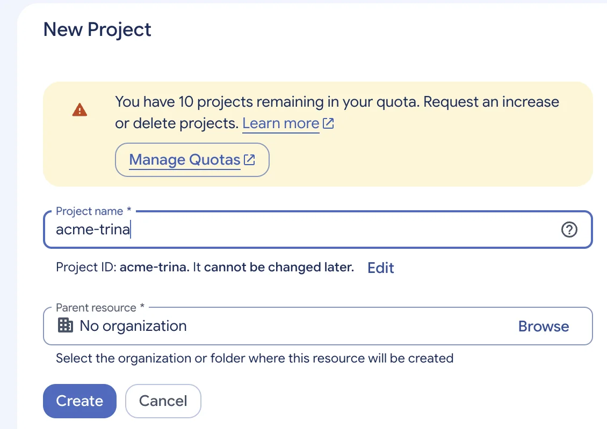

#### API 다섯 개 켜기
아래 페이지를 하나씩 열고 **Enable**을 눌러요.

- [Google Drive API](https://console.cloud.google.com/apis/library/drive.googleapis.com)
- [Gmail API](https://console.cloud.google.com/apis/library/gmail.googleapis.com)
- [Google Calendar API](https://console.cloud.google.com/apis/library/calendar-json.googleapis.com)
- [Google Docs API](https://console.cloud.google.com/apis/library/docs.googleapis.com)
- [Google Sheets API](https://console.cloud.google.com/apis/library/sheets.googleapis.com)

지금은 팀이 Google 앱 몇 개만 쓰더라도 다섯 개를 모두 켜요. 켜진 API는 페이지에 **Enable** 대신 **Manage**와
**API Enabled**가 보여요.

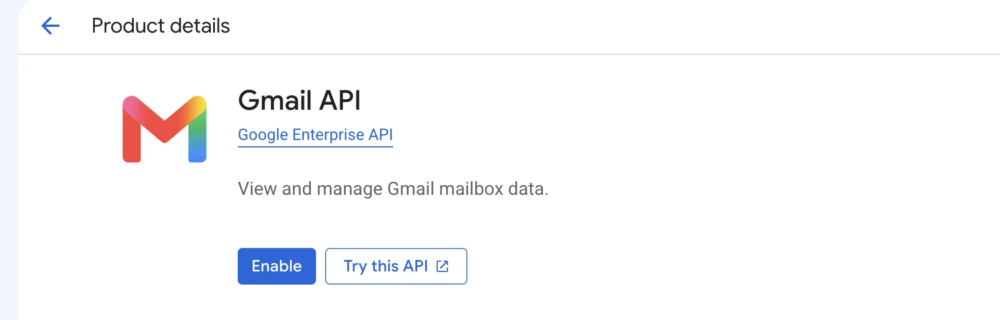

#### 앱 이름 정하고 Internal로 설정하기
[Google Auth Platform](https://console.cloud.google.com/auth/overview)을 열어요. 처음이면 **Get started**가 보여요.

1. **App Information**: 사람들이 알아볼 **App name**(예: "Acme Trina")과 **User support email**을 넣고 **Next(다음)** 버튼을
   눌러요.

   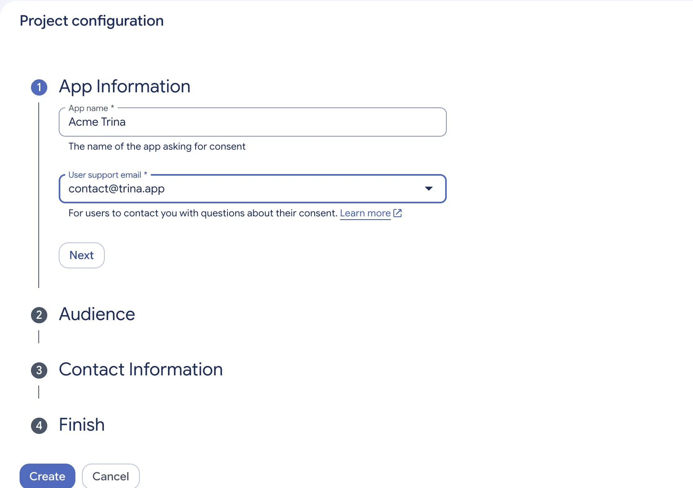

2. **Audience**: **Internal**을 골라요. 회사 계정만 이 앱을 쓸 수 있고, Google 검토도 필요 없어요. (그림에서
   **Internal**이 흐리게 보이는 건 가상의 계정에 조직이 없어서예요. 회사 계정이면 고를 수 있어요.)

   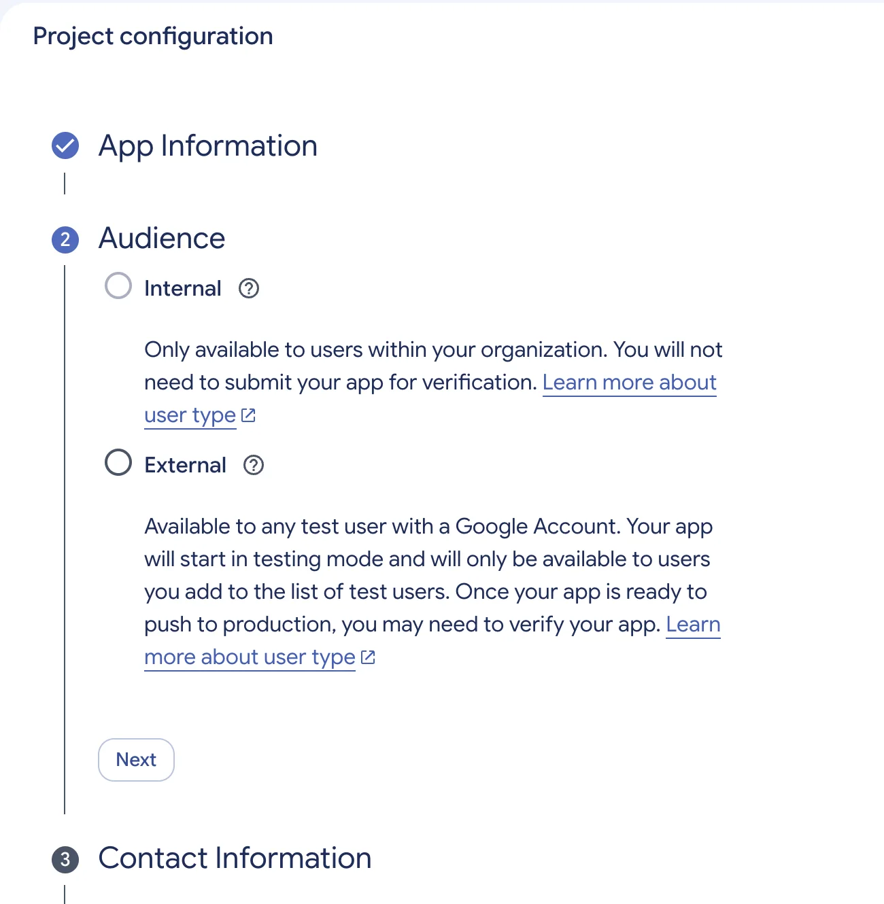
3. **Contact Information**: 이 프로젝트에 대해 Google이 연락할 이메일 주소.
4. **Finish**: Google 정책에 동의하고 **Create**를 눌러요.

나중에 [Branding](https://console.cloud.google.com/auth/branding)과
[Audience](https://console.cloud.google.com/auth/audience)에서 바꿀 수 있어요.

#### 권한 추가하기
[Data access](https://console.cloud.google.com/auth/scopes)를 열고 **Add or remove scopes**를 눌러요.

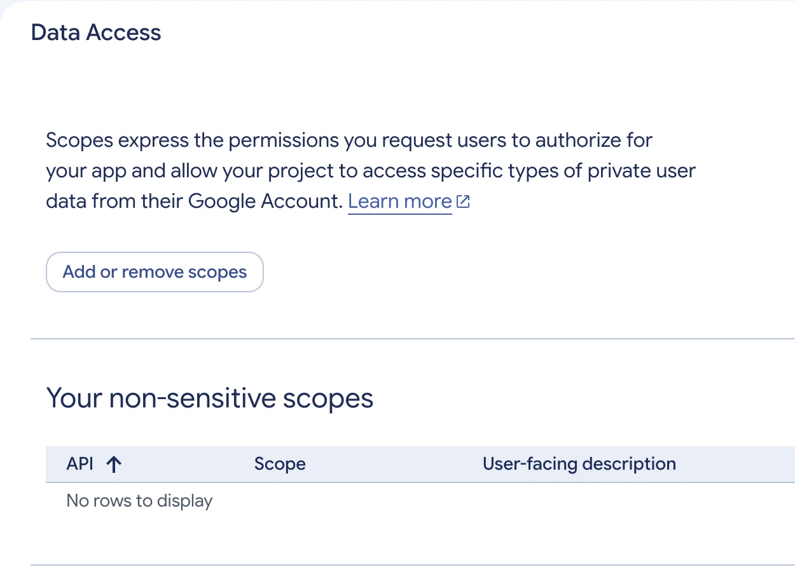

오른쪽에 패널이 열려요. 패널 맨 아래 **Manually add scopes**에 아래 블록을 통째로 붙여 넣고 **Add to table**,
**Update**를 차례로 누른 뒤 페이지에서 **Save**를 눌러요.

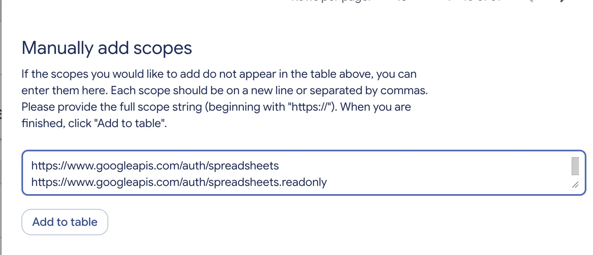

```
openid
https://www.googleapis.com/auth/userinfo.email
https://www.googleapis.com/auth/userinfo.profile
https://www.googleapis.com/auth/drive.readonly
https://www.googleapis.com/auth/drive.file
https://www.googleapis.com/auth/gmail.readonly
https://www.googleapis.com/auth/gmail.send
https://www.googleapis.com/auth/gmail.compose
https://www.googleapis.com/auth/gmail.modify
https://www.googleapis.com/auth/gmail.labels
https://www.googleapis.com/auth/gmail.settings.basic
https://www.googleapis.com/auth/calendar
https://www.googleapis.com/auth/calendar.readonly
https://www.googleapis.com/auth/calendar.events
https://www.googleapis.com/auth/documents
https://www.googleapis.com/auth/documents.readonly
https://www.googleapis.com/auth/spreadsheets
https://www.googleapis.com/auth/spreadsheets.readonly
```

Trina AX가 다섯 앱에서 요청하는 권한을 모두 모은 목록이에요. 하나도 빼면 안 돼요. 하나라도 없으면 로그인이 거절돼요.

#### 로그인 클라이언트 만들기
[Clients](https://console.cloud.google.com/auth/clients)를 열고 **Create client**를 눌러요.

1. **Application type**: **Web application**.
2. **Name**: 아무 이름이나 괜찮아요. 예: "Trina AX". 사람들에게는 보이지 않아요.

   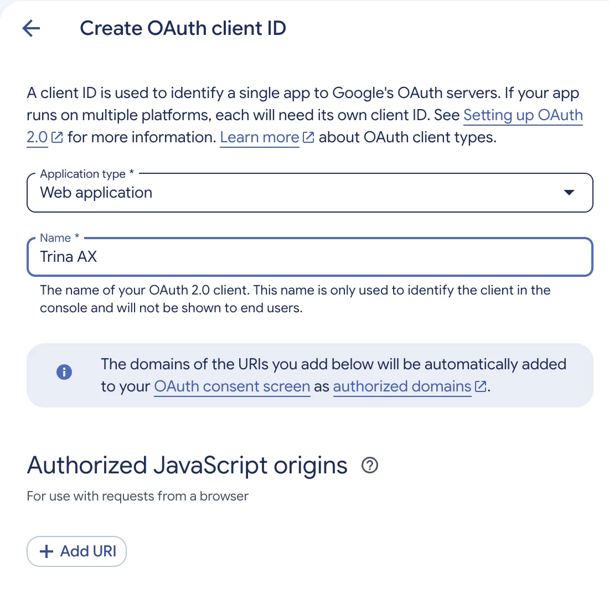

3. **Authorized redirect URIs**에서 **Add URI**를 두 번 누르고 돌아올 주소 두 개를 붙여 넣어요. 주소는 Trina AX에서
   복사해요(다음 부분의 창에 **복사** 버튼과 함께 나와요). 우리 팀 주소가 들어간 이런 모양이에요.

   ```
   https://<your team address>/api/integrations/google-drive/callback
   https://<your team address>/api/integrations/google-apps/callback
   ```

   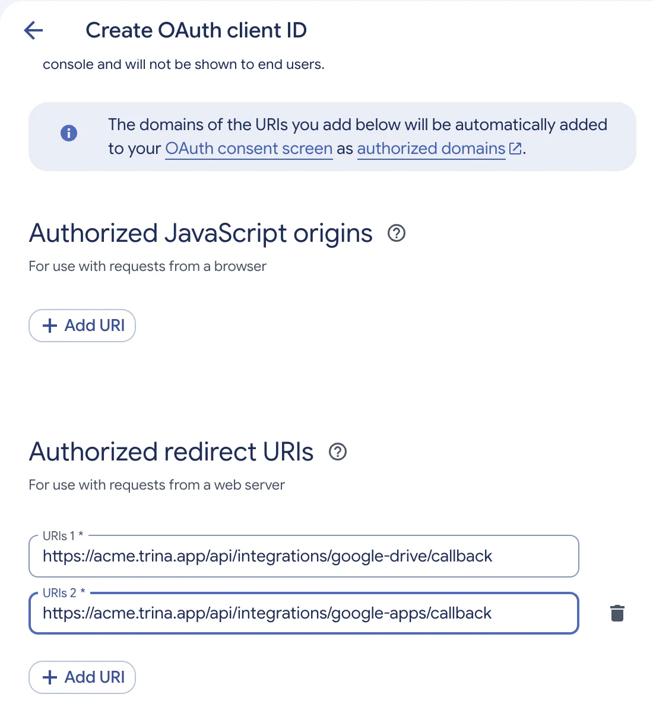

4. **Create**를 눌러요. **OAuth client created**에서 **Download JSON**을 눌러 파일을 보관해요. Google은 비밀 값을 이때만
   보여 줘요. 잃어버리면 그 클라이언트에 새 비밀 값을 만들어요.

   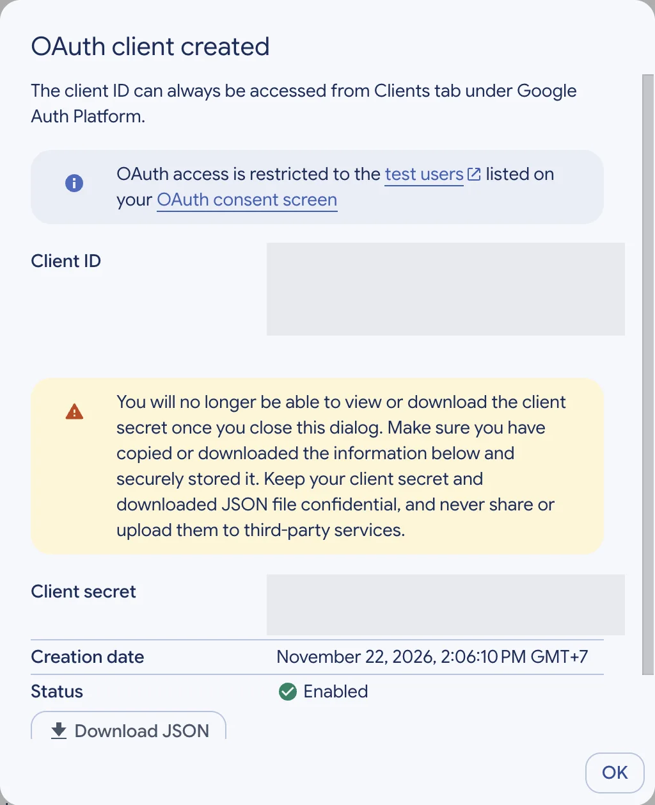
:::

## Trina AX에서

:::steps
#### Google 페이지 열기
**관리자 › 연결한 서비스**에서 Google 앱 아무거나 골라요(예: **Gmail**). 다섯 페이지 모두 맨 아래에 **팀 설정**이 있고,
첫 줄이 **Google 로그인**이에요. "팀원 모두 Trina의 Google 앱으로 로그인해요. 회사의 Google 앱을 대신 쓸 수도 있어요.
여기 있는 모든 Google 앱에 함께 적용돼요."

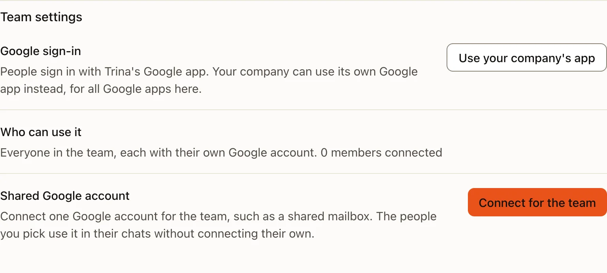

#### 회사 앱 쓰기 누르기
**회사의 Google 앱 쓰기** 창이 열려요. 첫 단계 **시작하기 전에**에서 누구를 위한 건지 알려 주고 이 페이지로 가는 링크가
있어요.

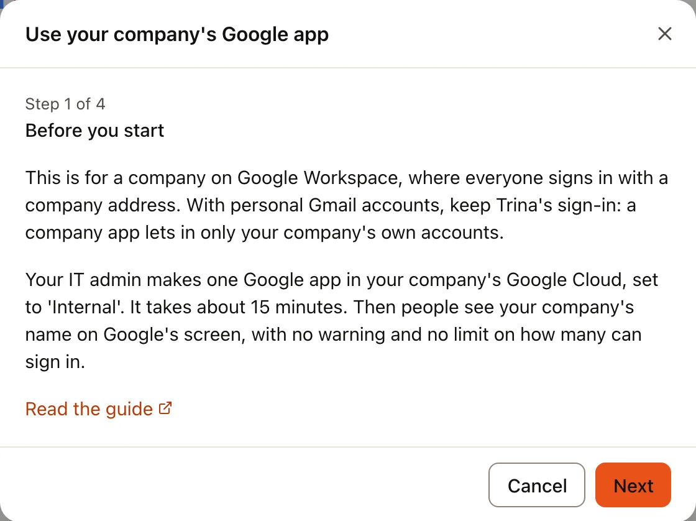

#### Google Cloud에서
두 번째 단계에는 위의 Google Cloud 순서가 페이지 링크와 함께 나오고, 우리 팀의 돌아올 주소 두 개가 각각 **복사** 버튼과
함께 있어요. 여기서 복사해 **Authorized redirect URIs**에 넣으면 틀릴 일이 없어요.

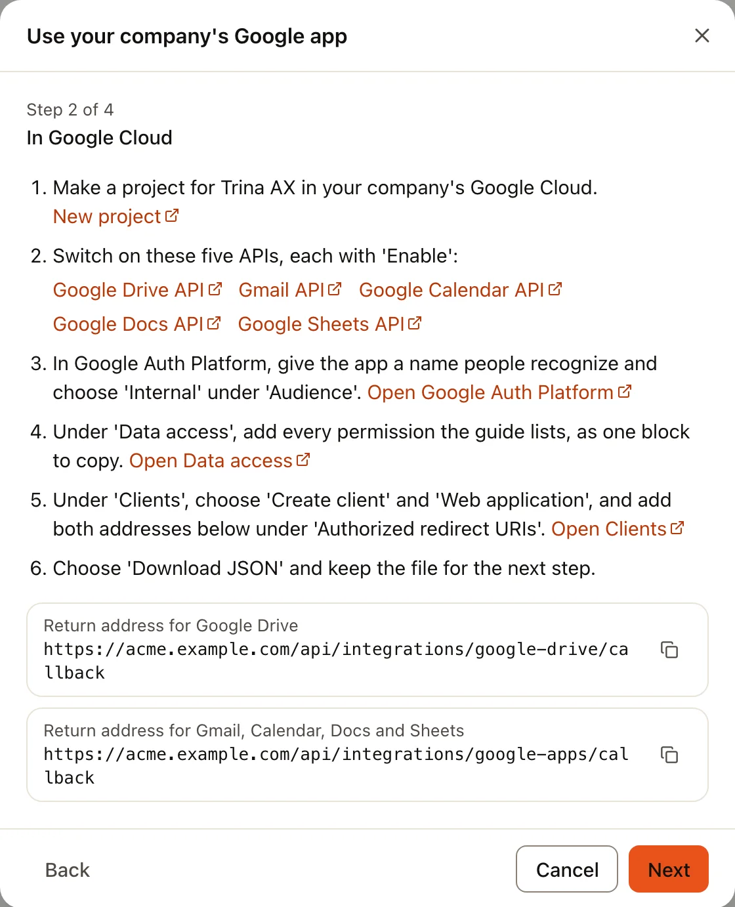

#### 여기에 추가하기
Google에서 내려받은 파일을 끌어다 놓거나 골라요. 직접 입력하고 싶으면 **ID와 비밀 값을 대신 입력하기**를 눌러
**클라이언트 ID**와 **클라이언트 보안 비밀번호** 칸을 열어요. 돌아올 주소 두 개가 다 들어 있지 않은 파일은 거절되고,
Google Cloud에 어떤 주소를 더 넣어야 하는지 알려 줘요.

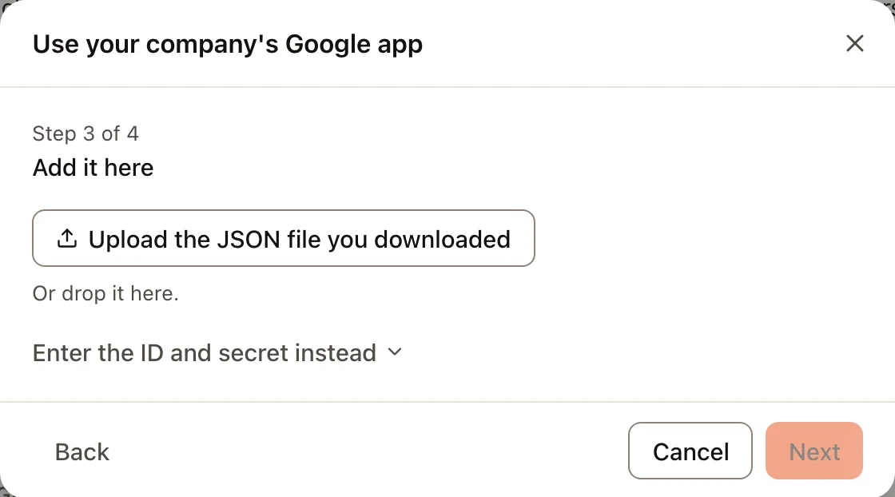

#### 확인하고 저장하기
마지막 단계 **저장하기 전에**는 무엇이 바뀌는지 우리 팀 숫자로 보여 줘요. 몇 명이 Google을 다시 연결해야 하는지, 그리고
팀이 함께 쓰는 Google 계정과 팀과 공유한 Drive는 관리자가 다시 연결해야 한다는 것도요. **저장**을 누르기 전에는 아무것도
바뀌지 않아요. **취소**를 누르면 전부 그대로예요.

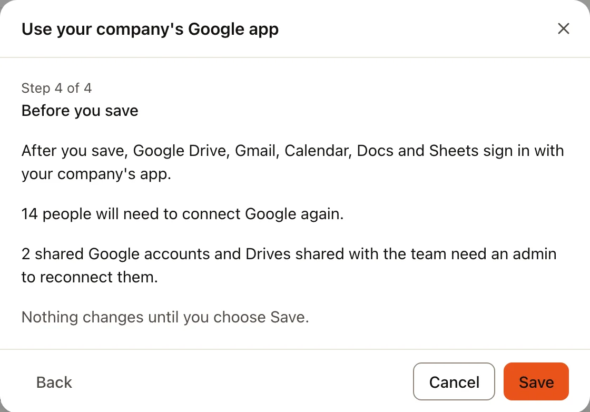
:::

**저장**하고 나면 그 줄에 "팀원 모두 회사 Google 앱으로 로그인해요. Google Drive, Gmail, Calendar, Docs, Sheets에 함께
적용돼요."가 누가 언제 설정했는지와 함께 떠요. 줄의 ⋯ 메뉴에는 **바꾸기**(예: 새 비밀 값을 만든 뒤 새 파일을 넣을 때)와
**Trina의 Google 로그인으로 돌아가기**가 있어요. 한 번만 설정하면 돼요. 이 줄은 다섯 Google 페이지에서 모두 같아요.

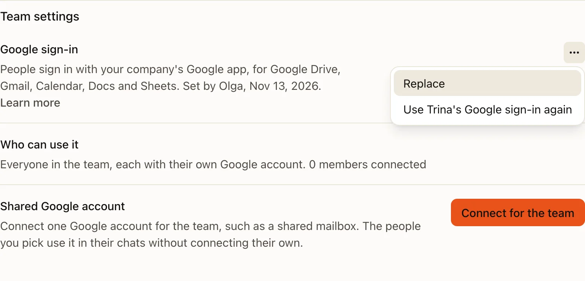

폰에서는 ⋯가 폰 설정 화면처럼 줄 이름 옆에 있어요.

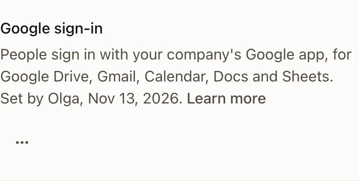

## 멤버에게 보이는 것

바꾸는 순간 Trina의 앱으로 만든 Google 연결은 모두 멈춰요. Google은 로그인을 그걸 만든 앱에 묶어 두기 때문이에요.

- **각자** **설정 › 커넥터**의 Google 앱에서 늘 보던 **다시 연결**을 한 번 보게 돼요. 다시 연결하면 Google 화면에 회사 앱
  이름이 보이고 경고는 뜨지 않아요.
- **팀이 함께 쓰는 Google 계정과 팀과 공유한 Drive**는 Google 페이지의 **팀 설정** 아래에 **다시 연결**이 떠요. 관리자가
  다시 연결해야 하고, 그 전까지는 AI가 쓸 수 없어요.

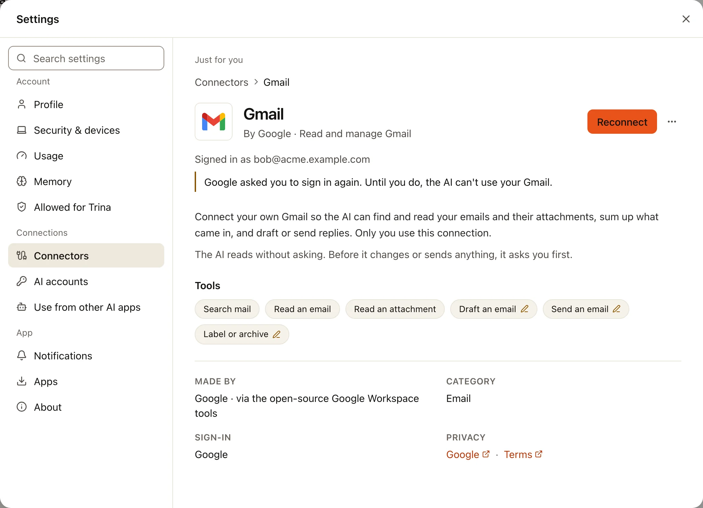

## 선택: Admin console에서 앱 신뢰하기

회사가 Google 계정을 쓸 수 있는 앱을 제한하고 있다면, Google Workspace 최고 관리자가 이 앱을 신뢰하는 앱으로 표시해야
해요. 이걸 하지 않으면 연결할 때 `admin_policy_enforced`가 뜰 수 있어요.

1. 앱의 클라이언트 ID를 찾아요. 내려받은 JSON 파일의 `"client_id":` 뒤에 있고,
   [Clients](https://console.cloud.google.com/auth/clients)의 클라이언트 페이지에도 있어요. `.apps.googleusercontent.com`으로
   끝나요.
2. 최고 관리자 계정으로 [Admin console](https://admin.google.com/)에 로그인해요.
3. 왼쪽 메뉴에서 **Security**, **Access and data control**, **API controls** 순서로 열어요.
4. **Manage Third-Party App Access**를 고르고 **Configure new app**을 눌러요.
5. 검색창에 클라이언트 ID를 붙여 넣고 목록에서 내 앱을 골라요.
6. 적용할 대상(보통은 조직 전체)을 고르고 **Trusted**로 설정한 뒤 **Configure**로 마쳐요(Google의 마지막 버튼이에요.
   이름이 조금 다를 수 있어요).

## Trina AX가 보관하는 것

- 앱의 ID와 비밀 값은 **팀 서버의 비공개 파일**에 보관하고, 서버만 읽을 수 있어요. 다시 보여 주지 않아요. 페이지에도,
  로그에도, 활동 로그에도 나오지 않아요.
- 호스팅으로 쓰는 팀은 **Trina 호스팅 서비스가 그 서버를 운영**해요. 그래서 그 파일도 거기 있어요. 비밀 값만으로는 아무것도
  열 수 없어요. 각자 Google에서 직접 로그인하고 동의해야 해요.
- 각자의 Google 로그인 정보는 지금처럼 서버에 암호화해서 보관해요.

## Trina의 로그인으로 돌아가기

아무 Google 페이지에서나 **팀 설정 › Google 로그인**의 ⋯를 열고 **Trina의 Google 로그인으로 돌아가기**를 골라요. 먼저
**저장하기 전에**와 같은 숫자를 보여 줘요. 확인하면 다섯 Google 앱이 다시 Trina의 앱으로 로그인하고, 각자 Google을 한 번
다시 연결하고, 회사 앱 파일은 서버에서 지워져요. 그다음 Google Cloud에서 클라이언트를 지워도 돼요.

팀 주소가 바뀌면 Google 로그인 줄에 그렇게 나와요. Google Cloud의 클라이언트에 새 돌아올 주소 두 개를 넣고, 파일을 다시
내려받은 뒤, Trina AX에서 ⋯ › **바꾸기**를 열어요. 창이 **Google Cloud에서** 단계로 열리고 복사할 새 주소가 보여요. 그
전까지는 아무도 Google을 연결할 수 없어요.

## 문제가 생기면

| 이런 게 보이면 | 이렇게 해요 |
|---|---|
| Google 페이지에 **`redirect_uri_mismatch`** | Google Cloud에 돌아올 주소가 없거나 글자 하나가 달라요. [Clients](https://console.cloud.google.com/auth/clients)에서 내 클라이언트를 고르고, 창의 **Google Cloud에서** 단계에서 두 주소를 다시 복사해 붙여 넣어요. 저장한 뒤 적용까지 몇 분 걸릴 수 있어요. |
| **"일부 권한에 체크하지 않았어요. 다시 연결하고 모든 항목에 체크한 채로 두세요."** | Google 화면에서 체크를 풀었거나 **Data access**에 권한이 빠졌어요. 위 블록이 전부 들어 있는지 확인하고, 모든 항목에 체크한 채로 다시 연결해요. |
| **`admin_policy_enforced`** | 회사 Admin console이 이 앱을 막고 있어요. 신뢰하는 앱으로 표시해요([위](#선택-admin-console에서-앱-신뢰하기) 참고). |
| **회사 밖 계정**이 거절돼요 (Google이 이 앱은 조직 안에서만 쓸 수 있다고 해요) | **Internal**이 바로 그런 뜻이에요. 회사 계정으로 로그인해요. 팀이 함께 쓰는 Google 계정도 회사 계정이어야 해요. |

개발자와 운영자를 위한 자세한 내용: [Google 앱](../../../GOOGLE-APPS.md) (영어), [Google Drive](../../../GOOGLE-DRIVE.md) (영어).
