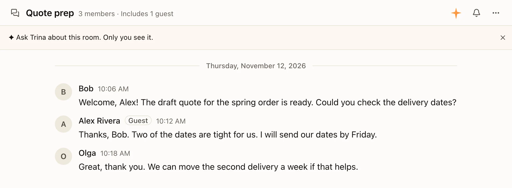
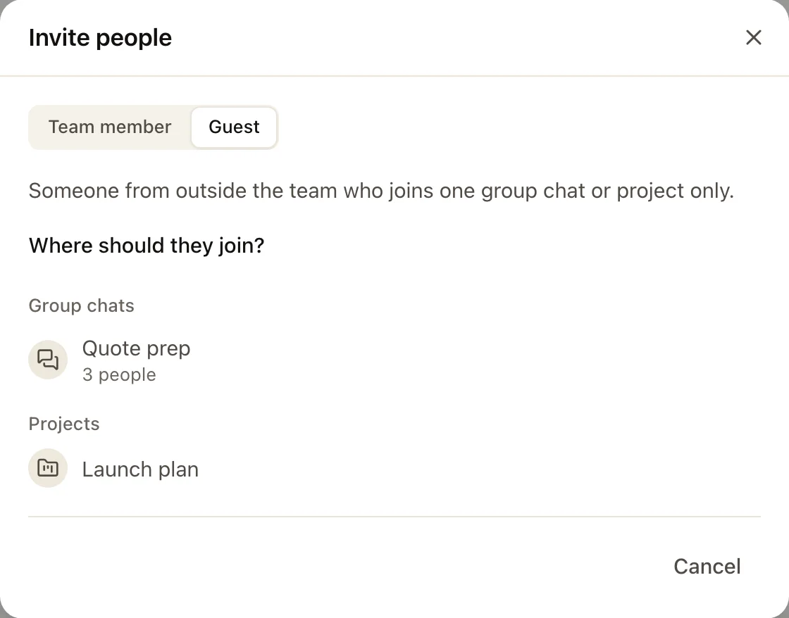

**게스트**는 고객, 협력사, 프리랜서처럼 팀 밖에 있는 사람이에요. 게스트는 그룹 대화 하나와 프로젝트 하나까지만 들어올 수 있고,
팀의 다른 것은 아무것도 보지 못해요. 다른 대화도, 팀 파일도, 다른 프로젝트도, 팀 스킬도요. 요금제의 팀 인원 수에도 들어가지 않아요.

| | 팀원 | 게스트 |
|---|---|---|
| **갈 수 있는 곳** | 부서와 폴더 권한이 허용하는 모든 곳 | 그룹 대화 하나와 프로젝트 하나까지 |
| **팀 파일** | 열 수 있는 폴더 | 자기 프로젝트의 파일만 (그룹 대화에서는 없음) |
| **AI** | 팀의 AI 설정 | 따로 AI를 골라 주지 않으면 AI 없음 |
| **팀 인원** | 1명으로 세요 | 세지 않아요 |
| **대화에 보내는 파일** | 파일당 10GB까지 | 파일당 100MB까지. 소유자나 관리자가 **관리자 › 멤버·초대**의 **게스트** 목록 위에서 1GB나 10GB로 올릴 수 있어요 |

게스트 이름 옆에는 **게스트** 표시가 붙고, 게스트가 있는 대화나 프로젝트는 맨 위에 그렇게 나와요("게스트 1명 포함").

## 누가 게스트를 초대할 수 있나요

- **그룹 대화:** 그 대화에 있는 사람 누구나.
- **프로젝트:** 프로젝트를 만든 사람, 또는 팀장이나 관리자.

대화나 프로젝트를 먼저 열지 않아도 돼요. **새 대화**의 첫 줄이 **게스트 초대하기**이고, 팀장과 관리자는 **팀원 초대**와
**관리자 › 멤버·초대 › 팀에 초대**에서도 **게스트**를 찾을 수 있어요. 아래의
[대화나 프로젝트를 열지 않고 초대하기](#대화나-프로젝트를-열지-않고-초대하기)와 [관리자 페이지에서](#관리자-페이지에서)에 자세히 있어요.

게스트는 **팀 대화방**(모두가 있는 대화방과 부서마다 있는 대화방)에는 들어오지 않아요. 게스트도 1:1 대화를 할 수 있지만,
자기 대화나 프로젝트에 있는 사람하고만 할 수 있어요.

## 게스트 초대하기

:::steps
#### 추가 목록 열기
그룹 대화에서는 맨 위의 **⋯** 버튼을 누르고 **초대하기**를 골라요(또는 대화 이름을 누르고 **초대하기**). 프로젝트에서는
프로젝트 페이지의 **멤버** 옆 **관리**를 눌러요. 첫 줄이 **게스트 초대하기**예요.

#### 누구에게 보낼지 적고 AI 고르기
**누구에게 보내나요?** 칸에 그 사람 이름을 적어요. **AI 사용**에는 처음에 **AI 없음**이 골라져 있어요. 다른 선택지는
아래 [게스트의 AI](#게스트의-ai)에서 설명해요.

#### 링크를 복사해 직접 보내기
**링크 만들기**를 누르면 이 사람만을 위한 링크가 만들어져요. 트리나는 이메일을 보내지 않아요. **링크 복사**를 눌러 이메일이나
채팅으로 직접 보내요. 링크는 7일 동안 한 번만 쓸 수 있고, 창에 링크가 끝나는 날짜와 시각이 나와요.

:::

이 링크는 쓰이거나 만료될 때까지 **관리자 › 멤버·초대**의 **초대 링크**에도 **게스트** 표시와 그 사람 이름과 함께 나와요.

링크는 만든 사람이 계속 초대할 수 있을 때만 작동해요. 만든 사람이 대화에서 나가거나, 프로젝트에서 빠지거나, 내보내지거나,
(**팀 AI**를 고른 경우) 더 이상 관리자가 아니면 링크가 멈추고 **관리자 › 멤버·초대**의 **초대 링크**에서 빠져요. 초대할 수
있는 다른 사람이 새 링크를 만들면 돼요.

### 대화나 프로젝트를 열지 않고 초대하기

- **새 대화**(대화 목록 위의 **+**): 첫 줄이 **게스트 초대하기**예요.
- **팀원 초대**(팀장과 관리자: 팀 로고 아래의 팀 메뉴, 검색, 또는 폰의 **나**): 창 맨 위에서 **게스트**를 골라요
  (처음에는 **팀원**이 골라져 있어요).
- **팀원 초대하기**(홈의 시작 단계와 팀 목표): 메시지 아래의 **게스트 초대하기**.

어디서든 게스트가 들어올 곳 하나를 고르는 목록이 나와요. 내가 있는 그룹 대화, 그리고 내가 멤버를 바꿀 수 있는
프로젝트(내가 만든 것. 팀장과 관리자는 팀 프로젝트 전부)예요. 하나를 고르고 위와 같은 창을 채우면 돼요. 그런 대화나
프로젝트가 아직 없으면 창에 그렇게 나와요. 요금제에 게스트 자리가 더 없으면 대신 그 안내가 나와요.

**내 프로젝트** 아래에 있는 내 프로젝트도 **나만** 표시를 달고 나와요. 하나를 고르면 프로젝트 페이지의 **멤버 추가**와 같은
방식으로 공유되고, **링크 만들기** 전에 창에 한 줄로 그렇게 알려 줘요.

- **링크 만들기**를 누르면 팀 프로젝트가 돼요. 게스트가 들어오기 전까지는 여전히 나만 보고 **내 프로젝트**에 있어요.
- 게스트가 들어오면 **팀 프로젝트**로 옮겨지고, 나와 게스트 두 사람이 멤버가 돼요.
- 게스트는 파일을 열고 고칠 수 있어요. 내 채팅은 이전 것도, 나중에 시작할 것도 보지 못해요.
- **멤버 추가**와 마찬가지로 다시 나만 보는 프로젝트로 돌릴 수 없어요.

팀에서 프로젝트 공유를 팀장과 관리자만 할 수 있게 해 뒀다면 팀원이 혼자 쓰는 프로젝트는 목록에 나오지 않아요.

### 관리자 페이지에서

팀장과 관리자는 대화나 프로젝트를 먼저 열지 않고도 게스트를 초대할 수 있어요. **관리자 › 멤버·초대**에서
**팀에 초대**를 누르고, 창 맨 위에서 **게스트**를 골라요(처음에는 **팀원**이 골라져 있어요). 게스트가 들어올 곳 하나를
골라요. 내가 있는 그룹 대화, 팀 프로젝트, 또는 내 프로젝트(위처럼 공유돼요)예요. 그다음 위와 같은 창을 채워요. 이름,
AI, **링크 만들기**, **링크 복사**예요. 요금제에 게스트 자리가 더 없으면 창에 들어올 곳 목록 대신 그 안내가 나와요.

## 게스트에게 보이는 것

링크를 열면 누가 초대했는지, 어느 대화나 프로젝트에 들어오게 되는지 나오는 페이지가 열려요. 아이디와 비밀번호를
정하면 바로 들어와요. **본인 계정으로 로그인**을 골랐다면, 자기 Claude나 ChatGPT 계정을 연결하게 된다는 안내도 나와요.
링크가 더 이상 작동하지 않으면 그 이유가 나와요. 만료됐거나, 이미 썼거나, 꺼졌거나, 만든 사람이 더 이상 초대할 수 없거나,
대화나 프로젝트가 없어진 경우예요.

로그인하면 트리나가 그 대화나 프로젝트를 열어 줘요. 왼쪽 막대에는 쓸 수 있는 것만 있어요. **파일**도, 팀 프로젝트나
대화방도 없고, AI가 꺼져 있으면 **트리나**도 없어요. **설정**에는 프로필, 알림처럼 자기 것만 있어요.

프로젝트에서는 프로젝트 멤버가 게스트의 채팅을 볼 수 있어요. AI를 쓸 수 있는 게스트에게는 프로젝트 페이지에서 이 사실을 알려 줘요.

## 그룹 대화 하나와 프로젝트 하나

게스트는 그룹 대화 하나와 프로젝트 하나에 동시에 있을 수 있어요. 그보다 많이는 안 돼요. 초대 한 번으로는 한 곳에 들어와요.
게스트를 두 번째 곳에 들이려면 다른 사람처럼 추가하면 돼요. 그룹 대화의 **초대하기**나 프로젝트의 **멤버**에서요. 두 번째 그룹
대화나 두 번째 프로젝트에 게스트를 추가하려고 하면 트리나가 막아요. 추가 목록에서 이미 같은 종류의 다른 곳에 있는 게스트는
체크할 수 없고, 그 위치가 나와요(나도 들어가 있는 곳만 이름이 보여요).

두 곳에 다 있는 게스트는 두 곳의 사람을 모두 봐요. 그룹 대화나 프로젝트에 있는 사람이면 누구에게나 메시지를 보낼 수 있고, 그
밖의 사람에게는 못 보내요. 양쪽 모두 게스트를 봐요. 다만 그룹 대화에만 있는 사람에게는 프로젝트 이름이 안 보이고, 반대도
마찬가지예요.

그룹 대화나 프로젝트가 여러 개 필요한 사람이라면 팀장이나 관리자가 **팀원으로 바꾸기**를 할 수 있어요(아래 참고).

게스트가 스스로 나가거나, 대화나 프로젝트에서 빠지거나, 그 대화나 프로젝트가 닫히면 그곳에서 빠져요. 다른 한 곳에 남아 있으면
계속 로그인할 수 있어요. 모든 곳에서 빠지면 더 이상 로그인할 수 없어요. 게스트를 내보냈을 때와 같아요. 휴지통에 있는 프로젝트는
계속 그 게스트의 프로젝트예요. 휴지통에 있는 동안에는 다른 프로젝트에 들어갈 수 없어요. 게스트가 있는
프로젝트를 휴지통으로 옮기면 확인하기 전에 그렇게 알려 줘요. 프로젝트가 휴지통에서 돌아오면 게스트도 따로 손대지 않아도 다시 로그인할 수
있어요. 단, 그사이에 팀장이나 관리자가 그 게스트를 켜거나 껐다면 예외예요. 대화나 프로젝트 이름을 바꿔도 게스트에게는
달라지는 게 없어요.

## 게스트의 AI

| 선택 | 뜻 | 고를 수 있는 사람 |
|---|---|---|
| **AI 없음** (기본) | 사람하고만 대화해요. | 초대하는 사람 누구나 |
| **팀 AI** | 팀의 AI 계정 하나를, 내가 정한 월 금액(미국 달러)까지 써요. | 팀장과 관리자 |
| **본인 계정으로 로그인** | **설정 › AI 제공사**에서 자기 Claude나 ChatGPT 계정을 연결해 써요. 본인 요금제라 팀은 돈을 내지 않아요. | 초대하는 사람 누구나 |

월 금액을 다 쓴 게스트에게는 다시 쓸 수 있는 날짜를 알려 줘요. 게스트가 쓰는 팀 AI 계정이 지워지면, 게스트에게는 지금 AI가
답할 수 없다고 나오고, **관리자 › 멤버·초대**의 그 게스트 줄에는 계정이 지워졌다고 나와요. **AI 바꾸기**에서 다른 계정을
고르면 돼요.

:::note
관리자 비밀번호 없이 설치한 사무실 Mac에서 Trina AX를 운영한다면, 거기서는 게스트가 AI를 쓸 수 없어요. 고를 수 있는 건
**AI 없음**뿐이에요. 관리자 설치(.pkg)로 설치하면 다른 선택지도 쓸 수 있어요.
:::

## 요금제와 한도

게스트는 팀 인원 수에 들어가지 않아요. 요금제마다 동시에 둘 수 있는 게스트 수가 정해져 있어요.

| 요금제 | 게스트 |
|---|---|
| 무료 체험 | 10 |
| Starter | 10 |
| Team | 30 |
| Business | 100 |
| 직접 운영하는 서버 (self-hosted) | 제한 없음 |

**관리자 › 멤버·초대**의 **게스트** 옆에 게스트 수가 나와요. 예: "게스트 3/10명". 게스트 자리가 다 차면, 초대 창에
무엇을 입력하기 전에 먼저 알려 줘요. 더 필요 없는 게스트를 내보내면 자리가 생겨요.

지금 게스트 수보다 적게 허용하는 요금제로 바뀌어도 아무도 내보내지 않아요. 모든 게스트가 계속 쓸 수 있어요. 숫자가 주황색으로
바뀌고 짧은 안내가 붙고, 게스트를 내보내거나 요금제를 바꾸기 전까지는 새로 초대할 수 없어요.

## 게스트 관리하기 (팀장과 관리자)

**관리자 › 멤버·초대**에 **게스트** 목록이 있어요. 게스트만 보려면 맨 위의 역할 목록에서 **게스트**를 골라요. 줄마다
게스트가 있는 곳과 쓰는 AI가 나와요.

게스트의 **⋯** 메뉴에는 이런 것들이 있어요.

- **AI 바꾸기**: AI 없음, 팀 AI, 본인 계정으로 로그인 중에서 다시 골라요.
- **팀원으로 바꾸기**: 일반 팀원이 되고 팀 인원이 1명 늘어나요. 있던 곳에 그대로 있고, 다른 대화와 프로젝트에도 넣을 수
  있어요. 게스트 AI와 월 금액은 끝나요. 그다음부터 AI는 다른 멤버처럼 팀 설정을 따라요. 내보냈던 게스트도 팀원으로 바꾸면
  다시 로그인할 수 있어요.
- **게스트 내보내기**: 계정이 꺼지고 더 이상 로그인할 수 없어요. 보낸 메시지와 파일은 팀에 남아요. 내보낸 게스트는
  **내보낸 게스트 보기** 뒤에 숨겨져요.

내보낸 게스트의 **⋯** 메뉴에는, 그 사람의 대화나 프로젝트가 아직 남아 있으면 **다시 들이기**가 있고, 그다음
**팀원으로 바꾸기**와 **삭제**가 있어요. 돌아올 곳이 없으면 줄에 그 이유가 나와요(스스로 나갔거나, 프로젝트가 휴지통에
있거나, 대화나 프로젝트가 없어졌어요). 다시 초대하거나 팀원으로 바꾸면 돼요. 프로젝트가 휴지통에 있다면 그 줄의
**프로젝트 복원**을 누르면 프로젝트가 돌아오고, 요금제에 게스트 자리가 남아 있으면 그 게스트도 함께 돌아와요.
