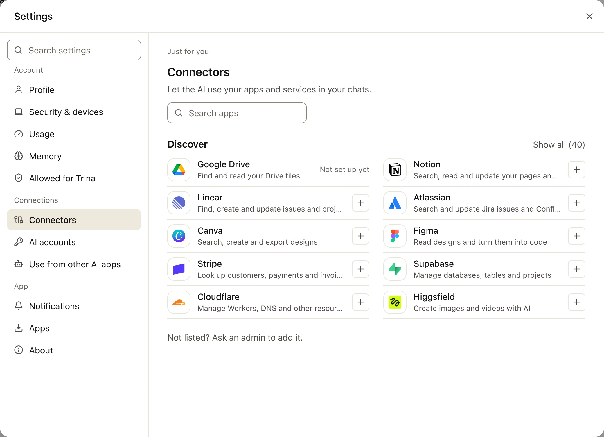
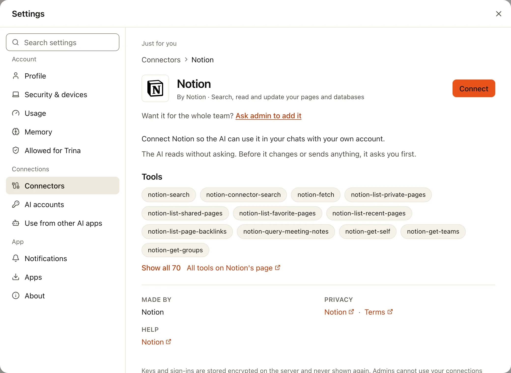
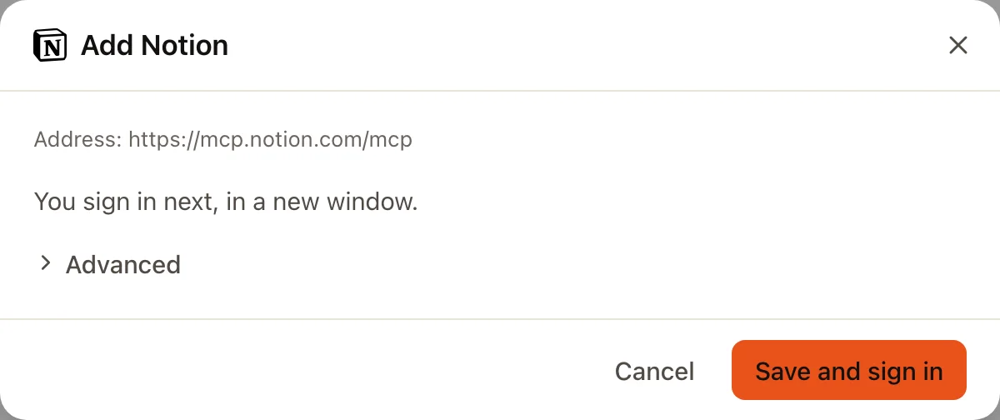
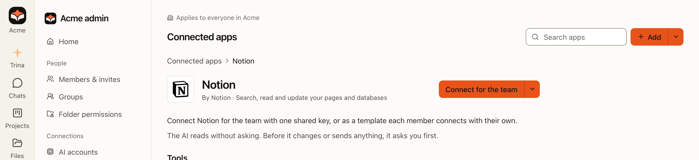
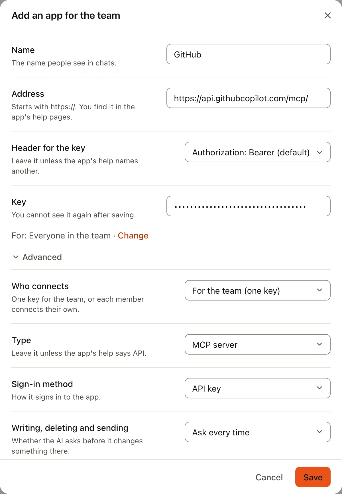

AI가 Trina AX 밖의 앱도 나 대신 쓸 수 있어요. Notion 페이지를 찾고, Linear 이슈를 열고, Jira 티켓을 읽어요. 앱마다 한
번만 연결하면 돼요. 대부분은 복사할 게 없어요. 그 앱 페이지에서 로그인하면 끝이에요. GitHub처럼 대신 키를 주는 앱도
몇 개 있어요.

:::note
0.4.0 이전에는 이 화면 이름이 **외부 서비스**예요. 이 연결은 MCP를 써요. 앱이 AI에게 도구를 내주는 흔한 방식이에요. 쓰는
데 더 알아야 할 건 없어요.
:::

## 내 앱은 어떻게 연결하나요

| 앱 | 필요한 것 | 안내 |
|---|---|---|
| Notion, Linear, Atlassian (Jira, Confluence), Figma, Canva, Stripe, Supabase, Cloudflare, Higgsfield와 **둘러보기**에 있는 다른 앱 | 그 앱의 내 계정. 복사할 건 없어요 | [둘러보기에서 앱에 로그인하기](#둘러보기에서-앱에-로그인하기) |
| GitHub | 내 GitHub 계정. 복사할 것 없음 | [GitHub](#github) |
| "MCP server" 주소를 공개하는 다른 앱 | 그 주소, 앱이 요구하면 키도 | [주소로 앱 추가하기](#주소로-앱-추가하기) |
| 회사가 운영하는 시스템(API) | 주소, 키, 메모 | [회사 API](api-connections.md) |
| Google Drive, Gmail, Calendar, Docs, Sheets | 내 Google 계정 | [Google 앱](google-apps.md) |
| Slack | 멤버는 필요 없어요. 관리자가 한 번 추가해요 | [Slack](slack.md) |

## 나만 쓰기, 팀이 같이 쓰기

| | 나만 | 팀 |
|---|---|---|
| 만드는 곳 | **설정 › 커넥터** | **관리자 › 연결한 서비스** (팀장과 관리자) |
| AI가 쓰는 계정 | 내 계정 | 로그인한 계정, 또는 저장한 키 |
| 쓰는 사람 | 나만, 내 채팅에서 | 관리자가 고른 팀 전체, 부서, 사람 |
| 볼 수 있는 사람 | 나만. 관리자도 못 봐요 | 관리자 |

팀 연결은 **한 번, 한 계정으로** 로그인해요. 그 연결을 쓰는 사람은 모두 그 앱에서 그 계정으로 일해요. 각자 자기
이름으로 일해야 한다면(내 Notion 페이지, 내 GitHub 권한) [템플릿](#템플릿-멤버가-각자-자기-키-쓰기)을 만들거나 각자 직접
연결하게 하면 돼요.

## 둘러보기에서 앱에 로그인하기

:::tip
**필요한 것**

- 브라우저에 로그인된 그 앱(Notion, Linear 등)의 계정.
- 복사하거나 붙여 넣을 건 없어요. Trina AX가 그 앱의 공식 주소를 채워 줘요.
:::

:::steps
#### 커넥터 열기
왼쪽 막대 맨 아래의 내 사진을 누르고 **설정 › 커넥터**로 가요(폰에서는 **나** 탭). **둘러보기**에 연결할 수 있는
앱이 나와요. **전체 보기**를 누르면 모두 보이고, **서비스 검색**으로 이름을 찾을 수 있어요.

#### 앱을 열고 연결 누르기
앱 페이지에 AI가 거기서 할 수 있는 일과 도구 목록이 나와요. **연결**(또는 목록의 **+**)을 눌러요. 멤버에게는 팀 전체가
쓰게 해 달라고 요청하는 **관리자에게 추가 요청하기**도 보여요.

#### 저장하고 로그인하기
창에 앱의 공식 주소가 나와요. **고급**은 그대로 두고 **저장하고 로그인**을 눌러요.

#### 앱 페이지에서 접근 허용하기
새 창에 그 앱(Notion, Linear 등)의 페이지가 열려요. 로그인하라고 하면 로그인하고, 워크스페이스를 고른 뒤 **허용**을
눌러요(버튼 이름이 **계속**이나 **수락**일 수도 있어요). 창이 닫히고 Trina AX에 **로그인했어요.** 안내가 떠요. 앱이
**내 커넥터**로 올라가고 **연결됨**이 보여요.
:::

팀용은 관리자가 **관리자 › 연결한 서비스**에서 똑같이 해요.

1. 왼쪽 막대 맨 위의 팀 로고를 누르고 **관리자 › 연결한 서비스**로 가서, **둘러보기**에서 앱을 열어요.
2. **팀용으로 연결**을 눌러요. (옆의 화살표를 누르면 대신 **템플릿: 멤버가 각자 연결**을 고를 수 있어요.
   [템플릿](#템플릿-멤버가-각자-자기-키-쓰기)을 참고해요.)
3. 창에 앱 주소와 **쓸 사람: 팀 전체** 줄이 나와요. 부서나 사람을 고르려면 그 줄의 **바꾸기**를 눌러요.
4. **저장하고 로그인**을 누르고, 앱 페이지에서 팀이 같이 쓸 계정으로 로그인해 위에서처럼 접근을 허용해요. 앱이
   **연결됨**으로 올라가요.

로그인은 컴퓨터의 브라우저나 데스크톱 앱에서 해야 해요. 한번 연결하면 폰에서도 써요.

## GitHub

GitHub는 둘러보기에 있는 다른 앱처럼 로그인으로 연결해요. 만들거나 복사할 토큰은 없어요. 서버가 가진 GitHub 앱으로 로그인하니까, 사람마다 자기 GitHub 계정으로 로그인하고 AI가 볼 수 있는 저장소를 골라요. Trina가 호스팅하는 팀은 바로 쓸 수 있어요. 직접 운영하는 서버는 운영자가 GitHub 앱을 먼저 더해야 하고, 그 전에는 GitHub 페이지에 "이 서버에는 GitHub가 아직 설정되지 않았어요"라고 나와요.

:::tip
**필요한 것**

- 브라우저에 로그인된 내 GitHub 계정
:::

:::steps
#### 연결 누르기
**둘러보기**에서 GitHub를 열고 **연결**을 눌러요. GitHub 페이지가 열려요(데스크톱 앱에서는 브라우저로).

#### 저장소 고르기
GitHub가 앱이 열 수 있는 저장소를 물어요. AI에 필요한 것만 고르면 AI는 그것만 봐요.

#### 끝
Trina AX로 돌아오면 줄에 **연결됨**이 보여요. AI는 뭔가 바꾸기 전에 먼저 묻고, **항상 허용**을 고를 수도 있어요.
:::

팀 전체용은 관리자가 GitHub를 팀용으로 연결하고 쓸 사람을 정하거나, 각자 자기 계정으로 로그인하는 [템플릿](#템플릿-멤버가-각자-자기-키-쓰기)을 만들어요.

## 주소로 앱 추가하기

"MCP server" 주소를 공개하는 앱이라면 둘러보기에 없어도 추가할 수 있어요. 팀장과 관리자가 **관리자 › 연결한 서비스** ›
**주소로 직접 추가**에서 해요. 멤버에게는 "목록에 없나요? 관리자에게 추가해 달라고 해 주세요."가 보여요.

:::tip
**필요한 것**

- **주소**: 그 앱의 도움말에 있어요. 보통 "MCP", "MCP server", "Connect to AI tools" 같은 페이지예요. `https://`로
  시작하고 `/mcp`로 끝나는 경우가 많아요.
- 앱이 로그인하는 방식: 앱 페이지에서 로그인(**로그인(OAuth)**), 키(**API 키**), 또는 로그인 없음(**없음**).
- 키를 쓴다면: 앱 설정("API keys", "Tokens", "Developer")에서 받은 **키**, 그리고 앱 도움말에 나와 있다면 `X-API-Key`
  같은 **헤더 이름**.
:::

창의 칸은 이래요.

| 칸 | 넣을 것 |
|---|---|
| **이름** | 채팅에서 사람들이 보는 이름. 예: "GitHub" |
| **주소** | 그 앱의 MCP 주소. `https://`로 시작해요. |
| **누가 연결하나요** (고급) | **팀 공용 하나** 또는 **멤버마다 각자** |
| **종류** (고급) | **MCP 서버**. 일반 웹 API일 때만 **API**를 골라요. 자세한 건 [회사 API](api-connections.md)에 있어요. |
| **인증 방식** (고급) | 앱 도움말에 따라 **로그인(OAuth)**, **API 키**, **없음** 중 하나. |
| **키를 보낼 헤더** | 앱 도움말에 다른 헤더가 없으면 **Authorization: Bearer (기본)** 그대로 둬요. 있으면 **다른 헤더**를 고르고 **헤더 이름**을 똑같이 입력해요. |
| **키** | 키 전체를 붙여 넣어요. 저장한 뒤에는 다시 볼 수 없어요. |
| **내 앱으로 로그인** (고급) | Google의 MCP 서버처럼 로그인 앱을 직접 만들라는 앱에만 써요. [내 앱으로 로그인하기](api-connections.md#내-앱으로-로그인하기)에 나와요. |
| **쓰기·삭제·보내기** (고급) | AI가 먼저 물어볼지 정해요(아래 참고). |

:::warning
키는 주소(`…?key=…`)가 아니라 **키** 칸에 넣어요. 팀 연결을 쓰는 사람은 그 주소를 볼 수 있고, AI도 주소를 읽어요.
:::

## 바꾸는 일은 허락이 필요해요

읽기는 바로 실행돼요. 나머지는 모두 쓰기이고, 연결의 **쓰기·삭제·보내기** 설정을 따라요.

| 설정 | 일어나는 일 |
|---|---|
| **매번 묻기** (기본) | Trina AX가 보낼 내용을 모두 적은 카드를 보여 줘요. 사람이 허락하기 전에는 아무것도 나가지 않아요. |
| **쓰기 막기** | 찾아보기만 해요. 쓰기는 거절돼요. |
| **묻지 않고 실행** | 쓰기를 묻지 않고 실행해요. 관리자만, 팀 연결에서만 고를 수 있어요. |

연결을 관리하는 사람은 연결 페이지에서 도구를 하나씩 끌 수도 있어요. 앱이 돌려준 내용은 바깥 데이터로 다루고, 지시로
받아들이지 않아요. 예약 작업에서는 허락할 사람이 없어서 쓰기가 거절돼요. 단, 작업 카드에서 허용한 **묻지 않고 실행** 팀
연결은 예외예요.

## 템플릿: 멤버가 각자 자기 키 쓰기

많은 앱이 키에 그 주인의 권한을 주고, 모든 호출을 그 사람 이름으로 기록해요. 이런 앱은 관리자가 **템플릿**을 추가해요.
앱은 한 번만 등록하고, 멤버가 각자 자기 키나 로그인으로 연결해요.

:::steps
#### 템플릿 추가하기
**관리자 › 연결한 서비스**에서 **주소로 직접 추가**를 눌러요(또는 앱 페이지에서 **팀용으로 연결** 옆 화살표 › **템플릿: 멤버가 각자 연결**). **고급**에서 **누가 연결하나요**를 **멤버마다 각자**로 정해요. 주소, 인증 방식, 쓸 사람을
채워요. 키 칸은 없고, 주소에 `?…` 부분도 넣을 수 없어요. 거기 키가 있으면 모든 멤버에게 가기 때문이에요.
**직원에게 보일 메모 (선택)** 칸에 키를 어디서 받는지 적어 두면 돼요.

#### 멤버가 연결하기
대상 멤버는 **활동**에서 알림을 받고, **설정 › 커넥터**의 **내 커넥터**에서 **팀** 표시와 **연결** 버튼이 붙은 템플릿을
봐요. 각자 자기 키를 넣거나 로그인해요. 그러면 그 사람만의 연결이 되고, 그 사람 채팅에서만 쓰여요.
:::

| | 팀 연결 (키 하나) | 템플릿 |
|---|---|---|
| 키 | 하나, 관리자가 넣어요 | 멤버마다 각자 |
| AI가 쓰는 권한 | 모두에게 키 주인의 권한 | 멤버마다 자기 권한 |
| 관리자가 보는 것 | 연결 | 누가 언제 연결했는지, 누구 키가 작동하지 않는지. 키는 절대 못 봐요 |

관리자 › 연결한 서비스의 템플릿 줄에서 **템플릿 · N명 연결**을 누르면 대상자가 보여요. **연결됨**, **연결 안 함**,
**키가 작동하지 않음** 중 하나예요. 템플릿이 필요한 예약 작업은 내 키가 없으면 실행되지 않아요. 결과에 "…에 내 키가
필요해요"가 뜨고 **연결**로 가는 링크가 있어요.

멤버는 자기 키나 로그인, 쓰기 설정만 바꿀 수 있고, 언제든 연결을 끊을 수 있어요. 관리자가 템플릿의 주소나 인증 방식을
바꾸면 모든 멤버의 키가 지워지고 다시 연결해야 해요. 이름이나 메모만 바꾸면 모두 연결된 채로 있어요. 템플릿을 지우거나
대상에서 누군가를 빼면 그 사람의 연결도 지워져요.

## 멤버에게 연결 요청하기

관리자는 앱을 채워 둔 요청을 멤버 한 명에게 보낼 수도 있어요. **관리자 › 연결한 서비스** › **추가** 옆 화살표 ›
**멤버에게 연결 요청**이에요. 멤버는 알림을 받고 자기 키로 연결하거나 거절해요. 관리자는 키를 볼 수 없어요.

## 채팅에서 연결하기

채팅에서 "Linear 연결해 줘"라고 부탁해도 돼요. AI가 앱의 공식 주소를 채우고 카드를 보여 줘요. 나는 카드에서 로그인하거나
키만 붙여 넣으면 돼요. 키는 AI에게 가지 않아요.

주소가 Trina AX 앱 목록에 없으면 카드의 주소 옆에 그렇다고 나와요. 연결하기 전에 그 앱의 공식 문서에 나온 주소와 같은지
확인해요.

## 문제가 생기면

| 이런 게 보이면 | 이렇게 해요 |
|---|---|
| **로그인 필요** | 로그인이 끝났거나 앱에서 키를 취소했어요. 연결을 열고 **다시 로그인**이나 **키 바꾸기**를 눌러요. |
| **로그인이 아직 끝나지 않았어요.** | 로그인 창을 닫았거나 다른 창 뒤에 있어요. **로그인 창 열기**를 누르거나, 취소하고 다시 해요. |
| **서비스 화면에서 로그인이 취소됐어요.** | 앱 페이지에서 취소나 거부를 눌렀어요. 다시 로그인하고 허용해요. |
| 이유에 "401"이나 "unauthorized"가 있는 **연결을 확인하지 못했어요.** | 키가 틀렸거나 만료됐거나, 복사할 때 공백이 들어갔어요. 앱의 복사 버튼으로 다시 복사해요. Bearer가 아닌 헤더라면 **헤더 이름**을 한 글자씩 확인해요. |
| **이 서비스가 알려 준 도구가 없어요.** | MCP 주소가 아니에요(앱 홈페이지 주소를 붙여 넣은 경우가 많아요). 앱의 MCP 도움말에 있는 주소를 써요. |
| 멤버가 앱을 못 찾아요 | 멤버는 **둘러보기**에 있는 앱만 연결할 수 있어요. 관리자에게 주소로 추가하거나 템플릿으로 추가해 달라고 해요. |

## 반대 방향

내 Claude(Claude Code, Claude Desktop, claude.ai)가 Trina AX**에** 연결해서 내 권한으로 내 파일을 쓸 수도 있어요.
[Trina AX MCP 커넥터 알아보기](../../agents/mcp-connector.md) (영어).

개발자를 위한 자세한 내용: [Integrations](../../../INTEGRATIONS.md) (영어).
