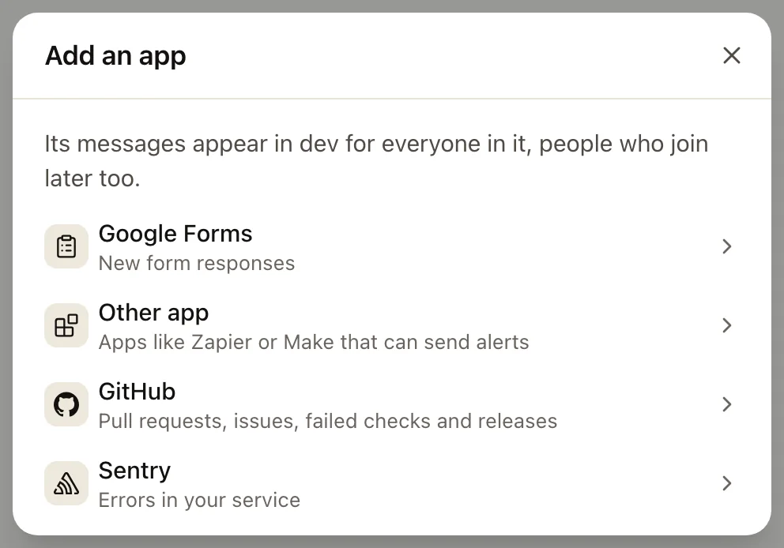
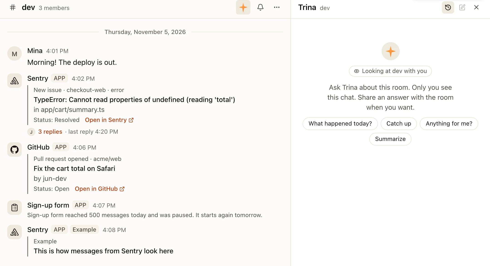
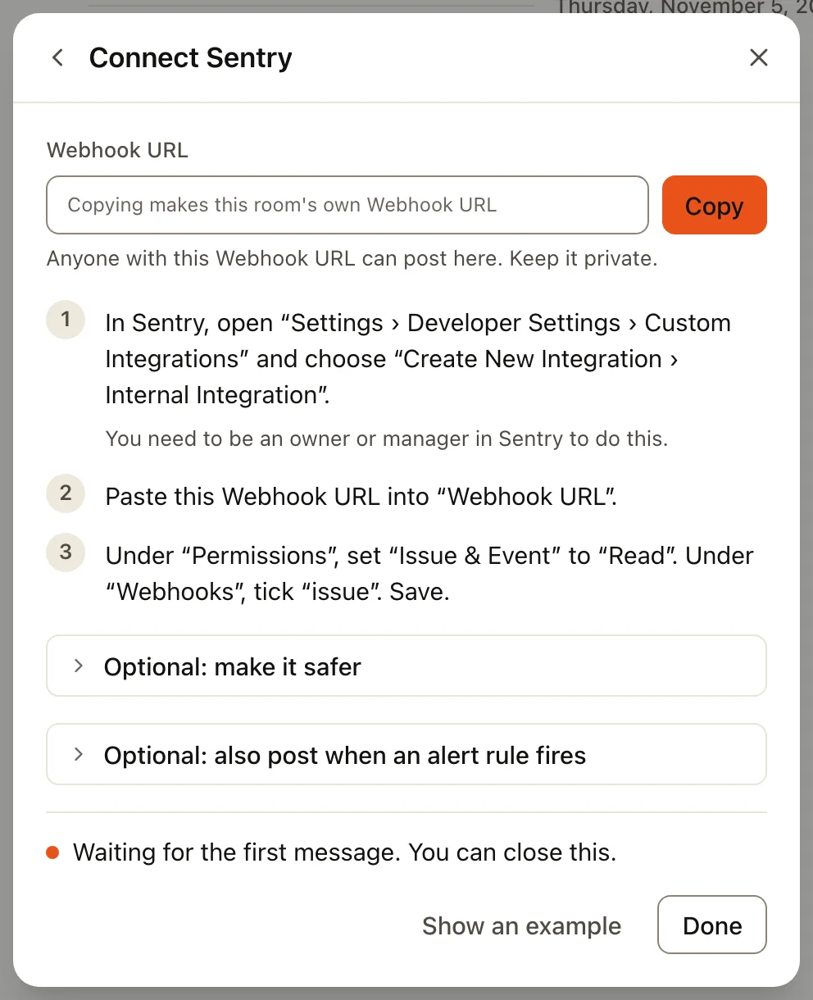
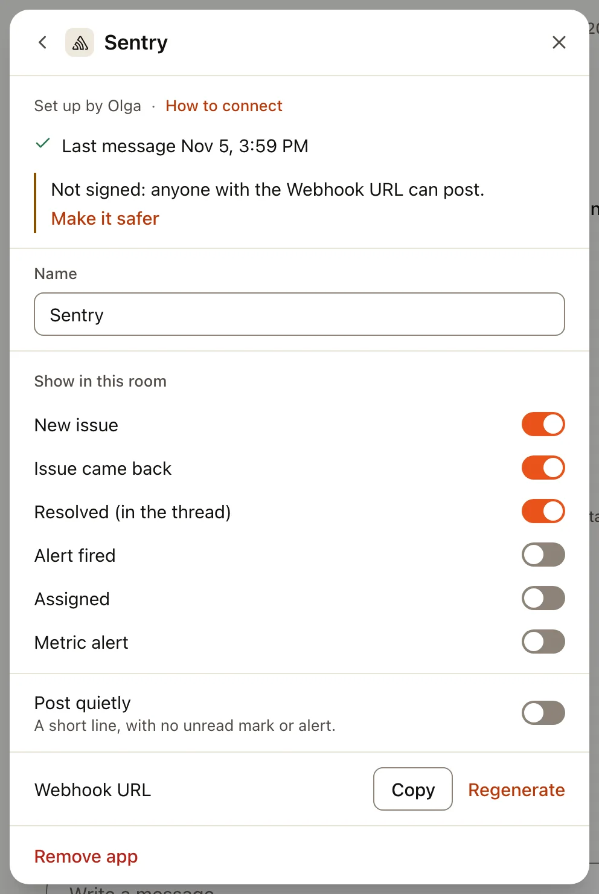

대화방은 팀이 이미 쓰는 서비스에서 새 소식을 받을 수 있어요. **Google 설문지**의 새 응답, **Sentry**의 오류,
**GitHub**의 풀 리퀘스트와 실패한 검사, 그 밖에 Webhook URL로 메시지를 보낼 수 있는 것이면 무엇이든요.
소식은 앱 로고와 **앱** 태그가 붙은 카드로 와요. 사람이 보낸 것처럼 보이지 않아요. 같은 일이 반복되면(같은 오류,
같은 풀 리퀘스트, 고친 응답) 첫 카드 아래 스레드 하나에 모이고, 일이 진행될 때마다 첫 카드의 상태 줄이 바뀌어요.

## 앱 추가하기

1. 대화방을 열고 **⋯ › 앱 추가**를 눌러요.
2. 서비스를 골라요. 서비스는 묶여 있어요. **설문·양식**(Google 설문지, Typeform, Tally, Jotform), **결제·주문**
   (Stripe, Shopify), **업무**(Notion, Zendesk, Jira, HubSpot), **개발자용**(GitHub, Sentry)이에요. **다른 서비스 더
   보기**를 누르면 몇 개가 더 나와요(토스페이먼츠, 채널톡, 포트원). 맨 끝의 **다른 앱**은 그 밖의 무엇이든 받아요. 요금제나 역할이 필요한 서비스는 줄에 그렇게 적혀 있어요(예: *필요: Notion 유료 요금제*).
   다른 앱은 먼저 이름을 붙여요(예: *백업 알림*). 메시지는 그 이름으로 보여요.
3. Webhook URL 옆 **복사**(Google 설문지는 **코드 복사**)를 누르고, 그 서비스에서 번호가 매겨진 단계를 따라 해요.
   복사하기 전에는 대화방에 아무것도 추가되지 않으니, 안내를 먼저 둘러보고 닫아도 돼요.
4. 안내 창에 진행 상황이 바로바로 보여요. *첫 메시지를 기다리는 중*, *연결됨*, 또는 마지막 시도가 왜 보이지 않았는지요.
   2분 동안 아무것도 오지 않으면 **아직 아무것도 안 왔나요?** 부분에 그 서비스에서 자주 하는 실수와 시험 메시지 보내는 법이 나와요.
   **예시 보기**는 메시지가 어떻게 보일지 안내 창 안에서 보여 줘요. 대화방에는 아무것도 올리지 않아요.

**설정 › 커넥터**에서 시작할 수도 있어요. Sentry, Notion, Stripe, Atlassian(Jira) 줄 아래에 **대화방에 앱 추가**가
있어요. 내가 앱을 추가할 수 있는 대화방만 나오고, 하나를 고르면 그 서비스의 안내가 열린 채로 대화방이 열려요. 고를 대화방이
없으면 먼저 **새 대화**로 하나 시작하세요.



할 수 있는 사람: 팀 대화방이나 전체 대화방에서는 그 방의 방장과 관리자, 1:1 대화나 그룹 대화에서는 거기 있는 누구나요.
대화방의 다른 사람은 카드를 보고, 스레드에 답하고, 트리나에게 카드에 대해 물어볼 수 있어요. 앱 이름을 누르면
누가 설정했는지 나와요.

앱 메시지는 대화방에 있는 모두가 봐요. 나중에 들어온 사람도요. 대화방은 신중하게 골라야 해요. 오류 보고나
설문 응답에 고객 정보가 들어 있을 수 있어요.

### 대화방에서는

소식마다 앱 이름 아래 카드가 하나씩 생겨요. **앱** 태그, 무슨 일이 있었는지, 상태 줄, 그 서비스에서 여는 링크가 있어요.
답글은 다른 메시지처럼 카드의 스레드에 달아요. 대화방의 **✦** 사이드 채팅에는 **오늘 무슨 일이 있었나요?** 제안이 나와요
(Google 설문지를 쓰는 방에는 **오늘 응답 요약**도). 앱 메시지를 요약하면서 누군가 챙겨야 할 일을 먼저 알려 줘요. 스레드에서는 **이 스레드
요약**이 나와요.



### Google 설문지

Google 설문지에는 URL을 붙여 넣을 곳이 없어서, 트리나가 설문지에 넣을 짧은 스크립트를 줘요
([Apps Script 트리거](https://developers.google.com/apps-script/guides/triggers/installable)).

- 설문지에서 **⋮ › Apps Script**를 열고, 원래 있던 내용을 지운 뒤 코드를 붙여 넣고 저장해요.
- 위쪽에서 **setUp**을 고르고 **Run**을 눌러요. Google이 **Google hasn't verified this app**이라고 보여 주는데, 정상이에요.
  스크립트는 내가 만든 것이고 내 계정에서만 돌아가기 때문이에요. **Advanced › Go to … (unsafe)** 순서로 고른 다음 접근을 허용해요.
- 설문지가 이메일 주소를 모으면, 응답마다 응답자 이메일이 보여요. 빼려면 앱 설정에서 **응답자 이메일**을 꺼요.
  설문지를 고칠 수 있는 사람은 누구나 코드를 볼 수 있어요.

### 설문, 결제, 업무 도구

Typeform, Tally, Jotform, Stripe, Shopify, Notion, Zendesk, Jira, HubSpot은 각자 안내가 따로 있어요. 그 서비스에서 할
단계를 그 서비스가 부르는 이름 그대로 적어 뒀어요. 간단히 정리하면 이래요.

- **Typeform**: 설문의 **Connect › Webhooks › Add a webhook**에서 붙여 넣고 저장한 뒤 켜요(스위치는 꺼진 채로
  시작하고, 저장한 뒤에야 작동해요).
- **Tally**: 설문의 **Integrations › Webhooks › Connect**에서 **Endpoint URL**에 붙여 넣어요.
- **Jotform**: 설문의 **Settings › Integrations**에서 **WebHooks**를 찾아 Webhook URL을 붙여 넣고,
  **Complete Integration**과 **Finish**를 눌러요(두 버튼 모두 URL을 넣어야 눌려요. **Add New Web Hook**은 누르지 마세요).
- **Stripe**(Admin 또는 Developer 역할): **Developers › Workbench › Webhooks › Create an event destination**에서 안내에
  나온 이벤트를 체크하고, **Webhook endpoint**를 고른 뒤 **Endpoint URL**에 붙여 넣어요.
- **Shopify**(스토어 소유자 또는 Settings 권한이 있는 직원): **Settings › Notifications › Webhooks › Create webhook**으로
  **Order creation**용 웹훅을 만들어요. 원하면 Order payment, Order cancellation, Refund create용으로도 하나씩 더 만들어요.
- **Notion**(유료 요금제): 데이터베이스의 **Automations**에서 동작 **Send webhook**을 골라요. 제목과 Status는 꼭 체크해요.
- **Zendesk**(Team 요금제 이상, 관리자): 웹훅을 만든 다음, 안내에 나온 본문을 보내는 트리거를 만들어요
  (그 단계의 **본문 복사**).
- **Jira**(스페이스 관리자): 스페이스의 **Space settings › Automation › Create flow**에서 트리거 **Work item created**,
  동작 **Send web request**를 고르고 안내에 나온 본문을 넣어요(**본문 복사**). 원하면 **Work item transitioned**와
  **Work item commented**용 흐름을 두 번째, 세 번째로 만들어서, 상태 변경과 댓글을 그 작업 항목의 스레드에 올려요
  ([Jira 자동화 동작](https://support.atlassian.com/cloud-automation/docs/jira-automation-actions/)).
- **HubSpot**(Data Hub Professional 또는 Enterprise): 거래(deal) 기준 워크플로에 동작 **Data ops › Send a
  webhook**을 넣고, **Customize request body**에 안내에 나온 키를 넣어요. 원하면 연락처용, 티켓용도 하나씩 만들어요
  ([HubSpot 워크플로](https://knowledge.hubspot.com/workflows/how-do-i-use-webhooks-with-hubspot-workflows)). 연락처는
  이름과 회사만 보여 주고, 이메일이나 전화번호는 절대 보여 주지 않아요.

설문 응답은 받은 그대로 대화방에 보여요. 이메일 주소도요. 올린 파일은 이름만 보여요(Google
설문지는 개수만 보여요. 그래서 스크립트에 Drive 접근 권한이 필요 없어요). 결제와
주문 카드는 고객 이름(Shopify는 도시도)만 보여 주고, 이메일, 전화번호, 카드 정보는 절대 보여 주지 않아요.

Stripe, Shopify, Zendesk, Typeform, Tally는 보내는 내용에 서명을 할 수 있어요. 안내의 **선택: 더 안전하게 쓰기**에
서비스의 서명 비밀값을 넣으면(또는 트리나가 주는 비밀값을 서비스에 붙여 넣으면), 그 뒤로는 서명된 메시지만 보여요. 트리나가
준 비밀값(Typeform, Tally, GitHub)은 그 비밀값으로 서명된 첫 메시지부터 적용돼요(Tally는 **Add a signing secret**에 자기
비밀값을 미리 채워 두니, 트리나의 비밀값으로 바꿔요). 그때까지는 서명이 없는 메시지도
보여서, 서비스에 붙여 넣기 전에 놓치는 메시지가 없어요. Jira와 HubSpot은
서명할 수 없어요. Webhook URL이 유일한 열쇠이니 남에게 알리지 마세요.

### 다른 서비스

선택 화면의 **다른 서비스 더 보기**를 누르면 주로 한국에서 쓰는 서비스가 나와요. 목록은 누구에게나 같아요.

- **토스페이먼츠**: 개발자센터의 **웹훅 › 웹훅 등록하기**에서 Webhook URL을 붙여 넣고
  **PAYMENT_STATUS_CHANGED**를 체크해요([토스페이먼츠 웹훅](https://docs.tosspayments.com/guides/v2/webhook)). 카드에는
  금액, 주문명, 결제 수단이 나와요. 카드 번호, 계좌, 전화번호는 절대 나오지 않아요. 선택: 개발자센터의 보안 키
  (**API 키 › 보안 키**).
- **채널톡**: **Settings › Webhook › Create new webhook**에서 Webhook URL을 붙여 넣고, 상담과 메시지
  알림을 켜요([채널톡 웹훅](https://developers.channel.io/en/articles/Webhook-events-7bd9b8e2)). 새 상담은
  고객 이름과 첫 메시지를 보여 줘요. 그 뒤에 온 고객 메시지(켜 두면 팀의 답변도)는 그 상담의 스레드에 모여요.
  팀 안의 그룹 대화는 보이지 않아요. 선택: 웹훅 토큰.
- **포트원**(V2): **결제 연동 › 연동 관리 › 결제알림(Webhook) 관리**에서 웹훅 버전 **결제모듈 V2**를 고르고
  Webhook URL을 붙여 넣어요([포트원 웹훅](https://developers.portone.io/opi/ko/integration/webhook/readme-v2)). 포트원은
  결제 ID와 상태만 보내서, 카드에 금액이나 이름이 나오지 않아요. 선택: 웹훅 시크릿(**웹훅 시크릿 발급**).

### 다른 앱

**Slack, Discord, JANDI 웹훅 URL**을 달라는 도구도 여기에 올릴 수 있어요. 그 칸에 트리나 Webhook URL을 붙여 넣으면 돼요.
둘 다 없는 도구는 Zapier나 Make로 연결할 수 있어요. 안내의 **쓰는 앱이 없나요?** 부분에 각각 예시가 하나씩
있어요.

Webhook URL로 메시지를 보낼 수 있는 것(Zapier, Make, Grafana, Uptime Kuma, 직접 만든 스크립트)이면 다 돼요. 서비스가
메시지를 보내는 곳에 Webhook URL을 붙여 넣고 시험 메시지를 보내 봐요. 안내 창과 앱 설정의 **보내는 방법**에
복사할 수 있는 예시가 있어요.

```json
{ "text": "Backup finished: 1,204 files", "title": "Nightly backup", "url": "https://example.com/report", "thread": "nightly-backup" }
```

- `text`가 메시지예요. 꼭 필요한 건 이 칸 하나예요(`content`도 돼요).
- `title`은 제목을, `url`은 링크 하나를 더해요. `thread`가 같은 메시지는 스레드 하나에 모여요.
- Slack 형식 메시지(`blocks`, `attachments`), 일반 텍스트, 일반 폼 전송(`text=…`처럼 같은 칸, 또는 Slack의
  `payload` 칸)도 받아요. `Idempotency-Key` 헤더를 넣으면
  다시 보내도 한 번만 올라가요.

```bash
curl -X POST -H 'Content-Type: application/json' -d '{"text":"Hello from my app"}' <Webhook URL>
```

다른 앱은 이름 첫 글자를 앱마다 다른 색 위에 보여 줘서, 한 대화에 다른 앱이 여러 개 있어도 헷갈리지 않아요. 그림으로 바꾸려면 앱 설정에서 **아이콘 바꾸기**를 누르고 **이미지 올리기**(PNG, JPEG, WebP, 정사각형으로 잘려요)나 **이모지 고르기**를 고르세요. **아이콘 지우기**를 누르면 다시 첫 글자가 보여요. 아이콘은 앱의 예전 메시지에도 보여요. 메시지로는 앱의 이름이나 아이콘을 바꿀 수 없어요. Slack의 `username`, `icon_url`, `icon_emoji`나 Discord의 `avatar_url` 같은 값은 무시돼서, Webhook URL로 보낸 어떤 것도 사람이나 다른 앱인 척할 수 없어요.

### GitHub

저장소마다 설정해요. 그 저장소의 관리자 권한이 있어야 해요([GitHub 문서](https://docs.github.com/en/webhooks/using-webhooks/creating-webhooks)).

- 저장소에서 **Settings › Webhooks › Add webhook**을 열어요.
- **Payload URL**에 Webhook URL을 붙여 넣고 **application/json**을 골라요.
- **Send me everything**을 고르고 **Add webhook**을 눌러요. 트리나는 앱 설정에서 켠 것만 보여 줘요.
- *선택, 더 안전하게:* 안내에서 **비밀값 복사**를 누르고 **Secret**에 붙여 넣어요. 그 비밀값으로 서명된 첫 전송
  (저장할 때 GitHub가 보내는 ping)부터, 트리나는 GitHub가 서명한 것만 보여 줘요([전송 검증](https://docs.github.com/en/webhooks/using-webhooks/validating-webhook-deliveries)).

아무것도 오지 않으면 GitHub 웹훅 페이지의 **Recent Deliveries**에서 무엇을 보냈는지 볼 수 있어요.

### Sentry

Sentry에서는 이걸 내부 통합(internal integration)이라고 불러요([Sentry 문서](https://docs.sentry.io/organization/integrations/integration-platform/)).
Sentry에서 owner나 manager여야 해요.



- Sentry에서 **Settings › Developer Settings › Custom Integrations**를 열고 **Create New Integration › Internal
  Integration**을 골라요.
- **Webhook URL**에 Webhook URL을 붙여 넣어요.
- **Permissions**에서 **Issue & Event**를 **Read**로 두고, **Webhooks**에서 **issue**를 체크해요. 저장해요.
- *선택, 더 안전하게:* 통합의 **Client Secret**을 안내 창에 붙여 넣어요. 그 뒤로 트리나는 Sentry가
  서명한 것만 보여 줘요([Sentry 서명 방식](https://docs.sentry.io/organization/integrations/integration-platform/webhooks/)).
- *선택:* 알림 규칙이 울릴 때도 올리려면, 규칙에 **Send a notification via an integration** 동작을 넣고
  이 통합을 고른 뒤, 앱 설정에서 **알림 울림**을 켜요.

## 설정

**⋯ › 연동**의 **앱**에 대화방의 앱이 나오고, **앱 추가**가 있어요. 앱 하나의 페이지에는 이런 것이 있어요.

- 누가 설정했는지, 그리고 **연결 방법 보기**(단계를 다시 보여 줘요).
- **상태 줄**: 마지막 메시지, *멈춤*, *첫 메시지를 기다리는 중*, 또는 **다시 만들기** 뒤 새 URL로 첫 메시지가
  올 때까지 *GitHub가 새 Webhook URL을 쓰기를 기다리는 중*(목록의 줄에도 나와요).
- **경고**: 경고마다 할 일이 하나씩 있어요. 마지막 시도가 왜 보이지 않았는지(**비밀값 확인**), *나간 멤버가 이 Webhook URL을 알고 있어요*
  (**다시 만들기**), 서명할 수 있는 서비스인데 아직 비밀값이 없으면 *서명 확인 안 됨: Webhook URL을 아는 누구나 올릴 수 있어요*
  (**더 안전하게**).
- **아이콘 바꾸기**(다른 앱): 이름 첫 글자 대신 이미지나 이모지를 쓰거나, **아이콘 지우기**로 되돌려요.
- **이름**: 메시지가 보일 이름.
- **이 대화방에 보이기**: 올릴 소식의 종류(종류가 여러 개인 앱). 서비스에서 설정하지 않은 선택 이벤트
  (예: Shopify의 환불)에는 *Shopify에서 아직 설정 안 됨*이 나오고, 그 단계로 가는 링크가 있어요.
- **조용히 올리기**: 안 읽음 표시나 알림 없이 짧은 한 줄로 올려요.
- **보내는 방법**(다른 앱).
- **Webhook URL**: 다시 **복사**하거나 **다시 만들기**를 해요(예전 URL은 바로 쓸 수 없게 돼요. 새 URL을
  서비스에 붙여 넣어요).
- **앱 제거**: 앱이 더는 올릴 수 없어요. 이미 올라온 메시지는 남아요.



## 한도

앱 하나는 하루에 메시지를 500개까지 올려요(Google 설문지는 응답 500개). 넘으면 자정(팀 시간대)까지 멈춰요.
대화방에 한 줄이 올라오고, 대화방을 관리하는 사람은 **활동**(폰과 브라우저에도)에서 **지금 다시 켜기**가 달린 알림을 받아요
(하루에 한 번). 팀의 앱을 모두 합쳐서는 하루에 메시지를 5,000개까지 올려요. 넘으면 모든 앱이 자정까지
멈추고, 그 줄과 알림에 *오늘 팀의 앱 메시지가 모두 합쳐 5,000개에 도달했어요*라고 나와요. **지금 다시 켜기**는 없어요. 건너뛴
설문 응답은 설문지의 응답 탭에 그대로 있어요. 카드는 일반 텍스트예요. 카드 안의 내용으로 누군가를 멘션하거나,
무언가를 실행하거나, 링크를 숨길 수 없어요.

## 앱이 서버에 닿지 못할 때

앱이 팀에 메시지를 보내려면 바깥과 연결돼 있어야 해요. 호스팅 팀과 트리나 릴레이를 쓰는 서버는 연결돼
있어요. 사무실 네트워크 안에만 있는 서버는 그렇지 않아요. 대화방의 **앱 추가**에 그렇게 나오고, 팀장이
**관리자 › 시스템 › 연결**에서 **연결 켜기**를 할 수 있어요. 자체 공인 주소가 있고 국가나 네트워크 제한을 둔 서버도
앱 메시지는 어디서든 받아요. 관리자 › 시스템 › 연결에 그렇게 나와요.
