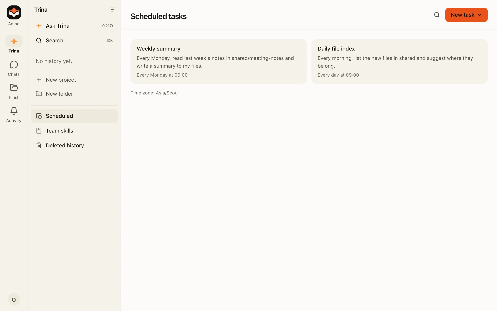
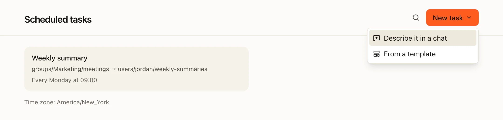
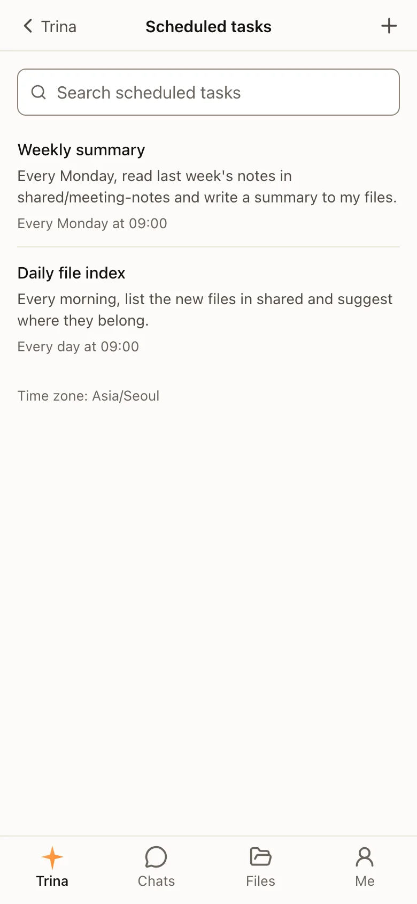

예약 작업은 요청 하나를 계속 반복해서 실행해요. 평일 아침마다, 월요일마다, 매달 1일처럼요. 만든 사람의 권한으로 실행돼요.

:::note
0.4.0부터 예약 작업은 따로 **예약 작업** 페이지가 있어요. 트리나 목록 위쪽의 한 줄이에요(폰에서는 **트리나** 탭의 **☰** 메뉴). ⌘K의 **새 예약 작업**으로도 열려요. 그 전 버전에서는 **설정 › 예약 작업**에 있어요.
:::

## 작업 만들기

**새 작업**을 골라요. 방법은 두 가지예요.

- **채팅으로 설명하기.** 예를 들어 "매주 월요일 9시에 shared/sales에 있는 지난주 메모를 요약해 줘"처럼요. AI가 일정을 만들고 보여 줘요.
- **템플릿으로 만들기.** 템플릿을 고르고, 폴더와 시간을 채워서 저장해요.

## 예약 실행에서 할 수 있는 것

| 항목 | 예약 실행에서는 |
|---|---|
| **권한** | 만든 사람의 폴더 권한과 만든 사람의 스킬을 써요. |
| **시간** | 팀 시간대를 따라요. |
| **질문** | 답할 사람이 없어서, 사람이 필요한 일은 실행하지 않아요. 단, 작업 카드에서 허용한 것은 예외예요(아래 참고). |
| **웹** | 사람이 확인하지 않아도 되는 새 웹 주소를 한 번 실행에 8개까지 열어요. |
| **큰 파일 내려받기** | 1 GB가 넘는 파일은 물어보지 않고 건너뛰어요. |

## 묻지 않고 저장하고 보내기

예약 실행에는 확인 카드에 답할 사람이 없어요. 그래서 작업을 만들거나, 고치거나, 다시 확인할 때 작업 카드가 한 번 물어봐요.

- **저장 폴더.** "새 파일 저장: shared/Weekly reports (지금 30명이 볼 수 있어요). 넣어도 되는 내용: 내 폴더, #Sales 대화방"처럼요. 실행할 때마다 그 폴더와 하위 폴더에 **새** 파일을 묻지 않고 넣어요. 한 번 실행에 20개까지예요. 작업이 직접 만들지 않은 파일은 바꾸거나 덮어쓰지 않고, 스킬이나 지침 파일은 건드리지 않아요. 카드에 없는 곳(다른 폴더, 다른 대화방)에서 더 적은 사람만 볼 수 있는 내용을 읽었다면, 대신 내 폴더에 저장하고 이유를 알려 줘요.
- **내 연결.** "보낼 수 있는 곳: 내 Notion · 'Daily notes'"처럼요. 카드에 적힌 받는 곳에만 보내요.

저장 폴더를 옮기거나, 이름을 바꾸거나, 지우거나, 폴더 권한이 바뀌거나, 내가 더 이상 그 폴더에 쓸 수 없게 되면, 작업에 **저장 폴더를 다시 확인해 주세요**와 **다시 확인**이 나오고 알림이 한 번 와요. 확인하기 전까지는 내 폴더에 저장해요. 부서에 사람이 들어오거나 나가도 달라지는 건 없어요.

**수정**의 **저장 폴더** 칸에서 다른 폴더를 고르거나 폴더를 뺄 수 있어요(×). 넣어도 되는 내용도 항목마다 뺄 수 있어요(×).

## 작업 관리하기

작업을 열면 일정, 지시문, 다음 실행, 마지막 실행이 보여요.

- **지금 실행**을 누르면 바로 실행해요.
- 스위치로 멈추거나 다시 켜요.
- 이름 옆 메뉴에 **수정**과 **삭제**가 있어요.

이미 끝난 한 번짜리 작업이나 더 이상 실행할 수 없는 작업에는 왜 켤 수 없는지 나와요.

## 폰에서

작업이 목록 하나로 나와요. 위에 검색창이 있고, 새 작업은 맨 위 **+** 버튼으로 만들어요.

