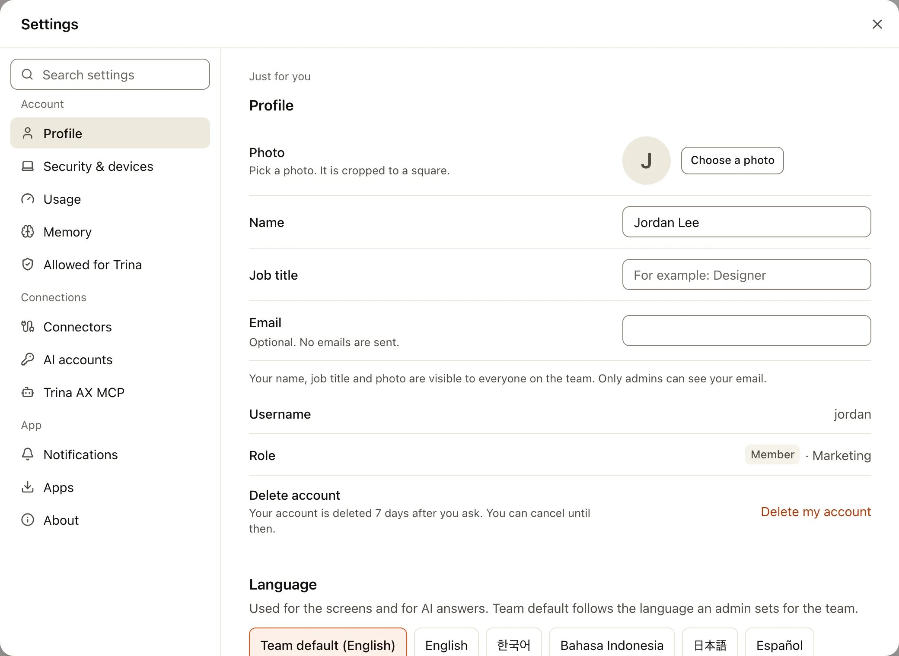
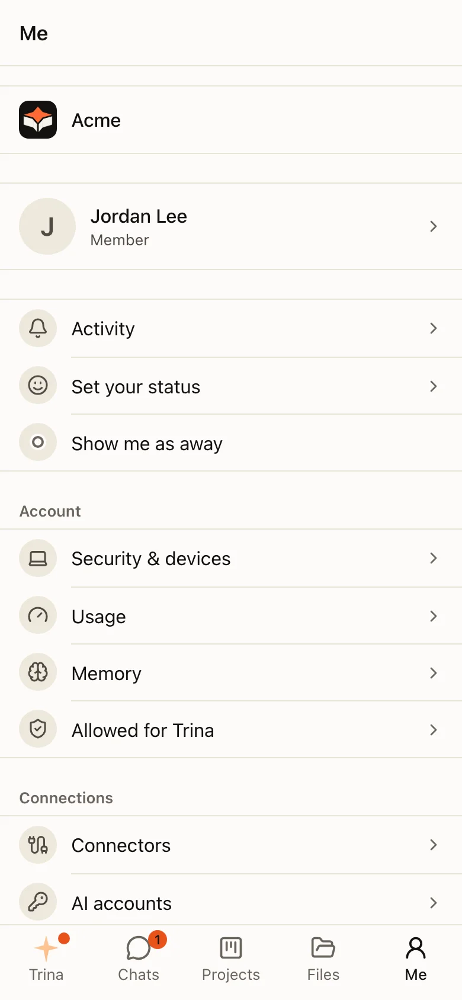
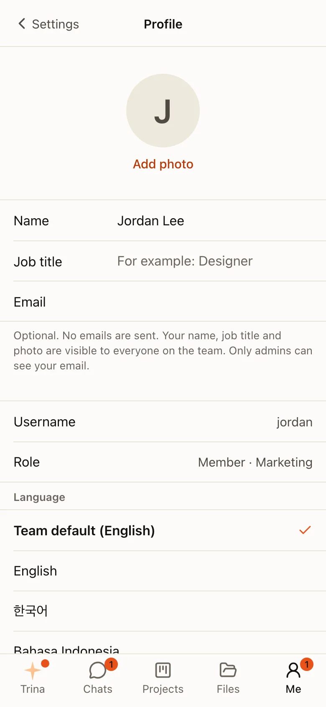
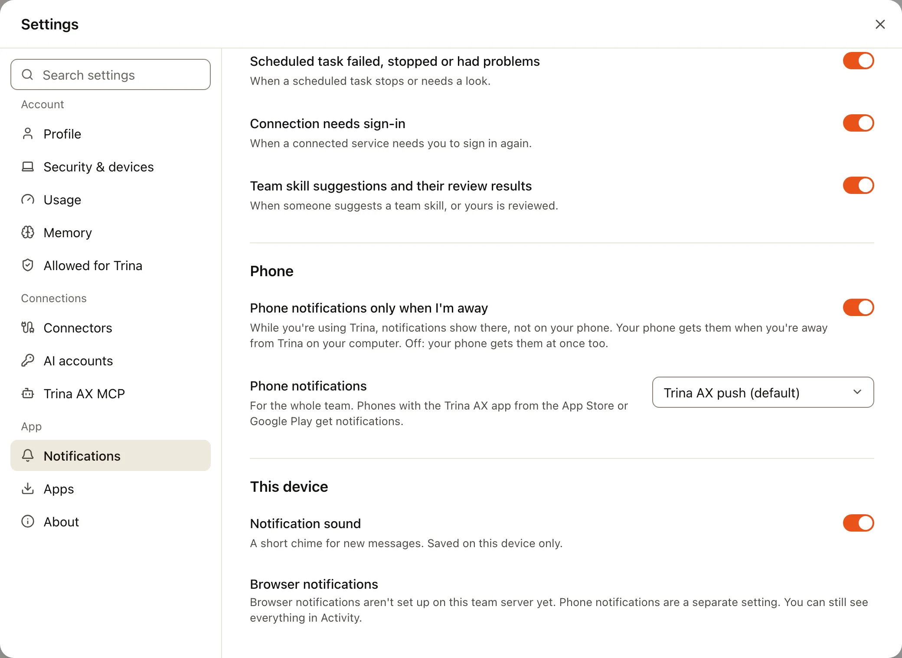
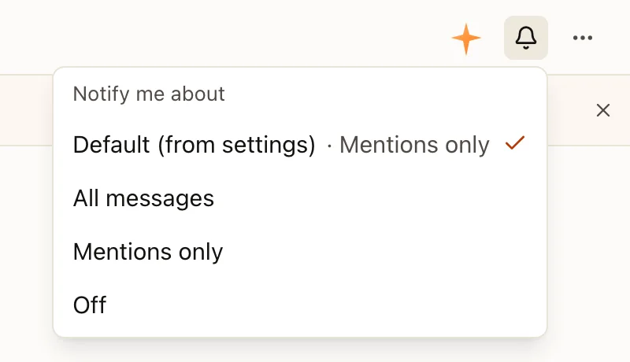
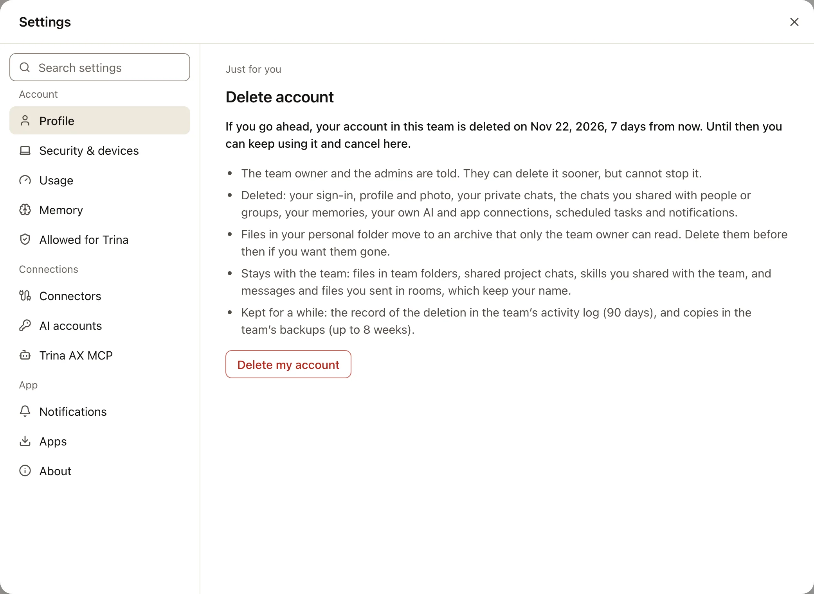
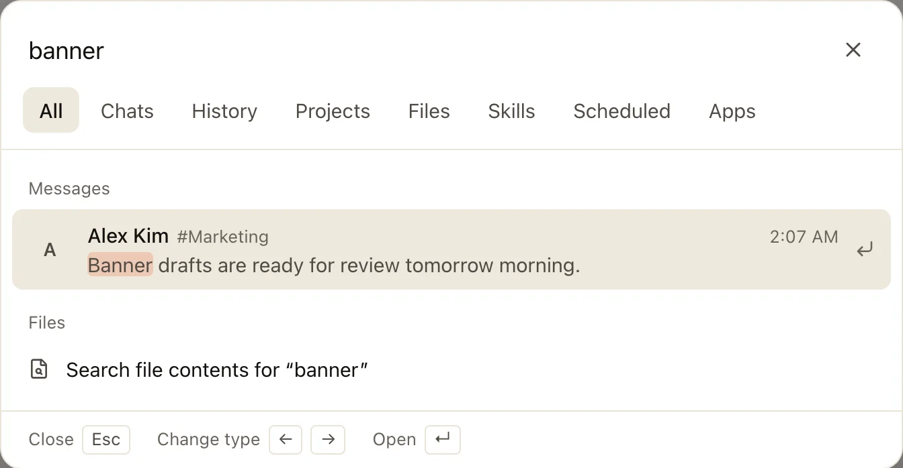

내 계정에 관한 건 모두 왼쪽 막대 맨 아래의 내 사진에 있어요. 한 번만 누르면 돼요.

## 계정 메뉴

왼쪽 막대 맨 아래 내 사진을 눌러요. 폰에서는 **나** 탭을 열어요.

| 항목 | 하는 일 |
|---|---|
| **자리 비움으로 표시** | 다시 바꿀 때까지 다른 사람에게 자리 비움으로 보여요 |
| **상태 설정** | 이모지가 붙은 짧은 상태를 이름 옆에 보여 줘요 |
| **설정** | 설정 창을 내 프로필 화면으로 열어요 |
| **로그아웃** | 지금 로그인을 끝내요 |

내 사용량은 **설정 › 사용량**에 있고, 지운 채팅은 트리나 목록의 **트리나 기록** 옆 **⋯** 메뉴에 있는 **삭제한 기록**에 있어요
(폰에서는 **트리나** 탭 **☰** 메뉴의 맨 아래).

### 팀 바꾸기

데스크톱 앱에서는 왼쪽 막대 맨 위의 팀 로고를 누르고 **다른 팀으로
전환**을 골라요. 앱의 **팀** 메뉴(⌘1–9)와 똑같이 내 팀 목록이 나와요. 폰 앱에서는 **나** 탭의 팀 이름 아래에
있어요. 웹 브라우저에서는 팀마다 주소가 따로 있어서 바꿀 게 없어요.

## 설정 창

설정은 지금 보던 화면 위에 창으로 열려요. `/settings/usage` 같은 링크를 열면 그 항목에서 바로 열려요.
설정 창의 내용은 모두 나에게만 적용돼요. 팀 전체에 적용되는 것은 관리자 화면에 있어요.

| 묶음 | 항목 |
|---|---|
| **계정** | 프로필, 보안·기기, 사용량, 메모리, 트리나에게 허용한 것(그리고 브라우저, 아래 참고) |
| **연결** | 커넥터, AI 제공사(팀이 팀원에게 자기 계정 추가를 허용할 때), Trina AX MCP, 개발 환경 사이트(나에게 개발 환경이 켜져 있을 때) |
| **앱** | 알림, 앱, 정보 |

[게스트](guests.md)는 프로필, 알림처럼 자기 항목만 봐요. 본인 계정으로 로그인하는 게스트는 **AI 제공사**에서 자기 Claude나 ChatGPT 계정을 연결해요.

**커넥터**에는 다른 서비스와의 연결이 모여 있어요. Google Drive, Gmail과 다른 Google 앱, Slack, 그리고
목록에 있는 서비스예요. 하나를 열어 연결하거나, AI가 그 서비스로 무엇을 할 수 있는지 보거나, 연결을 끊어요. 서비스 이름 위의
**커넥터**(폰에서는 **‹ 커넥터**)를 누르면 목록으로 돌아가요. `/connectors` 같은 예전 링크로도 열려요.
자세한 내용은 [MCP 연결](mcp.md)에 있어요.

:::steps
#### 항목 찾기
왼쪽에서 항목을 고르거나 **설정 검색**에 입력해요.

#### 필요한 것 바꾸기
프로필, 언어(English, 한국어, Bahasa Indonesia, 日本語, Español, 简体中文), 테마(밝게, 어둡게, 시스템 설정 따라가기. 프로필에 있어요), 기본 엔진, 알림 등을 바꿔요.

#### 닫기
**Esc**를 누르거나 **✕** 버튼을 눌러요. 원래 보던 곳으로 돌아가요.
:::

**트리나에게 허용한 것**에는 확인 카드에서 **항상 허용**을 고른 것과, 새 파일을 넣어도 된다고 허용한 대화방 폴더가 나와요.
하나를 지우면 다음에 다시 물어봐요.

**브라우저**(데스크톱 앱에, 그리고 **모든 웹사이트 허용**이 켜져 있는 동안 웹에도 있어요)에는 **모든 웹사이트 허용**이 있어요. 켜 두면 내 채팅과 대화방에서 내가 부탁할 때 AI가 공개 웹사이트를 묻지 않고 열어요. 예약 작업은 계속 물어요. 알아보기 어려운 긴 글자나 긴 내용이 붙은 주소도 계속 묻지만, 눈에 띄는 토큰만 걸러 내요. 문서나 페이지, 대화방 메시지에 숨은 지시가 있으면 AI가 읽을 수 있는 것을 어떤 사이트로든 보내게 만들 수 있어요. 주소 카드의 "모든 사이트 허용 (설정에서 끌 수 있어요)"으로 켤 수도 있어요. 데스크톱 앱에서는 같은 스위치가 앱 자체 브라우저에도 적용되고, 그 브라우저는 자기 창에서 한 번 더 물어봐요. 이 항목은 팀이 허용하는 동안에만 보여요.

폰에서는 설정이 화면 전체를 채워요. 항목 목록이 먼저 나오고, **←** 버튼을 누르면 목록으로 돌아가요.

## 알림

**설정 › 알림**에서 어떤 알림을 받을지 골라요. 대화 메시지(1:1·그룹 대화와 멘션만, 새 메시지 전부, 또는 받지 않기),
내 스레드의 답글, **방해 금지 시간**, 예약 작업, 연결, 팀 스킬, **나에게 공유된 채팅**이에요. **폰**의
**폰 알림은 자리를 비웠을 때만**을 켜면 컴퓨터로 트리나를 쓰는 동안에는 폰이 조용해요. **이 기기**에는 소리 설정과,
브라우저에서는 **브라우저 알림**이 있어요.

팀장과 관리자는 **폰 › 휴대폰 알림**에서 팀 전체의 휴대폰 알림을 어디로 보낼지 골라요.
**Trina AX 푸시 (기본)**, **끄기**, 또는 **직접 지정**이에요. 직접 지정은 직접 빌드한 폰 앱을 위한 자체 푸시 서비스 주소를 넣는
거예요. 폰에 오는 알림에는 파일이나 대화 내용이 절대 들어가지 않아요.

### 대화 하나의 알림

폰에서 단톡방 하나만 알림을 끄듯이, 대화마다 알림을 따로 정할 수 있어요.

1. **대화**에서 그 대화를 열어요.
2. 오른쪽 위 **✦**, **⋯** 옆의 종을 눌러요. 폰에서는 위쪽 **⋯** 를 누르고 **알림 설정**을 골라요.
3. **이 대화 알림**에서 하나를 골라요. **기본값 (설정 따름)**(지금 이 대화에 어떻게 적용되는지 함께 보여요),
   **모든 메시지**, **멘션만**, **끄기**예요.

체크 표시가 바로 고른 쪽으로 옮겨 가고, **끄기**면 종에 빗금이 그어져요.

채널은 바꾸지 않으면 **멘션만**, 1:1·그룹 대화는 **모든 메시지**예요. **멘션만**인 대화는 새 메시지가 와도 이름만 굵게
보이고, 목록, **대화** 탭, 앱 아이콘에 숫자가 붙지 않아요. 나를 멘션한 메시지는 **@**로 보이고 숫자에도 들어가요.
**끄기**로 둔 대화는 숫자가 회색이고 어디에도 더해지지 않아요.

## 계정 삭제

**설정 › 프로필 › 계정 삭제**에서 비밀번호를 넣고 요청하면, 7일 뒤 이 팀의 내 계정이 삭제돼요.
페이지에 삭제 날짜, 삭제되는 것, 팀장의 보관 폴더로 옮겨지는 것, 팀에 남는 것이 나와요. 그때까지는
계정을 계속 쓸 수 있고, **계정 유지하기**를 누를 수 있어요. 팀장과 관리자에게 알림이 가요. 더 일찍 삭제할 수는 있지만
막을 수는 없어요. 팀장 본인의 계정은 여기서 삭제할 수 없어요. 먼저 팀을 다른 사람에게 넘겨야 해요.

## ⌘K로 검색하기

**⌘K**(Windows는 Ctrl+K)를 누르거나 **트리나에게 묻기** 아래 **검색**을 골라요.

- **탭**으로 검색 범위를 좁혀요. 전체, 대화, 기록, 프로젝트, 파일, 스킬, 예약, 서비스예요.
- **아무것도 입력하지 않으면** 내가 챙겨야 할 것, 최근 채팅과 프로젝트, 그리고 **트리나에게 묻기** 같은 빠른 동작이 나와요.
- **대화와 사람**은 이름으로 찾고, 전체 탭 맨 위에 나와요. 이름 일부나 초성("ㄱㅈ"으로 "견적")을 입력해요. 대화를 고르면 그 대화가 열려요. 사람을 고르면 그 사람과의 1:1 대화가 열려요. 아직 없으면 새 대화 목록이 그 사람이 체크된 채로 열리고, 버튼을 눌러야 대화가 시작돼요.
- 내 대화(채널, 다이렉트 메시지, 그룹 대화)의 **메시지**는 전체 탭에서 채팅 다음에 나와요. 누가, 어디서, 언제 썼는지와 입력한 말 앞뒤 내용이 보여요. 지금 그 대화를 열면 보이는 것만 찾아요. 하나를 고르면 그 메시지 위치에서 대화가 열려요(답글이면 스레드가 열려요). **최근 메시지로**를 누르면 최신 메시지로 돌아가요. 단어 일부로도 찾아요. "견적"으로 "견적서를"을 찾아요.
- **대화에서 보낸 파일**은 전체 탭과 파일 탭에서 팀 파일 다음에 이름으로 찾아요. 파일, 보낸 사람, 어디서, 언제 보냈는지가 나와요. 내가 볼 수 있는 메시지의 파일만 찾아요. 하나를 고르면 그 파일을 보낸 메시지 위치에서 대화가 열려요.
- **입력한 단어는 모두 찾아요.** 순서는 상관없어요. "견적서 보내"로 메시지, 채팅, 파일 이름에서 "견적서를 보내드렸어요"를 찾아요.
- **키:** ↑와 ↓로 움직이고, Enter로 열고, ←와 →로 탭을 바꾸고, Esc로 닫아요.
- 검색창 아래 **칩**으로 찾는 메시지와 파일을 좁혀요: **이 대화**(대화에서 검색을 열었을 때), **내가 보낸**, **나를 멘션한**. `from:me`나 `mentions:me`를 입력해도 같아요.

| 키 | 하는 일 |
| --- | --- |
| **⌘K**(Ctrl+K) | 어디서든 검색을 열어요. |
| 채널, 1:1 대화, 그룹 대화, 스레드에서 **⌘F**(Ctrl+F) | **이 대화**가 켜진 채로 검색을 열어요. 대화의 **⋯** 메뉴에도 **이 대화에서 검색**이 있어요. |
| AI 채팅, 파일 보기, 또는 옆에 파일이나 아티팩트를 연 채로 **⌘F**(Ctrl+F) | 지금처럼 페이지에서 찾아요. |
| 그 밖의 곳에서 **⌘F**(Ctrl+F) | ⌘K와 같아요. |
| 검색이 열린 채로 **⌘F**를 한 번 더 | 검색창으로 돌아가고 입력한 글자가 선택돼요. 페이지에서 찾으려면 데스크톱 앱의 **편집 › 찾기…** 메뉴를 써요. |

