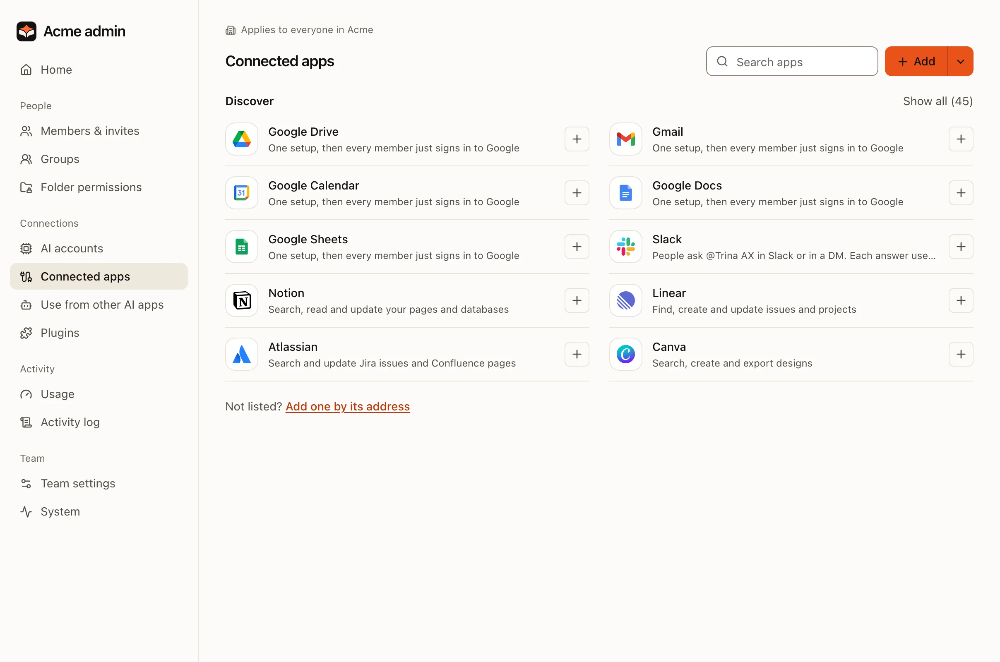
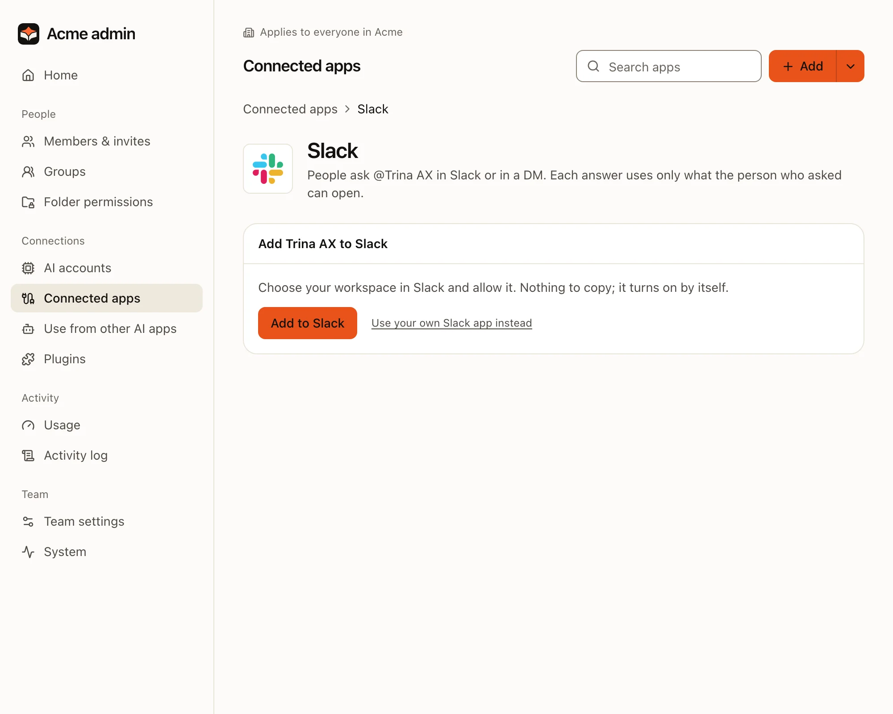
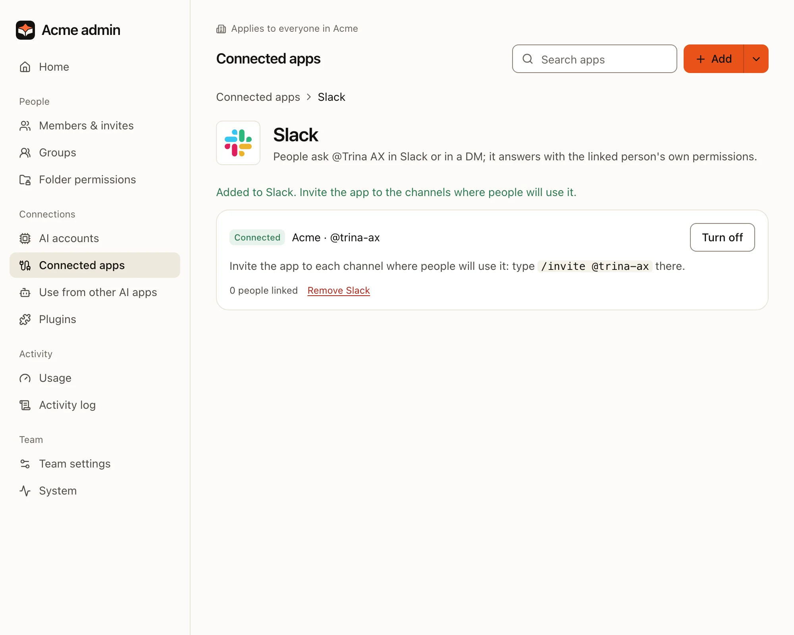
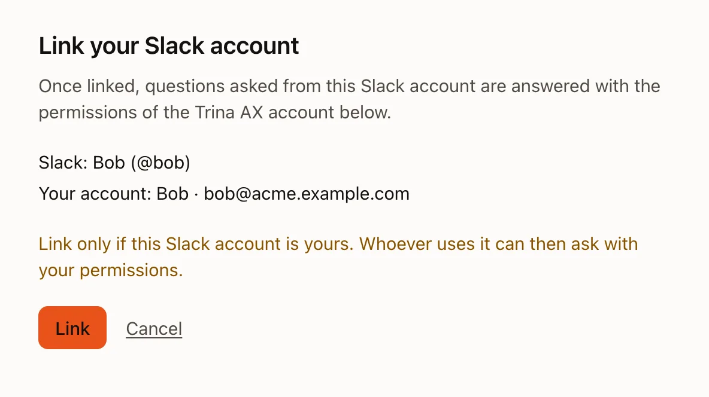
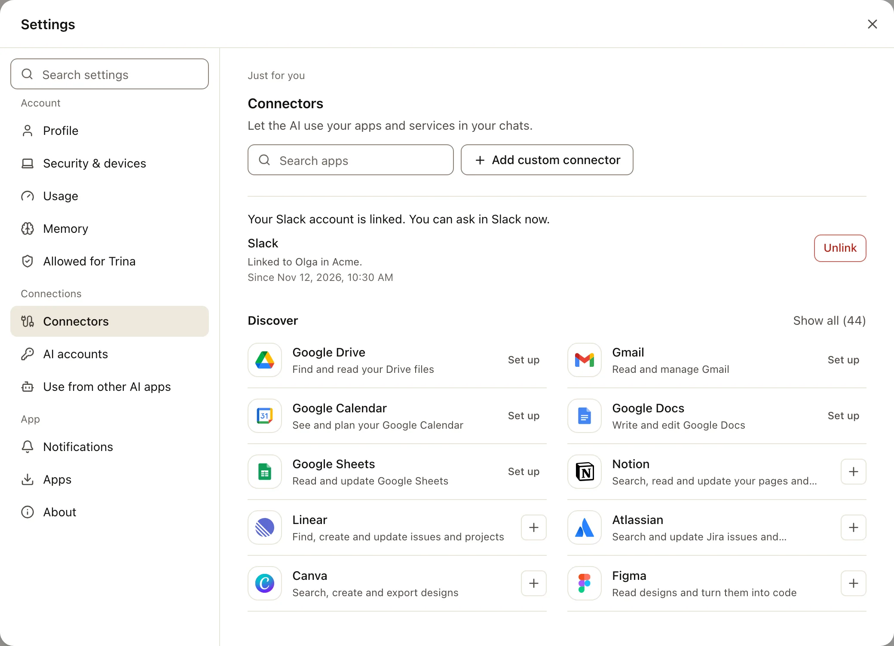
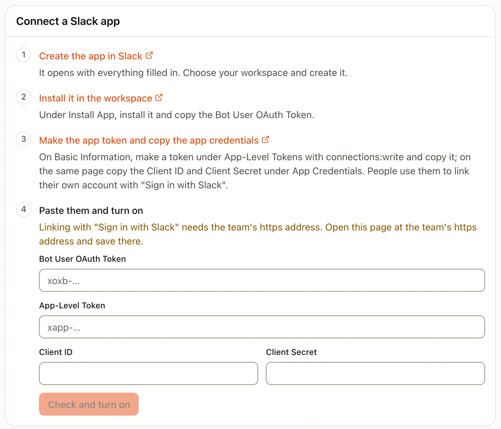
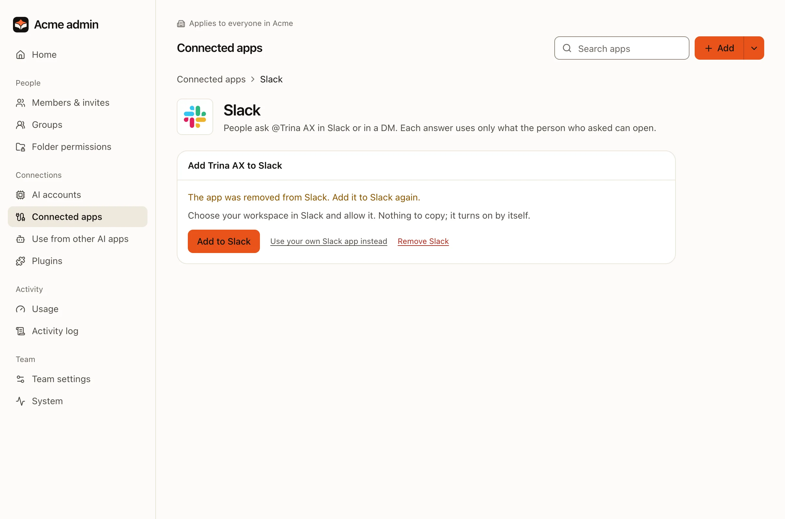

Slack을 연결하면 Slack을 떠나지 않고 Trina AX에게 물어볼 수 있어요. 채널에서 **@Trina AX**를 멘션하거나 DM을 보내면
돼요. 질문은 물어본 사람의 계정으로 실행돼요. 그 사람의 폴더 권한, AI 엔진, 한도를 쓰고, 답변 전체는 Trina AX에도 채팅으로
남아요.

짧은 단계 두 개면 끝나요. 팀장이나 관리자가 Slack에 앱을 한 번 추가하고, 각자 자기 Slack 계정을 한 번 연결해요.

:::tip
**필요한 것**

- **앱 추가** (한 번): Trina AX의 팀장이나 관리자, 그리고 Slack 워크스페이스에서 앱을 승인할 수 있는 사람(Slack
  워크스페이스 관리자나 소유자). 복사하거나 붙여 넣을 건 없어요.
- **내 계정 연결** (각자 한 번): 내 Slack 계정. 복사하거나 붙여 넣을 건 없어요.
- **Slack에 추가 버튼이 없는 서버에서만**: 우리 팀 Slack 앱에서 받는 값 네 개.
  자세한 건 [아래](#slack에-추가-버튼이-없다면)에 있어요.
:::

:::note
이 페이지의 화면은 가상의 팀과 워크스페이스 "Acme"로 찍었어요.
:::

## Slack에 Trina AX 추가하기 (팀장이나 관리자)

:::steps
#### 관리자 › 연결한 서비스에서 Slack 열기
**관리자**에서 **연결한 서비스**를 골라요. Slack도 여기 있는 서비스 중 하나예요. 추가하기 전에는 **둘러보기**에, 추가한
뒤에는 **연결됨**에 있어요. 팀장과 관리자에게 보여요.



**Slack**을 골라요. 페이지에 **Slack에 Trina AX 추가**가 보여요.



#### Slack에 추가 누르기
**Slack에 추가**를 누르면 Slack 페이지가 열려요. 폰에서도 돼요.

#### 워크스페이스 고르고 허용하기
Slack 페이지 오른쪽 위에 워크스페이스 이름이 있고, Trina AX가 거기서 보고 할 수 있는 일이 나와요. 먼저 워크스페이스를
확인해요. Slack은 마지막으로 쓴 워크스페이스로 열리는데, 그게 원하는 곳이 아닐 수 있어요. 필요하면 그 모서리에서 바꾸고
**허용**을 눌러요.

#### Trina AX의 Slack 페이지로 돌아와요
"Slack에 추가했어요. 쓸 채널에 앱을 초대해 주세요."가 떠요. 그 줄에 워크스페이스와 앱이 보이고, 몇 초 동안
**연결 중**이었다가 **연결됨**으로 바뀌어요. 복사하거나 붙여 넣을 건 없어요. Trina AX가 Slack 창을 기다리는 동안
**다시 시도**와 **취소**가 있고, 5분이 지나면 기다리기가 저절로 끝나요.


:::

앱은 Slack 워크스페이스 관리자나 소유자만 추가할 수 있어요. 다른 사람이 하면 "Slack 워크스페이스 관리자가 추가해야 해요.
관리자에게 부탁해 주세요."가 뜨고, 앱은 다시 워크스페이스에서 빠져요.

### 채널에 앱 초대하기

Slack은 앱이 들어가 있는 채널의 메시지만 Trina AX에 알려 줘요. 다른 Slack 앱과 똑같아요. 사람들이 질문할 채널마다
이렇게 해요.

1. Slack에서 채널을 열어요.
2. 메시지 입력창에 `/invite @trina-ax`를 입력하고 Enter를 눌러요. (입력하는 동안 Slack이 앱을 추천하면 골라요.)
3. 앱이 추가됐다는 줄이 채널에 올라와요. 이제 채널의 누구나 앱을 멘션할 수 있어요.

```
/invite @trina-ax
```

DM은 초대하지 않아도 돼요. Slack 사이드바의 **Apps** 아래에서 **Trina AX**를 찾아 메시지를 보내면 돼요.

## 내 계정 연결하고 물어보기 (모두)

각자 자기 Slack 계정을 자기 Trina AX 계정에 한 번 연결해요. 다른 사람 계정을 대신 연결할 수는 없어요.

:::steps
#### Slack에서 물어보기
앱을 초대한 채널에서 **@Trina AX**를 멘션하거나 DM을 보내요. 예: "@Trina AX shared/sales에 있는 지난주 메모 요약해 줘"

#### 처음에는 계정 연결하기
처음에는 Trina AX가 나에게만 답해요. "여기서 Trina AX에게 물어보려면 먼저 Trina AX 계정을 연결해 주세요. 이 링크는
10분 동안 한 번만, 나만 쓸 수 있어요."

1. 그 메시지에서 **Trina AX 계정 연결하기**를 눌러요.
2. 브라우저에서 Trina AX가 열려요(로그인하라고 하면 로그인해요). **Slack 계정 연결** 페이지에 두 계정이 함께 보여요.
   내 Slack 이름, 그리고 내 Trina AX 이름과 이메일이에요.
3. Slack 계정이 내 것이 맞는지 확인하고 **연결하기**를 눌러요. 페이지에 "연결했어요. Slack으로 돌아가 다시 물어봐
   주세요."가 떠요.

**연결하기**는 Slack 계정의 이메일이 Trina AX 계정과 같을 때 보여요. 다르면 페이지에 이유가 나오고, 대신
**Slack으로 로그인해서 연결**을 쓸 수 있어요.



#### 또는 Trina AX에서 연결하기
**설정 › 커넥터**에 **Slack** 줄이 있어요. "…의 Slack 계정으로 로그인하면 연결돼요." **연결**을 누르면 Slack에 갔다가
돌아오고, 그 줄에 연결된 계정이 보여요.



#### 다시 물어보기
Slack으로 돌아가서 질문을 다시 해요. 이제부터는 Trina AX가 바로 답해요.
:::

### 답은 어디로 오나요

| 물어본 곳 | 받는 것 |
|---|---|
| **채널** | "답을 만들고 있어요…"가 뜬 뒤 나에게만 보이는 답이 와요. **채널에 올리기**가 함께 있어요. 누르면 "…님의 질문"과 내 이름을 붙여 스레드에 답을 올려요. |
| **DM** | 내 메시지의 스레드로 답이 와요. |

- **같은 스레드에서 이어 가기.** 그 스레드에서 앱을 다시 멘션하거나 DM 스레드에 답장하면 같은 채팅이 이어져요. 새
  스레드는 새 채팅이에요.
- **내 언어로.** Slack에 나오는 Trina AX 문구("답을 만들고 있어요…", "… 계정으로 답해요.", "Trina AX에서 열기")는 내 Trina AX
  언어로 나와요. 답변 자체는 AI 답변 언어로 고른 언어를 따라요.
- **답변 전체는 Trina AX에도 있어요.** 긴 답은 Slack에서 줄여 보여 주고 나머지로 가는 링크를 달아요. "답을 만들고
  있어요…"에도 어느 계정으로 답하는지 나와서 내 질문인지 알 수 있어요.
- **올리기 전에.** 부서 폴더나 내 개인 폴더처럼 팀 모두가 볼 수 없는 곳을 답에 썼다면, **채널에 올리기**가 먼저 확인을
  받아요. **그래도 올리기**와 **취소**가 나와요. 다른 조직과 함께 쓰는 채널에는 답을 올리지 않아요.

## Slack에 추가 버튼이 없다면

**Slack에 추가**는 Trina 호스팅 서비스가 서버를 맡고 있는 곳에서만 보여요. Trina가 운영하는 팀, 또는 직접 설치했지만
호스팅 서비스에 등록된 서버예요. 그 밖의 서버에서는 **관리자 › 연결한 서비스**의 Slack 페이지에 대신 **Slack 앱 연결하기**가
보여요. 우리가 준 manifest로 팀의 Slack 앱을 만들고 키를 붙여 넣는 네 단계예요. 앱 키를 붙여 넣어야 해서 팀장만 할 수
있어요. 관리자에게는 "여기서 Slack 연결은 팀장만 할 수 있어요."가 보여요. 페이지는 팀의 `https://` 주소로 열어야 해요. 각자의
**Slack으로 로그인** 링크가 그 주소로 돌아와요.



:::tip
**필요한 것 (모두 api.slack.com/apps의 내 Slack 앱 설정에 있어요)**

| Trina AX의 칸 | Slack의 위치 | 모양 |
|---|---|---|
| **Bot User OAuth Token** | **Install to Workspace**를 한 뒤 **Install App** (또는 **OAuth & Permissions**) | `xoxb-…` |
| **App-Level Token** | **Basic Information › App-Level Tokens › Generate Token and Scopes**, scope는 `connections:write` | `xapp-…` |
| **Client ID** | **Basic Information › App Credentials** | 점이 들어간 숫자 |
| **Client Secret** | **Basic Information › App Credentials**, **Show** | 영문자와 숫자 |
:::

:::steps
#### Slack에서 앱 만들기
**Slack에서 앱 만들기**를 눌러요. Slack의 "Create an app"이 우리 manifest 내용으로 다 채워진 채 열려요. 워크스페이스를
고르고 **Create**를 눌러요. 우리 워크스페이스 전용 앱이 만들어져요.

#### 워크스페이스에 설치
**워크스페이스에 설치**(Slack의 **Install App** 페이지)를 누르고 **Install to Workspace**, **Allow**를 눌러요. `xoxb-`로
시작하는 **Bot User OAuth Token**을 복사해요.

#### 앱 토큰 만들고 앱 정보 복사하기
**앱 토큰 만들고 앱 정보 복사하기**(Slack의 **Basic Information** 페이지)를 눌러요. **App-Level Tokens**에서
**Generate Token and Scopes**를 누르고, 아무 이름이나 붙인 뒤 scope `connections:write`를 넣고 **Generate**를 눌러요.
`xapp-`로 시작하는 토큰을 복사해요. 같은 페이지의 **App Credentials**에서 **Client ID**와 **Client Secret**을 복사해요
(먼저 **Show**를 눌러요).

#### 붙여 넣고 켜기
네 값을 각 칸에 붙여 넣고 **확인하고 켜기**를 눌러요. Trina AX가 Slack에 값을 확인해요. Slack이 받지 않는 값이 있으면 그
칸 아래에 이름과 함께, 고칠 수 있는 Slack 페이지가 나와요.
:::

그다음 위에서처럼 채널에 앱을 초대해요. 운영자를 위한 자세한 내용:
[팀의 앱 설정하기](../../../SLACK.md#setting-up-the-teams-own-app-the-owner) (영어).

| 이런 게 보이면 | 할 일 |
|---|---|
| "봇 토큰이 아니에요." 또는 "Slack이 이 토큰을 받지 않아요." | **Install App**에서 **Bot User OAuth Token**(`xoxb-`)을 Slack의 복사 버튼으로 다시 복사해요. |
| "Slack이 이 앱 토큰을 받지 않아요." | scope `connections:write`로 App-Level Token을 새로 만들어 붙여 넣어요. |
| "두 토큰이 서로 다른 Slack 앱의 것이에요." | 두 토큰은 같은 Slack 앱에서 나와야 해요. |
| "Client ID가 아니에요." 또는 "Client Secret이 아니에요." | **Basic Information › App Credentials**에서 다시 복사해요. 두 칸이 서로 바뀌었을 수 있어요. |
| "[Slack 앱 설정 › Socket Mode]를 켜 주세요." | manifest가 켜 두는 설정이에요. 누가 껐다면 Slack에서 다시 켜요. |
| **Slack으로 로그인**이 리디렉션 오류로 실패해요 | 팀의 `https://` 주소가 아닌 다른 주소에서 저장했어요. 팀 주소로 페이지를 열고 다시 저장해요. |

팀의 Slack 앱이 이미 설정돼 있을 때도 이 네 단계가 보여요. 바꾸려면 팀장이 먼저 앱을 지우고(**토큰 바꾸기**, 그다음
**Slack 연결 삭제**) **Slack에 추가**를 눌러요. 관리자는 팀의 앱을 끄고 켤 수 있지만, 바꾸거나 지우는 건 팀장만 할 수
있어요. 관리자 › 연결한 서비스에 Slack이 아예 없다면 팀장이나 관리자가 아닌 거예요. 팀장이나 관리자에게 부탁해요.

## Slack 채널을 대화에 연결하기

고객은 Slack 채널에서 이야기하지만 팀은 Trina AX에서 일한다면, 그 채널을 팀 대화방이나 프로젝트 하나에 연결하세요. 채널에 올라온 메시지가 대화방에 바로 보이고, 팀이 대화방에 쓴 글은 채널로 돌아가요. 고객은 Slack에 그대로 있고 달라지는 게 없어요.

#### 대화방 메뉴 › 앱 추가 › Slack을 여세요

대화방에 있는 팀 소유자나 관리자만 할 수 있어요. 처음에는 내 Slack 계정을 알 수 있게 'Slack으로 로그인'을 눌러 달라고 해요.

#### 채널을 고르고 연결을 누르세요

나와 Trina AX 앱이 둘 다 들어가 있는 채널이 보여요. 목록에 없으면 먼저 Slack에서 앱을 초대하세요(`/invite @trina-ax`). 버튼 위 문장을 읽어 주세요: '이제부터 이 대화방의 모든 사람이 채널 메시지를 봐요', 그리고 쓴 글은 각자 이름으로 Slack에 가요. '연결'을 누르세요.

#### 사람들에게 보이는 것

- 대화방에서는 Slack 메시지가 보낸 사람의 Slack 이름과 사진, 작은 Slack 표시와 함께 보여요. 스레드, 멘션, 수정과 삭제도 따라가요. 머리글에 '#채널 · Slack'이 보여요.
- Slack에서는 대화방 메시지가 '민아 (Trina AX)'처럼 보여요. 글을 쓰는 데 Slack 계정은 필요 없어요.
- AI 답과 파일은 Slack으로 가지 않아요. 그런 메시지에는 'Slack에 보내지 않음'이 붙어요. Slack이 거절하면 '다시 시도'가 함께 보여요.
- 게스트가 있는 대화방은 아직 연결할 수 없고, 연결된 동안에는 게스트를 초대할 수 없어요.

그만하려면 대화창을 다시 열고(머리글의 '#채널 · Slack'을 눌러도 돼요) '연결 끊기'를 누르세요. 그동안 나눈 대화는 대화방에 남아요.

## 지우거나 다시 연결하기

**관리자 › 연결한 서비스**의 Slack 페이지에는 늘 지금 상태가 나오고, 목록의 Slack 줄에도 같은 상태가 보여요.
**켜짐**, **연결 중**, **꺼짐**, 또는 내가 해야 할 일이에요. 몇 분 동안 Slack이 답하지 않으면 페이지에 **응답 없음**과
할 일이 떠요. Slack에서 앱을 지웠다면 줄에 **다시 연결**이 뜨고, 페이지에서 **Slack에 추가**를 다시 하거나, 다시 쓰지 않을
거라면 **Slack 연결 삭제**를 할 수 있어요.



| 생긴 일 | 할 일 |
|---|---|
| **누가 Slack에서 앱을 지웠어요** | Slack 페이지에 "Slack에서 앱이 빠졌어요. 다시 Slack에 추가해 주세요."가 떠요. **Slack에 추가**를 다시 눌러요. 각자의 연결은 그대로예요. 같은 워크스페이스에 추가하면 아무도 다시 연결하지 않아도 돼요. 다시 쓰지 않을 거라면 **Slack 연결 삭제**를 눌러요. Slack은 **둘러보기**로 돌아가고 모두의 계정 연결이 지워져요. |
| **잠깐 꺼 두고 싶어요** | **끄기**를 눌러요. Trina AX가 Slack에서 답하지 않아요. 연결은 그대로예요. **켜기**를 누르면 다시 답해요. |
| **아예 없애고 싶어요** | **Slack 연결 삭제**를 누르고 확인해요. 앱이 Slack 워크스페이스에서 빠지고 모두의 계정 연결이 지워져요. 나중에 다시 추가하면 모두 다시 연결해야 해요. |

누구나 언제든 **설정 › 커넥터**의 Slack 줄에서 자기 Slack 계정의 **연결 끊기**를 할 수 있어요.

## 자주 묻는 질문

### Slack에 Trina AX를 누가 추가할 수 있나요?

Trina AX에서 팀장이나 관리자가 **Slack에 추가**를 누르고, Slack에서 워크스페이스 관리자나 소유자가 허용해야 해요. 관리자는
앱을 끄고 켜거나, 다시 추가하거나, 지울 수도 있어요. 팀의 Slack 앱을 직접 설정하는 일(키 붙여 넣기)은 팀장만 해요.
멤버에게는 관리자 메뉴가 보이지 않아요. 멤버는 **설정 › 커넥터**에서 자기 Slack 계정을 연결해요.

### 각자 로그인해야 하나요?

네, 한 번요. Slack 계정을 연결하기 전까지는 Trina AX가 연결 링크만 보내요. Trina AX 계정이 꺼지거나 지워진 사람은 바로
연결이 끊겨요.

### Trina AX는 Slack에서 무엇을 보나요?

앱을 초대한 채널에서 @Trina AX를 멘션한 메시지와, 앱에 보낸 DM이에요. 스레드에서 물어보면 AI가 그 스레드도 읽어요.
부탁하면 앱이 초대돼 있고 나도 들어가 있는 채널이나 스레드를 읽을 수 있어요. 거기 있는 다른 앱의 메시지(폼 알림, 모니터링
알림 같은 것)도 내용과 함께 읽어요. 파일은 읽지 않고, 앱을 초대하지 않은 채널은 읽을 수 없어요. 계정을 연결하고 누가
물어봤는지 표시하려고 워크스페이스 사람들의 이름과 이메일 주소를 읽어요. 채널에서는 물어본 사람이 올리기 전까지 답이 그
사람에게만 보여요.

### 답은 누구의 권한으로 하나요?

물어본 사람의 권한이에요. 그 사람의 폴더 권한, AI 엔진, 한도를 써요. 다른 채팅처럼 그 사람의 사용량에 들어가요.

### 워크스페이스를 여러 개 연결할 수 있나요?

아니요, 팀마다 워크스페이스 하나예요. 이미 다른 팀에 연결된 워크스페이스는 거절돼요. "이 Slack 워크스페이스는 다른 팀에
연결돼 있어요. 그 팀에서 빼거나 Slack에서 앱을 지운 뒤 다시 해 주세요." 함께 쓰는 채널에 있는 다른 조직 사람과 봇에게는
답하지 않아요.

자세한 내용: [Slack 커넥터](../../../SLACK.md) (영어).
