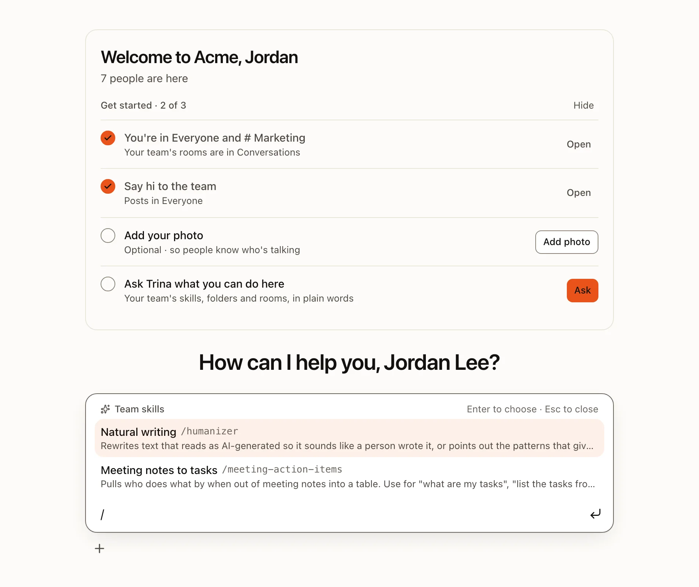
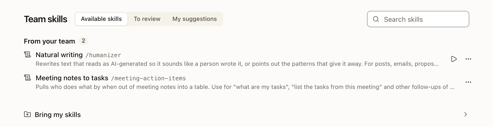

스킬은 `SKILL.md` 파일에 적어 두고 다시 쓰는 진행 순서예요. 팀이 어떤 일을 어떻게 하는지 AI에게 알려 줘요. 모델을 학습시키지 않고, 권한을 더 주지도 않아요.

## 스킬 쓰기

- 채팅에서 `/`를 입력해 스킬을 고르거나, 메시지에 `/스킬-이름`을 적어요.
- 요청에 맞는 스킬이 있으면 AI가 알아서 찾아 불러오기도 해요.
- 트리나 목록 위쪽의 **팀 스킬** 줄(폰에서는 **트리나** 탭의 **☰** 메뉴)에서 내가 쓸 수 있는 스킬을 볼 수 있어요.





## 추천 스킬

제품에는 바로 쓸 수 있는 스킬 4개가 팀 언어(한국어나 영어, 다른 언어는 영어)로 들어 있어요. 저절로 들어가는 건 없어요. 누군가 그 스킬 이름이 적힌 버튼을 눌러야 들어가요.

| 폴더 | 스킬 | 들어가는 방법 |
|---|---|---|
| `skills/general/` | 회사 소개서, 카드뉴스, 홍보 영상 | 팀장이 시작 설정 단계 **팀이 쓸 스킬을 골라 주세요**에서 고르거나, 나중에 팀장이나 관리자가 **쓸 수 있는 스킬**에서 넣어요 |
| `skills/work/` | 자연스러운 글 | 위와 같아요 |

- **시작 설정 단계에서**는 스킬마다 한 줄 설명과 **예시**가 있어요. 회사 소개를 저장했다면 회사 소개서, 카드뉴스, 홍보 영상은 체크된 채로 나와요(회사 소개로 만들기 때문이에요). 자연스러운 글은 체크되지 않은 채로 시작해요. 버튼에는 몇 개가 들어가는지 적혀 있어요. 예를 들어 **스킬 3개 넣기**처럼요.
- **쓸 수 있는 스킬에서**는 팀장과 관리자에게 목록 아래 접힌 줄 **Trina AX가 준비한 스킬 · 2개 더**가 보여요. 팀에 아직 없는 스킬이 들어 있어요. 열어서 원하는 것을 체크하고(처음엔 아무것도 체크돼 있지 않아요) **팀에 넣기**를 눌러요. 검색하는 동안에는 이 줄이 숨겨지고, 팀에 모두 들어가면 사라져요. 나중 버전에 새 스킬이 생기면 숫자만 늘어나요. 따로 알림은 없어요.
- **예시**는 가상의 회사 예시커피를 위해 그 스킬이 만든 결과와, 스킬의 출처를 보여 줘요.

시작 설정을 마칠 때 팀에 이 중 하나가 있으면, 마지막 화면에서 그 스킬로 첫 결과를 만들어 보자고 권해요(카드뉴스가 먼저예요). 누르면 스킬 양식이 열리고, **실행**을 누르기 전에는 아무것도 실행되지 않아요.

이 스킬들은 팀의 파일이에요. 팀 스킬 담당자가 고치거나, 옮기거나, 지울 수 있어요. 다시 넣으면 빠진 것만 들어가요. 고친 스킬은 다시 넣어도 덮어쓰지 않고, 다른 팀 스킬이 이미 쓰는 이름의 스킬은 건너뛰어요. 지운 스킬은 누군가 이름으로 다시 넣을 때만 돌아와요.

**자연스러운 글**은 AI가 쓴 것 같은 글을 사람이 쓴 것처럼 다듬어요. 사실은 하나도 바꾸지 않아요. 한국어판은 회사가 직접 썼고, 한국어 글 종류(블로그, 쇼츠 제목, 인스타그램, 제안서, 공지)를 알아요. 영어판은 오픈 소스 "humanizer" 스킬(MIT 라이선스, 고지문은 스킬 안에 있어요)을 고쳐 만들었어요.

출처가 분명한 스킬만 제품에 넣어요. 예전 버전은 회의 업무, 문서 요약, 마케팅, 일상 업무, 한국 인사 문서용 스킬도 넣었는데, 그 스킬이 있는 팀은 자기 팀 파일로 계속 갖고 있어요.

## 스킬이 있는 곳

| 위치 | 볼 수 있는 사람 |
|---|---|
| `skills/<name>/SKILL.md` | `skills/`를 읽을 수 있는 모든 사람(보통 팀 전체) |
| `skills/<folder>/<name>/SKILL.md` | 그 폴더를 읽을 수 있는 사람만. 예: `skills/finance/` |
| `groups/<group>/skills/<name>/SKILL.md` | 그 부서 사람만. 부서 밖의 팀장이나 관리자도 못 봐요. |
| `projects/<project>/skills/<name>/SKILL.md` | 그 프로젝트 채팅에서만, 프로젝트 폴더를 읽을 수 있는 사람에게만. |
| `users/<you>/skills/<name>/SKILL.md` | 나만요. 팀장과 관리자도 못 봐요. |

이름이 같은 스킬이 둘 있으면 나에게 가장 가까운 것이 쓰여요. 이건 나에게만 적용돼요. 내 개인 스킬, 내 부서 스킬, 팀 스킬, 프로젝트 스킬 순서예요. 프로젝트 스킬은 새 이름만 더할 수 있어요. 내가 속한 부서 두 곳에 같은 이름의 스킬이 있으면 둘 다 폴더와 함께 나오고, `/이름`은 이름이 먼저 오는 부서의 스킬을 써요.

## 부서 스킬

부서마다 자기 폴더에 스킬이 있어요. 부서 파일 옆의 `groups/<group>/skills/`예요. 부서 사람만 이 스킬을 보고 써요. **팀 스킬**(부서 이름 아래 부서마다 한 묶음), `/` 메뉴(부서 이름이 표시돼요), AI가 아는 내용 모두 그래요. 팀장과 관리자도 그 부서에 없으면 부서 스킬을 받지 않아요.

- 부서 사람은 누구나 부서의 다른 파일처럼 스킬을 더하거나 고칠 수 있어요. 팀 스킬과 마찬가지로 AI가 거기에 저장하기 전에 카드로 물어보고, 바뀐 내용은 모두 부서 이름과 함께 기록돼요.
- 팀원은 부서에 스킬을 제안할 수 있어요(**스킬로 제안**, 그다음 부서 폴더). 부서 사람들이 검토해요.
- 부서 이름을 바꿔도 폴더는 그대로예요. **팀 스킬**의 묶음에는 바로 새 이름이 보여요. 부서를 지우면 부서 사람들의 목록에서 그 스킬도 빠져요.

부서 스킬은 팀 스킬 담당자가 아니라 부서 사람들이 써요. 한 사람이 거기 저장한 내용을 부서 사람 모두의 AI가 따라요.

## 프로젝트 스킬

`projects/<project>/`의 팀 프로젝트는 `skills/` 폴더에 자기 스킬을 둘 수 있어요. 스킬마다 `SKILL.md`가 든 폴더 하나예요. AI는 이 스킬을 그 프로젝트 채팅(내 채팅, 공유 채팅, 프로젝트 안의 예약 작업)에서만 쓰고, 대화방이나 다른 채팅에서는 절대 쓰지 않아요. **팀 스킬**에는 프로젝트마다 **<프로젝트> 프로젝트 스킬** 묶음이 있고, 프로젝트 안의 `/` 메뉴에도 표시돼요.

- 프로젝트 폴더에 쓸 수 있는 사람이면 누구나 더하거나 고칠 수 있어요. AI가 먼저 프로젝트 이름이 붙은 카드로 물어보고, 바뀐 내용은 모두 프로젝트 이름과 함께 기록돼요.
- 프로젝트 스킬은 새 이름만 더할 수 있어요. 팀이나 부서, 내가 이미 쓰는 이름이면 페이지에 **같은 이름: 팀 전체**처럼 표시되고, AI의 카드는 실행될 일 없는 스킬을 저장하는 대신 다른 이름을 권해요.
- 스킬을 팀, 부서, 프로젝트, 내 스킬 사이에서 옮기려면 스킬 메뉴의 **옮기기**를 써요. 단계마다 누가 스킬을 얻고 누가 잃는지 보여 주고, 더 많은 사람이 받기 전에 전체 내용을 보여 줘요. 프로젝트 채팅에서 AI에게 부탁할 수도 있어요. AI는 더 적은 사람이 받는 쪽으로만, 그리고 모든 파일을 나열한 카드를 보여 준 뒤에만 옮겨요.

## 스킬 직접 쓰기

:::steps
#### 폴더 만들기
파일 화면에서 `skills/<name>/`를 만들어요. 이름에는 소문자(어느 언어든), 숫자, 하이픈 하나씩만 쓰고(공백, 점, 대문자는 안 돼요), 폴더 이름과 같아야 해요.

#### SKILL.md 쓰기
머리말로 시작하고, 그다음 진행 순서를 적어요.
```markdown
---
name: meeting-summary
description: Summarize permitted meeting notes into decisions, actions and open questions.
---

# Inputs
Ask for the source paths before reading.

# Procedure and output
Return decisions, an action table and open questions. Cite the source paths.
```

#### 불러와지는지 확인하기
스킬을 불러올 수 없으면 **팀 스킬**에 이유가 분명하게 나와요. 머리말을 고치고 다시 해 봐요.
:::

[SKILL.md 형식 전체 보기](../../agents/skills-format.md) (영어).

## Claude Code나 Codex에서 쓰던 스킬 가져오기

팀장과 관리자는 이미 쓰고 있는 스킬을 **쓸 수 있는 스킬** 목록 아래 **내 스킬 가져오기**나 제안 링크로 팀에 가져올 수 있어요. 시작 설정 단계에서는 미리 준비된 스킬만 권해요. 폰에서는 컴퓨터에서 하라고 안내해요.

| 어디서 | 고르거나 끌어다 놓을 것 | 읽는 것 |
|---|---|---|
| Claude Code | `~/.claude`(또는 프로젝트의 `.claude`) | `skills/`, `commands/*.md`, `CLAUDE.md` |
| Codex | `~/.codex`, 지금 쓰는 개인 스킬은 `~/.agents` | `skills/`(`.system`은 제외), `prompts/*.md`, `AGENTS.md`, `config.toml`의 원격 서버 |

Claude Code나 Codex를 팀에 연결해 뒀다면([MCP 커넥터](../../agents/mcp-connector.md) (영어)), 한 줄을 붙여 넣기만 해도 제안을 보내요.

- 그 폴더의 다른 것은 열지 않아요. 키나 토큰이 든 스킬은 내 컴퓨터 밖으로 나가지 않고, 이름만 목록에 나와요.
- 서버가 스킬을 하나하나 다시 확인하고, 팀 전체가 쓸 만한 것을 권해요. 확인이 30초 넘게 걸리면 아무것도 체크되지 않은 목록이 나오고, 내가 직접 골라요. 넣는 버튼을 누르기 전에는 팀에 아무것도 가지 않아요.
- 규칙 파일은 팀 규칙 하나가 돼요. 원격 MCP 서버는 키 없는 연결 템플릿이 되고, 팀원마다 자기 키로 연결해요.
- 팀 스킬과 이름이 같은 스킬은 내가 확인한 뒤 채팅에서 합쳐요. 그 채팅은 두 스킬을 읽고 팀 스킬을 저장하는 것만 할 수 있어요.
- **팀 대신 내 부서 한 곳으로.** 제안 페이지의 **보낼 곳**에서 팀 전체(기본값)나 내 부서 하나를 골라요. Claude Code와 Codex에서도 부서를 지정할 수 있어요. 부서로 보내는 제안은 스킬만 더하고(팀 규칙과 연결은 빠져요) 팀 스킬은 절대 바꾸지 않아요. 부서 스킬과 이름이 같은 스킬은 그 스킬에 합치거나 옆에 따로 두고, 팀 스킬과 이름이 같은 스킬은 부서만의 사본이 돼요. 부서 사람들은 **팀 스킬 › 검토**(부서로 오는 것만)에서 보고, 누구든 부서에 넣을 수 있어요.

## 스킬을 바꿀 수 있는 사람

팀 스킬은 **팀 스킬 담당자**가 바꿔요. 팀장, 관리자, 그리고 관리자가 추가한 사람이나 부서예요. 실제로는 `skills/`나 그 안 폴더에 쓰기 권한이 있다는 뜻이에요.

팀장과 관리자는 **팀 스킬** 제목 아래에서 누가 담당자인지 봐요. "고칠 수 있는 사람: 팀장·관리자, 영업: 3명, Alex [바꾸기]"처럼요. 이 목록은 폴더 권한에서 `skills/`에 대해 정한 그대로라서, 부서나 전체 규칙, 팀 폴더 전체에 걸린 규칙으로 고칠 수 있는 사람도 들어가요. 그 안에서 따로 쓰기 규칙(사람, 부서, 전체)이 있는 폴더는 끝에 개수로 나와요("폴더별로 맡긴 곳 2개"). **바꾸기**를 누르면 창 하나가 열려요.

- 팀장과 관리자(항상)와, `skills/`에 자기 쓰기 규칙이 있는 사람과 부서가 모두 나와요. 규칙이 `skills/finance/` 같은 하위 폴더에 걸려 있으면 폴더도 함께 나와요. **빼기**를 누르고 확인하면 그 규칙을 없애요. 다른 규칙(부서, 전체, 그 사람의 `skills/` 규칙)으로 여전히 고칠 수 있으면 그렇다고 알려 줘요.
- **사람이나 부서 추가**로 이름을 찾아요. 경고를 읽고 **팀 스킬 관리 켜기**를 누르면 그 사람이나 부서가 `skills/` 전체를 고칠 수 있어요.
- 폴더 하나만 맡기려면 **폴더별로 맡기려면 폴더 권한에서**를 따라가서, 거기서 그 폴더에 쓰기 권한을 줘요.

팀원과 다른 팀 스킬 담당자에게는 이 줄이 보이지 않아요.

- 팀원은 개인 스킬을 팀에 **제안**할 수 있어요. 받을 폴더의 팀 스킬 담당자가 검토해요.
- 내 검토를 기다리는 제안은 트리나 목록(휴대폰에서는 메뉴)의 **팀 스킬** 옆에 숫자로 보여요. 대화의 안 읽은 메시지 수와 같아요. **검토 대기**에는 아직 기다리는 제안만 있고, 등록했거나 거절한 제안은 그 탭 맨 아래 **검토한 제안**에 있어요.
- `skills/`가 바뀌면 모두 기록되고, 팀장과 관리자는 버전 기록 링크가 달린 알림을 받아요.
- 부서 스킬은 부서 사람들이 바꿔요([부서 스킬](#부서-스킬) 참고). 바뀐 내용은 같은 방식으로 기록되고 알려져요.

## 팀원이 자기 스킬 가져오기

팀원은 (컴퓨터에서) **쓸 수 있는 스킬** 목록 아래 **내 스킬 가져오기**를 쓰거나, 처음으로 좋은 결과가 나온 뒤 답변 아래에 나오는 한 줄을 써요. 그 줄은 쓰던 스킬이나 파일도 팀에 가져올지 물어봐요. 어느 쪽이든 같은 창이 열려요.

- 팀원이 `.claude`, `.codex`, `.agents` 폴더를 고르거나 끌어다 놓아요. 읽는 방식은 위와 같아요. 키가 든 스킬은 컴퓨터 밖으로 나가지 않아요.
- 처음엔 아무것도 체크돼 있지 않아요. 스킬을 10개까지 체크해서 제안으로 보내고, 제안은 한 번에 20개까지 대기할 수 있어요. 규칙 파일과 MCP 서버는 보내지 않아요.
- 서버가 스킬을 하나하나 다시 확인하고(키, 스크립트, 크기, 이름, 그 사람 컴퓨터의 경로), 팀 파일 밖에 따로 보관해요. AI가 판단하지 않아요.
- 팀원이 팀 폴더에 쓸 수 있으면 창에 파일을 넣을 팀 폴더 링크도 나와요. 폰에서는 그 폴더만 권하고, 쓸 수 있는 폴더가 없으면 아무것도 나오지 않아요.

팀장과 관리자는 보낼 때마다 **활동**에 알림을 하나 받아요("Mina님이 스킬 2개를 팀에 올리자고 했어요"). 누르면 **검토**가 사람별로 묶여 열려요. 이런 스킬은 팀장과 관리자만 보고 승인해요. 승인하면 `skills/<폴더 이름>/`에 파일과 함께 저장되고, 팀원에게 알려 주고, 목록에는 "Mina님이 제안"이라고 나와요. 승인해도 초대 링크가 여는 스킬이나 7일 목표에 적힌 스킬은 바뀌지 않아요. 이 줄은 ✕를 누르면 다시 나오지 않아요.

## 시작용 스킬

저장소에는 가상의 입력이 든 시작용 스킬 6개가 있어요. 주간 보고, 영업 후속 연락, 브랜드 브리프, 경비 검토, 신규 입사자 안내, 회의 요약이에요. [예시 보기](../../../../examples/README.md) (영어).
