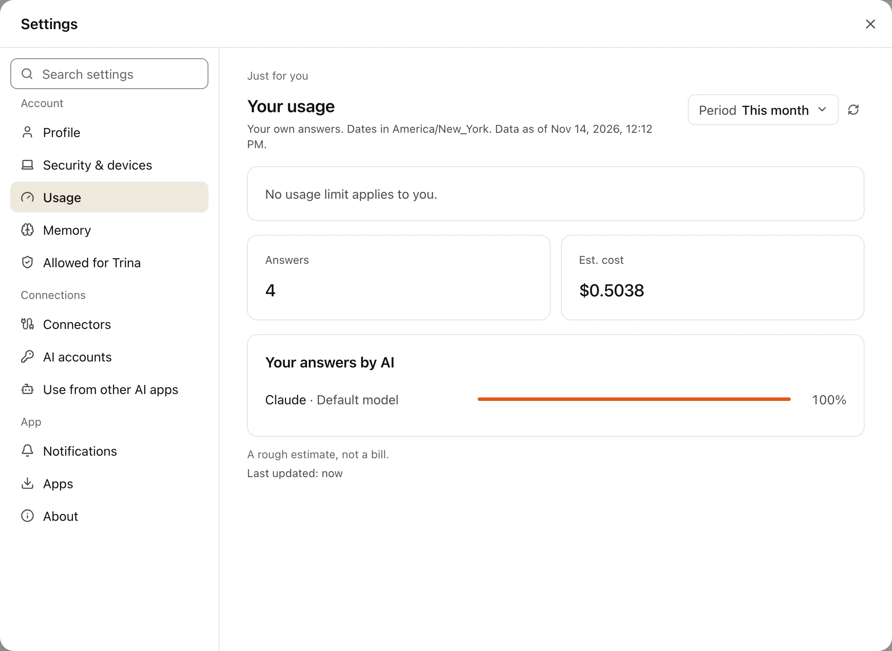
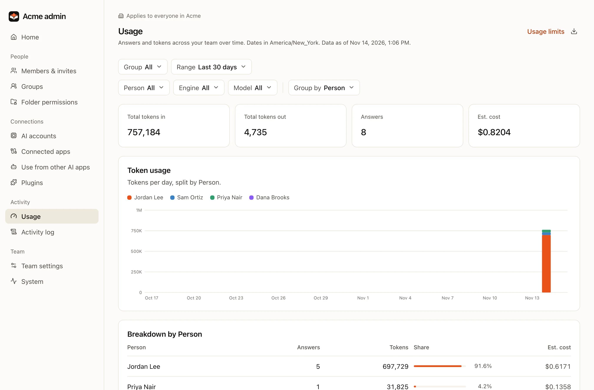

Trina AX는 답변을 하나하나 세요. 누가 물었는지, 어떤 엔진과 모델이 답했는지, 토큰을 얼마나 썼는지, 예상 비용은 얼마인지요.

:::note
비용은 같은 양을 API로 썼을 때의 가격을 어림한 값이에요. 청구서가 아니에요. 구독으로 연결한 경우 요청마다 더해지는 금액은 0이지만, 토큰은 그대로 세요.
:::

## 내 사용량

**설정 › 사용량**을 열어요(왼쪽 막대 맨 아래 내 사진 › **설정**, 폰에서는 **나** 탭). 내 답변 수와 예상 비용, 어떤 AI가 답했는지, 나에게 걸린 한도가 얼마나 찼는지 보여 줘요. 언제나 내 숫자만 보여요.

:::note
개인 사용량은 0.4.0에 새로 생겼어요. 그 전에는 관리자만 **관리자 › 사용량**에서 사용량을 봐요.
:::

## 팀 사용량

관리자는 **관리자 › 사용량**을 열어요. Claude Console의 사용량 페이지와 비슷하게 생겼어요.

- 위쪽 **필터**: 작은 버튼마다 지금 고른 값이 보여요.
  - **부서**(팀에 부서가 있을 때만)와 **기간**: 오늘, 지난 7일이나 30일, 이번 달, 또는 직접 지정한 기간.
  - **사람**, **엔진**, **모델**, **AI 연결**: 하나만 골라서 볼 때 써요. **필터 지우기**를 누르면 다시 전부 보여요.
  - **묶는 기준**: 사람, 부서, 엔진, 모델, 날짜, AI 연결, 스킬.
- **카드**: 합계예요. 입력 토큰, 출력 토큰, 답변 수, 예상 비용.
- **토큰 사용량**: 하루 토큰을 누적 막대로 보여 줘요. 묶는 기준 값마다 색이 하나예요(가장 큰 다섯 개, 나머지는 "기타"). 날짜에 마우스를 올리거나, 차트에 초점을 두고 화살표 키를 쓰면 그날 숫자가 보여요.
- **상세 내역**: 묶는 기준 값마다 한 줄로 답변 수, 토큰, 비중, 예상 비용을 보여 줘요.
- **CSV 다운로드** 버튼을 누르면 상세 내역을 CSV로 저장해요.

개인 스킬은 이름으로 세지 않아요. 그래서 누군가 혼자 쓰는 스킬을 관리자가 알 수 없어요. 부서 스킬은 팀 스킬처럼 세요.

## 한도 걸기

처음에는 한도가 없어요. 관리자가 **관리자 › 팀 설정**의 **사용 한도**에서 걸어요.

한 사람에게 걸 때는 **관리자 › 멤버·초대**에서 하는 게 더 빨라요. 그 사람의 **…** 메뉴를 열고 **사용 한도…** 항목을 골라요.
창은 처음부터 그 사람 것으로 열리고, 지금 걸린 한도와 얼마나 썼는지가 보여요. **하루**나
**한 달**을 골라 각각 보거나 정하고, **한도 삭제**로 하나를 없애요. 한도가 걸린 사람은 이름 아래 조용한 한 줄로
한도가 보이고, 다 쓰면 **한도 초과**가 붙어요. 폰에서는 그 사람을 열고 **사용 한도**를 눌러요.

| 한도 대상 | 기간 |
|---|---|
| 사람 한 명 | 하루 또는 한 달 |
| 부서 하나 | 하루 또는 한 달 |
| 팀 전체 | 하루 또는 한 달 |

한도를 다 쓰면 그 한도에 걸린 사람은 기간이 초기화될 때까지 새 답변을 시작할 수 없어요. 언제 초기화되는지는 사용량 페이지에 나와요.
