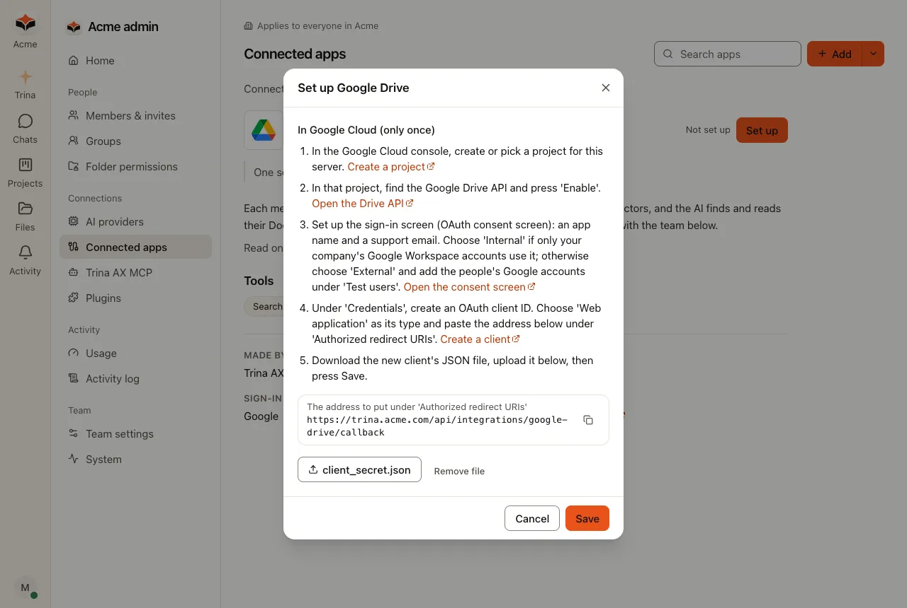
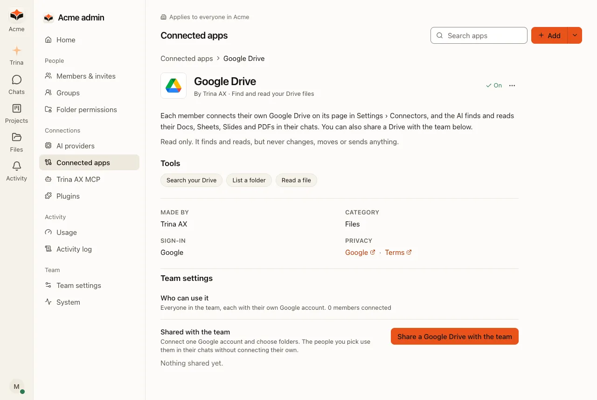
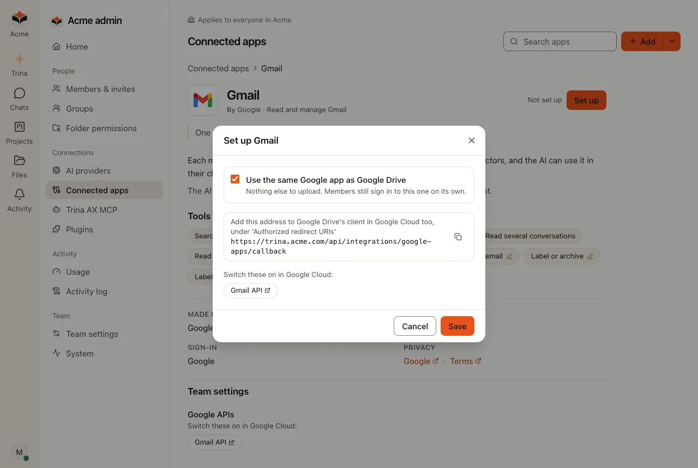
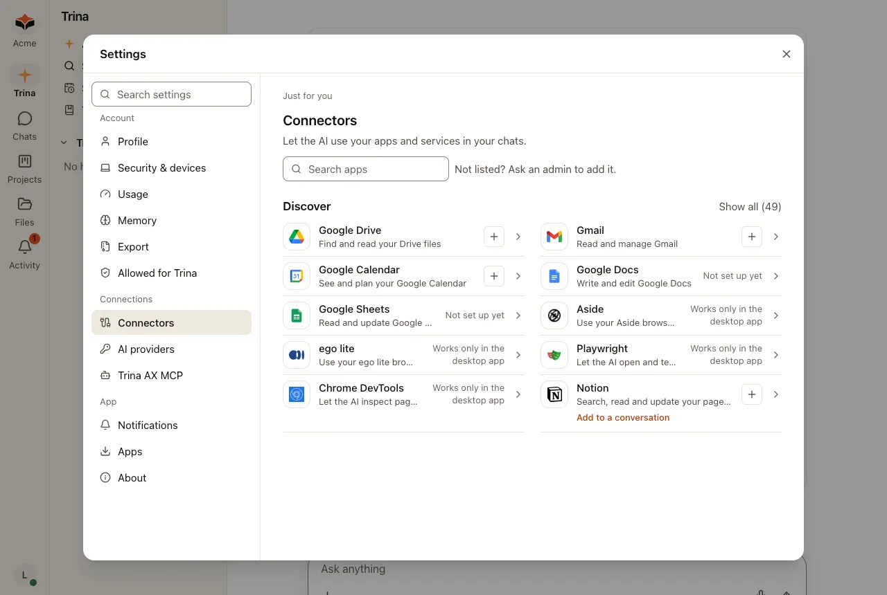
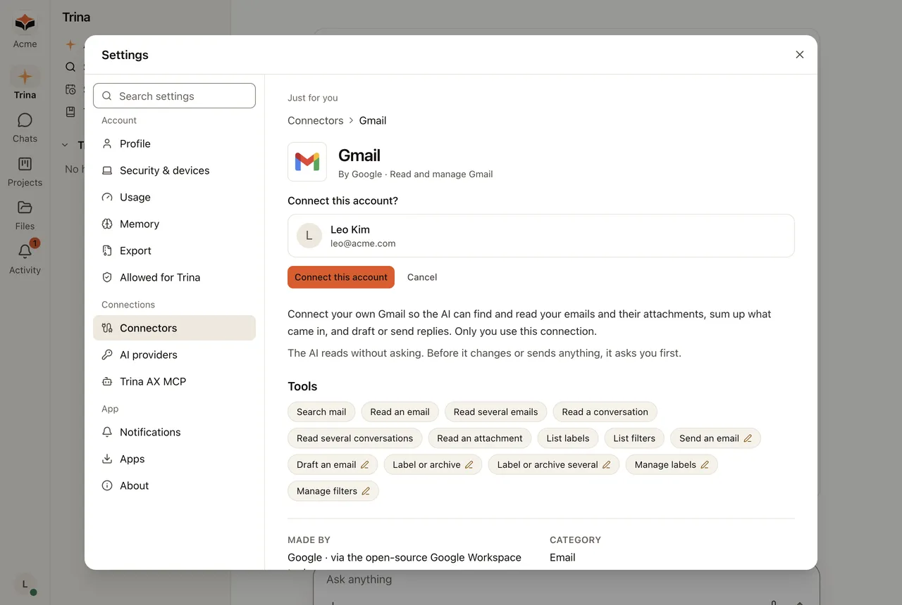
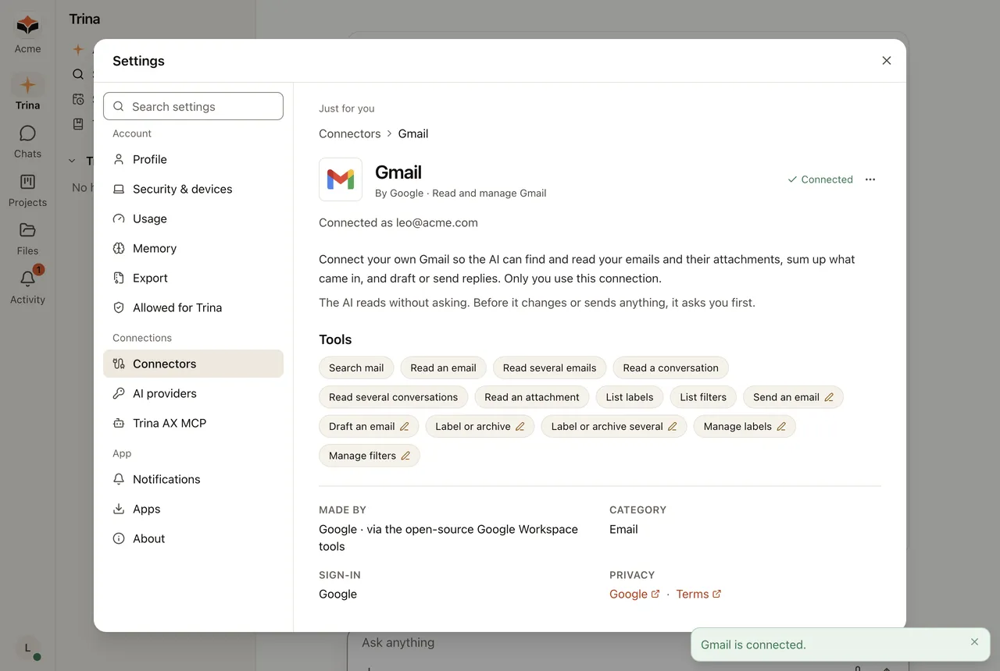

On a server you run yourself, Google Drive, Gmail, Google Calendar, Google Docs and Google Sheets can sign in with
**your company's own Google app**. You make the app once in Google Cloud, add it once in **Admin › Connected apps**, and
then every member connects their own Google account with one button. Nothing goes through Trina's Google app, and
Google does not need to review anything when your app is **Internal**.

It takes about 20 minutes: most of it in Google Cloud, then two short dialogs in Trina AX.

:::note
**Which page is yours?** This page is for a self-installed server whose Google cards say **Not set up** with a **Set
up** button. If they say "Set up by the hosting service" instead (a hosted team, or a server registered with the Trina
hosting service), use [Use your company's own Google app](../use/google-own-app.md): there you set the app once for all
five Google apps.
:::

:::tip
**What you need**

| Item | Where it comes from | Where it goes |
|---|---|---|
| A **public address** for your server, such as `trina.acme.com` | The installer (`--public-host`), or `tunnel.host` in [Configuration](configuration.md) | Trina AX builds the two return addresses from it |
| Two **return addresses** | The Set up dialogs in Trina AX, each with **Copy** | Google Cloud › Clients › your client › **Authorized redirect URIs** |
| The client's **JSON file** | Google Cloud › Clients › **Download JSON**, right after you make the client | Trina AX › Google Drive › **Set up** |
:::

:::note
The screenshots use a made-up team, "Acme", at `trina.acme.com`. They were taken on a real run against Google. Google
Cloud's own screens are described by their labels, because they change often.
:::

## Before you start

- **A public address.** Google sends people back to your server after they sign in, so the server needs an `https://`
  address that Google can reach. Without one, the Set up buttons say the server has no public address.
- **Linux for Gmail, Calendar, Docs and Sheets.** Those four run a small helper program that the Linux installer and
  the Docker image include. On the Mac app their cards say they are not available on this computer; Google Drive works
  everywhere.
- **Internal or External.** Decide who will sign in:
  - Everyone has an address of your company on **Google Workspace** (such as `name@acme.com`): choose **Internal**.
    Anyone in your company can sign in, with no limit and no review by Google.
  - People use **personal Gmail** accounts, or you have no Google Workspace: choose **External** and keep it in
    **Testing**. Only the people you list as **test users** can sign in (at most 100), Google shows them a "Google
    hasn't verified this app" warning, and asks them to sign in again every 7 days.

## In Google Cloud

Sign in to [Google Cloud](https://console.cloud.google.com/) with your company's Google account.

:::steps
#### Make a project
Open [New project](https://console.cloud.google.com/projectcreate), give it a name you will recognize, such as
"acme-trina", and choose **Create**. Check that the new project is chosen at the top of the page before the next steps.

#### Switch on the APIs
Open each page and choose **Enable** (switch on the ones you will use; all five does no harm):
[Google Drive API](https://console.cloud.google.com/apis/library/drive.googleapis.com),
[Gmail API](https://console.cloud.google.com/apis/library/gmail.googleapis.com),
[Google Calendar API](https://console.cloud.google.com/apis/library/calendar-json.googleapis.com),
[Google Docs API](https://console.cloud.google.com/apis/library/docs.googleapis.com),
[Google Sheets API](https://console.cloud.google.com/apis/library/sheets.googleapis.com).

#### Name the app and choose who can use it
Open [Google Auth Platform](https://console.cloud.google.com/auth/overview) and choose **Get started**:

1. **App Information**: an **App name**, such as "Acme Trina", and a **User support email**.
2. **Audience**: **Internal** or **External** (see [Before you start](#before-you-start)). Internal is greyed out when
   the Google account is not part of a Google Workspace organization.
3. **Contact Information**: an email address Google may write to.
4. **Finish**: tick that you agree to Google's policy, **Continue**, then **Create**.

#### External only: add your test users
Open [Audience](https://console.cloud.google.com/auth/audience), choose **Add users**, type the Google accounts of the
people who will connect (separate them with commas), and choose **Save**. Check that they now appear under **Test
users**: someone who is not listed gets "Access blocked" from Google.

#### Add the permissions
Open [Data access](https://console.cloud.google.com/auth/scopes), choose **Add or remove scopes**, and paste the
permission list from [Use your company's own Google app](../use/google-own-app.md#in-google-cloud) under **Manually add
scopes**. Then **Add to table**, **Update**, **Save**. (In our run an External app in Testing signed in without this
step, but an Internal app and any app you publish later need the list.)

#### Make the sign-in client
Open [Clients](https://console.cloud.google.com/auth/clients) and choose **Create client**:

1. **Application type**: **Web application**. **Name**: anything, such as "Trina AX".
2. Under **Authorized redirect URIs**, choose **Add URI** twice and paste **both** return addresses, with your server's
   address:

   ```
   https://<your public address>/api/integrations/google-drive/callback
   https://<your public address>/api/integrations/google-apps/callback
   ```

   The first is for Google Drive, the second for Gmail, Calendar, Docs and Sheets. Copy them from the Set up dialogs in
   Trina AX (next part) so they are exactly right.
3. Choose **Create**. In **OAuth client created**, choose **Download JSON** and keep the file somewhere private. Google
   shows the secret only now.
:::

## In Trina AX

:::steps
#### Set up Google Drive with the file
In **Admin › Connected apps**, open **Google Drive** and choose **Set up**. The dialog repeats the Google Cloud steps
and shows Drive's return address with **Copy**. Choose **Upload the JSON file you downloaded**, pick the file, and
choose **Save**.



A file whose redirect URIs do not list Drive's address is refused with a line saying so.

#### Check that Drive is on
Google Drive now says **On**. Everyone in the team may connect their own Drive, and an admin may share a Drive with
the team.



With Drive's app set up, the sign-in page of Trina AX also offers **Sign in with Google** (see [Sign in with
Google](../use/sign-in-with-google.md)).

#### Set up Gmail, Calendar, Docs and Sheets with the same app
Open **Gmail** and choose **Set up**. Keep **Use the same Google app as Google Drive** ticked: there is nothing to
upload. The dialog shows the second return address: make sure it is in your client's **Authorized redirect URIs** in
Google Cloud (you added it above). Choose **Save**. Do the same for **Google Calendar**, **Google Docs** and **Google
Sheets**, the ones your team uses.



Each card then says **On** and "Uses the same Google app as Google Drive." A card you have not set up stays **Not set
up yet** for members.
:::

## What members see

:::steps
#### Find the app
A member opens **Settings › Connectors**. The apps you set up have a **+** button; the others say **Not set up yet**.



#### Sign in at Google
**+** (or **Connect** on the app's page) opens Google in a new window:

1. **Choose an account**. With an External app it must be one of your test users.
2. External only: **Google hasn't verified this app**. Choose **Continue**. This is expected for an app in Testing.
3. Google names **your server's address** (such as `trina.acme.com`), not the app name, while the app is unverified.
   Choose **Continue**.
4. **Select what … can access**: the boxes start unticked. Tick **Select all**, then **Continue**. A sign-in with a box
   left unticked is refused, and Trina AX says to connect again with every box ticked.

#### Confirm the account in Trina AX
Back in Trina AX the page asks **Connect this account?** with the Google account. Choose **Connect this account** right
away: if the page is reloaded first, the member starts again with **Connect**.



#### Connected
The page says **Connected** and "Connected as" the account. The AI can now use it in that person's chats: for
example "List the subjects of my three latest emails" or "What is on my calendar tomorrow?". Reading needs no
confirmation; sending, changing or deleting asks first.


:::

To stop, a member opens the app's ⋯ and chooses **Disconnect**.

## Problems

| What you see | What to do |
|---|---|
| **`redirect_uri_mismatch`** on Google's page | A return address is missing from the client or differs by a letter. Drive needs `/google-drive/callback`; Gmail, Calendar, Docs and Sheets need `/google-apps/callback`. Copy both from the Set up dialogs into **Authorized redirect URIs** again. A change in Google Cloud can take a few minutes to work. |
| **Access blocked** / "has not completed the Google verification process" | External app: the account is not a test user. Add it under **Audience › Test users**. |
| "Some permissions were not ticked. Connect again and keep every box ticked." | The person left a box unticked on Google's screen. Connect again and tick **Select all**. |
| An account from outside the company is refused | That is what **Internal** means. Use an account of your company, or make the app External. |
| Members must sign in again every 7 days | Google does this for External apps in Testing. Use an Internal app, or publish the app (Gmail's permissions then need Google's verification). |
| The Set up button is missing or says the server has no public address | Set the public address (installer `--public-host`, or `tunnel.host`) and restart the server. |
| The Google cards say "Set up by the hosting service" | The server signs in through the Trina hosting service. Use [Use your company's own Google app](../use/google-own-app.md). |

Details for developers and operators: [Google apps](../../GOOGLE-APPS.md), [Google Drive](../../GOOGLE-DRIVE.md) and
[how the server runs the Google apps helper](../../GOOGLE-APPS-RUNTIME.md).
