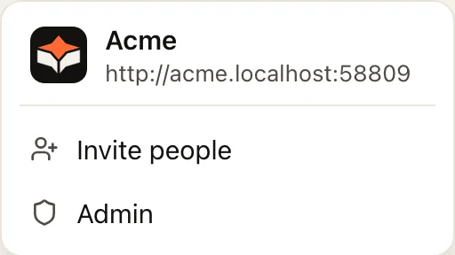
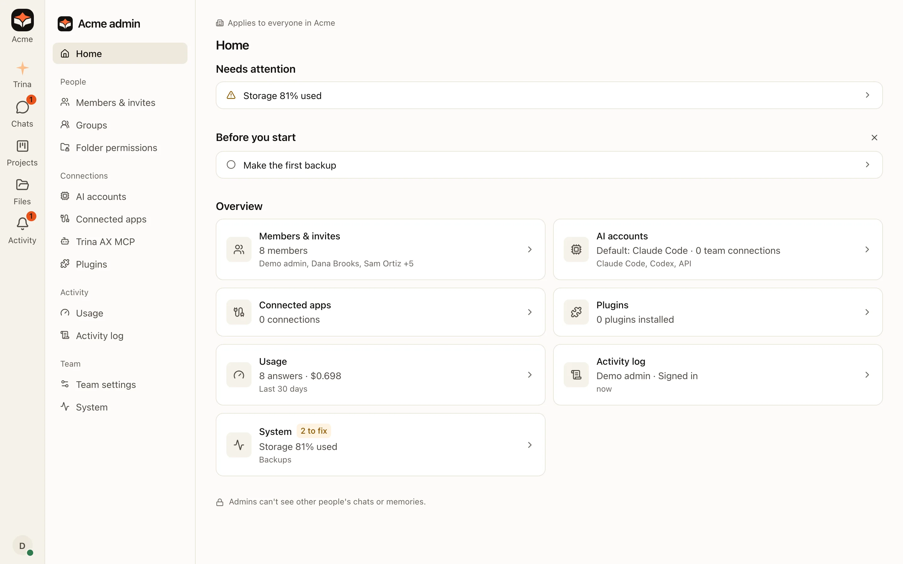
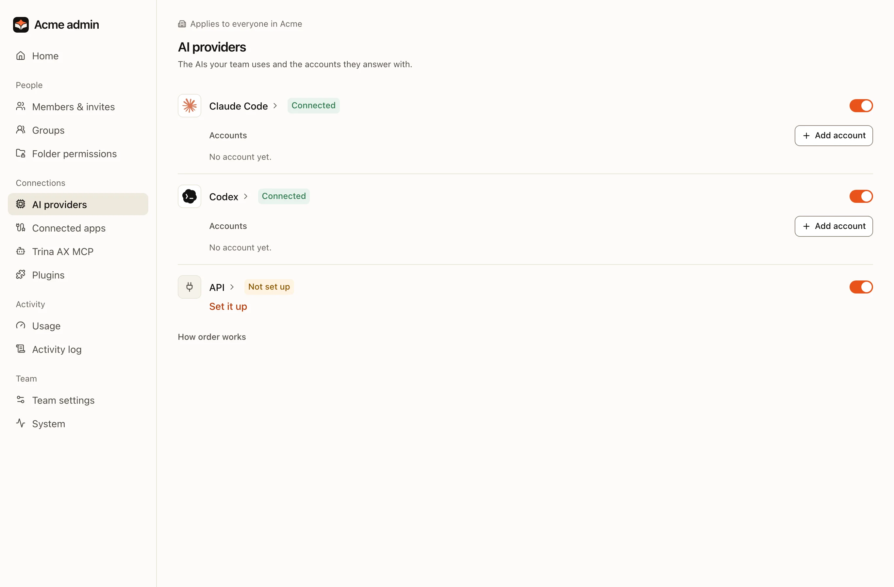
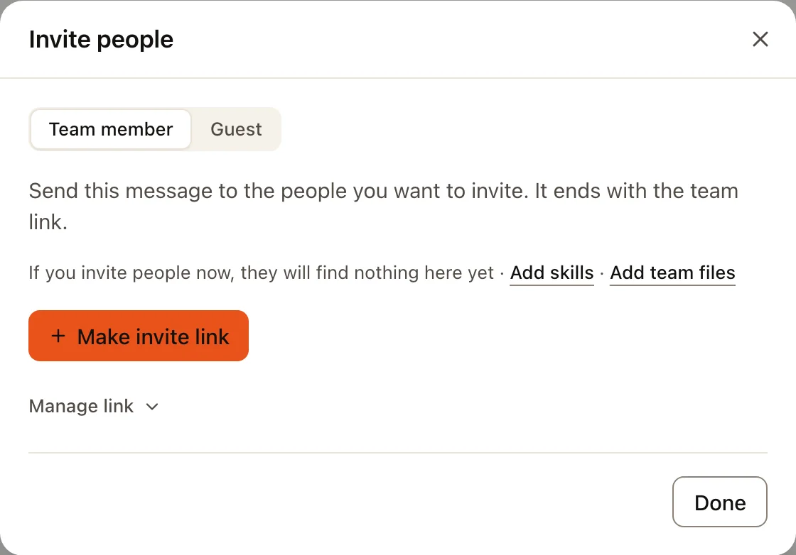
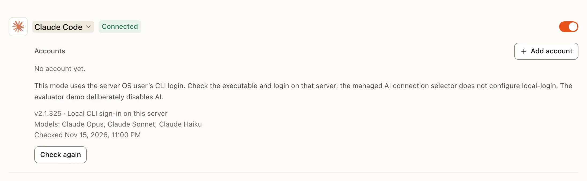
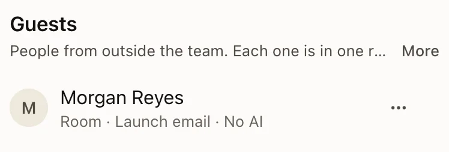
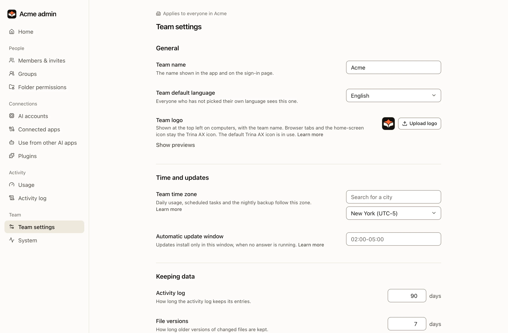
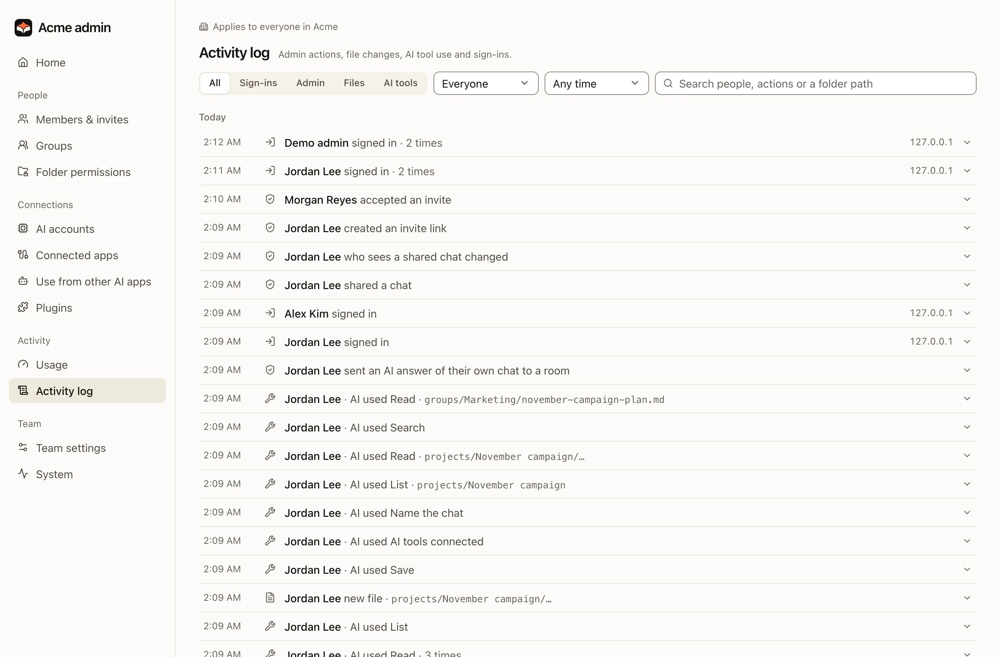
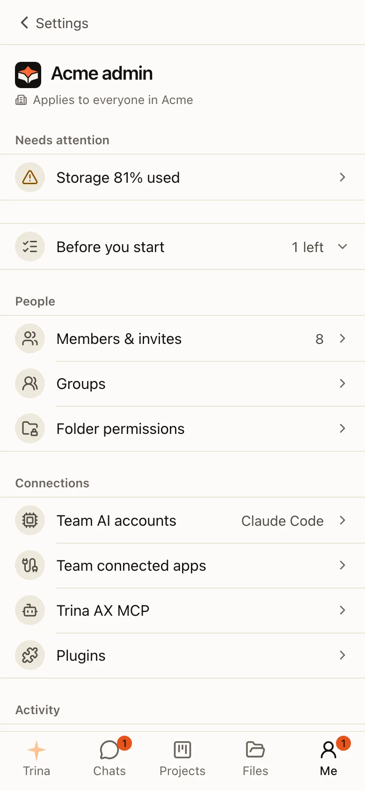

**Admin** is for the owner and admins. Every page in it is for the whole team: the menu's title is your team's name
and logo ("Acme admin"), and every page says "Applies to everyone in Acme" above its title. Your own settings stay in
**Settings**, with the same page names: Admin › Connected apps is the team's connections, yours are in
**Settings › Connectors**.

To open Admin on a computer:

1. Choose your team's logo, at the top of the bar on the left. The team menu opens: the team's address, **Invite
   people**, **Admin** and **Switch team**. (Members see only the address and **Switch team**.)
2. Choose **Admin**. It opens on **Home**, which lists what needs attention first.

⌘K (Ctrl+K on Windows) and "Admin" finds it too. On a phone, open the **Me** tab, then **Admin**.

For the owner, Home also lists the first setup steps that are still to do: check the AI connection, set folder
permissions, invite your team, prepare a team skill, make the first backup. A finished step leaves the list.

## The Admin menu

| Group | Pages |
|---|---|
| **People** | Members & invites, Groups, Folder permissions |
| **Connections** | AI providers, Connected apps (Google apps, [Slack](slack.md) and other services such as Notion), Trina AX MCP, Plugins |
| **Activity** | Usage, Activity log |
| **Team** | Team settings, System |

**Members & invites** also lists the guests: people from outside the team, each in one private channel or group chat, and one project, at most. [Read about guests](guests.md).

:::note
Earlier versions had the AI accounts on their own **AI connections** page, next to **AI engines**. Both are one
**AI providers** page now (it was called **AI accounts** for a while), and the old addresses open it. The team's AI settings (defaults, who picks the engine, members'
own accounts, usage limits) are in **Team settings**. **Slack** had its own menu item too; it is one row of
**Connected apps** now, and its old address opens it there.
:::

On a company with Google Workspace, the Google apps can sign in with your company's own Google app, set once for all five: [Use your company's own Google app](google-own-app.md).

## Your first week

:::steps
#### Set permissions
Assign folders to groups and check access with two test accounts. [Read about permissions](files-and-permissions.md).

#### Connect the AI
In **AI providers**, the owner or an admin chooses **Add account** in the Claude Code or Codex row and connects an authorized
Claude or OpenAI account. Each row shows whether that engine is ready.

#### Invite the team
Start with a small pilot group, then confirm roles and folder access.

1. Choose your team's logo, then **Invite people**.
2. Keep **Team member** (**Guest** is for someone from outside the team) and choose **Make invite link**.
3. Choose **Copy message** and paste it into Slack, Teams or an e-mail. It ends with the link. People who open it make
   their account and land in the team.

**Members & invites** also lists the team's [guests](#guests).
Under the list, **Invite links** shows only the links that still work: the team invite link and invite links nobody
has used yet. A used or expired link, or a guest link whose private channel, group chat or project is gone, leaves the list; who joined is in the member list and in the [Activity log](#activity-log).

#### Add a first skill
Copy a starter skill and review its result against the sources. [Read about skills](team-skills.md).

#### Make a first backup
Back up, then practise a restore with IT. [Read about backups](../operate/backups.md).
:::

## What admins cannot do

- Read other people's chats. The activity log shows which files the AI read, not the conversation.
- See personal folders or personal skills in `users/<id>/`.
- Use a team MCP connection, unless a rule names them.

:::warning
People who operate the server, its OS or its storage can read stored files and chats. In hosted plans, that includes Trina's operators.
:::

## AI providers

**Admin › AI providers**, first in the Connections group, has one row per engine (Claude Code, Codex, API) with its
logo, its state and an on/off switch. When something is wrong, one short line under the name says how to fix it.
Under Claude Code and Codex are the accounts the team answers with, in the order they are tried, each with its logo,
plan and state, and **Add account** for the owner and admins. The top working account is used first; if one is refused
or at its limit, the next one is used. To change the order, the owner and admins drag an account by its handle (⠿) on
the left, on a computer or a phone. With the keyboard: Tab to the handle, Space to pick the account up, the arrow keys to
move it, Space to drop it, Escape to cancel.

Click an engine's name to open its details: how it signs in, every model, when it was last checked, **Check again**,
and for the owner and admins the API engine form. Click an account's name for who uses it, this month's use and when it
was last used. The **⋯** menu of an account has Check again, Move up / down, rename, replace, switch off and delete.

## Guests

**Admin › Members & invites** ends with **Guests**: people from outside the team, each in a private channel or group chat and a project at most, who
do not take seats. Each row says where the guest is and which AI they have. Its **⋯** menu has **Change AI** (no AI,
their own sign-in, or a team AI account with a monthly limit), **Make team member** and **Remove guest**. Members invite
guests themselves from a private channel, a group chat or a project ([Guests](chats-and-projects.md#guests)). Owners and admins can
also choose **Invite people** › **Guest** here and pick the one private channel, group chat or project ([Guests: From Admin](guests.md#from-admin)). A team with no guests
has no **Guests** section; pick **Guests** in the list of roles to check. On Admin **Home**, the **Guests** card opens
Members & invites with only the guests listed.

## Connected apps

**Admin › Connected apps** lists the team's connections under **Connected**, and services you can add under
**Discover**. Each row shows the app's state (for example **On**, **Connecting** or **Needs attention**); the whole row
opens the app's page, which shows the same state. Connecting an app that opens a browser window (a Google app, a
service's sign-in, **Add to Slack**) can always be left: **Try again** and **Cancel** are there while it waits, and the
wait ends by itself after five minutes if the window was closed. Slack has its own guide: [Slack](slack.md).

## The team's AI settings

**Admin › Team settings** ends with the team's AI settings:

| Group | What it holds |
|---|---|
| **AI defaults** | The default engine and model, and how many answers run at the same time. |
| **Who picks the engine** | Whether members may pick another engine, and switching to Codex at Claude's limit. |
| **Members' own accounts** | Whether members may add their own accounts, whether a subscription may be shared, and the accounts they added. |
| **Usage limits** | Token or dollar limits a day or a month, for a person, a group or the team. |

Cancel and Save appear in a group only after you change something in it; each group saves on its own.

:::note
From 0.4.0. In 0.3.0 and earlier, all of this and the engines are on one **AI engines** page.
:::

## Activity log

**Admin › Activity log** lists sign-ins, admin actions, file changes and AI tool use, grouped by day. The filters stay at the top while you scroll. It never shows chat content.

## System

**Admin › System** shows the team's storage, the version and updates, the server's health, how the team reaches the server, connected folders, backups and export, as plain sections. Storage shows the files people sent in conversations on a line of their own, **Files in conversations**: one number for the whole team, never by person or conversation. The files of deleted chats and conversations count in **Team files** ("Team files include 120 MB from deleted chats and conversations, removed after 30 days"): they are kept 30 days so they can be brought back. When the disk is 80% full, and again at 95%, the owner and admins find a notice in **Activity** (at most once a day each) that opens this card. When a file sent in a conversation does not fit, a member or guest reads that there isn't enough space and to ask an admin, with **See the files you sent**; the owner and admins get **See what uses the space**. Under the lines, **Ask people to clean up** sends a notice to the people whose files in conversations take the most space, asking them to delete what they no longer need (once a day; you don't see who). Health lists what needs attention first, such as a missing engine, a failed check or disabled automatic updates; the checks that passed fold into one line with **Show details**. An admin who is not the owner sees the plan, storage and, on an office Mac, the automatic updates. To keep a small disk from filling, backups leave out folders that are rebuilt automatically, and caches nobody used for 14 days are cleared. Your own files are never touched. When an update waits for running tasks to finish, System says so; it offers **Wait, then update** or **Update now anyway**.

**Restart…** under Health restarts **The AI only** (when answers don't come or the AI is stuck; about 10 seconds) or **All of Trina AX** (when the screen freezes or is slow; everyone is disconnected for about 30 seconds), after your password. **Restart when answers finish** waits for the running answers, at most 10 minutes, and shows only how many there are, never whose; while it waits, the row offers **Restart now** and **Don't restart**. Only the owner can also choose **Restart right away**; an admin who is not the owner sees only this row under Health. A restart can't start during an update, a backup or a prepared restore, and at most 5 times an hour. Each restart is in the Activity log. When the server stopped answering several times and is no longer restarted by itself, the row says so.

Files sent in a conversation that nobody can open any more (everyone left the group chat, or its group was deleted) are removed from the disk 30 days after it closed. Its messages stay, but nobody can read them.
