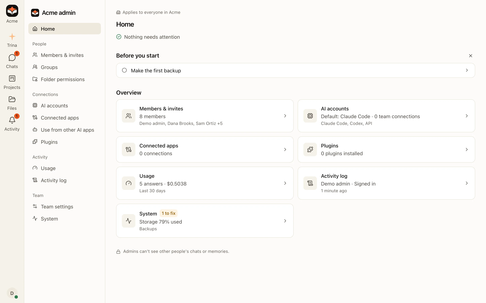
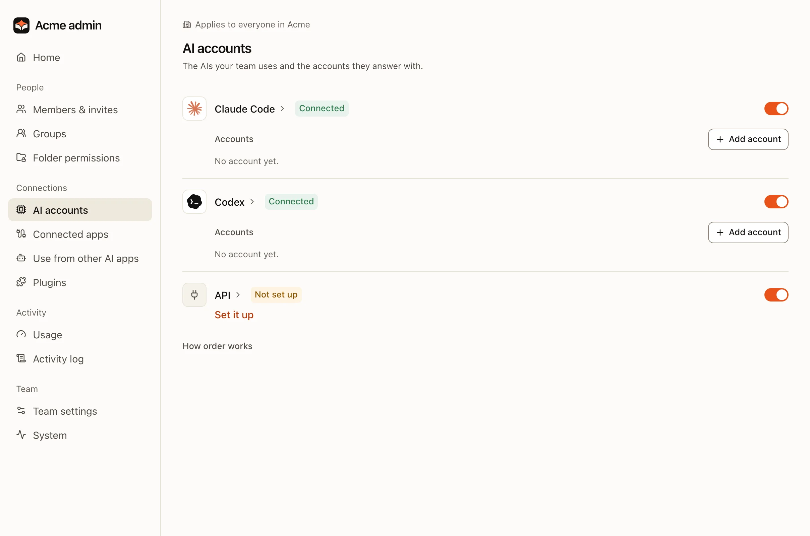
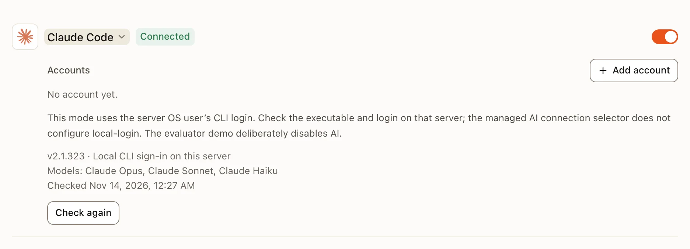
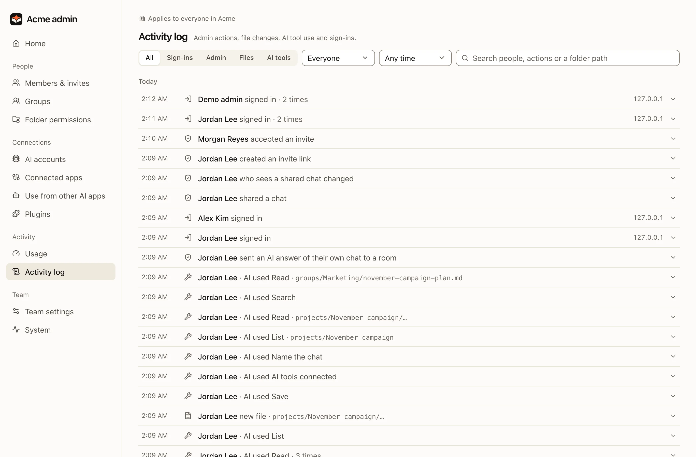

**Admin** in the sidebar is for the owner and admins. Every page in it is for the whole team, and says so next to its
title. It opens on **Home**, which lists what needs attention first.
For the owner, Home also lists the first setup steps that are still to do: check the AI connection, set folder
permissions, invite your team, prepare a team skill, make the first backup. A finished step leaves the list.

## The Admin menu

| Group | Pages |
|---|---|
| **People** | Members & invites, Groups, Folder permissions |
| **Connections** | Providers, MCP, App connectors, AI apps, Plugins |
| **Activity** | Usage, Activity log |
| **Team** | Team settings, System |

:::note
Earlier versions had the AI accounts on their own **AI connections** page, next to **AI engines**. Both are one
**Providers** page now, and the old addresses open it. The team's AI settings (defaults, who picks the engine, members'
own accounts, usage limits) are in **Team settings**.
:::

## Your first week

:::steps
#### Set permissions
Assign folders to groups and check access with two test accounts. [Read about permissions](files-and-permissions.md).

#### Connect the AI
In **Providers**, the owner or an admin chooses **Add account** in the Claude Code or Codex row and connects an authorized
Claude or OpenAI account. Each row shows whether that engine is ready.

#### Invite the team
Start with a small pilot group, then confirm roles and folder access.

#### Add a first skill
Copy a starter skill and review its result against the sources. [Read about skills](team-skills.md).

#### Make a first backup
Back up, then practise a restore with IT. [Read about backups](../operate/backups.md).
:::

## What admins cannot do

- Read other people's chats. The activity log shows which files the AI read, not the conversation.
- See personal folders or personal skills in `users/<id>/`.
- Use a team MCP connection, unless a rule names them.

:::warning
People who operate the server, its OS or its storage can read stored files and chats. In hosted plans, that includes Trina's operators.
:::

## Providers

**Admin › Providers**, first in the Connections group, has one row per engine (Claude Code, Codex, API): its state,
sign-in mode, models and last check, with **↻** to check again and an on/off switch. Under Claude Code and Codex are
the accounts the team answers with, in the order they are tried, with **Add account** for the owner.

Click an engine's name to open its details: what is missing and how to fix it, every model, and for the owner and admins the API engine form.

## The team's AI settings

**Admin › Team settings** ends with the team's AI settings:

| Group | What it holds |
|---|---|
| **AI defaults** | The default engine and model, and how many answers run at the same time. |
| **Who picks the engine** | Whether members may pick another engine, and switching to Codex at Claude's limit. |
| **Members' own AI accounts** | Whether members may add their own accounts, whether a subscription may be shared, and the accounts they added. |
| **Usage limits** | Token or dollar limits a day or a month, for a person, a group or the team. |

Cancel and Save appear in a group only after you change something in it; each group saves on its own.

:::note
From 0.4.0. In 0.3.0 and earlier, all of this and the engines are on one **AI engines** page.
:::

## Activity log

**Admin › Activity log** lists sign-ins, admin actions, file changes and AI tool use, grouped by day. The filters stay at the top while you scroll. It never shows chat content.

## System

**Admin › System** shows the team's storage, the version and updates, the server's health, how the team reaches the server, connected folders, backups and export, as plain sections. Health lists what needs attention first, such as a missing engine, a failed check or disabled automatic updates; the checks that passed fold into one line with **Show details**. An admin who is not the owner sees the plan, storage and, on an office Mac, the automatic updates.
