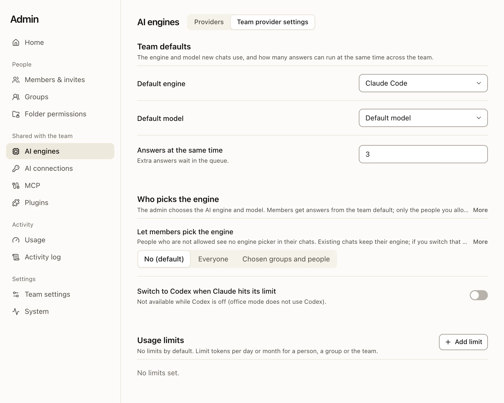

**Admin** in the sidebar is for the owner and admins. It opens on **Home**, which lists what needs attention first.
For the owner, Home also lists the first setup steps that are still to do: check the AI connection, set folder
permissions, invite your team, prepare a team skill, make the first backup. A finished step leaves the list.

## The Admin menu

| Group | Pages |
|---|---|
| **People** | Members & invites, Groups, Folder permissions |
| **Shared with the team** | AI engines, AI connections, MCP, Plugins |
| **Activity** | Usage, Activity log |
| **Settings** | Team settings, System |

## Your first week

:::steps
#### Set permissions
Assign folders to groups and check access with two test accounts. [Read about permissions](files-and-permissions.md).

#### Connect the AI
The owner connects an authorized Claude or OpenAI account in **AI connections**. **AI engines › Providers** shows whether each engine is ready.

#### Invite the team
Start with a small pilot group, then confirm roles and folder access.

#### Add a first skill
Copy a starter skill and review its result against the sources. [Read about skills](team-skills.md).

#### Make a first backup
Back up, then practise a restore with IT. [Read about backups](../operate/backups.md).
:::

## What admins cannot do

- Read other people's chats. The activity log shows which files the AI read, not the conversation.
- See personal folders or personal skills in `users/<id>/`.
- Use a team MCP connection, unless a rule names them.

:::warning
People who operate the server, its OS or its storage can read stored files and chats. In hosted plans, that includes Trina's operators.
:::

## AI engines

**Admin › AI engines** has two tabs.

| Tab | What it holds |
|---|---|
| **Providers** | One row per engine (Claude Code, Codex, API): its state, sign-in mode, models and last check, with **↻** to check again and an on/off switch. |
| **Team provider settings** | The default engine and model, answers at the same time, who may pick the engine, switching to Codex at Claude's limit, and usage limits. |

Click an engine's name to open its details: what is missing and how to fix it, every model, and for the owner the API engine form.

Save and Cancel appear in a section only after you change something in it.

:::note
The two tabs are new in 0.4.0. In 0.3.0 and earlier, everything is on one **AI engines** page.
:::

## Activity log

**Admin › Activity log** lists sign-ins, admin actions, file changes and AI tool use, grouped by day. The filters stay at the top while you scroll. It never shows chat content.

## System

**Admin › System** shows the team's storage, the version and updates, the server's health, how the team reaches the server, connected folders, backups and export, as plain sections. Health lists what needs attention first, such as a missing engine, a failed check or disabled automatic updates; the checks that passed fold into one line with **Show details**. An admin who is not the owner sees the plan, storage and, on an office Mac, the automatic updates.
