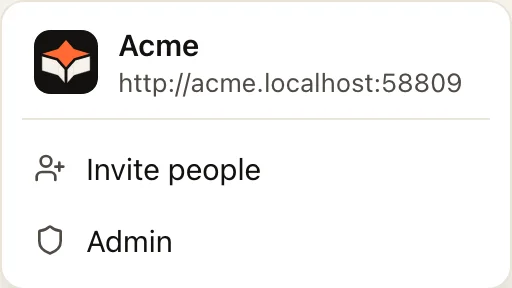
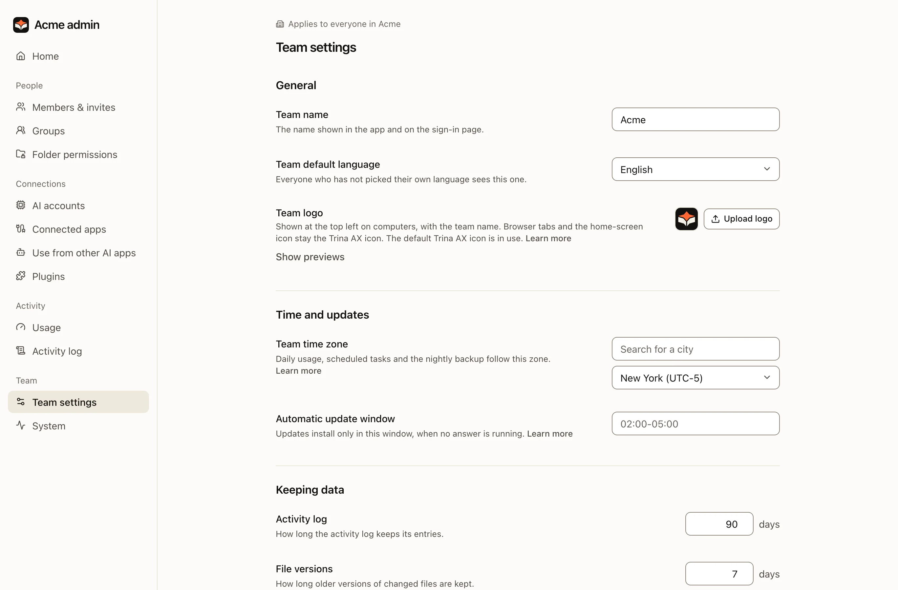
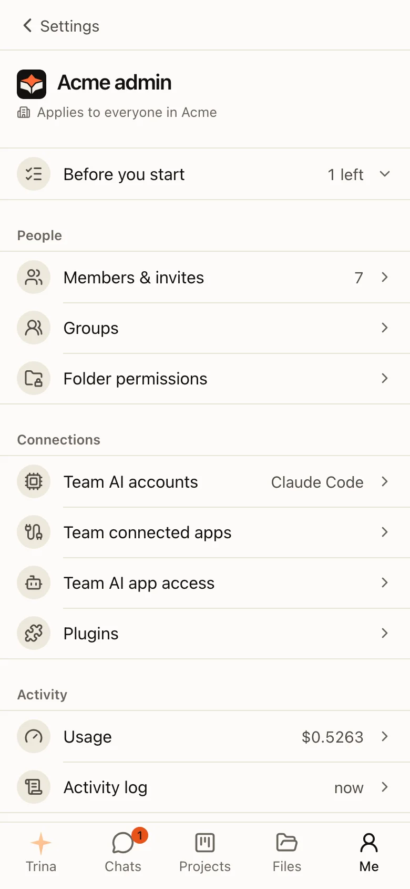

**Admin** is for the owner and admins. On a computer it is in the team menu under your team's logo at the top of the bar on the left, and ⌘K finds it; on a phone it is in the **Me** tab. Every page in it is for the whole team: the menu's title is your
team's name and logo ("Acme admin"), and every page says "Applies to everyone in Acme" above its title. The pages keep
the same names as in Settings. Admin › Connected apps is the team's connections; yours are in **Settings › Connectors**. It opens on
**Home**, which lists what needs attention first.
For the owner, Home also lists the first setup steps that are still to do: check the AI connection, set folder
permissions, invite your team, prepare a team skill, make the first backup. A finished step leaves the list.

## The Admin menu

| Group | Pages |
|---|---|
| **People** | Members & invites, Groups, Folder permissions |
| **Connections** | AI accounts, Connected apps (Google apps, other services such as Notion and, for the owner only, [Slack](slack.md)), Use from other AI apps, Plugins |
| **Activity** | Usage, Activity log |
| **Team** | Team settings, System |

**Members & invites** also lists the guests: people from outside the team who are in one chat or project. [Read about guests](guests.md).

:::note
Earlier versions had the AI accounts on their own **AI connections** page, next to **AI engines**. Both are one
**AI accounts** page now, and the old addresses open it. The team's AI settings (defaults, who picks the engine, members'
own accounts, usage limits) are in **Team settings**. **Slack** had its own menu item too; it is one row of
**Connected apps** now, and its old address opens it there.
:::

On a company with Google Workspace, the Google apps can sign in with your company's own Google app, set once for all five: [Use your company's own Google app](google-own-app.md).

## Your first week

:::steps
#### Set permissions
Assign folders to groups and check access with two test accounts. [Read about permissions](files-and-permissions.md).

#### Connect the AI
In **AI accounts**, the owner or an admin chooses **Add account** in the Claude Code or Codex row and connects an authorized
Claude or OpenAI account. Each row shows whether that engine is ready.

#### Invite the team
Start with a small pilot group, then confirm roles and folder access.

#### Add a first skill
Copy a starter skill and review its result against the sources. [Read about skills](team-skills.md).

#### Make a first backup
Back up, then practise a restore with IT. [Read about backups](../operate/backups.md).
:::

## What admins cannot do

- Read other people's chats. The activity log shows which files the AI read, not the conversation.
- See personal folders or personal skills in `users/<id>/`.
- Use a team MCP connection, unless a rule names them.

:::warning
People who operate the server, its OS or its storage can read stored files and chats. In hosted plans, that includes Trina's operators.
:::

## AI accounts

**Admin › AI accounts**, first in the Connections group, has one row per engine (Claude Code, Codex, API) with its
logo, its state and an on/off switch. When something is wrong, one short line under the name says how to fix it.
Under Claude Code and Codex are the accounts the team answers with, in the order they are tried, each with its logo,
plan and state, and **Add account** for the owner and admins. **How order works** under the list explains the order.

Click an engine's name to open its details: how it signs in, every model, when it was last checked, **Check again**,
and for the owner and admins the API engine form. Click an account's name for who uses it, this month's use and when it
was last used. The **⋯** menu of an account has Check again, Move up / down, rename, replace, switch off and delete.

## Connected apps

**Admin › Connected apps** lists the team's connections under **Connected**, and services you can add under
**Discover**. Each row shows the app's state (for example **On**, **Connecting** or **Needs attention**); the whole row
opens the app's page, which shows the same state. Connecting an app that opens a browser window (a Google app, a
service's sign-in, **Add to Slack**) can always be left: **Try again** and **Cancel** are there while it waits, and the
wait ends by itself after five minutes if the window was closed. Slack has its own guide: [Slack](slack.md).

## The team's AI settings

**Admin › Team settings** ends with the team's AI settings:

| Group | What it holds |
|---|---|
| **AI defaults** | The default engine and model, and how many answers run at the same time. |
| **Who picks the engine** | Whether members may pick another engine, and switching to Codex at Claude's limit. |
| **Members' own accounts** | Whether members may add their own accounts, whether a subscription may be shared, and the accounts they added. |
| **Usage limits** | Token or dollar limits a day or a month, for a person, a group or the team. |

Cancel and Save appear in a group only after you change something in it; each group saves on its own.

:::note
From 0.4.0. In 0.3.0 and earlier, all of this and the engines are on one **AI engines** page.
:::

## Activity log

**Admin › Activity log** lists sign-ins, admin actions, file changes and AI tool use, grouped by day. The filters stay at the top while you scroll. It never shows chat content.

## System

**Admin › System** shows the team's storage, the version and updates, the server's health, how the team reaches the server, connected folders, backups and export, as plain sections. Storage counts the files of deleted chats and rooms in **Team files** ("Includes 120 MB from deleted chats and rooms, removed after 30 days"): they are kept 30 days so they can be brought back. Health lists what needs attention first, such as a missing engine, a failed check or disabled automatic updates; the checks that passed fold into one line with **Show details**. An admin who is not the owner sees the plan, storage and, on an office Mac, the automatic updates.

