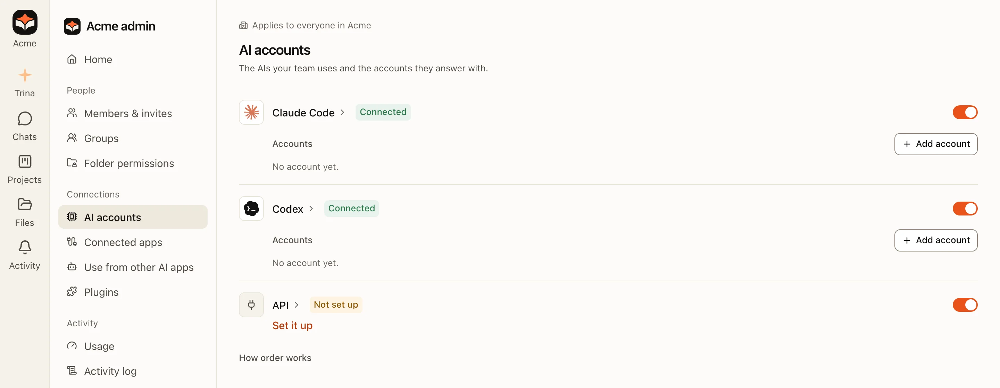
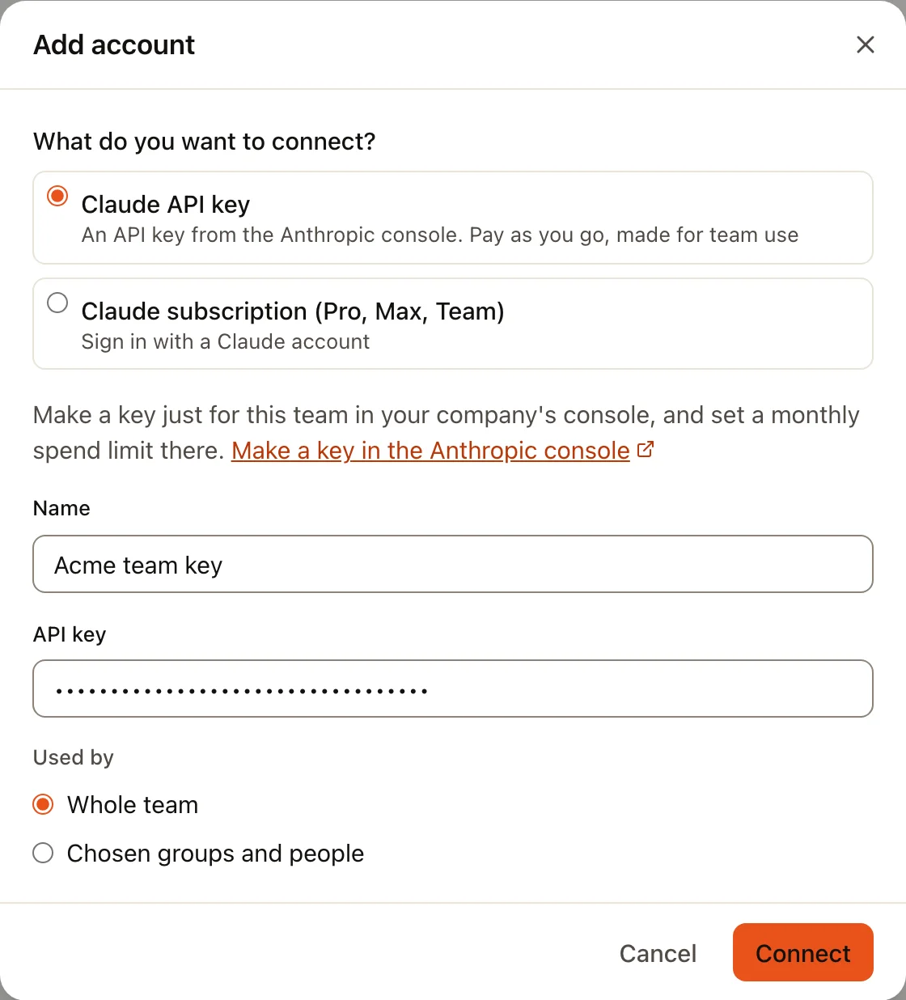
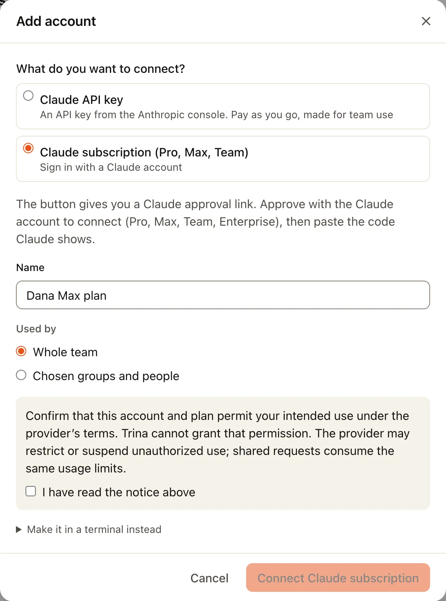
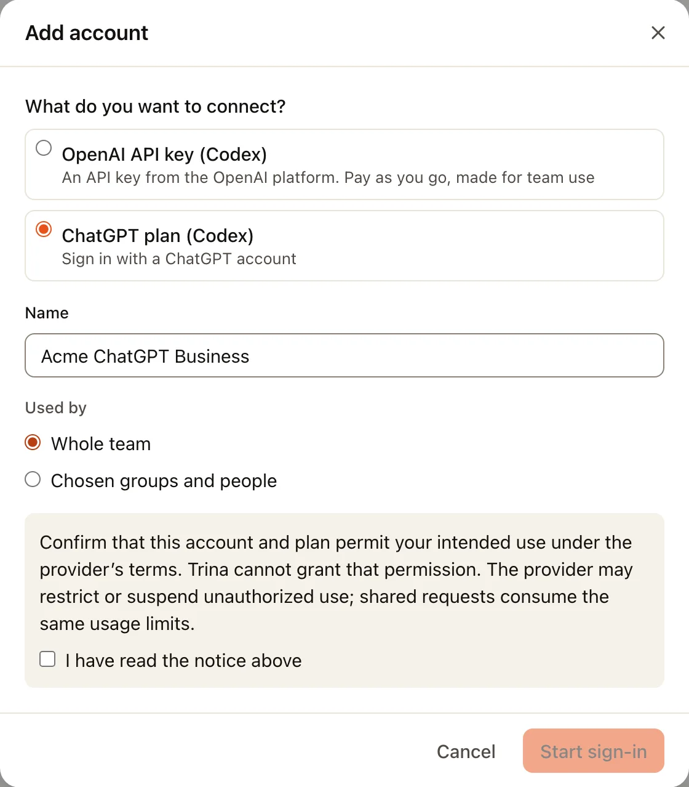
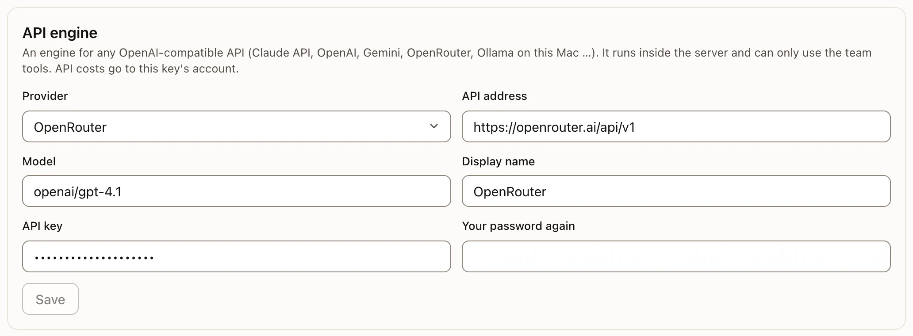
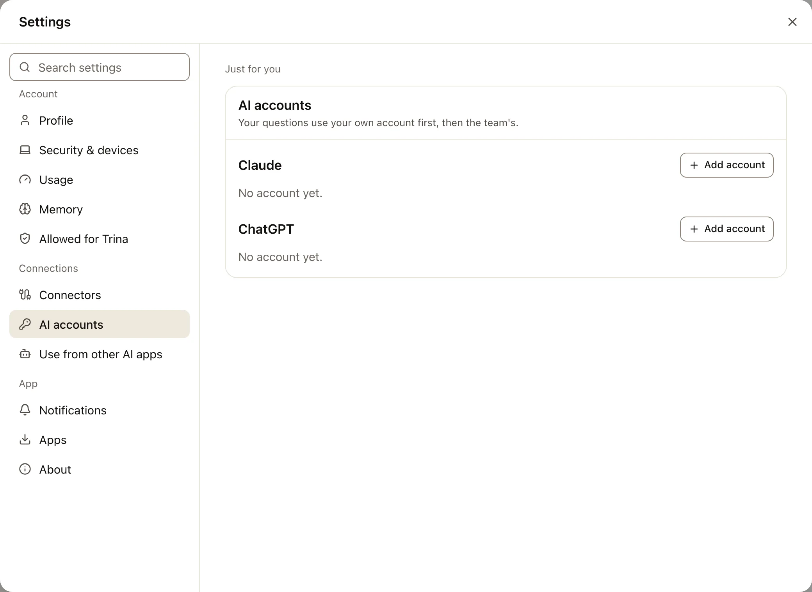

Trina AX answers with an AI account your team connects: a Claude or ChatGPT account, or an API key. AI use is not
included in Trina AX. Anthropic, OpenAI or the other AI company bills the account or key you connect, under that
company's terms.

The owner or an admin connects the team's accounts in **Admin › AI accounts**. When the team allows it, each person can
also add their own in **Settings › AI accounts**: their own questions use it first.

## Which one to pick

| Choice in Trina AX | What you need | Billed by | Good for |
|---|---|---|---|
| **Claude API key** | An API key from the Claude Console | Anthropic, per use | A team, with a monthly limit you set at Anthropic |
| **Claude subscription (Pro, Max, Team)** | A Claude account with a paid plan | Anthropic, your plan | One person's own account |
| **OpenAI API key (Codex)** | An API key from the OpenAI platform | OpenAI, per use | A team that uses OpenAI |
| **ChatGPT plan (Codex)** | A ChatGPT account with a paid plan | OpenAI, your plan | One person's own account |
| **API engine** | An address, a model and a key from any OpenAI-compatible service | That service | OpenRouter, Gemini or a model on your own computer |

:::warning
A subscription (Claude or ChatGPT) is made for its owner. Before you connect one for other people, check that the
provider's terms allow it: the dialog asks you to confirm **I have read the notice above**. For a team, an API key is
the safer choice.
:::

## Add a Claude API key

:::tip
**What you need**

- **API key**: a long code that starts with `sk-`. You make it in the [Claude Console](https://platform.claude.com/settings/keys).
- **Name**: any name your team will recognize, such as "Acme team key".
:::

:::steps
#### Make the key at Anthropic
Sign in to the [Claude Console](https://platform.claude.com/settings/keys) with your company's account. Open
**API keys** and choose **Create Key**. Give it a name such as "Trina AX", then copy the key: Anthropic shows it only
once. While you are there, set a monthly spend limit for your organization under **Limits**. See Anthropic's
[API key guide](https://docs.claude.com/en/api/admin-api/apikeys/get-api-key) for details.

#### Open Add account
In Trina AX, open **Admin › AI accounts**. In the **Claude Code** row, choose **Add account**, then **Claude API key**.
The dialog links to the Claude Console too: **Make a key in the Anthropic console**.

#### Paste and connect
Fill in **Name** and paste the key into **API key**. Under **Used by**, keep **Whole team** or choose **Chosen groups
and people**. Choose **Connect**. Trina AX checks the key with Anthropic and the account shows **Working**.

:::

## Add a Claude subscription

:::tip
**What you need**

- A **Claude account** with a Pro, Max, Team or Enterprise plan, signed in in your browser.
- Nothing to copy from a console: Claude shows you a **code** after you approve, and you paste it back.
:::

:::steps
#### Open Add account
In **Admin › AI accounts** (or **Settings › AI accounts** for your own), choose **Add account** under Claude, then
**Claude subscription (Pro, Max, Team)**. Fill in **Name**, choose who uses it, read the notice and tick **I have read
the notice above**.

#### Approve at Claude
Choose **Connect Claude subscription**. After a few seconds, **Open Claude to approve** appears (or **Copy link**, to
open it in the browser where you are signed in to Claude). Claude's own page opens: check that it shows the account you
mean, and approve.

#### Paste the code
Claude then shows a code. Copy all of it (it has a `#` in the middle) into **Paste the code Claude shows after you
approve**. Trina AX says **Connected · Claude subscription**.
:::

Your Claude password never reaches Trina AX: you sign in on Claude's own page, and Trina AX keeps only the access Claude
hands out.

**Make it in a terminal instead** (under the notice) is the other way, for someone who has Claude Code installed: run
`claude setup-token` in a terminal, approve in the browser that opens, and paste the whole token it prints (the
terminal says which line) into **Token**. It works for one year.

## Add an OpenAI API key

:::tip
**What you need**

- **API key**: starts with `sk-`. You make it on the [OpenAI platform](https://platform.openai.com/api-keys).
:::

:::steps
#### Make the key at OpenAI
Sign in to the [OpenAI platform](https://platform.openai.com/api-keys), open **API keys** and choose **Create new
secret key**. Pick the project it belongs to, then copy the key: OpenAI shows it only once. Set a budget for that
project under **Limits**.

#### Paste it in Trina AX
In **Admin › AI accounts**, choose **Add account** in the **Codex** row, then **OpenAI API key (Codex)**. Fill in
**Name**, paste the key into **API key**, choose who uses it and choose **Connect**.
:::

## Add a ChatGPT plan

:::tip
**What you need**

- A **ChatGPT account** with a paid plan. Nothing to copy from a console: Trina AX gives you an address and a code
  to enter at OpenAI.
:::

:::steps
#### Start the sign-in
In **Admin › AI accounts**, choose **Add account** in the **Codex** row, then **ChatGPT plan (Codex)**. Fill in
**Name**, choose who uses it, tick **I have read the notice above**, and choose **Start sign-in**.

#### Enter the code at OpenAI
Trina AX shows **Open this address** and **Enter this code (within 15 minutes)**. Open the address, sign in with the
ChatGPT account, type the code and approve.

#### Done
Trina AX shows **Connected · ChatGPT** with the plan's name. If you signed in with another account than the one you
meant, sign out at chatgpt.com and choose **Start again**.
:::

## The API engine

The API engine talks to any service that offers an OpenAI-compatible API. It is still marked **Experimental**: answers,
tools and costs can differ from Claude Code and Codex.

:::tip
**What you need**

- **Provider**: pick one, and Trina AX fills in its **API address** and a **Model**.
- **Model**: the model's exact name at that provider.
- **API key**: from the provider's key page.
- **Your password again**: your own Trina AX password, to confirm.
:::

| Provider | API address | Where to make the key |
|---|---|---|
| OpenAI | `https://api.openai.com/v1` | [platform.openai.com/api-keys](https://platform.openai.com/api-keys) |
| Claude API (Anthropic) | `https://api.anthropic.com/v1` | [platform.claude.com/settings/keys](https://platform.claude.com/settings/keys) |
| Google Gemini | `https://generativelanguage.googleapis.com/v1beta/openai` | [aistudio.google.com/apikey](https://aistudio.google.com/apikey) |
| OpenRouter | `https://openrouter.ai/api/v1` | [openrouter.ai/settings/keys](https://openrouter.ai/settings/keys) |
| Ollama (this Mac) | `http://127.0.0.1:11434/v1` | No key: a model running on the same computer as the server |

:::steps
#### Open the API row
In **Admin › AI accounts**, choose **Set it up** under **API**.

#### Fill in the form
Pick the **Provider**, check the **Model**, give it a **Display name**, paste the **API key** and type **Your password
again**. Choose **Save**.

:::

## Your own account

When an admin turns on **Let members add their own AI connection** (**Admin › Team settings**, **Members' own
accounts**), everyone sees **Settings › AI accounts**: "Your questions use your own account first, then the team's."
Choose **Add account** under **Claude** or **ChatGPT** and follow the same steps as above. Only your own questions use
it; admins can't use it or see its key.

## Voice input

Voice input turns speech into text through OpenRouter. On your own server, an admin adds an **OpenRouter API key** in
**Admin › Team settings**, under **Voice input**. Make the key at [openrouter.ai/keys](https://openrouter.ai/keys).

## Problems

| What you see | What to do |
|---|---|
| **Not an API key of this kind.** | The key is for another kind (an OpenAI key in the Claude field, or the other way round), or it was copied with a space. Copy it again. |
| **Paste the whole code (it has a # in the middle).** | Part of Claude's code is missing. Copy it again with Claude's copy button. |
| **That code did not work. Start again, approve, and paste the new code.** | The code was used already or is too old. Choose **Connect Claude subscription** again. |
| **The time ran out.** (ChatGPT) | The code works for 15 minutes. Choose **Start again**. |
| **Connections can only be added over a secure connection (https).** | Open Trina AX at its `https://` address. |
| An account shows **Refused** or **Needs reconnecting** | The key was revoked or the sign-in ended. Open the account's **⋯** menu and choose **Replace token or key** or **Reconnect**. |
| An account shows **Monthly limit used up** | The limit set in its **⋯** › **Monthly limit** was reached. Raise it or wait for next month. |

More about the order accounts are used in, limits and engines: [Admin](admin.md#ai-accounts) and
[Usage and limits](usage-and-limits.md).
