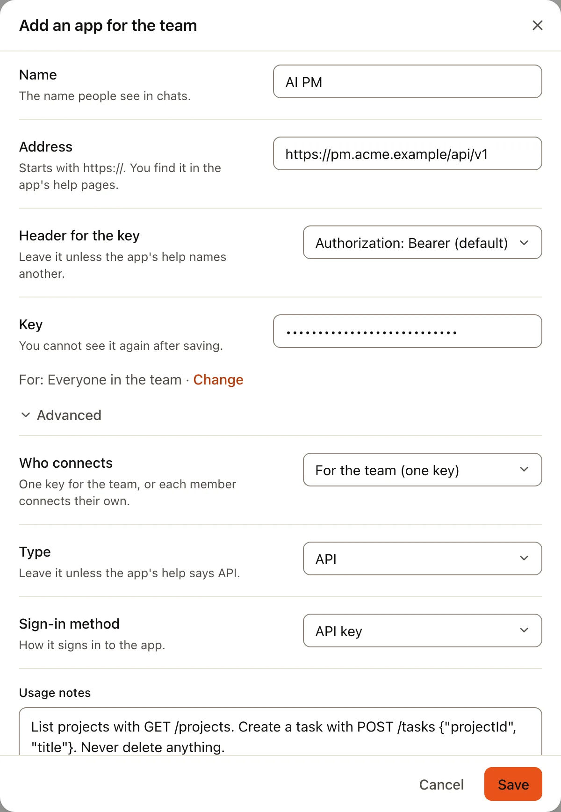
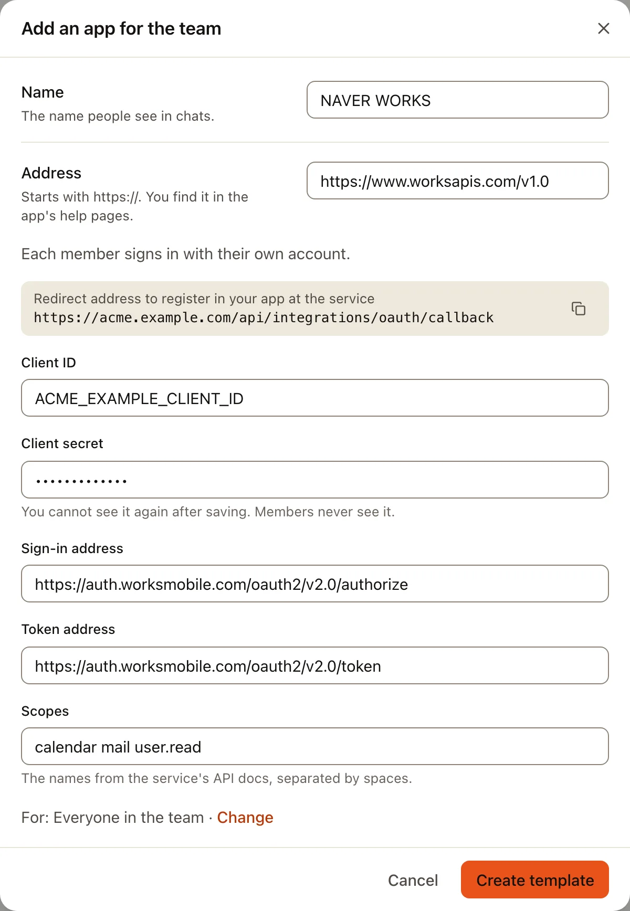

Your company may have its own system: a project tracker, an order system, an internal tool. If it has a web API, the
AI can use it. An owner or admin adds it once in **Admin › Connected apps**, with its address, a key and a few lines on
how to use it. The AI can then call only addresses under that one.

Some services, such as NAVER WORKS, don't hand out keys: people sign in, through a sign-in app your company makes at
that service. That is [the second half of this page](#sign-in-with-your-own-app).

You need someone who knows the system (its admin or developer) for the values below. Nothing here needs code.

## Connect an API with a key

:::tip
**What you need**

- **Address**: the API's base address, such as `https://pm.acme.example/api/v1`. Ask the system's admin, or look in
  its API documentation ("base URL").
- **Key**: an API key or token for that system. Make one for Trina AX only, with no more rights than the AI needs.
- **Header for the key**: most APIs take `Authorization: Bearer <key>`. If the API's documentation names another
  header, such as `X-API-Key`, note its exact name.
- **Usage notes**: a few lines on which addresses the AI should call. The system's API documentation has them.
:::

:::steps
#### Open the dialog
In **Admin › Connected apps**, choose **Add one by its address** under Discover. Open **Advanced** and set **Type** to
**API** and **Sign-in method** to **API key**.

#### Fill in the fields
- **Name**: the name people see in chats, such as "AI PM".
- **Address**: the base address. The AI can call only paths under it.
- **Header for the key**: keep **Authorization: Bearer (default)**, or choose **Another header** and type the
  **Header name** exactly as the documentation writes it.
- **Key**: paste the key.
- **Usage notes**: the main paths, the values they need, and anything the AI must not do. Up to 4,000 characters.



#### Choose who may use it and save
**For: Everyone in the team · Change** chooses the groups or people. Leave **Writing, deleting and sending** on
**Ask every time** at first. Choose **Save**: Trina AX checks the address and key, and the line shows **Connected**.
:::

A good usage note reads like this:

```
List projects with GET /projects.
Create a task with POST /tasks and a JSON body {"projectId", "title", "dueDate"}.
Dates are YYYY-MM-DD. Never call DELETE.
```

The AI reads the note every time it uses the API, so keep it short and exact.

## Sign in with your own app

Some services let people sign in (OAuth) but only through an app registered at the service: NAVER WORKS, and Google's
own MCP servers. You make that app once in the service's developer console, then paste its values into Trina AX.
Usually you add it as a **template**, so each member signs in with their own account.

:::tip
**What you need, from the service's developer console**

- **Client ID** and **Client secret** of the app you made there.
- **Sign-in address** and **Token address** (for an API; an MCP server finds them by itself).
- **Scopes**: the permissions the AI needs, separated by spaces.

**What you give the service**

- The **redirect address** Trina AX shows: `https://<your team address>/api/integrations/oauth/callback`.
:::

:::steps
#### Open the dialog in Trina AX first
In **Admin › Connected apps**, choose **Add one by its address**, open **Advanced**, set **Who connects** to
**Each member's own**, **Type** to **API** (or **MCP server**), and **Sign-in method** to
**Sign in (OAuth)**. For an MCP server, also turn on **Sign in with my own app**. The dialog now shows **Redirect
address to register in your app at the service** with a copy button. Copy it.

#### Make the app at the service
In the service's developer console, make an app (it may be called an "OAuth app", "client" or "integration"). Paste
the redirect address under its redirect URL, choose the scopes, and copy its **Client ID** and **Client secret**.

#### Fill in the rest and save
Back in Trina AX, fill in **Name**, **Address**, **Client ID**, **Client secret**, the **Sign-in address** and **Token
address** (for an API) and **Scopes**. Choose **Create template**. Members then see it in **Settings › Connectors**
and sign in with their own account.


:::

### NAVER WORKS

| In Trina AX | Value |
|---|---|
| **Type** | **API** |
| **Address** | `https://www.worksapis.com/v1.0` |
| **Sign-in address** | `https://auth.worksmobile.com/oauth2/v2.0/authorize` |
| **Token address** | `https://auth.worksmobile.com/oauth2/v2.0/token` |
| **Client ID**, **Client secret** | From your app in the NAVER WORKS Developer Console |
| **Scopes** | What the AI needs, for example `calendar mail file user.read` |
| **Usage notes** | The API addresses the AI should call, from the NAVER WORKS API documentation |

In the NAVER WORKS Developer Console, open your app (or add one under API 2.0), set its **Redirect URL** to the address
Trina AX shows, tick the same **OAuth Scopes**, and copy the **Client ID** and **Client Secret**. NAVER WORKS explains
the sign-in in its [OAuth guide](https://developers.worksmobile.com/kr/docs/auth-oauth).

### Google's MCP servers

Google also offers MCP servers for Gmail, Calendar, Drive and more (`https://gmailmcp.googleapis.com/mcp/v1` and
similar), in Google's preview program. They need your own Google sign-in app, made as in
[Your company's own Google app](google-own-app.md#in-google-cloud) but with the redirect address above. For everyday
use, the built-in [Google apps](google-apps.md) need no app of your own.

## Problems

| What you see | What to do |
|---|---|
| **The service did not accept this app’s Client ID or Secret.** | The Client ID or secret was copied wrong, or the secret was renewed at the service. Edit the connection, enter the secret again under **Advanced**, and sign in again. |
| The service says the redirect address is wrong (`redirect_uri_mismatch`, "invalid redirect") | The redirect URL in the service's console differs from the one Trina AX shows. Copy it again with the copy button; check `https`, the team address and that there's no slash at the end. |
| **The saved client secret does not follow a new address. Enter it again.** | You changed the address or sign-in address. For safety the secret is not reused: paste it again. |
| Calls answer 401 or 403 | The key has expired, lacks a permission, or was copied with a space. Make a new key, or add the missing scope at the service and sign in again. |
| The AI calls the wrong paths | Make the **Usage notes** more exact: list each path with its method. |

Full details for developers: [Integrations](../../INTEGRATIONS.md#your-own-app-client-id).
