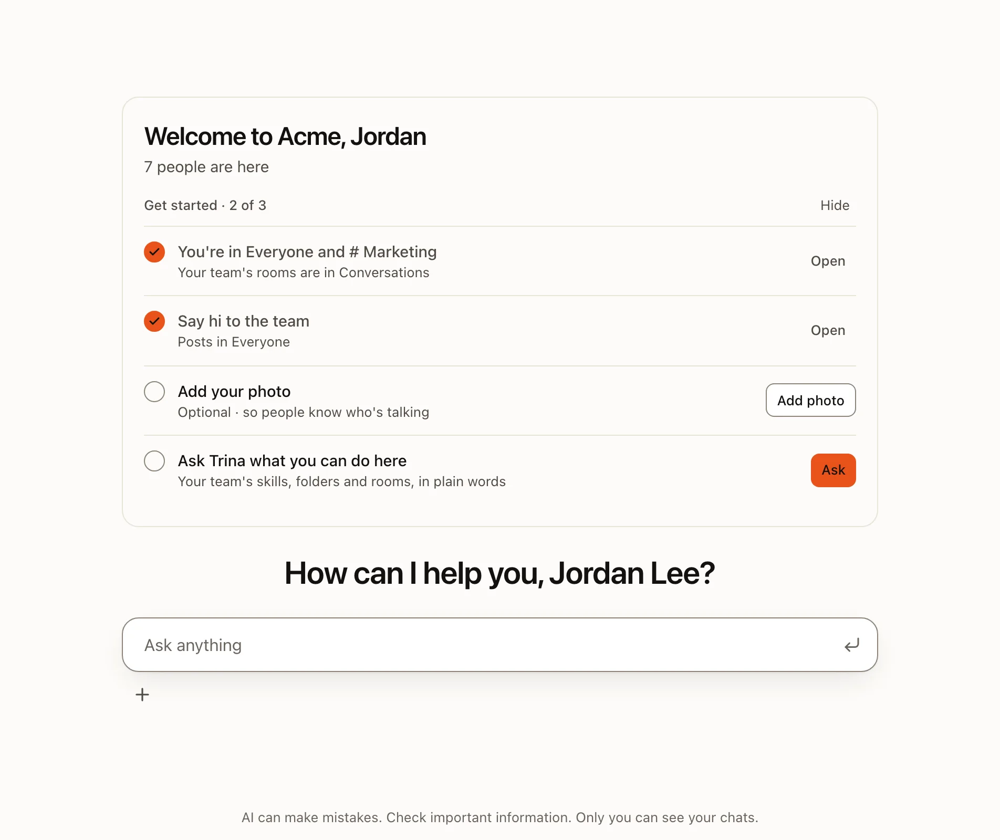
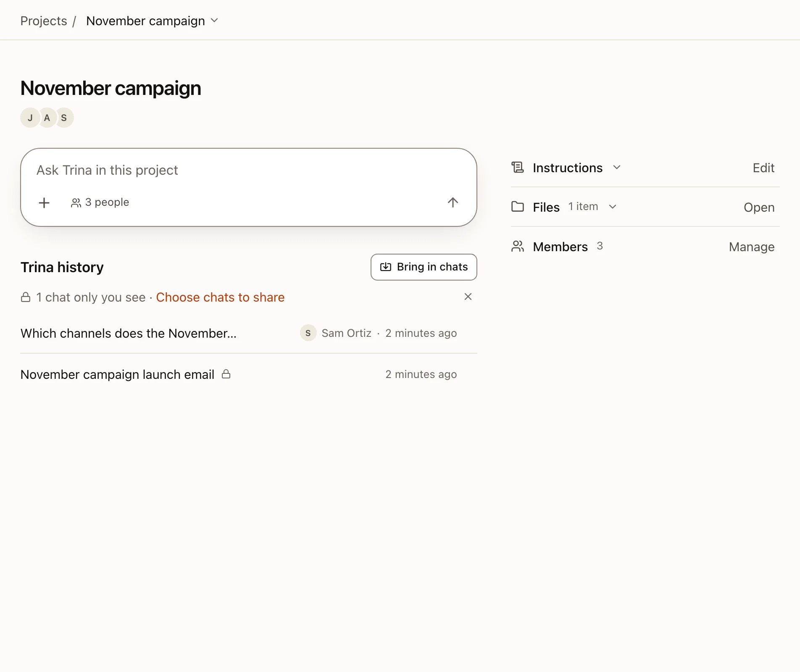

A chat is a conversation with the AI. Only you see your chats. Admins see which files the AI read, never the conversation.

## Start a chat

:::steps
#### Open a new chat
Choose **New chat** in the sidebar, or type in the box on the home page. The first time, under the box, **Ready in your
team** lists what your team set up: its skills (**Example** shows a result, **Try it** opens the skill) until you have run
one, and the team files (**Ask** puts a question about them in the box, not sent). With nothing set up yet, **Start
here** offers one question to send.

#### Ask in plain words
For example: "Summarize last week's sales notes in shared/sales." Type `/` to pick a team skill.

#### Follow the work
Open **N steps** under an answer to see each tool the AI used and each file it read.
:::

## How an answer works

| Topic | What happens |
|---|---|
| **Engine** | Members get the team default. People an admin allows can pick an engine and model in the chat. |
| **Files** | The AI uses Trina's file tools. Each call is checked against your own permissions. |
| **Questions** | When the AI needs a choice or a confirmation, it shows a card. It cannot answer that card itself. |
| **Helpers** | For big requests the AI can split work into sub-tasks, up to 4 at a time. Each helper works as you. |
| **Length** | One answer may use tools up to 150 times by default (admins choose 10 to 500). At the limit, **Continue** picks it up. |
| **Web** | The AI can open web pages. The server checks each address, and asks you before risky ones. |

:::note
Selected context goes to the AI provider you connected. Self-hosting is not offline processing. [Read the data flows](../operate/security.md).
:::

## Several chats at once

Each chat in **Trina history** (the sidebar on a computer, the ☰ menu on a phone) shows at most one mark, at the right end of its row:

| Mark | What it means |
|---|---|
| **?** in amber | The AI waits for you: a question or confirmation card, or an answer that failed or paused at a limit. A card's **?** stays until you answer it. |
| Grey ring | The AI is answering, or the answer waits its turn. |
| Dot, title in bold | A new answer you have not opened yet. |

Opening a chat clears its dot, and the **?** of a failed or paused answer, on every device. **Show all** says how many hidden chats need you, and its filter can show only the chats that are answering or wait for you. A room shows **?** in place of its count while the AI waits for your answer there.

While the browser tab is in the background, its title counts the chats and rooms that want you, for example "(2) Trina". The desktop app shows the same number on the Dock on a Mac, and a notification when a card opens or an answer that ran over a minute ends while you look elsewhere; clicking it opens that chat. Scheduled tasks get the mark only; a question asked from Slack is answered there, so its chat gets no dot. On a phone, the ☰ button gets a dot when a chat in it wants you, the **대화** tab shows **?** while the AI waits for your answer in a room, and a short message with **Open** appears in the app.

## Projects

A project is a folder of the team folder, plus instructions. Use it for work that keeps coming back to the same files: a launch, a client, a quarter's report.

:::steps
#### Make a folder a project
In **Files**, open the menu of a folder you can write and choose **Make it a project**.

#### Write the instructions
Say what the work is and how the AI should help. The first paragraph shows under the project's title.

#### Chat in the project
Start a chat from the project's page, or move a chat in from the chat title's menu. The AI then gets that folder and those instructions.

:::

- There is no member list. Whoever can read the folder sees the project.
- A folder holds one project. Once it is a project, only an admin moves, renames or deletes the folder.
- Instructions you did not write all by yourself count as outside content. The AI asks before it remembers anything after reading them.
- **Shared chats.** In a team project's settings, its creator or an admin can turn on **이 프로젝트의 채팅을 프로젝트 사람들과 공유**. From then on, new chats in the project can be seen and continued by everyone who can read its folder (owner and admins included); the chats you had before stay yours. Every question shows the picture and name of the person who sent it, yours too. Each answer runs as the person who asked, with their access. When the AI is about to read something some of them cannot open, it asks you first (**읽고 공유하기** / **읽지 않기**). A shared chat takes team files only. Turning the setting off keeps the chats already shared.

## Find anything

Press ⌘K (Ctrl+K on Windows) or choose **Search** in the sidebar to find chats, messages in your conversations, projects, files, skills, scheduled tasks and MCP connections. [Read about search and settings](settings-and-search.md).

## Deleted chats

Deleting a chat moves it to **삭제한 기록** (Deleted history), where you can bring it back for 7 days by default. Admins can choose 1 to 365 days.

- A shared chat goes to the 삭제한 기록 of the person who made it. When a project's creator or an admin deletes someone else's shared chat, it is in their 삭제한 기록 too, for as long as they can still bring it back.
- Deleting a project moves its shared chats to the 삭제한 기록 of the people who made them. Brought back, such a chat is its maker's alone, without a project.
