A chat is a conversation with the AI. A new chat is yours alone until you [share it](#share-a-chat); a chat in a team
project is shared with the project's members unless you pick **Only me**. Admins see which files the AI read, never the
conversation.

## Start a chat

:::steps
#### Open a new chat
Choose **Ask Trina** at the top of your Trina list (**Trina** on the bar on the left), press ⇧⌘O (Ctrl+Shift+O on Windows), or type in the box on the home page. On a phone, the **Trina** tab opens on Home: type in the box at the bottom. The first time, under the box, **Ready in your
team** lists what your team set up: its skills (**Example** shows a result, **Try it** opens the skill) until you have run
one, and the team files (**Ask** puts a question about them in the box, not sent). With nothing set up yet, **Start
here** offers one question to send.

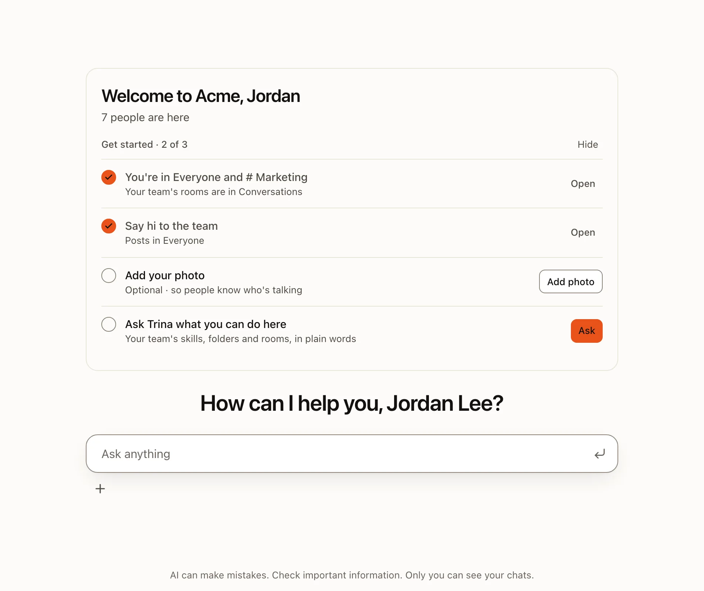

#### Ask in plain words
For example: "Summarize last week's sales notes in shared/sales." Type `/` to pick a team skill.

The message box has your text on top and one row of buttons under it, inside the box: **+** on the left adds files
(from your computer or the team's files), and on the right are the AI choice (for people an admin allows), the
microphone where they are on, and send (**↑**). Enter sends.

#### Follow the work
Open **N steps** under an answer to see each tool the AI used and each file it read.
:::

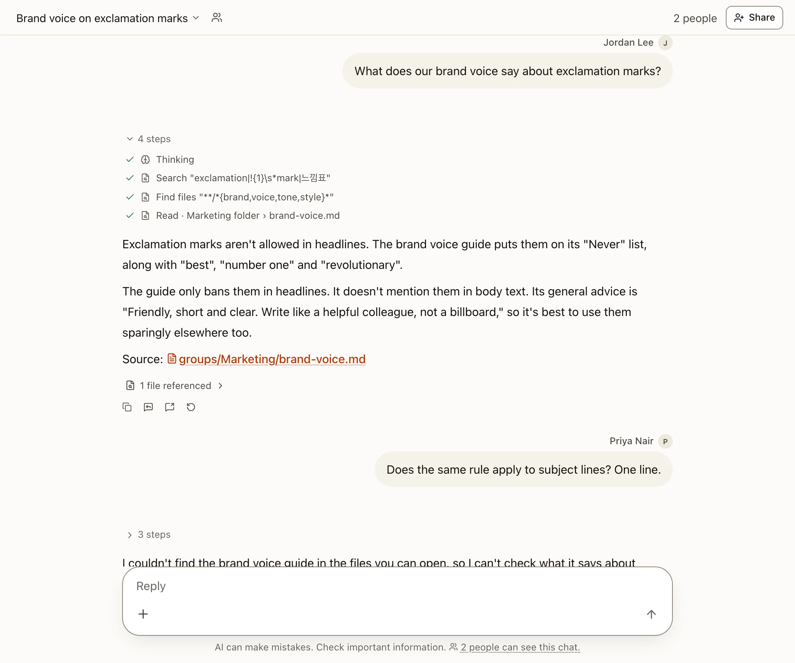

## How an answer works

| Topic | What happens |
|---|---|
| **Engine** | Members get the team default. People an admin allows can pick an engine and model in the chat. |
| **Files** | The AI uses Trina's file tools. Each call is checked against your own permissions. |
| **Questions** | When the AI needs a choice or a confirmation, it shows a card. It cannot answer that card itself. |
| **Helpers** | For big requests the AI can split work into sub-tasks, up to 4 at a time. Each helper works as you. |
| **Length** | One answer may use tools up to 500 times by default (admins choose 10 to 2,000; scheduled tasks, questions from Slack and guests up to 150). At the limit, **Continue** picks it up. |
| **Web** | The AI can open web pages. The server checks each address, and asks you before risky ones. |
| **Help** | Ask how to use, set up or fix Trina AX: the AI looks it up in these docs, kept on your server with its version, and ends with a link to the page. |

:::note
Selected context goes to the AI provider you connected. Self-hosting is not offline processing. [Read the data flows](../operate/security.md).
:::

## Your Trina list

On a computer, **Trina** on the bar on the left opens your list of Trina chats beside the page. At the top are
**Ask Trina**, **Search**, **Scheduled** and **Team skills**. Under them, from the top:

| Part | What is in it |
|---|---|
| **Waiting for you** | Shows only while a chat waits for your answer, and opens it |
| **Pinned** | The chats you pinned |
| **Trina history** | All your other chats, newest first. A chat in a project shows the project's name at the end of its row |

A small mark says who sees a chat: a lock before the title for a chat only you see in a team project, and the
people icon for a shared chat. A shared chat others wrote in shows their faces at the end of its row instead (up to 3, 2 on
a phone); hover them to see their names. This is the same in your history, on a project's page and in search.

**Trina** on the bar also opens the waiting chat while it shows **?**. Chats you deleted are in **Deleted history**, in
the **⋯** menu next to **Trina history**. The filter button at the top of the list can show only some chats, for example the
ones that are answering or wait for you. Your projects have their own place: **Projects** on the bar.

On a phone, the **Trina** tab opens on Home. **☰** at the top opens your history: **Search**, **Scheduled**, **Team
skills**, then **Trina history** (your pinned chats first, then newest first, by date), and **Set your status** and
**Deleted history** at the bottom.

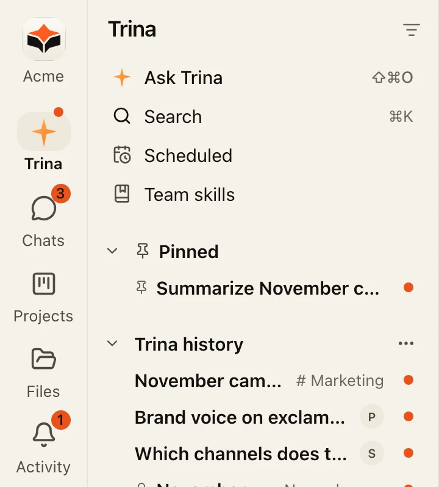

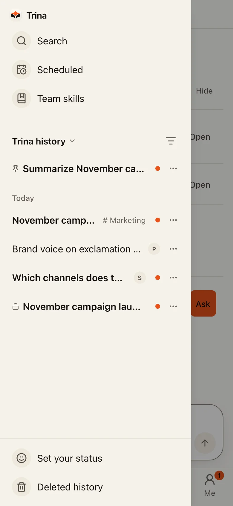

### Sections

Trina chats have no folders. To keep chats about one piece of work together, put them in a [project](#projects).

In the **Chats** list you can group channels and direct messages into your own **sections**, like the sidebar sections
in Slack. A section only sorts your own list: it holds no files, nobody else sees it, and it never changes who is in a
conversation.

1. Open **Chats** on the bar on the left.
2. Point at **Channels** and press the **+** at the end of that line. A small menu opens with **Create a channel** and
   **New section**.
3. Choose **New section**, type a name (for example "Clients") and press **Create**.
4. A list of your conversations opens. Tick the ones you want and press **Add 2 conversations** (the number follows what
   you tick), or **Skip** to fill it later.

You see the new section in your Chats list, above **Channels**, with the conversations you picked.

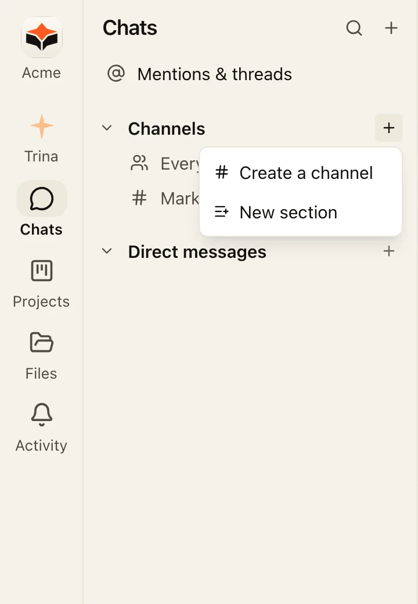

- **Move one conversation:** on its row, choose **···** › **Move to section** and pick the section (or **New section…**).
  On a computer you can also drag the row onto a section. **Remove from section** puts it back where it was: under **Channels**,
  **Projects** (a project's chat room) or **Direct messages**.
- **Change a section:** its **···** has **Add conversations**, **Rename section**, **Move up**, **Move down** and
  **Delete section**. Deleting a section only removes the heading: its conversations go back to **Channels** and
  **Direct messages**.

## Several chats at once

Each chat in your list of Trina chats shows at most one mark, at the right end of its row:

| Mark | What it means |
|---|---|
| **?** in amber | The AI waits for you: a question or confirmation card, or an answer that failed or paused at a limit. A card's **?** stays until you answer it. |
| Grey ring | The AI is answering, or the answer waits its turn. |
| Dot, title in bold | A new answer you have not opened yet. |

Opening a chat clears its dot, and the **?** of a failed or paused answer, on every device. A folded section keeps the strongest mark of the chats in it. A conversation shows **?** in place of its count while the AI waits for your answer there.

While the browser tab is in the background, its title counts the chats and conversations that want you, for example "(2) Trina". The desktop app shows the same number on the Dock on a Mac, and a notification when a card opens or an answer that ran over a minute ends while you look elsewhere; clicking it opens that chat. Scheduled tasks get the mark only; a question asked from Slack is answered there, so its chat gets no dot. **Trina** on the bar on the left (on a phone, the **Trina** tab) shows **?** or a dot when a chat wants you, **Chats** shows **?** while the AI waits for your answer in a conversation, and on a phone a short message with **Open** appears in the app.

## Share a chat

You can share any chat of yours with people and groups, like a file in Google Drive. They see the whole chat, including what was said before they
were added, and can ask the AI in it themselves.

:::steps
#### Open Share
Choose **Share** at the top right of the chat (on a phone, the share icon in the top bar), or **Share** in **···** on its row in your list.

#### Add people and groups
Type a name in **Add people and groups**. You are in the list as **Started this chat**. **✕** takes someone out again
(**Undo** puts them back until you save).

#### Save
Press **Share** (**Save** when it was shared already). Leaving with changes you did not save asks first.
:::

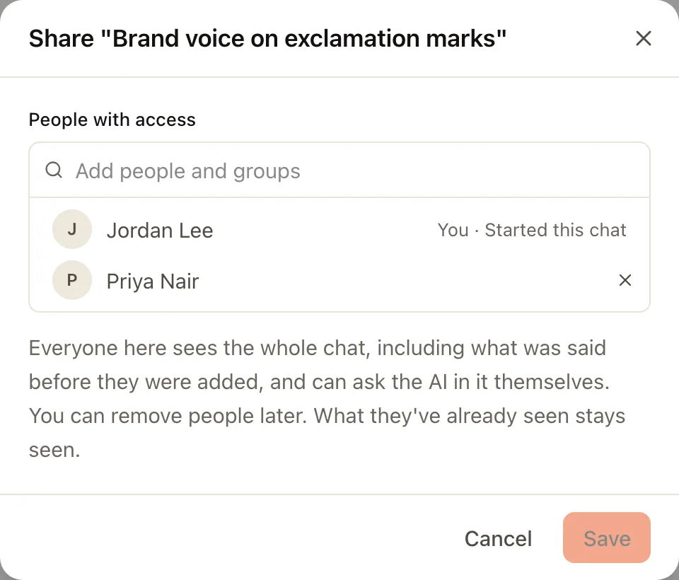

- **While you add people**, the app checks what they would start seeing, and a warning shows right away, only when
  something is at stake: for example "2 answers may have used your personal memories" or "3 answers used files Priya
  can't open". **Show answers** lists those answers. When nothing is at stake there is no warning; older answers that
  can't be checked get one small grey line. Pressing **Share** once shares the chat; **Cancel** leaves it as it was.
- **Files.** Files you attached from your computer before sharing become visible to the people you add, and the dialog
  says how many. A file you changed since you attached it stays yours: it is not counted, and the others don't see it.
  In a shared chat anyone in it can attach a file from the computer (at most 50 MB a file): it is kept with the chat,
  and only the people who see the chat can open it and ask Trina about it. Deleting the chat deletes them.
- **Who sees answers.** Answers in a shared chat are never hidden from the people in it, including people added later.
  Each answer runs as the person who asked, with what they may open. Before the AI reads something some of them can't
  open, it asks you first.
- **What the others see.** The chat appears in their Trina list, and **Activity** says "Jordan shared a chat with you".
  When you add someone by name they also get a notification on their phone and in their browser (**Settings ›
  Notifications › Chats shared with me** turns it off). They can continue the chat with their own access, or choose
  **Hide from my list** in its menu; opening it again brings it back.
- **Change who sees it.** Only the person who started the chat changes who sees it: **Share** again, or **Change who
  sees it** under the box. Someone you take out loses the chat and its files at once and reads "This chat is no longer
  shared with you", also when they open its link later; what they were typing in it stays there with **Copy**. Someone
  you take out by name who is also in a group you shared it with keeps it through that group, and the dialog says so.
  Taking everyone out makes it yours alone again.
- **Send the link.** **Copy link** at the bottom left of the Share dialog copies the chat's address, and after you
  share, the message that says it is shared offers **Copy link** too. The link opens the chat only for people who can
  already see it; a teammate who can't gets **Ask for access** (below), with nothing of the chat on it. People you just added
  can use it once you press **Share** (or **Save**). The project's **Members** dialog has **Copy link** for the project too.
- **Ask for access.** A teammate who opens the link of a chat they can't see gets **Ask for access**, with room for a
  note; the page shows nothing of the chat, not its title and not who is in it. After they press it, the button reads
  **Requested**. You get the request in **Activity** with **Share** and **Decline**, and a notification on your phone and
  in your browser (**Settings › Notifications › Sharing**; at most 10 a day, counted together with requests to open
  files). **Share** adds them by name, after the same check as the Share dialog; **Decline** tells them only that it
  wasn't approved, and they may ask again. A project's link works the same way: whoever changes its members gets the
  request, and **Add** makes the person a member. A shared chat of a team project asks to join that project. Where no
  request is possible (a chat that is never shared, such as one in a personal project, or nobody left to answer), the
  page says only that they can't ask, without the button and without saying why. Guests can't ask, and someone who can already open it is simply let in.
- **Personal things stay out.** In a shared chat the AI does not use your memories from other chats, your browser, your
  email or your schedules. To use them, choose **Continue in a chat only you see** in the chat's menu.
- **It still learns from you.** When you correct it or tell it how you work, the AI keeps that in your own memory, as in
  your own chats, with a small "Remembered" step only you can undo. What other people write in the chat never goes into
  your memory.
- A chat in a personal project stays yours: **Share** offers to move it out first. A chat in a team project is shared
  with the project's members (see [Projects](#projects)).

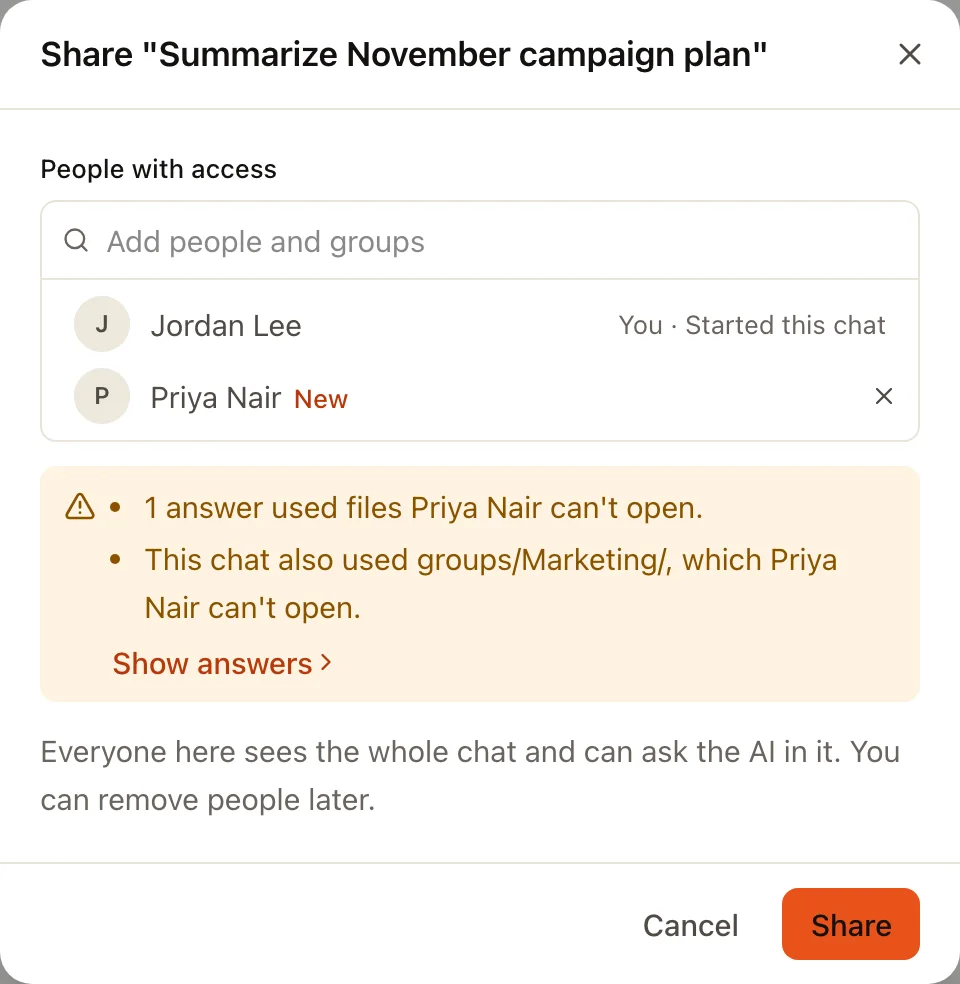

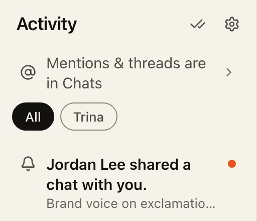

## Pin a chat

In your list of Trina chats, a chat's **···** (or a right-click on its row, or a long press on a phone) has **Pin to top**.
Pinned chats come first in your Trina list, the most recently pinned first, with a small pin before the
title, on a computer and on a phone. A project's page lists your
pinned chats there first too. **Unpin** puts a chat back. A pin is yours only, also on a shared project chat,
and it goes when the chat is deleted or you can no longer see it. You can pin up to 50 chats.

Conversations in **Chats** (channels and direct messages) are pinned the same way, from a row's **···** or the conversation's own
**···**: pinned ones come first, with a small pin after the name, in every list of conversations, on a computer and in the phone's **Chats** tab.
Only you see your pins. A pin goes when you leave the conversation or hide it. You can pin up to 50 conversations.

The **Chats** list shows every conversation: your pins, your sections, then **Channels** (the Everyone channel first, then
by name; private channels have a lock) and **Direct messages** (one-to-one chats and group chats without a name together, the latest first, each with the members' faces). Conversations you hid are behind **Hidden conversations (N)**.

The **+** beside **Channels** opens a small menu. **Create a channel**: pick people and give it a name, and it is a
private channel that only they see. **New section** makes one of your own sections, as described above under Sections. The **+** beside **Direct messages** is **New message**: pick one person for a direct message, or several
for a group chat named after them (if you already have one with exactly those people, it opens). To turn a group chat
into a private channel, choose **···** › **Turn into a private channel** and give it a name.

A direct chat with someone who left the team says "<name> left the team" and has no message box. The history stays readable.

## Team chat

**Chats** on the bar on the left (on a phone, the **Chats** tab) is where people talk to each other: **Channels**
(one for everyone in the team, one per group, and the private channels you are in) and **Direct messages** (one-to-one chats and group chats).
The messages that name you and the new replies in threads you follow are in **Activity**, with your other notices.

To message one person, click their photo or name beside a message (an @mention of them, or their row in a conversation's member list, works too). A small card opens with their name and title: **Message** opens your direct message with them. On a phone the card opens from the bottom of the screen. Your own card has **Edit profile** instead. Apps, and people who are no longer in the team, have no card; a guest can message only the people in their group chat or project.

To bring in someone from outside the team, choose **Invite a guest** when you add people to a private channel, a group chat or a project. [Read about guests](guests.md).

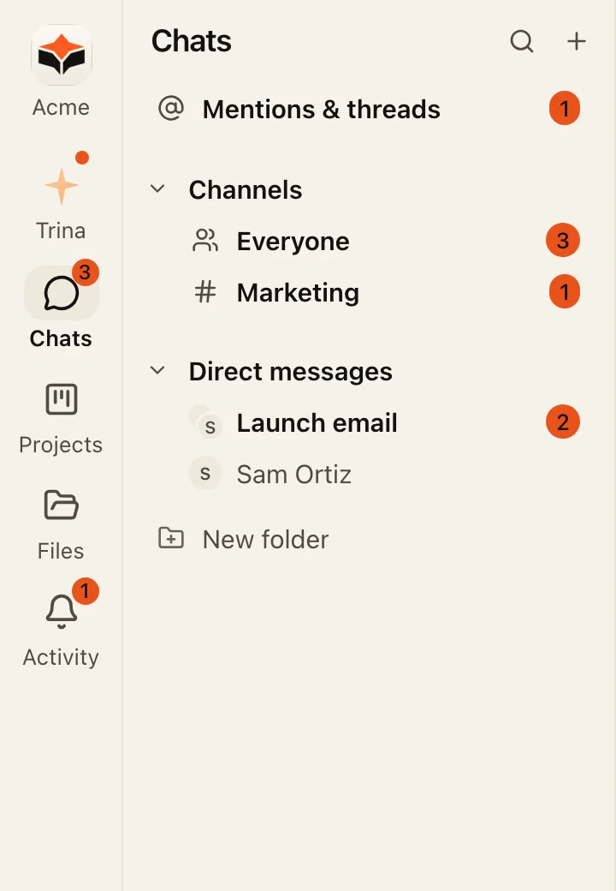

#### Ask Trina beside a conversation

The **✦** button at the top of a conversation opens a side chat with Trina next to it. Only you see this chat, and the AI
answers with what you may open. When an answer is worth sharing, **Send** under it puts it in the conversation as your
message (or in the thread when you asked about one message). If some people in the conversation cannot open a file the answer
used, the app tells you first and waits for your yes.

With a thread open, **✦** opens the side chat beside the thread, and both stay on screen (in a small window the
conversation makes way for the two). The side chat's box then says **Looking at this thread**: your question is about that
thread, and the answer can go straight into it. Press **✕** on that line to ask about the whole conversation instead.

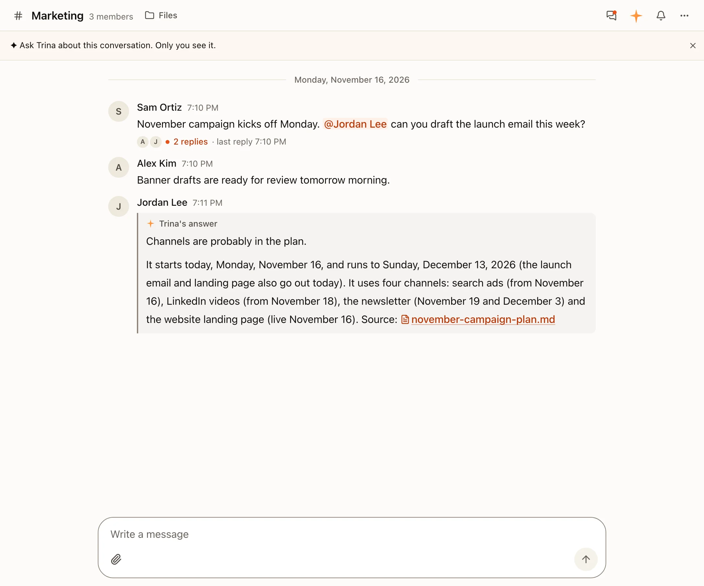

#### Reply in a thread

**Reply in thread** on a message keeps a side conversation under it, so the conversation stays easy to read. The conversation shows how
many replies a thread has; **Also send to the conversation** puts a reply in the conversation too.

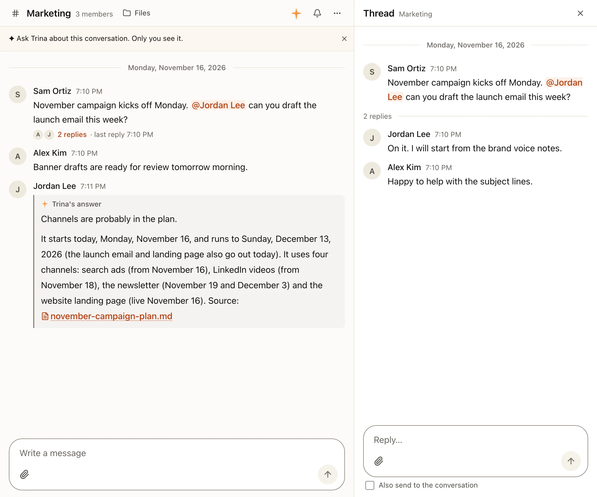

#### Link to a message

**Copy link** in a message's **⋯** menu (on a phone, press and hold the message) copies its address. Paste it in any
channel, group chat, direct message or thread: it shows as the conversation's name, and the message shows under it
as a card with who wrote it, when, its words and its files. Click the card to open the message.

Each person sees the card only if they can see that message. For everyone else the link stays a plain link, and opening
it says the conversation can't be found. When some people in the conversation can't see the message, the box says so
before you send: **Only show link** (the default) sends just the link; **Show message** shows them a copy of the message,
marked as shared by you. A copy goes away if the original is deleted. To take a card off your own message, point at it
and click **✕** (or choose **Remove preview** in the message's menu).

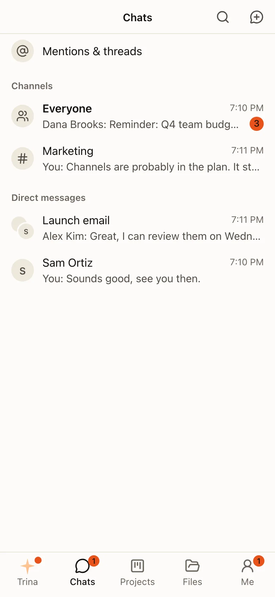

### Where your conversations are listed

The Chats list has the same order on a computer and on a phone: **Pinned**, then your own sections, then **Channels**,
**Projects** and **Direct messages**.

- **Projects** holds each team project's own chat room, by name, with a folder icon. A project's room shows there once
  someone writes in it; until then you open it from the project. It has no **+**: you make projects on the Projects page
  or from a conversation (see [Make a conversation a project](#make-a-conversation-a-project)).
- A conversation shows in one place only. A project room you pin, or drag into one of your sections, leaves Projects.
  Drag it onto the **Projects** header to put it back.
- When a project goes to the trash, its room leaves the list. Restoring the project brings it back.

### A department's room and its folder

Each department (a group in **Admin › Groups**) has its own channel. When the department has a folder you can open, the
top of its channel shows a folder button with the department's name: it opens that folder in Files.

- **A file you send there goes into the department folder's Chat attachments folder**, so the department's files are in
  one place. Under the file's name the chat says where it went, for example "Sales › Chat attachments".
- A file stays in the conversation only, marked **Only in this conversation**, when more people than the department can
  open the folder, when someone in the channel cannot open Chat attachments, or when you can only view the folder. The
  channel then also has **Files**, which lists those files.
- **Deleting a message deletes only the message.** A file in the department folder stays there, and the confirm says
  where; delete it in Files if you want it gone.
- Admins can open every team folder, so they can open these files in Files too, even when they are not in the
  department. They do not see the conversation.
- People who join the department later can open every file already in its Chat attachments folder, but not the
  earlier messages, as in a project.
- When the department's folder is inside a project, files sent in the channel stay in the conversation.
- Files sent before this change stay in the channel, in its **Files** list.

### Guests

Someone from outside the team, such as an agency or a client, can join a private channel, a group chat or a project as a guest, and be
in one private channel or group chat, and one project, at most. In a private channel or group chat open its members (the name at the top), **Add people**, then **Invite a guest**; in
a project, **Share** at the top of its page. Say who the link is for and whether they get AI, then **Create link**. The link
works once: send it to them yourself.

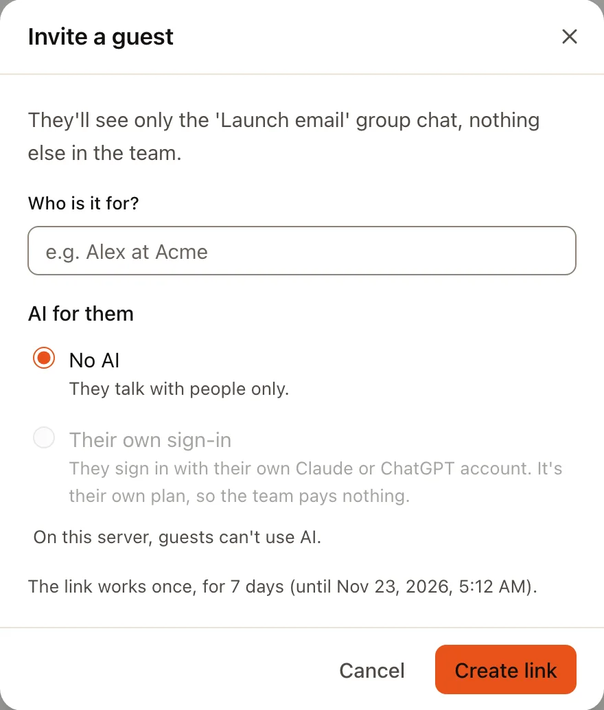

- A guest sees only that place: no Files, no other conversations or projects, no team areas.
- Their AI is off unless you choose **Their own sign-in**, or an admin gives them a **Team AI** account with a monthly limit.
- A **Guest** tag shows next to their name, and the header says **Includes 1 guest**.
- Admins see every guest in **Admin › Members & invites › Guests** ([Admin](admin.md#guests)).

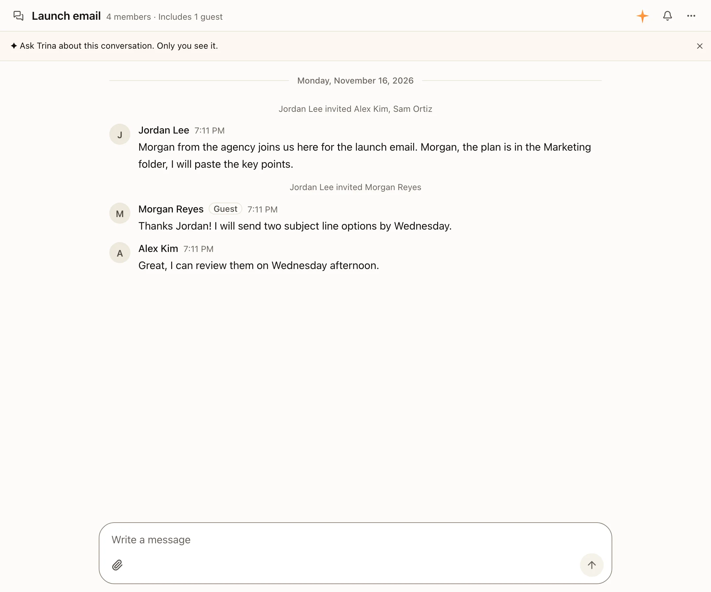

## Projects

A project keeps the chats, files and instructions of one piece of work together, for you or for the people you add. Use it for work that keeps coming back to the same files: a launch, a client, a quarter's report.

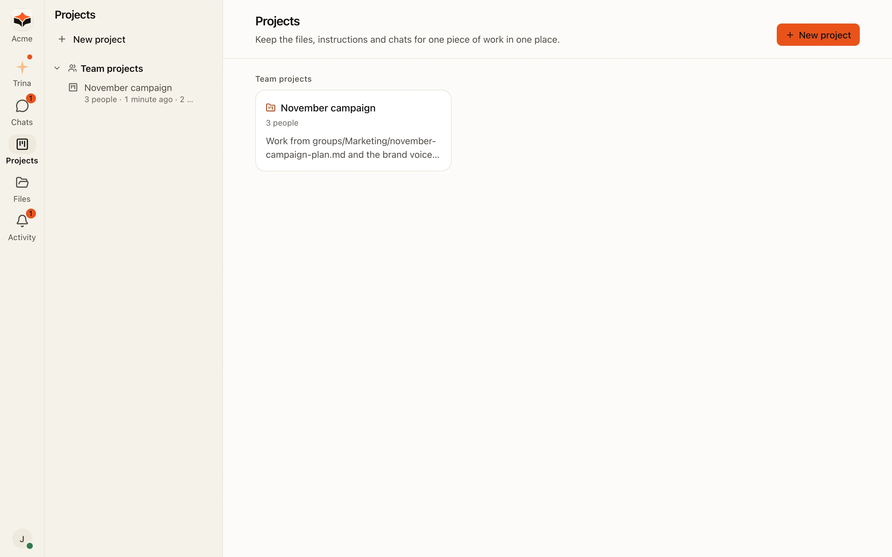

:::steps
#### Make a project
Open **Projects** on the bar on the left (on a phone, the **Projects** tab) and choose **New project**. Give it a name.
To work on it with others, add them under **People (optional)** right there. Without people it is **Only me**: only
you see it until you share it.

#### Write the instructions
Say what the work is and how the AI should help. The first paragraph shows under the project's title.

#### Chat in the project
Start a chat from the project's page, or move a chat in with **Move to project** in the chat title's menu. The AI then gets the project's files and instructions.

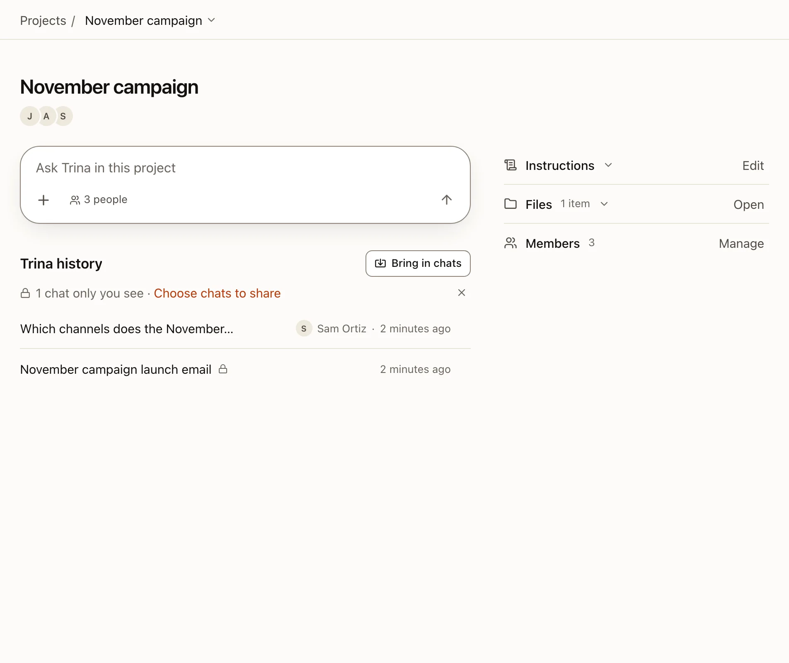
:::

- Your projects are under **Projects**, on the bar on the left and on the phone's **Projects** tab: **Team projects**
  (others see them too) and **My projects** (only you). A project's name opens its page. A chat you open from a project
  goes back to that project; its chats are in **Trina history** in your Trina list too. The team folder and its trash are
  under **Files**.
- A project has members. At the top right of the project's page you see who they are (**Only me**, or their faces), and
  **Share** adds people. The faces open the list of everyone in it. When you share a project that is only yours, the
  dialog tells you that they can see and edit its files and instructions, that your chats so far stay yours, and that it
  cannot go back to only you. In some teams only the owner and admins share projects; you then see no **Share**.
- A project can also have one or more guests: people from outside the team who see only this project. Its members can see the chats a guest has there. [Read about guests](guests.md).
- Only a project's members see what is in it. The owner and admins can change its members, but they do not see its
  chats, files and instructions unless they are members.
- **To rename a project**, click its name at the top of its page, type the new name and press Enter (Esc cancels).
  You can also choose **Rename** in the **···** of the project in the **Projects** list (or right-click it), or in the
  menu of the name at the top of the page. On a phone, tap the project's name in the top bar. This is for the project's
  creator, the owner and admins; others see the name as plain text. Renaming a project does not rename its folder.
- A folder holds one project. Once it is a project, only an admin moves, renames or deletes the folder.
- **Move to trash** in a team project's menu puts it in the trash with its files. Its members keep its card, marked
  **In trash**: its page says who moved it there and when, and that an admin or its creator can restore it. Nobody
  opens its files, chats or instructions until then. An admin or its creator restores it on its page or in
  **Files › Trash**, where it is one row with the project's name. **Delete for good** is for admins only.
- Instructions you did not write all by yourself count as outside content. The AI asks before it remembers anything after reading them.
- **Chats in a team project are shared with its members.** A small chip after **+** in the project's message box says
  who will see the chat you're starting (for example **👥 3 people**). Press it to keep that chat to yourself (**🔒 Only
  me**); the next new chat starts shared again. A chat only you see shows a lock. Every question shows the picture and
  name of the person who sent it. Each answer runs as the person who asked, with their access. When the AI is about to
  read something some of them cannot open, it asks you first (**Read and share** / **Don't read**).
- **Chats you bring in or move in stay yours.** The project page says how many ("1 chat only you see"), and **Choose
  chats to share** (or **Share** in a chat's **⋯** menu) shares them; sharing can't be undone. **Bring in chats** moves other
  chats in.
- **Files in project chats.** A file you attach from your computer (**+**, a paste or a drop) in a shared project chat
  is saved in the project folder's **Chat attachments** subfolder (named in the team's language), where the project's
  people can open it, and a line under it says so. You need write access to the project folder (without it, **+**
  offers team files only); **✕** before sending moves the file to the trash.

### Keep one project chat to yourself

A new chat in a team project is shared with everyone in the project, like a document you create in a shared Google
Drive folder. To ask something only you should see:

1. Open the project's page.
2. In the message box, look right after **+**: the chip says who will see the chat, for example **👥 3 people**.
3. Press the chip. It changes to **🔒 Only me**.
4. Type your question and send it.

The chat shows a lock in the project's list and in your Trina history: only you see it. The next new chat in the project
starts shared again, so check the chip each time. To share it later, choose **Share** in the chat's **⋯** menu
(or **Share** at the top right of the chat). Once shared, the whole chat so far is visible to the project's members, and
sharing can't be undone.

### A project's chat room

Every team project has its own chat room. The project's people are the room's people, and its files are the project's
files, so there is one list of people and one place for files.

- **Chat room** on the project's page (on a phone, a row under the project's name) opens the room. The first time,
  the room is made and named after the project. A small chat icon on the project's row in **Projects**, with a dot
  while something is unread, and **Chat room** at the top of the project's AI chats open it too.
- At the top of the room, the folder button with the project's name opens the project's page: its files and its AI
  chats. The room appears under **Projects** in the Chats list, with a folder icon, once someone writes in it.
- **Who is in it** follows the project. Adding someone to the project adds them to the room, and they see its whole
  history; taking someone out of the project takes them out of the room. The members dialog says so before you add
  anyone. To change who is in it, open the room's name at the top, then **Manage people** (for whoever may change the
  project's people). **Mute** keeps the room quiet; **Leave project** leaves the project and its room.
- **A file you send there goes into the project's Chat attachments folder**, where the project's people find it on the
  Files page. People who can only view the project can write messages, but can't add files.
- **Deleting a message deletes only the message.** Its file stays in the project's Chat attachments; delete it there in
  Files if you want it gone.
- Trina in the room's side chat saves new documents in the project's folder, and the project's AI chats can read the
  room. Both see the same people, so nothing is asked about who can see it.
- The room's **✦** side chat stays private to you. When it is empty, it says so and links to the project's page, where the
  project's people ask Trina together.
- When the project's people are exactly the people of one department, the start of the room and its info say "Same
  people as #Sales. Keep Atlas talk here.", with a link to the department's channel.

### Make a conversation a project

A private channel or a group chat that turns into real work can become a project, with its history.

1. Open the conversation's **⋯** (at the top, on its row in the list, or by pressing and holding the row on a phone) and
   choose **Make it a project**. You see it if you may make team projects; in a team where only admins make them, a
   member does not.
2. Check the name. It starts as the conversation's name (for a group chat without one, the names of its people). If
   another project already has that name, the new folder gets "-2", and the dialog says so.
3. Read what happens, then choose **Make project**:
   - Everyone in the conversation becomes one of the project's people.
   - Files sent in the conversation move to the project's **Chat attachments** folder. A file that not everyone in the
     conversation could see (for example one sent before someone joined) stays in the conversation, and the dialog says
     how many.
   - People added to the project later see messages from then on, and they can open the moved files.

The conversation stays open and is now the project's chat room, with the project's folder button at the top and a line
that says who made it a project. While the files move, the top says **Moving files…**; a second line says how many moved
and how many stayed. A file that stayed is marked **Only in this conversation**, and the room keeps a **Files** list for
those files.

Your pins, sections, notifications and read place stay as they were. If someone joins or leaves while the dialog is open,
it says **The people changed** and shows the new count. A guest who already has a project blocks it: an admin makes them a
team member first.

In a direct message, the **⋯** has **New project with** and the person's name instead. It makes a new project for the two
of you, with its own chat room. The direct message stays as it is.

## Find anything

Press ⌘K (Ctrl+K on Windows) or choose **Search** under **Ask Trina** to find chats, messages in your conversations, projects, files, skills, scheduled tasks and MCP connections. [Read about search and settings](settings-and-search.md).

**Files you sent.** Type "Files you sent" in Search, or open it from a notice, to see the files you sent in your conversations, largest first, with the space they take. Deleting one deletes the message it was sent with, for everyone in the conversation.

## Deleted chats

Deleting a chat moves it to **Deleted history**, like the Recently Deleted album on an iPhone: you can bring it back for
7 days by default. Admins can choose 1 to 365 days.

To bring a chat back:

1. Open **Trina** on the bar on the left. On a phone, open the **Trina** tab and press **☰** at the top.
2. Press the **⋯** at the end of the **Trina history** heading and choose **Deleted history**. On a phone,
   **Deleted history** is at the bottom of the menu.
3. Find the chat (each row says when it was deleted) and press **Restore**.

The row leaves the list, and the chat is back in your Trina history.

- A shared chat goes to the **Deleted history** of the person who made it. When a project's creator or an admin deletes someone else's shared chat, it is in their **Deleted history** too, for as long as they can still bring it back.
- Deleting a project for good moves its shared chats to the **Deleted history** of the people who made them. Brought back, such a chat is its maker's alone, without a project.
