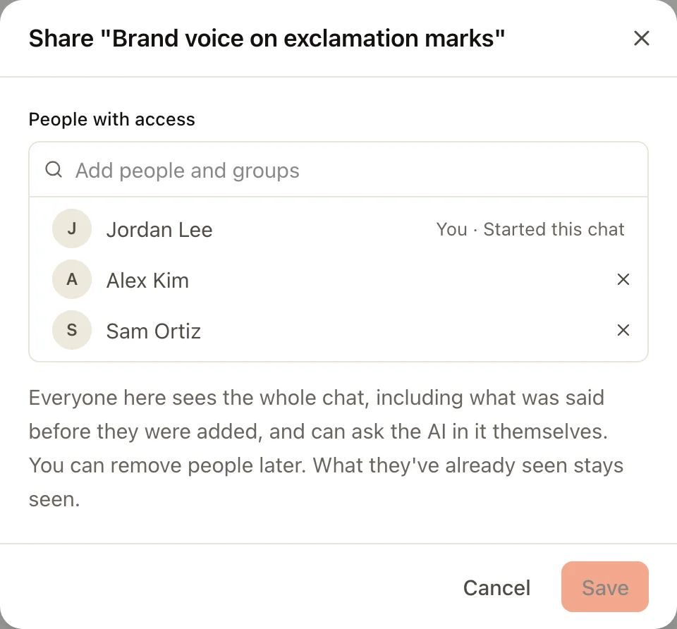

A chat is a conversation with the AI. Only you see your chats until you [share one](#share-a-chat); chats in a team project are seen by its members. Admins see which files the AI read, never the conversation.

## Start a chat

:::steps
#### Open a new chat
Choose **Ask Trina** at the top of your Trina list (**Trina** on the bar on the left), press ⇧⌘O (Ctrl+Shift+O on Windows), or type in the box on the home page. On a phone, the **Trina** tab opens on Home: type in the box at the bottom. The first time, under the box, **Ready in your
team** lists what your team set up: its skills (**Example** shows a result, **Try it** opens the skill) until you have run
one, and the team files (**Ask** puts a question about them in the box, not sent). With nothing set up yet, **Start
here** offers one question to send.

#### Ask in plain words
For example: "Summarize last week's sales notes in shared/sales." Type `/` to pick a team skill.

#### Follow the work
Open **N steps** under an answer to see each tool the AI used and each file it read.
:::

## How an answer works

| Topic | What happens |
|---|---|
| **Engine** | Members get the team default. People an admin allows can pick an engine and model in the chat. |
| **Files** | The AI uses Trina's file tools. Each call is checked against your own permissions. |
| **Questions** | When the AI needs a choice or a confirmation, it shows a card. It cannot answer that card itself. |
| **Helpers** | For big requests the AI can split work into sub-tasks, up to 4 at a time. Each helper works as you. |
| **Length** | One answer may use tools up to 150 times by default (admins choose 10 to 500). At the limit, **Continue** picks it up. |
| **Web** | The AI can open web pages. The server checks each address, and asks you before risky ones. |

:::note
Selected context goes to the AI provider you connected. Self-hosting is not offline processing. [Read the data flows](../operate/security.md).
:::

## Your Trina list

On a computer, **Trina** on the bar on the left opens your list of Trina chats beside the page. At the top are
**Ask Trina**, **Search**, **Scheduled** and **Team skills**. Under them, from the top:

| Part | What is in it |
|---|---|
| **Waiting for you** | Shows only while a chat waits for your answer, and opens it |
| **Pinned** | The chats you pinned |
| **Trina history** | All your other chats, newest first. A chat in a project shows the project's name at the end of its row |

A small mark before a title says who sees the chat: a lock for a chat only you see in a team project, the people icon (or
the faces of the others who wrote in it) for a chat you share.

**Trina** on the bar also opens the waiting chat while it shows **?**. Chats you deleted are in **Deleted history**, in
the **⋯** menu next to **Trina history**. The filter button at the top of the list can show only some chats, for example the
ones that are answering or wait for you. Your projects have their own place: **Projects** on the bar.

On a phone, the **Trina** tab opens on Home. **☰** at the top opens your history: **Search**, **Scheduled**, **Team
skills**, then **Trina history** (your pinned chats first, then newest first, by date), and **Set your status** and
**Deleted history** at the bottom.

### Folders

Trina chats have no folders. To keep chats about one piece of work together, put them in a [project](#projects).

The **Chats** list has **Conversation folders** for rooms and direct messages. A folder sorts your list, nothing more:
it holds no files and never changes who sees a conversation. Make one with **New folder**, then use a conversation's
**···** › **Move to folder**. A folder's **···** renames it, moves it up or down, or deletes it; deleting a folder keeps
its conversations in your list.

## Several chats at once

Each chat in your list of Trina chats shows at most one mark, at the right end of its row:

| Mark | What it means |
|---|---|
| **?** in amber | The AI waits for you: a question or confirmation card, or an answer that failed or paused at a limit. A card's **?** stays until you answer it. |
| Grey ring | The AI is answering, or the answer waits its turn. |
| Dot, title in bold | A new answer you have not opened yet. |

Opening a chat clears its dot, and the **?** of a failed or paused answer, on every device. A folded section keeps the strongest mark of the chats in it. A room shows **?** in place of its count while the AI waits for your answer there.

While the browser tab is in the background, its title counts the chats and rooms that want you, for example "(2) Trina". The desktop app shows the same number on the Dock on a Mac, and a notification when a card opens or an answer that ran over a minute ends while you look elsewhere; clicking it opens that chat. Scheduled tasks get the mark only; a question asked from Slack is answered there, so its chat gets no dot. **Trina** on the bar on the left (on a phone, the **Trina** tab) shows **?** or a dot when a chat wants you, **Chats** shows **?** while the AI waits for your answer in a room, and on a phone a short message with **Open** appears in the app.

## Pin a chat

In your list of Trina chats, a chat's **···** (or a right-click on its row, or a long press on a phone) has **Pin to top**.
Pinned chats come first in your Trina list, the most recently pinned first, with a small pin before the
title, on a computer and on a phone. A project's page lists your
pinned chats there first too. **Unpin** puts a chat back. A pin is yours only, also on a shared project chat,
and it goes when the chat is deleted or you can no longer see it. You can pin up to 50 chats.

Conversations in **Chats** (rooms, DMs and group chats) are pinned the same way, from a row's **···** or the room's own
**···**: pinned ones come first, with a small pin after the name, in every list of conversations, on a computer and in the phone's **Chats** tab.
Only you see your pins. A pin goes when you leave the room or hide it. You can pin up to 50 conversations.

The **Chats** list shows every conversation: your pins, your folders, then **Team rooms** (the everyone room first, then
by name), **Group conversations** and **Direct messages** (the latest first). Conversations you hid are behind **Hidden conversations (N)**.

## Share a chat

A chat outside projects can be shared with people and groups, like a file in Google Drive. In the chat's title menu (or
a row's **···** in your Trina list) choose **Share…**, type names in **Add people and groups**, and **Save**. **✕** takes
someone out again, with Undo until you save.

- Everyone it is shared with sees the whole chat, also what was said before they were added, and can ask the AI in it
  themselves. Each answer runs as the person who asked, with what they may open.
- Before new people are added, the app says which answers used places some of them cannot open, and asks you to
  **Share anyway**.
- The people you add find it in their Trina history and in **Activity**, can continue it, or **Hide from my list**. A
  notification on their phone or browser says who shared it with them (**Settings › Notifications › Chats shared with
  me** turns it off).
- A file you attached from your computer is kept with the chat: everyone who can see the chat can open it and ask
  Trina about it, and nobody else can. Taking someone out, or making the chat private again, takes the files away from
  them; deleting the chat deletes them.
- Only the person who started the chat changes who sees it. **Continue in a chat only you see** in the title menu starts
  a private copy for you.
- A chat in a team project is shared with the project's members instead (see [Projects](#projects)); a chat in a
  personal project cannot be shared until you move it.

A direct chat with someone who left the team says "<name> left the team" and has no message box. The history stays readable.

## Team chat

**Chats** on the bar on the left (on a phone, the **Chats** tab) is where people talk to each other: **Team rooms**
(everyone in the team, and one room per group), **Group conversations** and **Direct messages**. **Mentions & threads**
at the top collects the messages that name you and the threads you follow.

#### Ask Trina beside a room

The **✦** button at the top of a room opens a side chat with Trina next to it. Only you see this chat, and the AI
answers with what you may open. When an answer is worth sharing, **Send to room** under it puts it in the room as your
message (**Send to thread** when you asked about one message). If some people in the room cannot open a file the answer
used, the app tells you first and waits for your yes.

#### Reply in a thread

**Reply in thread** on a message keeps a side conversation under it, so the room stays easy to read. The room shows how
many replies a thread has; **Also send to the room** puts a reply in the room too.

### Guests

Someone from outside the team, such as an agency or a client, can join **one** group conversation or **one** project as
a guest. In a group conversation open its members (the name at the top), **Invite people**, then **Invite a guest**; in
a project, **Add people** in **Members**. Say who the link is for and whether they get AI, then **Create link**. The link
works once: send it to them yourself.

- A guest sees only that place: no Files, no other rooms or projects, no team areas.
- Their AI is off unless you choose **Their own sign-in**, or an admin gives them a **Team AI** account with a monthly limit.
- A **Guest** tag shows next to their name, and the header says **Includes 1 guest**.
- Admins see every guest in **Admin › Members & invites › Guests** ([Admin](admin.md#guests)).

## Projects

A project keeps the chats, files and instructions of one piece of work together, for you or for the people you add. Use it for work that keeps coming back to the same files: a launch, a client, a quarter's report.

:::steps
#### Make a project
Open **Projects** on the bar on the left (on a phone, the **Projects** tab) and choose **New project**. Give it a name.
A new project is **Only me**: only you see it until you add people.

#### Write the instructions
Say what the work is and how the AI should help. The first paragraph shows under the project's title.

#### Chat in the project
Start a chat from the project's page, or move a chat in with **Move to project** in the chat title's menu. The AI then gets the project's files and instructions.

:::

- Your projects are under **Projects**, on the bar on the left and on the phone's **Projects** tab: **Team projects**
  (others see them too) and **My projects** (only you). A project's name opens its page. A chat you open from a project
  goes back to that project; its chats are in **Trina history** in your Trina list too. The team folder and its trash are
  under **Files**.
- A project has members. On the project's page, **Members** shows who they are, and **Add people** shares a project
  that is only yours. Before it saves, it tells you that they can see and edit its files and instructions, that your
  chats so far stay yours, and that it cannot go back to only you. In some teams only the owner and admins share
  projects.
- Only a project's members see what is in it. The owner and admins can change its members, but they do not see its
  chats, files and instructions unless they are members.
- A folder holds one project. Once it is a project, only an admin moves, renames or deletes the folder.
- **Move to trash** in a team project's menu puts it in the trash with its files. Its members keep its card, marked
  **In trash**: its page says who moved it there and when, and that an admin or its creator can restore it. Nobody
  opens its files, chats or instructions until then. An admin or its creator restores it on its page or in
  **Files › Trash**, where it is one row with the project's name. **Delete for good** is for admins only.
- Instructions you did not write all by yourself count as outside content. The AI asks before it remembers anything after reading them.
- **Chats in a team project are shared with its members.** The chip after **+** in the project's box says who will
  see the chat you start (for example **👥 3 people**); tap it for **🔒 Only me** to keep that chat to yourself. A chat
  only you see shows a lock. Chats you move into a project arrive private: the line **1 chat only you see · Choose chats
  to share** on the project's page (or **Share with project members** in a chat's menu) shares them, and **Bring in
  chats** moves other chats in. Every question in a shared chat shows the picture and name of the person who sent it.
  Each answer runs as the person who asked, with their access; when the AI is about to read something some of them
  cannot open, it asks you first. A file you attach from your computer (📎, a paste or a drop) is saved in the project
  folder's **Chat attachments** subfolder (named in the team's language), where the project's people can open it, and a
  line under it says so; you need write access to the project folder (without it, the box offers team files only), and
  **✕** before sending moves the file to the trash.

## Find anything

Press ⌘K (Ctrl+K on Windows) or choose **Search** under **Ask Trina** to find chats, messages in your conversations, projects, files, skills, scheduled tasks and MCP connections. [Read about search and settings](settings-and-search.md).

## Deleted chats

Deleting a chat moves it to **Deleted history**, where you can bring it back for 7 days by default. Admins can choose 1 to 365 days.

- A shared chat goes to the **Deleted history** of the person who made it. When a project's creator or an admin deletes someone else's shared chat, it is in their **Deleted history** too, for as long as they can still bring it back.
- Deleting a project for good moves its shared chats to the **Deleted history** of the people who made them. Brought back, such a chat is its maker's alone, without a project.
