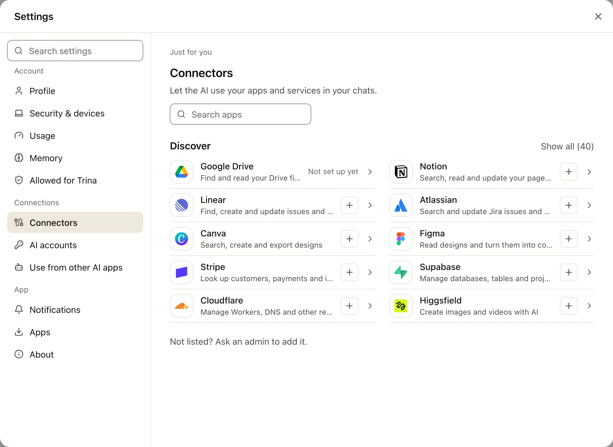
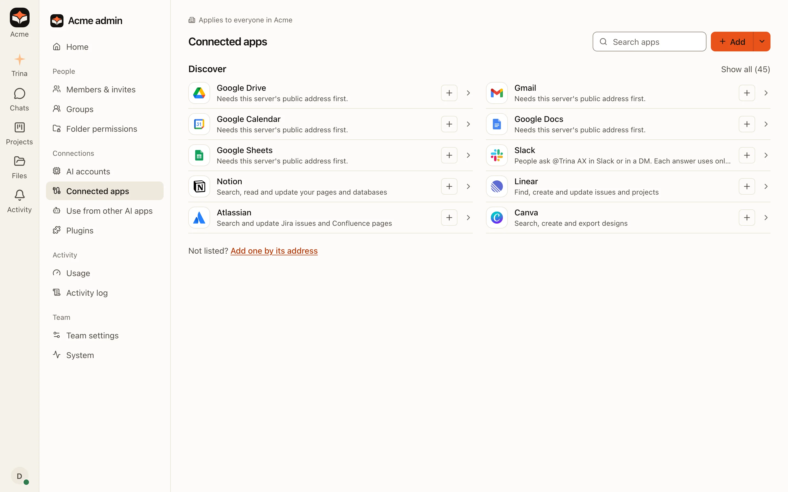

Trina AX connects to two kinds of things:

- **An AI account** that answers your questions: a Claude or ChatGPT account, or an API key from Anthropic, OpenAI or
  another AI company. Trina AX does not come with AI included: your team connects its own account, and that company
  bills the account you connect.
- **Apps** the AI uses for you: Google Drive, Gmail and the other Google apps, Slack, Notion, Linear, GitHub, or your
  company's own system.

This page tells you which guide to follow. Each guide lists, at the top, every value you need and where you get it.

:::note
The screenshots in these guides use a made-up company, "Acme", and made-up keys. A real key is never shown on a page or
in a picture.
:::

## Where to go

| What you want | Who does it | Where in Trina AX | Guide |
|---|---|---|---|
| Let the AI answer at all | The owner or an admin | **Admin › AI accounts** | [AI accounts](ai-accounts.md) |
| Use your own Claude or ChatGPT account for your own questions | You (when the team allows it) | **Settings › AI accounts** | [AI accounts](ai-accounts.md#your-own-account) |
| Let the AI read your Google Drive, Gmail, Calendar, Docs or Sheets | You | **Settings › Connectors** | [Google apps](google-apps.md) |
| Show your company's name on Google's sign-in screen | An admin of a company on Google Workspace | **Admin › Connected apps** › a Google app | [Your company's own Google app](google-own-app.md) |
| Ask Trina AX from Slack | An admin once, then each person once | **Admin › Connected apps › Slack** | [Slack](slack.md) |
| Let the AI use Notion, Linear, Atlassian, Figma, GitHub and other apps | You for yourself, an admin for the team | **Settings › Connectors** or **Admin › Connected apps** | [Notion, Linear and other apps](mcp.md) |
| Let the AI use your company's own system (an API) or an app that needs your own sign-in app, such as NAVER WORKS | An admin | **Admin › Connected apps** › **Add one by its address** | [Your company's API](api-connections.md) |
| Use your Trina AX files from Claude or ChatGPT | You | **Settings › Use from other AI apps** | [Team AX MCP connector](../agents/mcp-connector.md) |

To open **Settings**, choose your photo at the bottom of the bar on the left, then **Settings** (on a phone, the **Me**
tab). **Admin** is in the same menu for the owner and admins.

## Every value, and where it comes from

You never need all of these. Find the app you are connecting; the rest of the row says what to bring.

| Connecting | You enter in Trina AX | Where you get it |
|---|---|---|
| Claude API key | **API key** (a long code that starts with `sk-`) | [Claude Console › API keys](https://platform.claude.com/settings/keys) › **Create Key** |
| Claude subscription | **The code Claude shows** after you approve (it has a `#` in the middle) | claude.ai, in the window **Open Claude to approve** opens |
| OpenAI API key | **API key** (starts with `sk-`) | [OpenAI platform › API keys](https://platform.openai.com/api-keys) › **Create new secret key** |
| ChatGPT plan | Nothing: you enter a code **at OpenAI** | Trina AX shows the address and the code |
| API engine (OpenRouter, Gemini, …) | **API address**, **Model**, **API key** | The AI company's API page (see [the API engine](ai-accounts.md#the-api-engine)) |
| Google Drive, Gmail, Calendar, Docs, Sheets | Nothing: you sign in at Google | Your Google account |
| Your company's own Google app | The **JSON file** from Google Cloud (or **Client ID** and **Client secret**) | Google Cloud › Google Auth Platform › **Clients** |
| Slack (hosted teams) | Nothing: **Add to Slack** | A Slack workspace admin allows it |
| Slack (your own Slack app) | **Bot User OAuth Token** (`xoxb-`), **App-Level Token** (`xapp-`), **Client ID**, **Client Secret** | api.slack.com › your app |
| Notion, Linear, Atlassian, Figma, Canva and the other apps in Discover | Nothing: you sign in on the app's own page | Your account at that app |
| GitHub | **Address** `https://api.githubcopilot.com/mcp/` and a **Key** (a personal access token) | [GitHub › Settings › Developer settings › Personal access tokens](https://github.com/settings/personal-access-tokens/new) |
| Any other app that gives a key | **Address** and **Key** (sometimes **Header name**) | The app's help pages ("MCP server", "API keys") |
| Your company's API | **Address**, **Key**, **Usage notes** | Whoever runs that system |
| NAVER WORKS and other apps that sign in with your own app | **Client ID**, **Client secret**, **Sign-in address**, **Token address**, **Scopes** | The app's developer console |

## Personal or for the team

| | Personal | Team |
|---|---|---|
| Made in | **Settings › Connectors** or **Settings › AI accounts** | **Admin › Connected apps** or **Admin › AI accounts** |
| Who uses it | Only you, in your own chats | The people the admin picks: everyone, groups or people |
| Who sees the key | Nobody, not even admins | Nobody: an admin sees that a key is saved, never the key |

Keys and sign-ins are stored encrypted on the server and never shown again. To change a key, you replace it.

## Mistakes people make

| What happened | Why | What to do |
|---|---|---|
| "Enter the key." or "Not an API key of this kind." | The key was copied with a space, a line break or a missing end | Copy it again with the provider's copy button, not by selecting the text |
| `redirect_uri_mismatch` at Google, or a sign-in that says the address is wrong | The return address in the provider's console differs from the one Trina AX shows by a letter, `http` or a slash | Copy the address from the Trina AX dialog with its copy button and paste it again in the console |
| "Some permissions were not ticked." | A box was unticked on Google's screen | Connect again and keep every box ticked |
| "Sign-in needed" on a connection | The key was revoked, expired, or the sign-in ran out | Open it and choose **Sign in again**, or replace the key |
| A member sees "Not listed? Ask an admin to add it." | Only owners and admins add apps by their address | An admin adds it for the team, or as a template each member connects |
| The AI "can't" use an app you connected | The connection is someone else's, or you aren't among the people a team connection is for | In **Settings › Connectors**, check that the app is under **Your connectors** |
