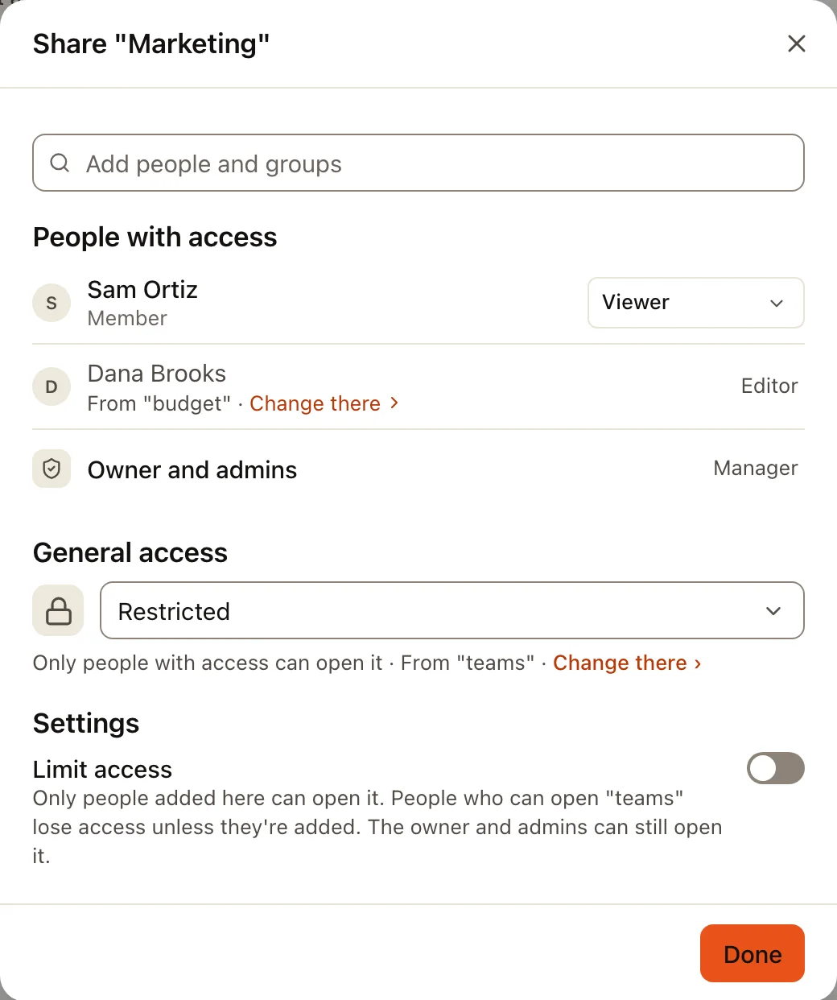
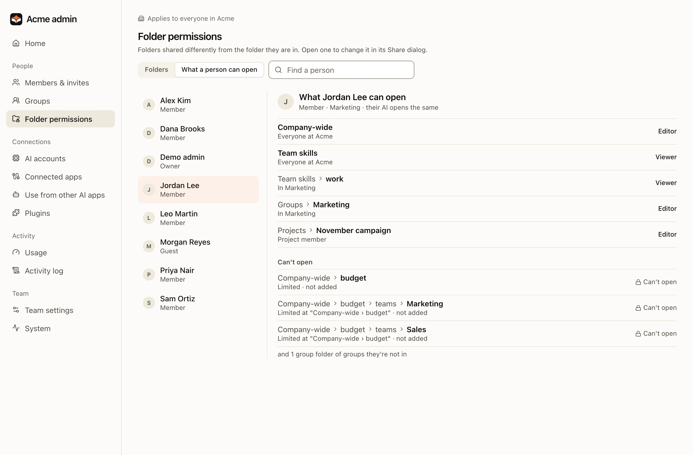
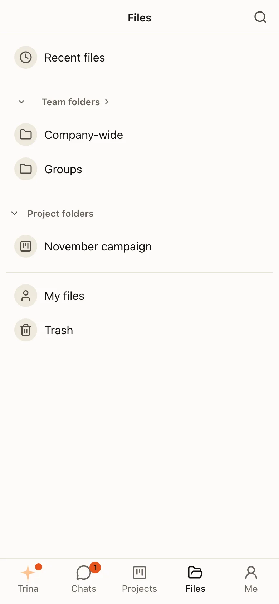

Company knowledge lives in one team folder on the server. Folder rules decide who sees what. The AI never sees more than the person asking.

## The team folder

| Folder | Who sees it | Use it for |
|---|---|---|
| `shared/` | As the rules say, usually everyone | Company-wide documents |
| `groups/<group>/` | That group, plus anyone a rule adds | Team documents, such as Sales or Finance; the group's own skills in `skills/` there |
| `projects/<project>/` | As the rules say | Work with its own folder and instructions |
| `skills/` | Everyone reads; skill managers write | Team skills and team rules |
| `users/<id>/` | Only that person | Personal files and personal skills |

## How access is decided

One permission function on the server decides every access. The OS stops the AI from going around it.

- A file you cannot open is **invisible**, not "denied". Files, AI answers, search, previews, version history, trash and live updates all follow the same rule.
- A person's access comes from the **nearest rule** above the file that names them. Person rules come before group rules. With several groups, the widest access wins.
- Changes apply **at once**. The AI reads permissions again on every tool call.
- Removing access does not erase earlier answers that quoted a file.

## Share a folder

Owners and admins share a folder like in Google Drive: **Files › a folder's ⋯ › Share**, or **Admin › Folder permissions › Share**. Both open the same dialog.

:::steps
#### Add people and groups
Type a name. Each person or group gets **Viewer** or **Editor**. **Remove access** is in the same menu.

#### Check General access
**Restricted**: only the people listed can open it. Or the whole team, as **Viewer** or **Editor**. A folder without a setting of its own shows what it gets from the folder above, with **Change there**.

#### Check before saving
The dialog names who will gain or lose access. Nothing changes until you save. Giving more access asks first, and so does a limit that shuts out people the folder above lets in.
:::

Access adds up, as in Google Drive: what a folder gives comes on top of what the folders above give. A role lower than that cannot be picked; the row says where the higher one comes from ("Editor from "Company-wide"").

To give a folder less than the folders above, turn on **Settings › Limit access**. Then only the people and groups added there open it. **Access removed** lists the people who can open the folder above but not this one; **Add** brings one back as Viewer. Turning the limit off again raises any role lower than the folders above to that level.

The owner and admins can always open team folders, except projects they are not a member of. They show as one **Manager** row.

:::note
After the update that made access add up, some folders list their people by name (tagged **Added when folders changed**), and Folder permissions shows a one-time notice naming them. People added by name keep access if they later leave the group. **Admin › Groups** and the person's page say so before saving, with **Remove now**.
:::

**Admin › Folder permissions › Folders** lists only the folders shared differently from the folder they are in, in the same names as Files, with **Limited** on the ones that keep people out. **Share** opens the folder's Share dialog. Project folders are one line: their members are changed on the project.

**What a person can open** shows, for one person (and so their AI), each folder with Viewer or Editor and why, and the folders they can't open.

:::warning
`skills/` holds instructions that every member's AI follows. Write access there makes someone a skill manager. Before the AI saves into `skills/`, the server asks a person to confirm. The same goes for a group's `groups/<group>/skills/`: every member of that group's AI follows it, and any member who may write the group's folder changes it.
:::

## Working with files

- **Upload** files or whole folders from the Files screen.
- **History**: every change keeps a version you can open or restore.
- **Trash**: **Files › Trash** lists what you could restore, by name and the place it was in ("price-sheet.xlsx · Company-wide › Sales"). A file deleted more than once is one row with its copies: **Restore** brings back the latest, and opening the row restores any other copy. If the list has other people's deletes, **Deleted by me** shows only yours. Items are removed for good after the team's retention period (Admin › Team settings, 30 days by default); each row says when.
- **Formats**: the AI reads text from PDF, Office and HWP/HWPX files, and sees photos and scanned pages as images (admins can turn that off). Linux servers run no OCR.
- **Confirmation**: when the AI would write restricted content somewhere more people can see, the server asks first.

## HTML to PDF

An HTML file, such as a quote or a report the AI wrote, becomes a PDF that looks like the page: its colours and backgrounds, merged table cells, page size and margins from the page's own `@page` rule (A4 when it names none) and its page breaks.

- **In the preview**: open the `.html` file and press **Save as PDF** in the preview header. The PDF is saved next to the page with the same name, and the notice links to it. A second PDF of the same page is saved as `name (2).pdf`, never over the first. In a folder you can only read, the PDF is downloaded instead. On a phone the action is in the **⋯** menu.
- **Ask the AI**: "Make quote.html into a PDF". The AI prints the page itself; it does not rewrite it as Markdown.
- **What the PDF uses**: the page and its own pictures, stylesheets and fonts in the team folder, by relative path. Web addresses are never loaded: a web picture shows as a grey box, as in the preview. Save the picture into the team folder and refer to it by path. Scripts in the page do not run, so a part a script would draw is missing; write that part as plain HTML.
- **Limits**: up to 200 pages and 50 MB, and about a minute per page. A few PDFs are made at a time on a server; the rest wait.
- **Where it works**: the server prints with a headless Chromium in its converter sandbox, with no network. A Linux server has one when Debian's `chromium` package is installed (the dev environment installs it, and so does a hosted server image made with the dev environment). On a Linux server each print runs with its own memory limit, apart from other conversions, and needs at least 3 GB of memory on the server (two prints at once from 6 GB). A server without a browser, or with less memory, does not show the action, and the AI says it cannot print HTML. An administrator can name the browser with `MYCEL_HTML_PDF_BROWSER` ([environment](../reference/environment.md)).

Full details: [Security and permissions](../../security-and-permissions.md) and the [permission model (Korean)](../../PERMISSIONS.md).
