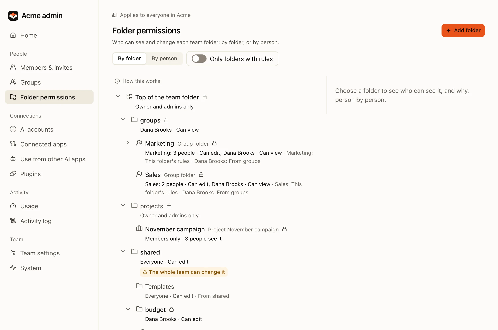
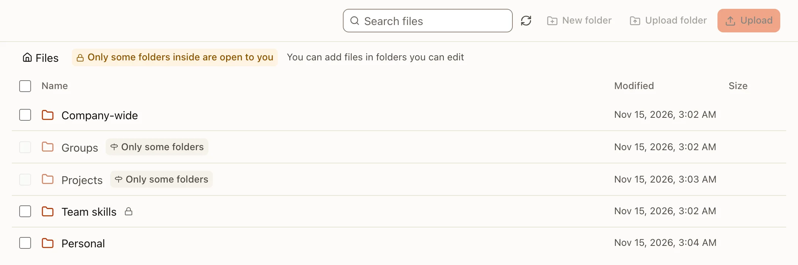

Company knowledge lives in one team folder on the server. Folder rules decide who sees what. The AI never sees more than the person asking.

## The team folder

| Folder | Who sees it | Use it for |
|---|---|---|
| `shared/` | As the rules say, usually everyone | Company-wide documents |
| `groups/<group>/` | That group, plus anyone a rule adds | Team documents, such as Sales or Finance; the group's own skills in `skills/` there |
| `projects/<project>/` | As the rules say | Work with its own folder and instructions |
| `skills/` | Everyone reads; skill managers write | Team skills and team rules |
| `users/<id>/` | Only that person | Personal files and personal skills |

## How access is decided

One permission function on the server decides every access. The OS stops the AI from going around it.

- A file you cannot open is **invisible**, not "denied". Files, AI answers, search, previews, version history, trash and live updates all follow the same rule.
- A person's access comes from the **nearest rule** above the file that names them. Person rules come before group rules. With several groups, the widest access wins.
- Changes apply **at once**. The AI reads permissions again on every tool call.
- Removing access does not erase earlier answers that quoted a file.

## Change folder rules

Admins use **Admin › Folder permissions**.

:::steps
#### Pick a folder
**By folder** shows the team folder as a tree. Each row says who can open it and where that comes from.

#### Choose the basic access
Follow the folder above, only the people named, everyone reads, or everyone reads and writes.

#### Add people and groups
Give each read, read and write, or no access. So "everyone reads, but not Bob" is possible.

#### Check before saving
The server works out who loses or gains access, and the Save button says it. Nothing changes until you save.
:::

**By person** shows what one person, and so their AI, can see, and why.

:::warning
`skills/` holds instructions that every member's AI follows. Write access there makes someone a skill manager. Before the AI saves into `skills/`, the server asks a person to confirm. The same goes for a group's `groups/<group>/skills/`: every member of that group's AI follows it, and any member who may write the group's folder changes it.
:::

## Working with files

- **Upload** files or whole folders from the Files screen.
- **History**: every change keeps a version you can open or restore.
- **Formats**: the AI reads text from PDF, Office and HWP/HWPX files, and sees photos and scanned pages as images (admins can turn that off). Linux servers run no OCR.
- **Confirmation**: when the AI would write restricted content somewhere more people can see, the server asks first.

## HTML to PDF

An HTML file, such as a quote or a report the AI wrote, becomes a PDF that looks like the page: its colours and backgrounds, merged table cells, page size and margins from the page's own `@page` rule (A4 when it names none) and its page breaks.

- **In the preview**: open the `.html` file and press **PDF로 저장** (Save as PDF) in the preview header. The PDF is saved next to the page with the same name, and **열기** in the notice opens it. A second PDF of the same page is saved as `name (2).pdf`, never over the first. In a folder you can only read, the PDF is downloaded instead. On a phone the action is in the **⋯** menu.
- **Ask the AI**: "견적서.html을 PDF로 만들어 줘". The AI prints the page itself; it does not rewrite it as Markdown.
- **What the PDF uses**: the page and its own pictures, stylesheets and fonts in the team folder, by relative path. Web addresses are never loaded: a web picture shows as a grey box, as in the preview. Save the picture into the team folder and refer to it by path. Scripts in the page do not run, so a part a script would draw is missing; write that part as plain HTML.
- **Limits**: up to 200 pages and 50 MB, and about a minute per page. A few PDFs are made at a time on a server; the rest wait.
- **Where it works**: the server prints with a headless Chromium in its converter sandbox, with no network. A Linux server has one when Debian's `chromium` package is installed (the dev environment installs it, and so does a hosted server image made with the dev environment). A server without one does not show the action, and the AI says it cannot print HTML. An administrator can name the browser with `MYCEL_HTML_PDF_BROWSER` ([environment](../reference/environment.md)).

Full details: [Security and permissions](../../security-and-permissions.md) and the [permission model (Korean)](../../PERMISSIONS.md).
