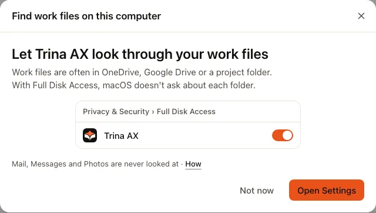

Your work files are spread over your computer: in OneDrive, in Downloads, in a project folder. The desktop app for
**Windows** and the **Mac app from the website** finds the ones you have worked on lately and suggests the ones that
look like work: forms, reports, proposals, brand material and the like. **You choose** which to add. Nothing is added,
shared or moved without you, and the files on your computer stay as they are.

It looks in these places:

- **Documents**, **Desktop** and **Downloads**.
- Your **cloud drives' folders** on this computer: OneDrive (and SharePoint), Google Drive, Dropbox and Box.
- **Work folders** in your home folder: folders named like your company or a client, or with a work word such as
  *Work*, *Projects* or *Clients*.
- **Messenger downloads**: the folders where KakaoTalk, Telegram, WhatsApp, Teams and others save the files you receive.
- **Files you opened lately**, anywhere in your home folder. On Windows also on your other drives and on network drives.

It shows only **recent** files (opened or changed in about the last six months) that clearly look like work, at most 50.
When your team's AI answers, it decides for the names it saw: a file it leaves out is not shown. Without AI, a file is
shown only when its name or folder names your company, it came from your company's own address or workspace (such as
`yourcompany.slack.com`), someone in your team wrote it, or it is a document you opened lately. A file downloaded from
Google Docs, Notion or Slack is not a work file for that reason alone. It never shows pieces of a saved web page
(a "…_files" folder), files inside an app's or a tool's folder, names a program gave ("Untitled", "f(3).txt"), chat
exports, notes of a few lines, or a "(1)" copy next to its original; of a numbered series in one folder it shows the
newest. If nothing clearly looks like work, it says so. You can find any other file it saw with the search.

What stays on your computer:

- The app reads only the **names, types, sizes and dates** of the files. It never moves, renames or changes them.
- A file that is **only in the cloud** (OneDrive's "online only", for example) is not downloaded while the app looks. The
  list says **In the cloud**; if you add it, it is downloaded then, and the upload says **Getting report.docx from
  iCloud…** (or OneDrive, Google Drive) while it does. A file that has not come down within a minute is not added; open
  it once on your computer so it downloads, then add it again.
- **Mail, Messages, Photos, Safari and other apps' data are never looked at.** The only app data the app reads are the
  lists of recently opened documents that macOS, Windows and Office keep.
- To help pick the work files, the **file names**, the names of the folders they are in, and their type, size and date
  may go to your team's AI. Files that look personal (pay slips, tax papers, IDs, CVs, medical papers) are kept apart
  and their names are never sent.
- File **contents** stay on your computer until you press **Add**. Then only the files you ticked are read and added.

## Start

1. Open **Files › My files** in the desktop app, in a window wide enough for the computer layout.
2. Click **Find work files** in the toolbar, beside Upload folder and Upload.

If you joined the team lately, the welcome card on **Home** has the same thing as an optional row, **Bring work files
from this computer** (in the desktop app only). It opens the same window and adds to the same place. The row shows done
once a file is there, and it never holds up the rest of the card.

The owner sees the same button in **Getting started › Team files**. There the files go to the team's home folder, as
the rest of that step does.

## On a Mac: give Full Disk Access once

To look beyond Documents, Desktop and Downloads, the Mac app needs **Full Disk Access**. So on a Mac the app first
shows this screen. From **My files** it says **Find your work files** (what you add, only you see); in **Getting
started › Team files** it says **Find files your team should have**.

1. Click **Open Settings**. System Settings opens at **Privacy & Security › Full Disk Access**.
2. **Trina AX** is already in the list, with its switch off: it appears there as soon as the app opens this screen,
   so you don't need **+**. Turn its switch on. macOS asks for your Mac's password or Touch ID.
3. Go back to the app. The screen goes on by itself as soon as the app has access.

If you turned it on and the screen still waits, macOS may count the switch only after the app restarts. Click
**Restart Trina AX**: the app restarts and opens the same screen again by itself, which then goes on. (If you click
**Quit & Reopen** in System Settings instead, you land there too.)

To take the access back later, turn the switch off in the same place.

**Not now** skips this: the app looks only through Documents, Desktop and Downloads, and macOS asks you about each of
them (see below). The app remembers **Not now** for 30 days: until then it goes straight to those three folders, and
**Look in more places (Full Disk Access)** above the list brings this screen back.

## The app asks first

Before anything is looked at, the app asks in its own window, on top of the app. It lists every place it will look
through and says what it reads: only file details (name, date, size, author, where it came from), never what's inside; nothing is ticked for you; contents stay on this computer
until you add them; and file names may go to your team's AI to help you pick. Click **Find work files** to go on, or
**Not now** (or press Esc) to stop. Enter works too, once the window has been on screen for a moment without typing:
an Enter you meant for the chat right before the window came up does not answer it.

The app asks this once for your team. The next time, the list comes straight away. It asks again after 90 days, or
when it would look in a place it did not list before (for example after you turn on Full Disk Access).

When you press **Add**, the app reads only the files you ticked. While it does, a strip above the page says
**Trina AX is reading 3 files from this computer**; it goes away by itself. With VoiceOver or Voice Control on, the app first lists the files in its own small window and asks
**Add 3 files**, so you can confirm without a mouse.

On Windows that is the only question: the app looks right away. When OneDrive keeps your Documents or Desktop, the
list says "Documents (OneDrive)".

## Without Full Disk Access (Mac): macOS asks for each folder

After **Not now**, the app looks only through Documents, Desktop and Downloads. The first time it reads one of them,
macOS asks you about that folder: "“Trina AX” would like to access files in your Documents folder." Under it you see
the app's reason: *Looks for work files here. File contents stay on this Mac until you choose to add them.* The
questions come one after the other, one per folder.

- **Allow**: the app looks in that folder.
- **Don't Allow**: the app skips that folder, and the list says so.

macOS remembers your answer, so it asks only once per folder.

## Pick the files

- Each file says **why** it is shown and **where** it is: "Mentions Acme · Opened 2 days ago · OneDrive – Acme › Plans".
- **Looks like work** lists the recent files that look like your company's, plus the AI's picks, best first.
- **May be personal** is folded and never sent to the AI. You can still open it and tick a file: it goes to My files,
  where only you see it.
- **Nothing is ticked.** Tick the files you want, or use **Select all**. You can add up to 100 files and 1 GB at a time.
- **Find by file name** searches everything the app found, also files not in either group.
- Files over 50 MB are not listed; add those on the Files page. A very big folder is looked at only in part, and the
  list says so.
- **Choose a folder…** points the app at one folder it missed. Pick the folder in the window that opens; the app looks
  through it, and its files show right away. Nothing is added until you tick files and click **Add**.

Click **Add n files**. The files go to **My files › From this computer**, in folders named after where they were
(Documents › Clients › …, OneDrive – Acme › …).

## Share some with your team

Once the files are in, the same window asks **Share any of these with your team?** It lists the files you just added.
**Nothing is ticked**, and nothing is shared until you press **Share**.

- **Good to share: Form** (or Company intro, Brand material, Rules and policies, Training material, Meeting notes)
  marks the kinds of files teams usually keep together. It is only a hint, from the same pick as the list before or
  from the file's name: tick what you want.
- In **Add people or groups**, add who should see them: **Everyone on the team** (the first choice: everyone in the
  team, also people who join later, never guests; a line says so before you press **Share**), teammates by name, or a
  group you are in (the team owner and admins can add any group). Guests can't be added.
- Click **Share n files**. Each ticked file is shared exactly as with **Share** on the Files page: the people you added
  can open and download it (view only). Each of them gets one notice in **Activity** for all of them ("Mina shared 5
  files with you"). The files you don't tick stay private to you.
- **Not now** shares nothing. Afterwards, **Share with your team** in the same window brings the step back, and you can
  always share a file later from its **⋯ › Share** on the Files page, or take someone's access away there.

The step doesn't appear when your team has turned off **Members can share files and folders they own** (Admin › Team settings).

## Undo

Right after adding (and after the share step), in the same window, **Undo** moves the files this run added to the
trash, and the folders it made if they are empty. Nothing else is touched: a file that was already in My files stays, even if it has the same name. After
you press Undo, the app says until when you can bring them back from **Trash**. Once you close that window, remove files
the usual way on the Files page. The files on your computer are never changed.

## If a folder was skipped (Mac, without Full Disk Access)

When you answered **Don't Allow**, the list says **"Trina AX can't see Downloads · Choose it yourself"**. If the app
could see none of the three folders, it says so instead of a list.

- **Choose it yourself** opens the Mac's folder window at that folder. Picking it there lets the app look through it.
- Or give Full Disk Access (above) and look again.
- Or add the files yourself: **Files › Upload folder**, then pick the folder.

macOS does not ask again after **Don't Allow**, and an app you answered that way may not be listed in **Privacy &
Security › Files & Folders**, so turning it on there is not always possible.

## Where it is not

- **In a browser or on a phone.** There is no way for a web page to look through your folders. Use **Upload folder**
  on the Files page.
- **The Mac App Store version.** macOS lets apps from the App Store read only the folders you pick, so that version
  keeps **Upload folder** on the Files page.
- **Guests** don't have it, and neither does the Linux app.
