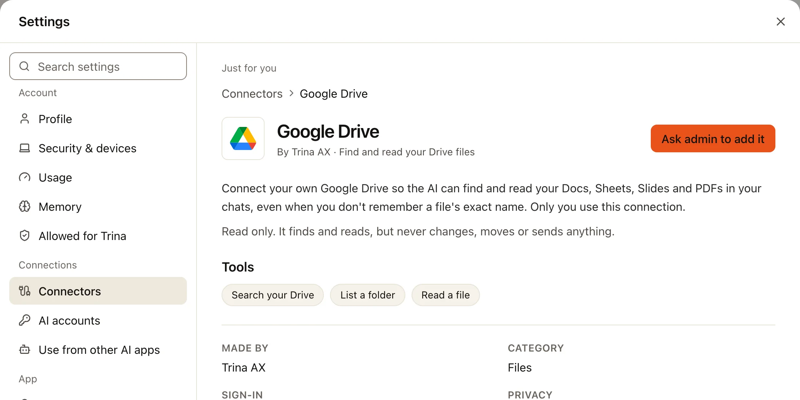
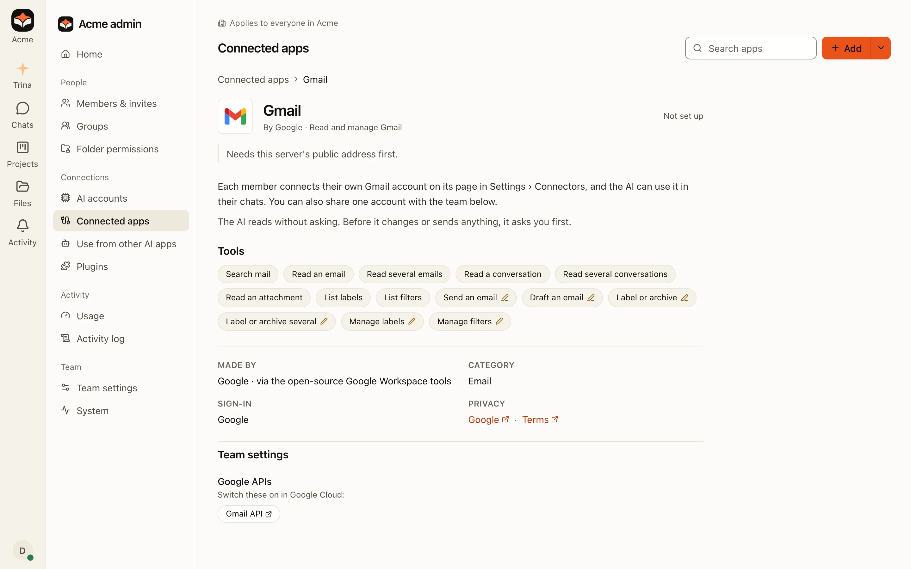

Google Drive, Gmail, Google Calendar, Google Docs and Google Sheets are built into Trina AX. Each person connects their
own Google account, once per app, and the AI uses it only in that person's chats, with that person's Google
permissions.

There is nothing to copy or paste: you sign in at Google.

## Connect a Google app (everyone)

:::tip
**What you need**

- Your Google account (a company Google Workspace account or a personal Gmail account), signed in in your browser.
:::

:::steps
#### Open the app in Connectors
Choose your photo at the bottom of the bar on the left, then **Settings › Connectors**, and pick the app (Gmail, for
example) under **Discover**. Its page says what the AI can do and lists every tool.

#### Choose Connect
Google's own sign-in page opens (in the desktop app, in your browser). Pick your account.

#### Keep every box ticked
Google lists what Trina AX may do, such as "Read, compose and send emails". Keep **every** box ticked and choose
**Continue**. A sign-in with a box unticked is refused: "Some permissions were not ticked. Connect again and keep
every box ticked."

#### Confirm the account
Back in Trina AX, check the account shown ("Connect this account?") and choose **Confirm this account**. The page says
**Connected as** your address.
:::

Reading is free. Before the AI sends a mail, adds an event or edits a document, it shows a card with everything it will
do, and waits for your yes. On the card, or in the app's **Settings** (its **⋯** menu), you can choose **Always allow**
instead of **Ask me first**. Google Drive only reads: it never changes, moves or sends anything.

### If you see "Ask admin to add it"

The app isn't set up on your team yet. Choose **Ask admin to add it**: the owner and the admins get a notice, and you
hear back when you can connect.



## A shared Google account for the team (admins)

A shared mailbox or calendar, such as `sales@acme.com`, can be connected once for the people who need it. In **Admin ›
Connected apps**, open the Google app, and under **Team settings › Shared Google account** choose **Connect for the
team**. Sign in with the shared account, then choose who uses it. Google Drive has **Shared with the team** in
the same place.

## Set up the Google apps (admins of a server you run yourself)

On a team hosted by Trina, Google sign-in is ready: nothing to set up. On a server your company runs itself, an admin
makes a Google sign-in app once in Google Cloud and adds it in **Admin › Connected apps**.

:::tip
**What you need**

- A **public https address** for your team's server (people come back to it from Google). Until it has one, the Google
  apps show "Needs this server's public address first." Whoever runs the server sets it: see
  [Configuration](../operate/configuration.md).
- A **Google Cloud project**, the **APIs** each app needs switched on, and a **sign-in client** of type
  **Web application**.
- From Google Cloud: the client's **JSON file** (or its **Client ID** and **Client secret**).
- For Google Cloud: the **return addresses** Trina AX shows, one for Google Drive and one for the other four apps.
:::



:::steps
#### Make the app in Google Cloud
Follow [In Google Cloud](google-own-app.md#in-google-cloud) on the company-app page: a project, the APIs, the app's name
and audience (**Internal** for a Google Workspace company; otherwise **External** with test users), the permissions,
and a **Web application** client.

#### Add the return addresses
Under the client's **Authorized redirect URIs**, add the addresses each app's **Set up** dialog shows, with its copy
button:

```
https://<your team address>/api/integrations/google-drive/callback
https://<your team address>/api/integrations/google-apps/callback
```

#### Upload the file in Trina AX
In **Admin › Connected apps**, open **Google Drive** and choose **Set up**. Upload the JSON file you downloaded, or
paste the **Client ID** and **Client secret**, and save. Then open Gmail, Google Calendar, Docs and Sheets one by one,
choose **Set up** and turn on **Use the same Google app as Google Drive**: nothing else to upload.
:::

Each app's page lists, under **Google APIs**, the APIs to switch on for it:

| App | Google APIs to enable |
|---|---|
| Google Drive | Google Drive API |
| Gmail | Gmail API |
| Google Calendar | Google Calendar API |
| Google Docs | Google Docs API, Google Drive API |
| Google Sheets | Google Sheets API, Google Drive API |

The Gmail, Calendar, Docs and Sheets apps run on Linux servers. On the Mac app their pages say "Not on your team's
server yet".

## Show your company's name on Google's screen

A company on Google Workspace can have every Google app sign in with its own Google app, so people see the company's
name and no warning on Google's screen: [Use your company's own Google app](google-own-app.md).

## Problems

| What you see | What to do |
|---|---|
| **Some permissions were not ticked. Connect again and keep every box ticked.** | Connect again and leave every box on Google's screen ticked. |
| **Google asked you to sign in again.** | Choose **Reconnect** on the app's page. This happens after a password change, or when your company's admin removed access. |
| **`redirect_uri_mismatch`** on Google's page (self-run servers) | A return address in Google Cloud differs from the one Trina AX shows. Copy it again from the **Set up** dialog. |
| **"This app is blocked"** or **`admin_policy_enforced`** | Your company's Google admin limits which apps may use Google accounts. Ask them to trust the app: see [Trust the app in the Admin console](google-own-app.md#optional-trust-the-app-in-the-admin-console). |
| **Google hasn't verified this app** | An External app in Testing. Choose **Advanced** › **Go to …** only if your admin made the app; or ask them to switch to your company's own app. |

Full details for developers and operators: [Google apps](../../GOOGLE-APPS.md) and [Google Drive](../../GOOGLE-DRIVE.md).
