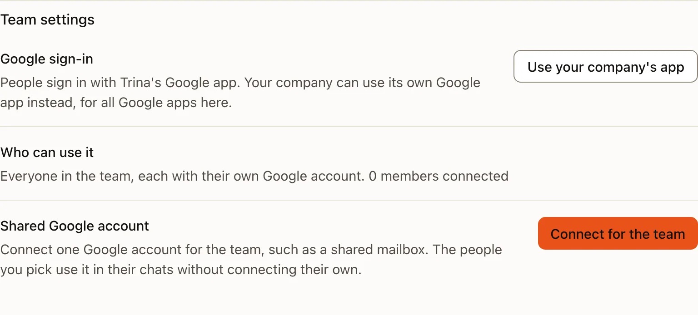
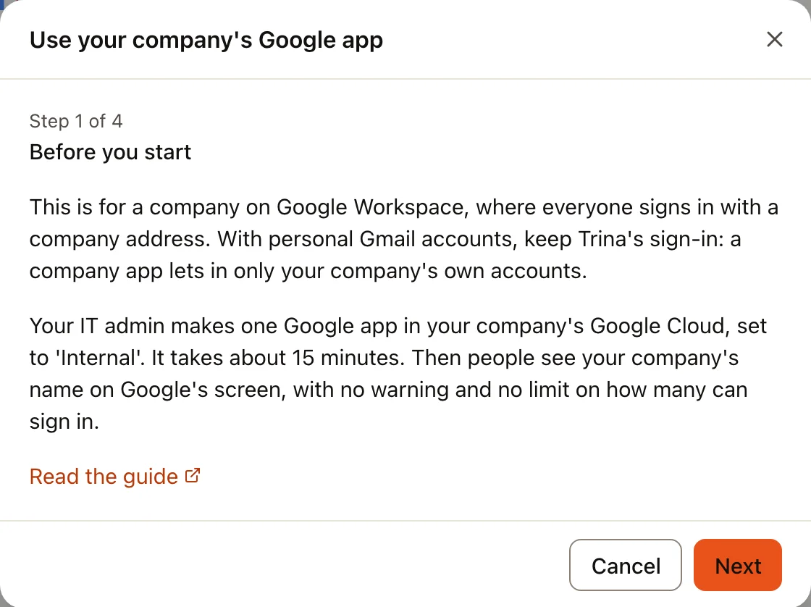
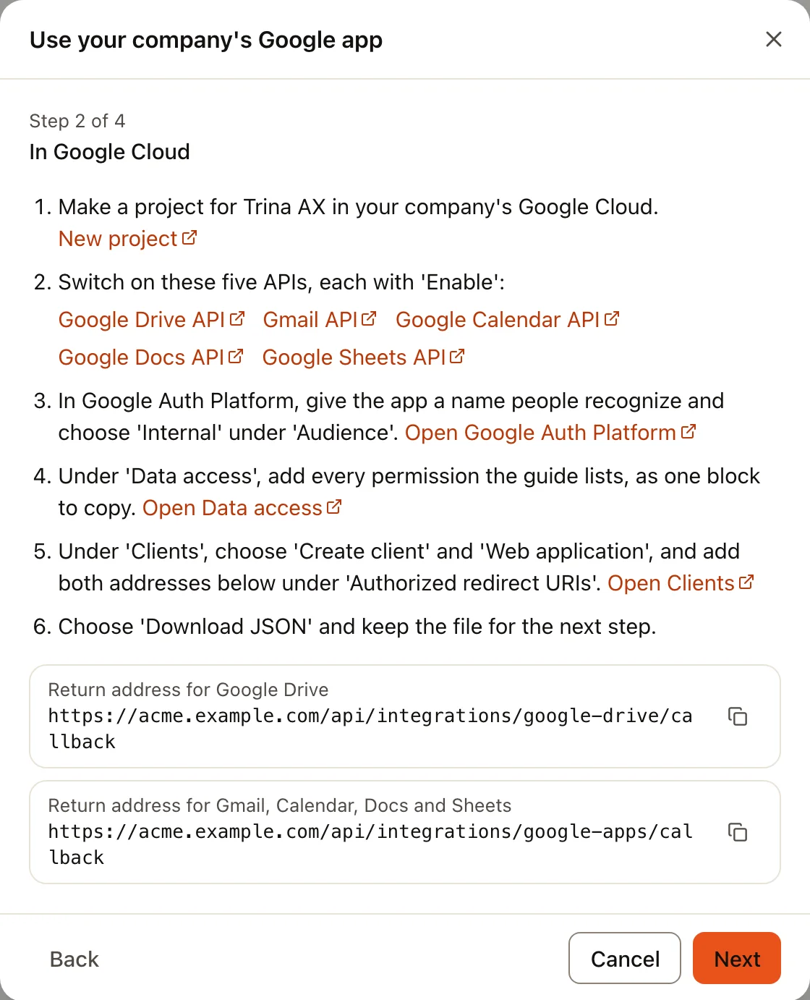
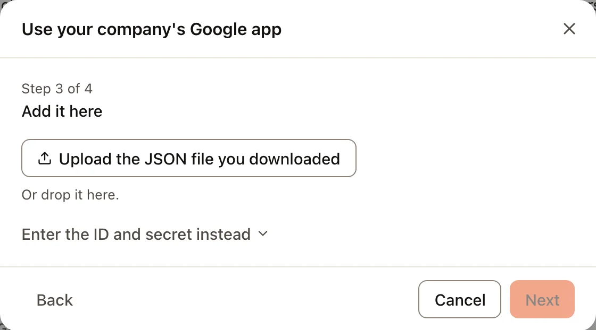
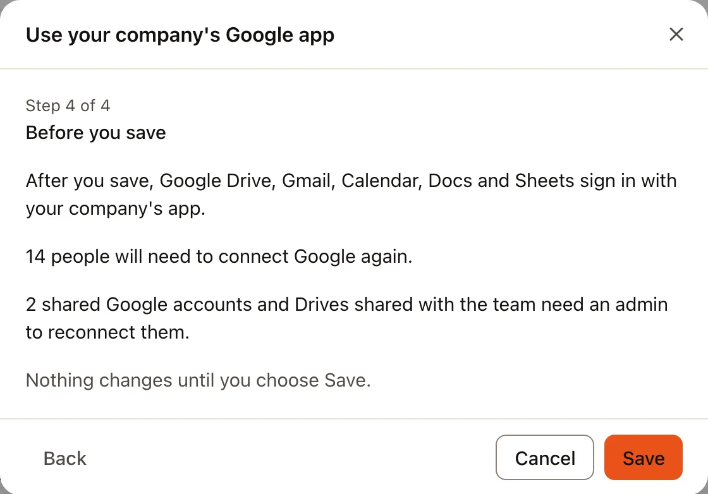
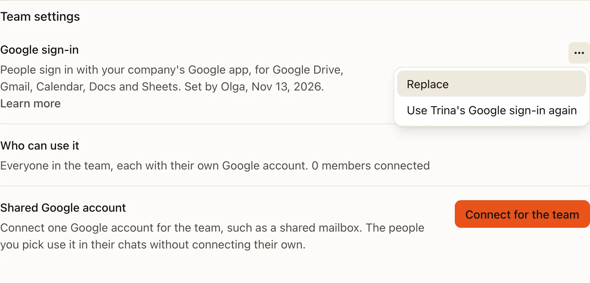
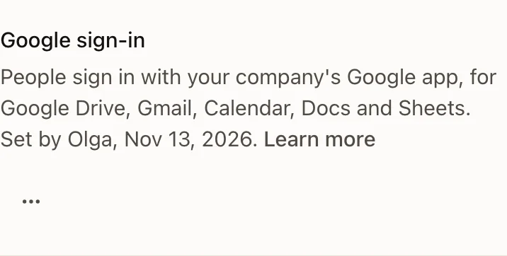
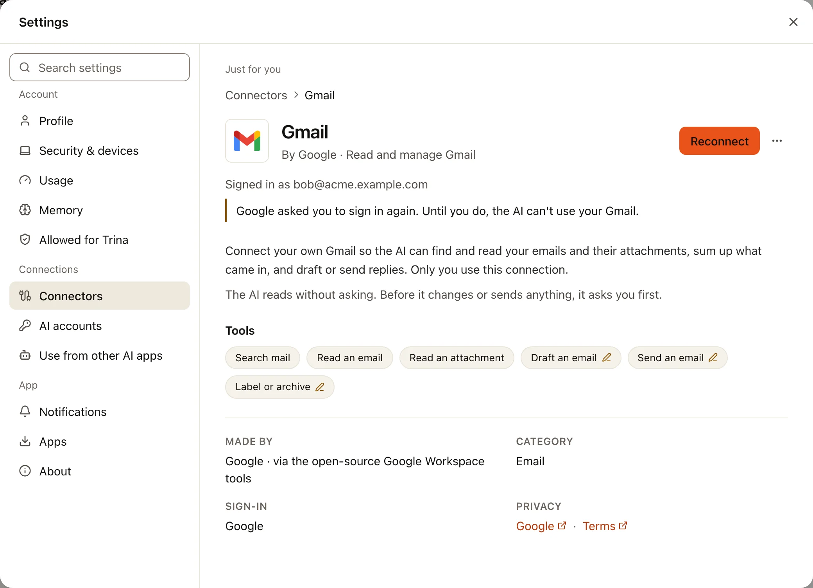

When people connect Google Drive, Gmail, Google Calendar, Google Docs or Google Sheets, they sign in at Google through
Trina's own Google app. A company on Google Workspace can use **its own Google app** instead. Its IT admin makes the
app once in Google Cloud and adds it to Trina AX once. From then on all five Google apps sign in with it, and people
see your company's name on Google's screen, with no "unverified app" warning and no limit on how many people can sign in.

It takes about 15 minutes: most of it in Google Cloud, then one dialog in Trina AX.

:::note
The screenshots on this page use a made-up team, "Acme". Google Cloud's own screens are not shown, because they change
often: this page quotes Google's labels and links to each Google Cloud page instead.
:::

## Who it is for

- **A company on Google Workspace** (everyone signs in with an address of your company, such as `name@acme.com`). This
  page is for you. You need to be the team's owner or an admin in Trina AX, and able to make a project in your
  company's Google Cloud.
- **People with personal Gmail accounts.** Keep Trina's sign-in: an Internal app only lets in your company's own
  accounts.

For members nothing else changes: the same pages, the same **Connect** button. They connect Google again once, after
you switch.

:::tip
A small team without Google Workspace can make an **External** app in **Testing** instead. Only the people you list
as test users can sign in (at most 100), and Google asks them to sign in again every 7 days. For most teams, Trina's
own sign-in is simpler.
:::

## In Google Cloud

Sign in to [Google Cloud](https://console.cloud.google.com/) with an account of your company.

:::steps
#### Make a project
Open [New project](https://console.cloud.google.com/projectcreate). Give it a name you will recognize, such as
"acme-trina", keep your company under **Organization**, and choose **Create**. Make sure the new project is chosen at
the top of the page before the next steps.

#### Switch on five APIs
Open each page below and choose **Enable**:

- [Google Drive API](https://console.cloud.google.com/apis/library/drive.googleapis.com)
- [Gmail API](https://console.cloud.google.com/apis/library/gmail.googleapis.com)
- [Google Calendar API](https://console.cloud.google.com/apis/library/calendar-json.googleapis.com)
- [Google Docs API](https://console.cloud.google.com/apis/library/docs.googleapis.com)
- [Google Sheets API](https://console.cloud.google.com/apis/library/sheets.googleapis.com)

Switch on all five, even if your team uses only some of the Google apps today.

#### Name the app and set it to Internal
Open [Google Auth Platform](https://console.cloud.google.com/auth/overview). The first time, it shows **Get started**:

1. **App Information**: an **App name** people will recognize, such as "Acme Trina", and a **User support email**.
2. **Audience**: choose **Internal**. Only accounts of your company can use the app, and Google does not need to
   review it.
3. **Contact Information**: an email address Google may write to about the project.
4. **Finish**: agree to Google's policy and choose **Create**.

Later you can change these in [Branding](https://console.cloud.google.com/auth/branding) and
[Audience](https://console.cloud.google.com/auth/audience).

#### Add the permissions
Open [Data access](https://console.cloud.google.com/auth/scopes) and choose **Add or remove scopes**. Under **Manually
add scopes**, paste the whole block below, choose **Add to table**, then **Update**, then **Save**.

```
openid
https://www.googleapis.com/auth/userinfo.email
https://www.googleapis.com/auth/userinfo.profile
https://www.googleapis.com/auth/drive.readonly
https://www.googleapis.com/auth/drive.file
https://www.googleapis.com/auth/gmail.readonly
https://www.googleapis.com/auth/gmail.send
https://www.googleapis.com/auth/gmail.compose
https://www.googleapis.com/auth/gmail.modify
https://www.googleapis.com/auth/gmail.labels
https://www.googleapis.com/auth/gmail.settings.basic
https://www.googleapis.com/auth/calendar
https://www.googleapis.com/auth/calendar.readonly
https://www.googleapis.com/auth/calendar.events
https://www.googleapis.com/auth/documents
https://www.googleapis.com/auth/documents.readonly
https://www.googleapis.com/auth/spreadsheets
https://www.googleapis.com/auth/spreadsheets.readonly
```

These are exactly the permissions Trina AX asks for, for all five apps together. Leave none out: a sign-in without one
of them is refused.

#### Make the sign-in client
Open [Clients](https://console.cloud.google.com/auth/clients) and choose **Create client**.

1. **Application type**: **Web application**.
2. **Name**: anything, such as "Trina AX".
3. Under **Authorized redirect URIs**, choose **Add URI** twice and paste both return addresses. Copy them from Trina AX
   (the dialog in the next part shows them, each with **Copy**). They look like this, with your team's address:

   ```
   https://<your team address>/api/integrations/google-drive/callback
   https://<your team address>/api/integrations/google-apps/callback
   ```

4. Choose **Create**. In **OAuth client created**, choose **Download JSON** and keep the file. Google shows the secret
   only now; if you lose it, make a new secret for the client.
:::

## In Trina AX

:::steps
#### Open a Google page
In **Admin › Connected apps**, choose any of the Google apps, **Gmail** for example. All five pages end with **Team
settings**, and its first row is **Google sign-in**: "People sign in with Trina's Google app. Your company can use its
own Google app instead, for all Google apps here."



#### Press Use your company's app
The dialog **Use your company's Google app** opens. Its first step, **Before you start**, says who it is for and
links to this page.



#### In Google Cloud
The second step lists the Google Cloud steps above, with a link to each page, and the two return addresses of your
team, each with **Copy**. Copy them from here into **Authorized redirect URIs**, so they are exactly right.



#### Add it here
Drop the file you downloaded from Google, or choose it. If you would rather type, **Enter the ID and secret instead**
opens two fields for the **Client ID** and **Client secret**. A file that does not list both return addresses is
refused, with a line saying which one to add in Google Cloud.



#### Check and save
The last step, **Before you save**, says what changes, with your team's numbers: how many people will need to
connect Google again, and that shared Google accounts and Drives shared with the team need an admin to reconnect them. Nothing
changes until you choose **Save**. **Cancel** leaves everything as it was.


:::

After **Save**, the row says "People sign in with your company's Google app, for Google Drive, Gmail, Calendar, Docs
and Sheets." with who set it and when. Its ⋯ menu has **Replace** (to add a new file, for example after a new secret)
and **Use Trina's Google sign-in again**. You set it once: the row is the same on all five Google pages.



On a phone the ⋯ stays beside the row's name, as in a phone's settings.



## What members see

Every connection to Google made through Trina's app stops working when you switch, because Google ties a sign-in to
the app that made it.

- **Each person** sees their usual **Reconnect** on their Google apps in **Settings › Connectors**, once. Google then
  shows your company's app name, with no warning.
- **Shared Google accounts and Drives shared with the team** show **Reconnect** under **Team settings** on their Google
  page. An admin reconnects them; until then the AI can't use them.



## Optional: trust the app in the Admin console

If your company limits which apps may use Google accounts, a Google Workspace super admin marks the app as trusted.
In the [Admin console](https://admin.google.com/), open **Security › Access and data control › API controls**, then
**Manage Third-Party App Access** › **Configure new app**. Search for the client ID (it is in the downloaded file),
choose it, and set **Trusted**. Without this, people may see `admin_policy_enforced` when they connect.

## What Trina AX keeps

- The app's ID and secret are kept in **a private file on your team's server**, readable only by the server. They are
  never shown again: not on the page, not in a log, not in the activity log.
- On a hosted team, **the Trina hosting service runs that server**, so it runs where that file is. The secret alone
  opens nothing: each person still signs in at Google and agrees there.
- People's own Google sign-ins are kept sealed on the server, as before.

## Go back to Trina's sign-in

On any Google page, in **Team settings › Google sign-in**, open ⋯ and choose **Use Trina's Google sign-in again**. It
first shows the same numbers as **Before you save**. After you confirm, all five Google apps sign in through Trina's
app again, people connect Google again once, and the company app's file is removed from the server. You can then
delete the client in Google Cloud.

If your team's address changes, the Google sign-in row says so. Add the two new return addresses to the client in
Google Cloud, download its file again, then open ⋯ › **Replace** in Trina AX: the dialog opens at **In Google Cloud**
with the new addresses to copy. Until then, nobody can connect Google.

## Problems

| What you see | What to do |
|---|---|
| **`redirect_uri_mismatch`** on Google's page | A return address in Google Cloud is missing or differs by a letter. Open [Clients](https://console.cloud.google.com/auth/clients), choose your client, and paste both addresses again from the dialog's **In Google Cloud** step. Saving can take a few minutes to work. |
| **"Some permissions were not ticked. Connect again and keep every box ticked."** | The person unticked a box on Google's screen, or a permission is missing in **Data access**. Check that the whole block above is listed there, then connect again with every box ticked. |
| **`admin_policy_enforced`** | Your company's Admin console blocks the app. Mark it trusted (see [above](#optional-trust-the-app-in-the-admin-console)). |
| **An account from outside the company** is refused (Google says the app can only be used within its organization) | That is what **Internal** means. Use an account of your company. Shared Google accounts must be company accounts too. |

Full details for developers and operators: [Google apps](../../GOOGLE-APPS.md) and [Google Drive](../../GOOGLE-DRIVE.md).
