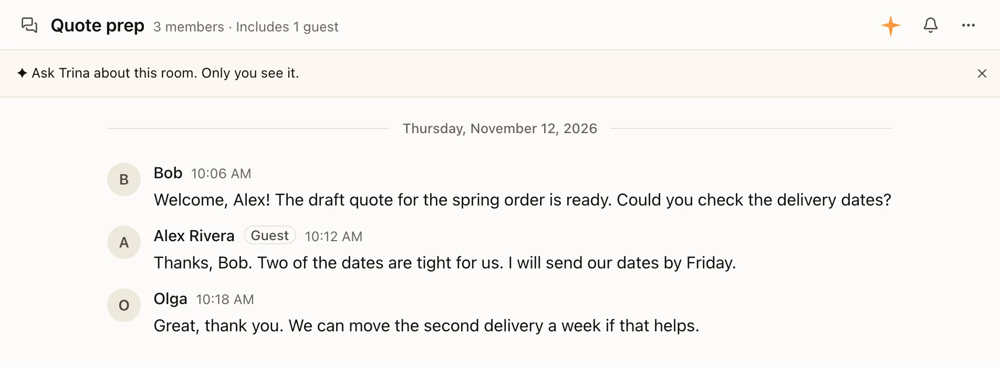
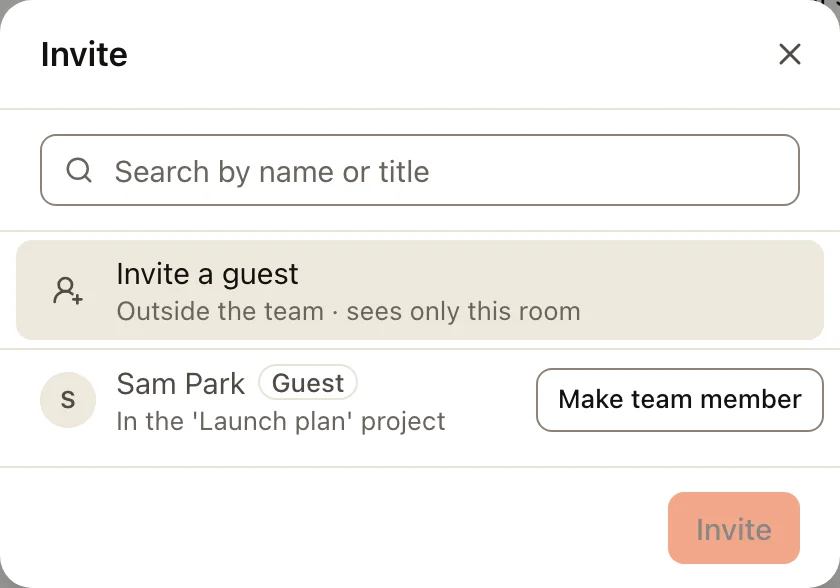
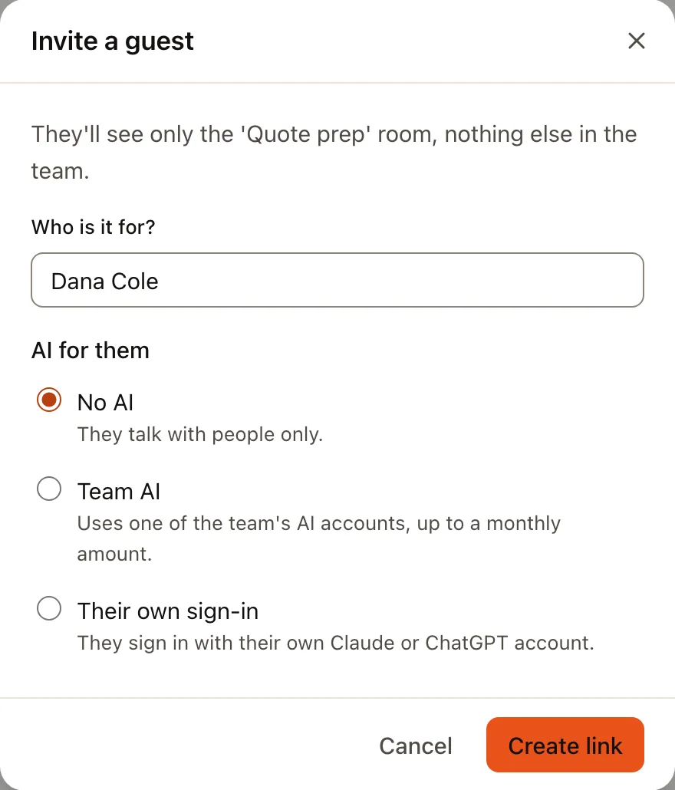
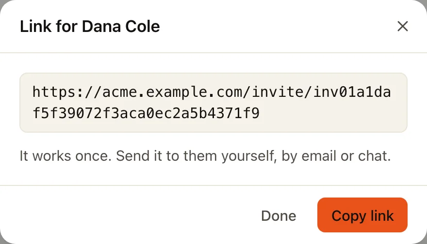
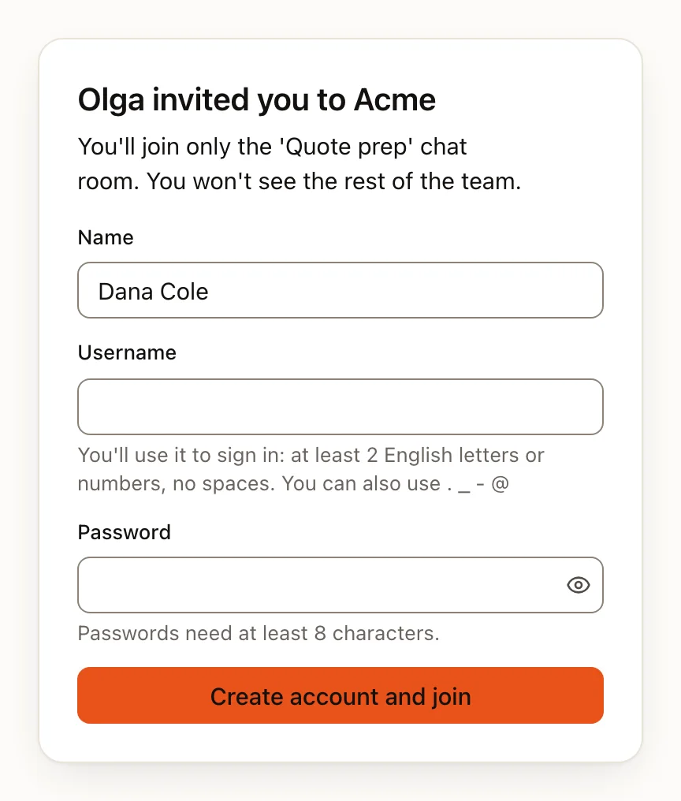
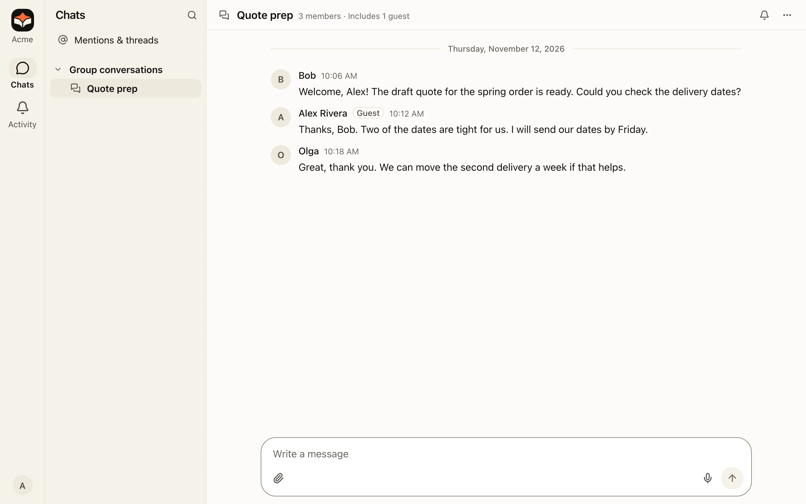
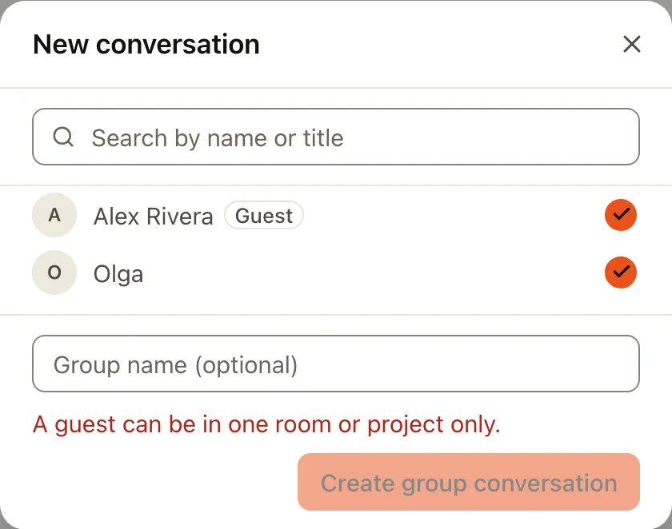
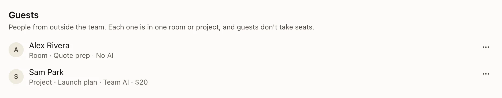

A **guest** is someone from outside your team, such as a client, a partner or a freelancer. A guest joins exactly one
group chat or one project and sees nothing else in the team: no other chats, no team files, no other projects, no team
skills. They don't take a seat on your plan.

| | A team member | A guest |
|---|---|---|
| **Where they can go** | Everything their groups and folder permissions allow | One group chat or one project |
| **Team files** | The folders they may open | Only the files of their project (none in a group chat) |
| **AI** | The team's AI settings | No AI, unless an AI is picked for them |
| **Seat** | Takes one | Doesn't take one |

Next to a guest's name you see a **Guest** tag, and a chat or project with guests in it says so at the top
("Includes 1 guest").

## Who can invite a guest

- **To a group chat:** anyone in that chat.
- **To a project:** the person who made the project, or an owner or admin.

Guests are never in **Team rooms** (the room for everyone and the rooms of each group). A guest can send direct
messages, but only to the people in their own chat or project.

## Invite a guest

:::steps
#### Open the add list
In a group chat, click the chat's name at the top, then **Invite people**. In a project, choose **Manage** next to
**Members** on the project's page. The first row is **Invite a guest**.

#### Say who it is for and choose their AI
Type the person's name under **Who is it for?**. Under **AI for them**, **No AI** is picked to start with. The other choices are explained
below in [A guest's AI](#a-guests-ai).

#### Copy the link and send it yourself
**Create link** makes a link for this one person. Trina doesn't send an email: choose **Copy link** and send it to
them yourself, by email or in a chat. The link works once, for 7 days; the dialog shows the date and time it stops.

:::

The link also shows in **Admin › Members & invites**, under **Guests**, with the person's name, until it is used.

## What the guest sees

The link opens a page that says who invited them and the one chat or project they will join. They choose a username
and a password, and they're in. If the link no longer works, the page says why: it expired, it was already used, it
was turned off, the person who made it can no longer invite them, or the chat or project is gone.

After they sign in, Trina opens their chat or project. The bar on the left only has what they can use: there is no
**Files**, no team projects or rooms, and no **Trina** when their AI is off. Their **Settings** has only their own
things, such as their profile and notifications.

In a project, the project's members can see the chats a guest has there. The guest is told this on the project's page.

## One place only

A guest can be in one group chat or one project, never more. Trina won't let you add a guest to a second place. In
an add list, a guest who is already somewhere else shows where they are, and you can't tick them.

If the person needs more than one place, an owner or admin can choose **Make team member** (see below).

If a guest leaves, is taken out, or their chat or project is closed, they can no longer sign in, the same as when
they are removed. If their project comes back from the trash, they can sign in again by themselves, unless an owner or
admin switched them on or off in the meantime. Renaming the chat or project changes nothing for them.

## A guest's AI

| Choice | What it means | Who can pick it |
|---|---|---|
| **No AI** (the default) | They talk with people only. | Anyone who invites |
| **Team AI** | They use one of the team's AI accounts, up to a monthly amount in US dollars that you set. | The owner and admins |
| **Their own sign-in** | They connect their own Claude or ChatGPT account in **Settings › AI accounts** and use that. | Anyone who invites |

Guests can't use the AI credit of a free trial. A guest who uses up their monthly amount is told the day it starts
again. If the team AI account a guest uses is deleted, the guest reads that AI can't answer them now, and their row in
**Admin › Members & invites** says the account was removed: choose **Change AI** to pick another one.

:::note
If your team runs Trina AX on an office Mac that was installed without an administrator password, guests can't use
AI there: the only choice is **No AI**. Installing it with the admin installer (.pkg) makes the other choices possible.
:::

## Plans and limits

Guests don't take seats. Each plan allows a number of guests at a time:

| Plan | Guests |
|---|---|
| Free | 3 |
| Starter | 10 |
| Team | 30 |
| Business | 100 |
| Your own server (self-hosted) | No limit |

**Admin › Members & invites** shows how many guests you have next to **Guests**, for example "3 of 10 guests". When the
plan is full, the invite dialog says so before you fill anything in. Removing a guest you no longer need frees a place.

If your plan changes to one with fewer guests than you have, nobody is removed: every guest keeps working. The count
turns orange with a short note, and new invites wait until you remove guests or change the plan.

## Manage guests (owners and admins)

**Admin › Members & invites** has a **Guests** list. To see only guests, pick **Guests** in the list of roles at the top. Each row
shows where the guest is and what AI they have.

The **⋯** menu of a guest has:

- **Change AI**: pick No AI, Team AI or their own sign-in again.
- **Make team member**: they become a normal member and take one seat. They stay where they are, and you can add
  them to more chats and projects. Their guest AI and monthly amount end: their AI then follows the team's settings,
  like any member's. A removed guest made a team member can sign in again.
- **Remove guest**: their account is switched off and they can't sign in any more. Their messages and files stay
  with the team. Removed guests are hidden behind **Show removed**.

The **⋯** menu of a removed guest has **Switch back on** while their chat or project is still there for them, then
**Make team member** and **Delete**. When there is nothing to bring them back to, their row says why (they left, their
project is in the trash, or the chat or project is gone): invite them again or make them a team member.
