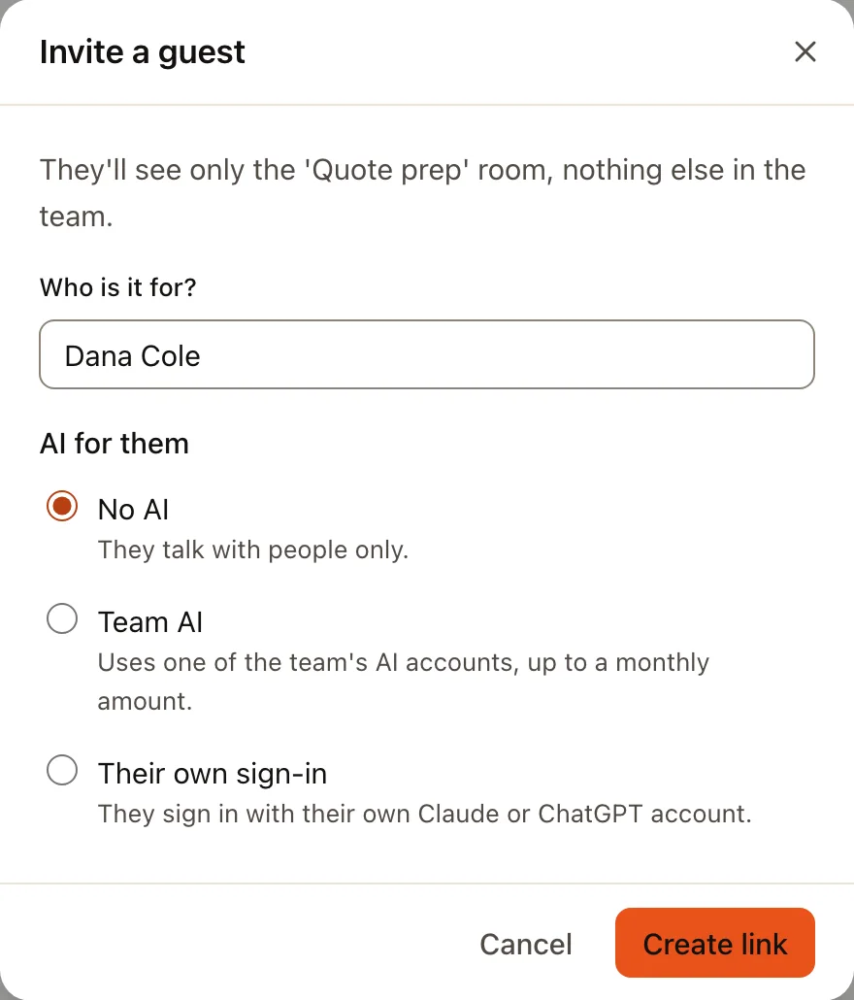
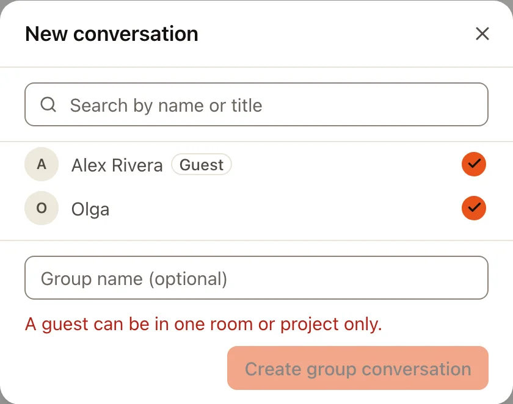

A **guest** is someone from outside your team, such as a client, a partner or a freelancer. A guest is in at most one
private channel or group chat, and one project, and sees nothing else in the team: no other chats, no team files, no other projects, no
team skills. They don't take a seat on your plan.

| | A team member | A guest |
|---|---|---|
| **Where they can go** | Everything their groups and folder permissions allow | One private channel or group chat, and one project, at most |
| **Team files** | The folders they may open | Only the files of their project (none in a private channel or group chat) |
| **AI** | The team's AI settings | No AI, unless an AI is picked for them |
| **Seat** | Takes one | Doesn't take one |
| **Largest file they can upload** | 1 GB in a chat, 20 GB in Files | 100 MB, unless an owner or admin raises it to 1 GB in **Admin › Members & invites**, above the **Guests** list |

Next to a guest's name you see a **Guest** tag, and a chat or project with guests in it says so at the top
("Includes 1 guest").

## Who can invite a guest

- **To a private channel or group chat:** anyone in it. A private channel is a group chat with a name of its own (it
  has a lock and is listed under **Channels**); a group chat without a name is listed under **Direct messages**. Either
  can take a guest.
- **To a project:** the person who made the project, or an owner or admin.

You don't have to open the chat or project first: **New message** starts with **Invite a guest**, and owners and
admins also find **Guest** in **Invite people** and in **Admin › Members & invites › Invite people**. See
[Without opening the chat or project](#without-opening-the-chat-or-project) and [From Admin](#from-admin) below.

Guests are never in **Channels** (the Everyone channel and the channel of each group). A guest can send direct
messages, but only to the people in their own chat or project.

## Invite a guest

:::steps
#### Open the add list
In a private channel or group chat, choose **⋯** at the top, then **Add people** (or click its name, then **Add people**). In
a team project, choose **Share** at the top of the project's page. The first row is **Invite a guest**.

#### Say who it is for and choose their AI
Type the person's name under **Who is it for?**. Under **AI for them**, **No AI** is picked to start with. The other choices are explained
below in [A guest's AI](#a-guests-ai).

#### Copy the link and send it yourself
**Create link** makes a link for this one person. Trina doesn't send an email: choose **Copy link** and send it to
them yourself, by email or in a chat. The link works once, for 7 days; the dialog shows the date and time it stops.

:::

The link also shows in **Admin › Members & invites**, under **Invite links**, tagged **Guest**, with the person's name, until it is used or expires.

A link works only while the person who made it can still invite. If they leave the private channel or group chat, lose the project, are removed, or (for **Team AI**) are no longer an admin, the link stops working and leaves **Invite links** in **Admin › Members & invites**. Someone else who can invite makes a new link.

### Without opening the chat or project

- **New message** (the **+** above your conversations): the first row is **Invite a guest**.
- **Invite people** (owners and admins: the team menu under the team's logo, search, or **Me** on a phone): choose
  **Guest** at the top of the dialog (**Team member** is picked to start with). The dialog's title then reads
  **Invite a guest**.
- **Invite your team** (the getting-started steps and the team goal on Home): under the message, **Invite a guest**.

Each lists the one place the guest can join: the private channels and group chats you are in (under two headings), and the projects whose members you can change
(the ones you made; owners and admins: any team project). Pick one, then fill in the same dialog as above. If there is
no such chat or project yet, the dialog says so. If your plan has no room for more guests, it says that instead.

Your own projects under **My projects** are listed too, marked **Only me**. Picking one shares it the way **Add people**
on the project's page does, and the dialog says so in one line before **Create link**:

- **Create link** makes it a team project. Until the guest joins, it is still only yours and stays under **My projects**.
- When the guest joins, it moves to **Team projects**, with you and the guest as its two members.
- The guest can open and edit its files. They don't see your chats, the ones from before or the ones you start later.
- Like **Add people**, this can't go back to only you.

If your team lets only owners and admins share projects, a member's own projects are not listed.

### From Admin

Owners and admins can invite a guest without opening the chat or project first. In **Admin › Members & invites**, choose
**Invite people**, then **Guest** at the top of the dialog (**Team member** is picked to start with). Pick the one
place the guest joins: a private channel or group chat you are in, a team project, or one of your own projects (shared as above). Then
fill in the same dialog as above: their name, their AI, **Create link** and **Copy link**. If your plan has no room for
more guests, the dialog says so instead of listing places.

## What the guest sees

The link opens a page that says who invited them and the one private channel, group chat or project they will join. They choose a username
and a password, and they're in. If you chose **Their own sign-in**, the page also tells them they will connect their own Claude or ChatGPT account. If the link no longer works, the page says why: it expired, it was already used, it
was turned off, the person who made it can no longer invite them, or the private channel, group chat or project is gone.

After they sign in, Trina opens their private channel, group chat or project. The bar on the left only has what they can use: there is no
**Files**, no team projects or channels, and no **Trina** when their AI is off. Their **Settings** has only their own
things, such as their profile and notifications.

In a project, the project's members can see the chats a guest has there. A guest who can use AI is told this on the project's page.

Guests don't receive or share file links. To give a guest a file, post it in their private channel, group chat or project.

## One private channel or group chat, and one project

A guest can be in one private channel or group chat, and one project, at the same time, never more. An invite opens one place. To bring a
guest into their second place, add them like anyone else: from **Add people** in the private channel or group chat, or **Share** at
the top of the project's page. Trina won't let you add a guest to a second private channel or group chat, or to a second project. In an add list, a guest who
is already in another place of the same kind can't be ticked and shows where they are (only the name of a place you
are in too).

A guest in both sees the people of both: they can message anyone in their private channel or group chat, or their project, and nobody
else. Each side sees the guest; people who are only in the private channel or group chat don't see the project's name, and the other way
round.

If the person needs more than one private channel, group chat or project, an owner or admin can choose **Make team member** (see below).

If a guest leaves, is taken out, or their private channel, group chat or project is closed, they are out of that place. They can still
sign in while they are in their other place. Out of every place, they can no longer sign in, the same as when they are
removed. A project in the trash stays theirs: while it is there they can't join another project. Moving a project with guests to the trash says so before you confirm. If their project comes back from the trash, they can sign in again by themselves, unless an owner or
admin switched them on or off in the meantime. Renaming the private channel or project changes nothing for them.

## A guest's AI

| Choice | What it means | Who can pick it |
|---|---|---|
| **No AI** (the default) | They talk with people only. | Anyone who invites |
| **Team AI** | They use one of the team's AI accounts, up to a monthly number of tokens that you set. | The owner and admins |
| **Their own sign-in** | They connect their own Claude or ChatGPT account in **Settings › AI providers** and use that. It is their own plan, so the team pays nothing. | Anyone who invites |

### Team AI's monthly limit

The limit is a number of **tokens**: how much the AI reads and writes. Pick **1M tokens**, **5M tokens** or
**10M tokens** (5M is picked first), or **Other** to type a number. Next to it, Trina says about how many answers that
allows, for example "5M tokens · about 62 answers". The limit starts over on the 1st of every month.

The number of answers is an estimate. Trina divides the limit by the tokens an answer of your team used on average in
the last 90 days, and rounds it down. While your team has fewer than 20 answers, it uses 80,000 tokens per answer and
says so. Answers that read files or use tools take more tokens than short ones.

A guest given Team AI before limits were in tokens keeps their limit in US dollars, for example "up to $20.00 a
month", until you change it. **Change AI** then asks for a number of tokens.

In **Admin › Members & invites**, a Team AI guest's row says the limit and what is left this month, for example "up to
5M tokens a month · 3.2M left", or **AI limit used up**.

A guest who uses up their monthly limit is told how many tokens it was and the day it starts again. If the team AI account a guest uses is
deleted, the guest reads that AI can't answer them now, and their row in **Admin › Members & invites** says the
account was removed: choose **Change AI** to pick another one.

:::note
If your team runs Trina AX on an office Mac that was installed without an administrator password, guests can't use
AI there: the only choice is **No AI**. Installing it with the admin installer (.pkg) makes the other choices possible.
:::

## Plans and limits

Guests don't take seats. Each plan allows a number of guests at a time:

| Plan | Guests |
|---|---|
| Free trial | 10 |
| Starter | 10 |
| Team | 30 |
| Business | 100 |
| Your own server (self-hosted) | No limit |

**Admin › Members & invites** shows how many guests you have next to **Guests**, for example "3 of 10 guests". When the
plan is full, the invite dialog says so before you fill anything in. Removing a guest you no longer need frees a place.

If your plan changes to one with fewer guests than you have, nobody is removed: every guest keeps working. The count
turns orange with a short note, and new invites wait until you remove guests or change the plan.

## Manage guests (owners and admins)

**Admin › Members & invites** has a **Guests** list. To see only guests, pick **Guests** in the list of roles at the top. Each row
shows where the guest is and what AI they have.

The **⋯** menu of a guest has:

- **Change AI**: pick No AI, Team AI or their own sign-in again.
- **Make team member**: they become a team member and take one seat. They stay where they are, and you can add
  them to more private channels, group chats and projects. Their guest AI and monthly limit end: their AI then follows the team's settings,
  like any member's. A removed guest made a team member can sign in again.
- **Remove guest**: their account is switched off and they can't sign in any more. Their messages and files stay
  with the team. Guests who left or were removed are hidden behind **Show guests who left or were removed (N)**; their rows say
  whether they left on their own or were removed.

The **⋯** menu of a removed guest has **Switch back on** while their private channel, group chat or project is still there for them, then
**Make team member** and **Delete**. When there is nothing to bring them back to, their row says why (they left, or the
private channel, group chat or project is gone): invite them again or make them a team member.

A guest whose project is in the trash stays in the list of guests, marked **in the trash**. **Restore project** on their
row puts the project back, and them with it while the plan has room for another guest.
