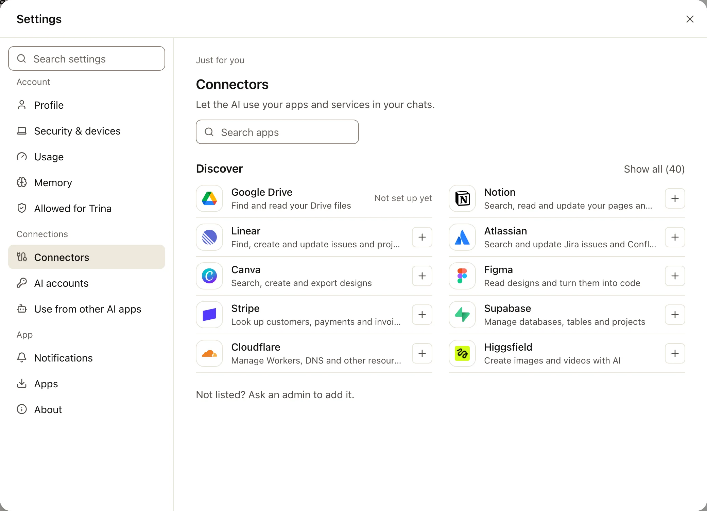
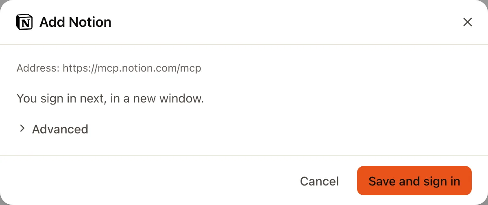

An MCP connection lets the AI use a service outside the team server. The AI uses the service's tools with the credentials of the connection.

:::note
Before 0.4.0, this screen is called **External services**.
:::

## Two kinds of connection

| Kind | What you give | What the AI gets |
|---|---|---|
| **MCP server** | The server's address; sign in or enter a key | The tools the server lists |
| **HTTP API with a key** | An address, a key and a note on how to use it | One tool, `api_request`, limited to addresses under that one |

## Personal and team connections

| | Personal | Team |
|---|---|---|
| Made by | The member, in **Settings › MCP** | An admin, in **Admin › MCP** |
| Used by | That member, in their own chats | The people its rules name: everyone, groups or people |
| Visible to | Only that member, not admins | Admins |

Admins manage team connections but do not use them unless a rule names them. Who may use a connection is checked on every call.

## Add a connection

:::steps
#### Open the MCP screen
**Settings › MCP** for yourself, or **Admin › MCP** for the team.

#### Pick a service or add by address
**Discover** lists services that support sign-in with Trina AX. **Add connection** takes any MCP server address.

#### Sign in or paste a key
Keys and sign-ins are stored encrypted on the server and never shown again.

#### Choose who may use it
For a team connection, name everyone, groups or people.
:::

You can also ask in a chat: "Connect Linear." The AI starts the connection, and you only sign in or paste the key into a sealed card.

## Changes need a yes

Reads run at once. Everything else is a write, and follows the connection's write policy:

| Policy | What happens |
|---|---|
| **Ask** (default) | The server shows a card with everything that will be sent. Nothing goes until a person says yes. |
| **Deny** | Writes are refused. |
| **Allow** | Writes run without asking. Only admins can choose this, and only for team connections. |

What a service returns is treated as outside data, never as instructions. In a scheduled run nobody can say yes, so writes are refused, except to an **Allow** team connection approved for that schedule.

## Ask a member to connect

Some services log calls as the key's owner. Then the key belongs in the member's own connection. An admin can send a member a request with the service filled in. The member connects with their own key, or declines.

## The other direction

Your own Claude (Claude Code, Claude Desktop or claude.ai) can connect **to** Trina AX as an MCP server, and use your files with your permissions. [Read about the Team AX MCP connector](../agents/mcp-connector.md).

Full details: [Integrations](../../INTEGRATIONS.md).
