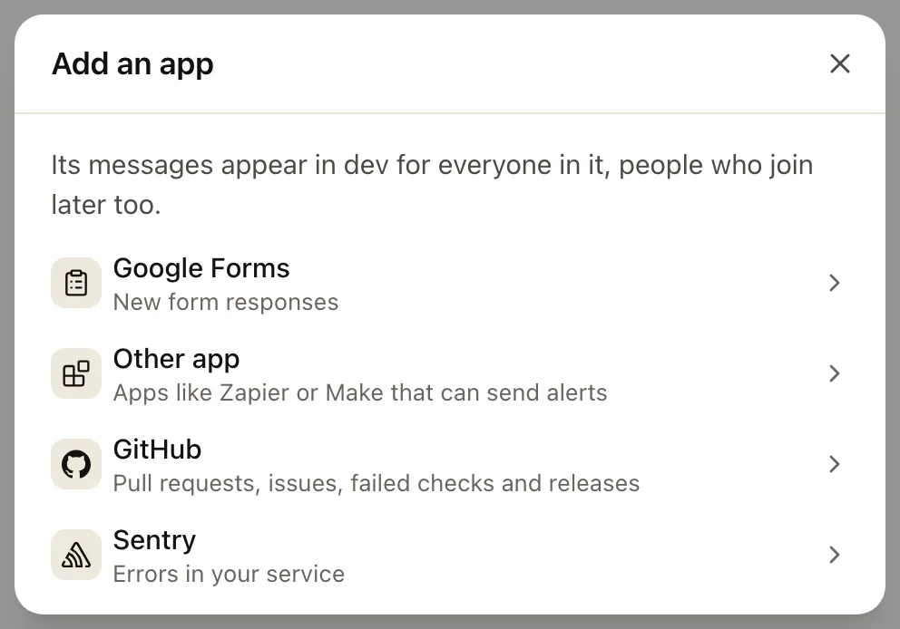
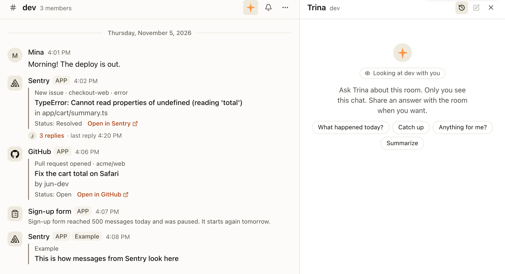
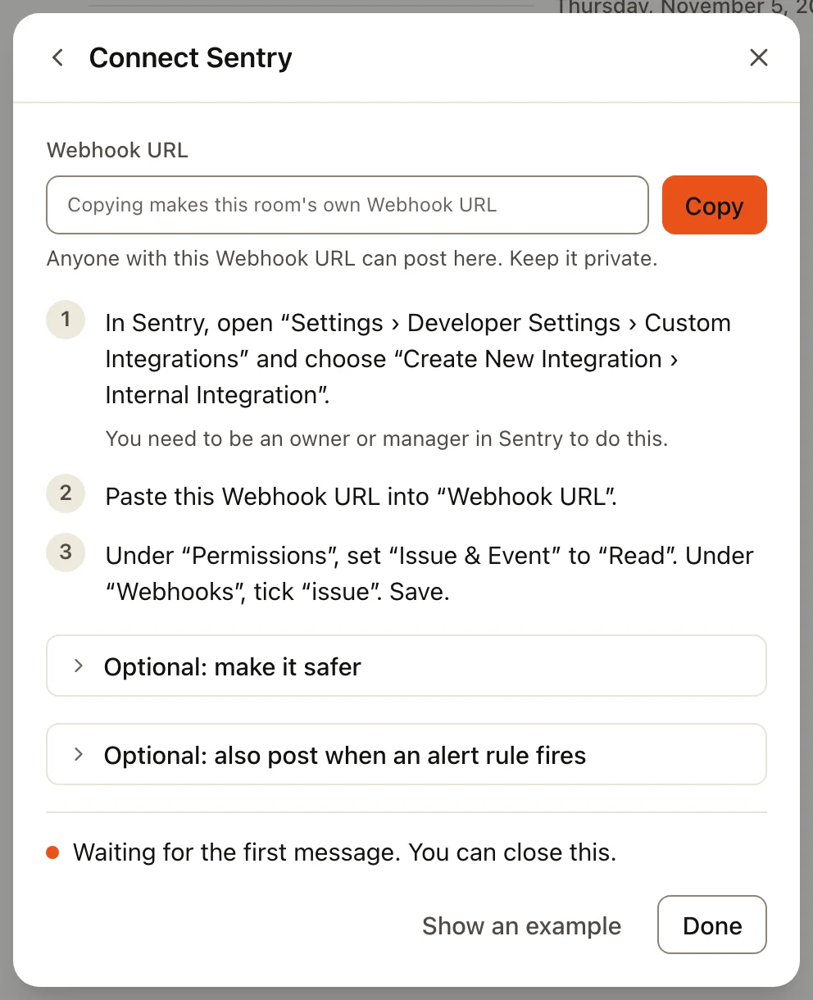
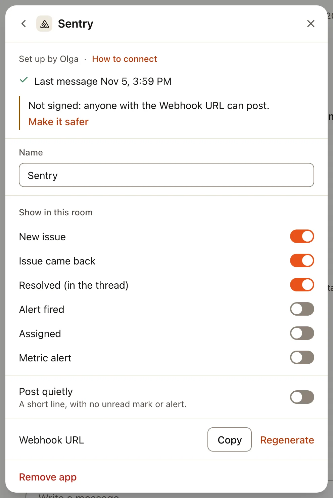

A room can get updates from the services your team already uses: new **Google Forms** responses, errors from
**Sentry**, pull requests and failed checks from **GitHub**, or anything else that can send a message to a Webhook URL.
They arrive as cards from the app, with its logo and an **APP** tag, never as a person. Repeats of the same thing (the
same error, the same pull request, an edited response) go into one thread under the first card, and the first card's
status line changes as things move on.

## Add an app

1. Open the room, then **⋯ › Add an app**.
2. Pick **Google Forms**, **Other app**, **GitHub** or **Sentry**. An Other app gets a name first (for example
   *Backup alerts*): its messages show under that name.
3. Press **Copy** next to the Webhook URL (Google Forms: **Copy code**) and follow the numbered steps in that service.
   Nothing is added to the room until you copy, so you can look first and close the guide.
4. The guide shows what happens live: *Waiting for the first message*, *Connected*, or why the last try wasn't shown.
   **Show an example** shows, inside the guide, how its messages will look. Nothing is posted.



Who can do this: in a team room or the everyone room, its owners and admins; in a 1:1 or a group chat, anyone in it.
Everyone else in the room sees the cards, replies in their threads and asks Trina about them. A tap on the app's name
says who set it up.

Everyone in the room sees an app's messages, people who join later too. Pick the room with care: an error report or a
form answer can hold customer data.

### In the room

Each update is a card under the app's name, with an **APP** tag, what happened, a status line and a link to open it in
the service. Replies go in the card's thread, as with any message. The room's **✦** side chat offers **What happened
today?** (Google Forms rooms also **Summarize today's responses**), which sums up the apps' messages with what needs someone first; in a thread it offers **Summarize this
thread**.



### Google Forms

Google Forms has nothing to paste a URL into, so Trina gives you a short script for the form
([Apps Script triggers](https://developers.google.com/apps-script/guides/triggers/installable)).

- In the form open **⋮ › Apps Script**, delete what's there, paste the code and save.
- Pick **setUp** at the top and press **Run**. Google shows **Google hasn't verified this app**: that's expected, because
  the script is your own and runs only in your account. Choose **Advanced › Go to … (unsafe)**, then allow access.
- If the form collects email addresses, each response shows the respondent's email. Turn **Respondent's email** off in
  the app's settings to leave it out. Anyone who can edit the form can see the code.

### Other apps

Anything that can send a message to a Webhook URL (Zapier, Make, Grafana, Uptime Kuma, your own scripts) works. Paste
the Webhook URL where the service sends messages and send a test. The guide and the app's settings show **How to send**
with an example to copy:

```json
{ "text": "Backup finished: 1,204 files", "title": "Nightly backup", "url": "https://example.com/report", "thread": "nightly-backup" }
```

- `text` is the message, and the only field you need (`content` works too).
- `title` adds a heading, `url` one link, and messages with the same `thread` go into one thread.
- Slack-style messages (`blocks`, `attachments`) and plain text are taken as well. An `Idempotency-Key` header makes a
  retry post only once.

```bash
curl -X POST -H 'Content-Type: application/json' -d '{"text":"Hello from my app"}' <Webhook URL>
```

### GitHub

Per repository; you need admin access to it ([GitHub docs](https://docs.github.com/en/webhooks/using-webhooks/creating-webhooks)).

- In the repository open **Settings › Webhooks › Add webhook**.
- Paste the Webhook URL into **Payload URL** and choose **application/json**.
- Choose **Send me everything** and press **Add webhook**. Trina shows only what you turn on in the app's settings.
- *Optional, safer:* **Copy secret** in the guide and paste it into **Secret**. From then on Trina shows only what GitHub
  signed ([validating deliveries](https://docs.github.com/en/webhooks/using-webhooks/validating-webhook-deliveries)).

If nothing arrives, **Recent Deliveries** on the webhook's page in GitHub shows what was sent.

### Sentry

Sentry calls this an internal integration ([Sentry docs](https://docs.sentry.io/organization/integrations/integration-platform/)).
You need to be an owner or a manager in Sentry.



- In Sentry open **Settings › Developer Settings › Custom Integrations** and choose **Create New Integration › Internal
  Integration**.
- Paste the Webhook URL into **Webhook URL**.
- Under **Permissions** set **Issue & Event** to **Read**; under **Webhooks** tick **issue**. Save.
- *Optional, safer:* paste the integration's **Client Secret** into the guide. From then on Trina shows only what Sentry
  signed ([how Sentry signs](https://docs.sentry.io/organization/integrations/integration-platform/webhooks/)).
- *Optional:* to also post when an alert rule fires, add the action **Send a notification via an integration** to the
  rule and pick this integration, then turn on **Alert fired** in the app's settings.

## Settings

**⋯ › Integrations** lists the room's apps under **Apps**, with **Add an App**. One app's page has:

- Who set it up, and **How to connect** (its steps again).
- **A status line**: the last message, *Paused*, or *Waiting for the first message*.
- **Warnings**, each with one action: why the last try wasn't shown (**Check the secret**), *Someone who left knows this
  Webhook URL* (**Regenerate**), and for GitHub and Sentry without a secret *Not signed: anyone with the Webhook URL can
  post* (**Make it safer**).
- **Name**: the name its messages show under.
- **Show in this room**: the kinds of updates to post (for apps that send more than one kind).
- **Post quietly**: a short line, with no unread mark or alert.
- **How to send** (Other apps).
- **Webhook URL**: **Copy** it again, or **Regenerate** it (the old one stops working at once; paste the new one into the
  service).
- **Remove app**: the app can't post any more; its messages stay.



## Limits

An app posts at most 500 messages a day (Google Forms: 500 responses). Past that it pauses until midnight (your team's
time zone): the room gets one line, and the people who manage it get a notice in **Activity** (and on their phone and in their browser) with **Resume now**
(once a day). Form
responses it skipped are still in the form's Responses tab. Cards are plain text: nothing in them can mention anyone,
run anything or hide a link.

## When apps can't reach the server

Apps need an outside connection to send messages to your team. Hosted teams and servers that use the Trina relay have
one. A server on an office network only does not: the room's **Add an app** says so, and the owner can **Turn on
connection** in **Admin › System › Connection**. A server with its own public address and a country or network list
still takes app messages from anywhere; Admin › System › Connection says so.
