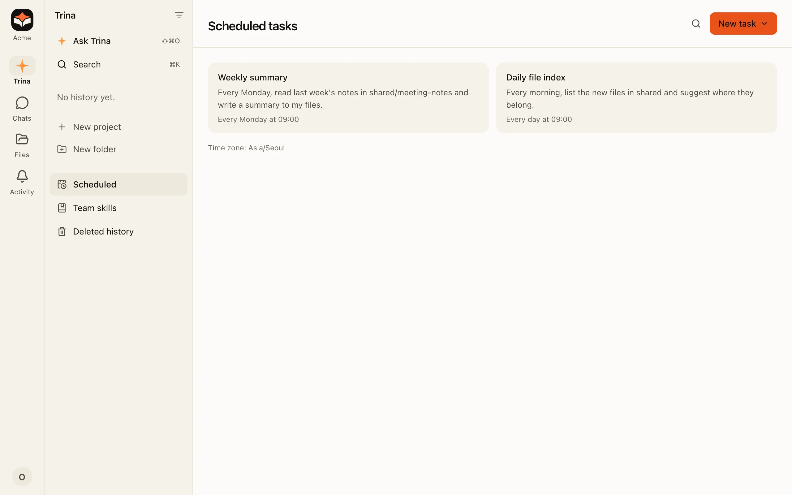
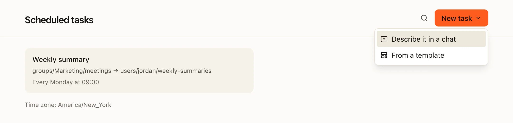
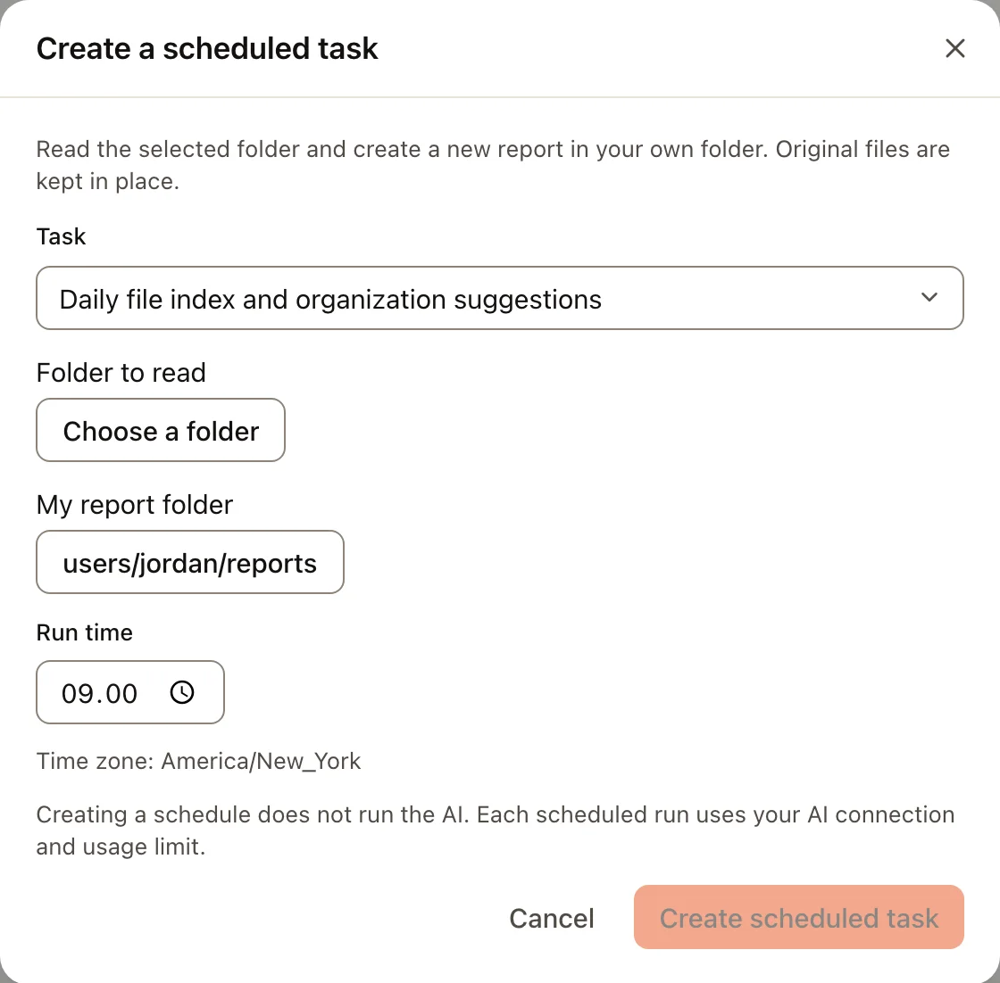
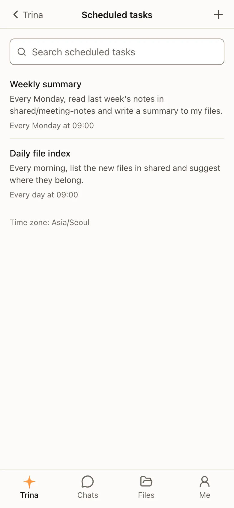

A scheduled task runs a request again and again: every weekday morning, every Monday, the first of the month. It runs as the person who made it.

:::note
From 0.4.0, scheduled tasks have their own **Scheduled** page: a row near the top of your Trina list (on a phone, in the **☰** menu of the **Trina** tab); **New scheduled task** in ⌘K opens it too. Before that, they are under **Settings › Schedules**.
:::

## Create a task

Open **Scheduled** near the top of your Trina list and press **New task** at the top right. A small menu offers two
ways:

### Describe it in a chat

1. Choose **Describe it in a chat**. A new chat opens with "Every weekday at 9:00, " already in the message box.
2. Finish the sentence in your own words and send it. For example: "Every Monday at 9:00, summarize last week's notes in
   shared/sales."
3. The AI shows a card with the task's name, when it repeats and the whole instruction. Check it, then press **Create**.
   (When the task could send something to a team connection, the card offers **Create, may send to those services** and
   **Create, never send to connected services** instead.) **Don't create** makes nothing.

The chat says the task was created, and it is now on the **Scheduled** page with its next run.

### From a template

1. Choose **From a template**. The **Create a scheduled task** window opens.
2. Under **Task**, pick what it does: **Daily file index and organization suggestions** or **Weekly summary**.
3. Press **Choose a folder** under **Folder to read** and pick the folder it should read.
4. Check **My report folder** (where the report is saved, in your own folder) and set **Run time** (and **Weekday** for
   the weekly one). The time is in the team's time zone, shown under it.
5. Press **Create scheduled task**.

A message says "Scheduled task created.", and the task is in the list. Creating it does not run the AI yet; each run
uses your AI connection and your usage limit.

## What a run can do

| Topic | In a scheduled run |
|---|---|
| **Permissions** | The owner's folder permissions and the owner's skills. |
| **Time** | The team's time zone. |
| **Questions** | Nobody is there to answer, so nothing that needs a person runs, except what the task's card allowed (below). |
| **Web** | At most 8 new web addresses per run that do not need a person. |
| **Large downloads** | A file over 1 GB is skipped instead of asked about. |

## Saving and sending without asking

A run has nobody to answer a confirmation, so the task's card asks once, when the task is made, edited or checked again:

- **Save folder.** "Saves new files in: shared/Weekly reports (30 people can see it now). Content that may go there: My folder, #Sales conversation". Runs put **new** files there and in its sub-folders without asking, at most 20 a run. They never change or replace a file there that they did not make, and never touch skills or instruction files. If a run read something fewer people may see that the card does not list (another folder, another conversation), it saves in your own folder instead and says why.
  The folder can be a new one inside a folder you can change (for example a `reports` folder in your group's folder): the card then says "(a new folder, made when you create the task)", and it is made only when you create the task.
- **Your own connections.** "Where it may send: My Notion · 'Daily notes'". Runs send only to the recipients on the card.

If the save folder is moved, renamed or deleted, its permissions change, or you can no longer write there, the task shows **Check the save folder again** with **Check again**, and you get one notice. Until you check it, runs save in your own folder. People joining or leaving a group do not change anything.

In **Edit**, the **Save folder** field picks another folder or removes it (×), and each item of the content that may go there can be removed (×).

## Manage a task

Open a task to see its schedule, instructions, next run and last run.

- **Run now** runs it at once.
- The switch pauses and resumes it.
- The menu on its name has **Edit** and **Delete**.

A finished one-time task, or one that can no longer run, says why it cannot be turned on.

## On a phone

The tasks are one list, with a search box above it and **+** at the top for a new task.

