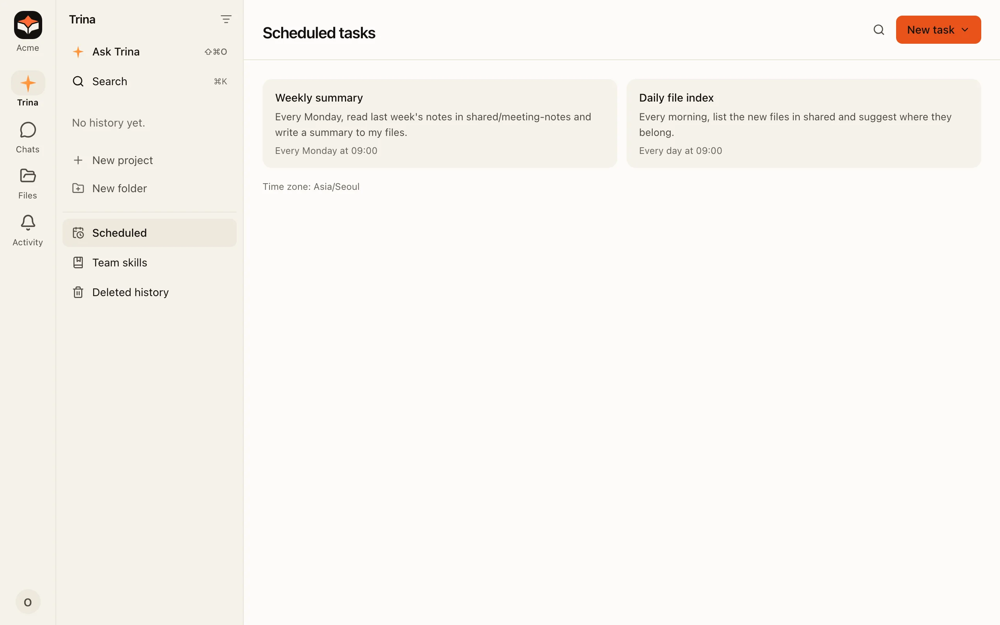
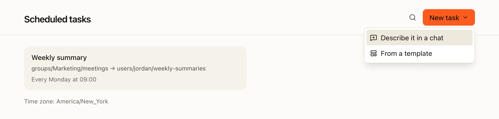
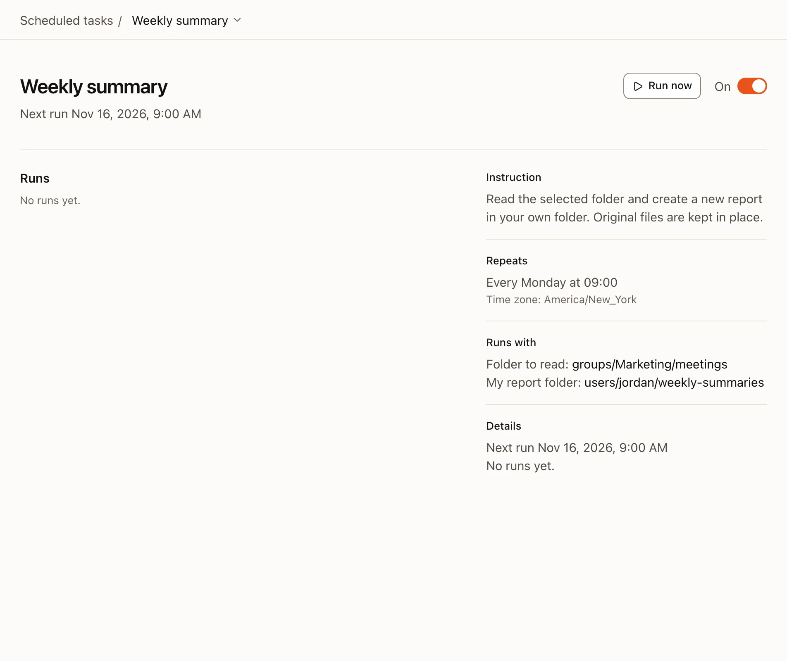
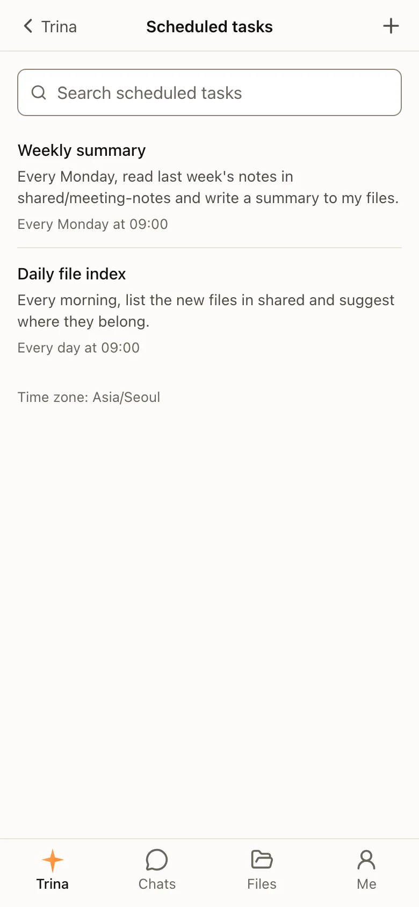

A scheduled task runs a request again and again: every weekday morning, every Monday, the first of the month. It runs as the person who made it.

:::note
From 0.4.0, scheduled tasks have their own **Scheduled** item in the sidebar. Before that, they are under **Settings › Schedules**.
:::

## Create a task

Choose **New task**. There are two ways:

- **Describe it in a chat.** For example: "Every Monday at 9:00, summarize last week's notes in shared/sales." The AI creates the schedule and shows it.
- **Start from a template.** Pick a template, fill in its folders and time, and save.

## What a run can do

| Topic | In a scheduled run |
|---|---|
| **Permissions** | The owner's folder permissions and the owner's skills. |
| **Time** | The team's time zone. |
| **Questions** | Nobody is there to answer, so nothing that needs a person runs, except what the task's card allowed (below). |
| **Web** | At most 8 new web addresses per run that do not need a person. |
| **Large downloads** | A file over 1 GB is skipped instead of asked about. |

## Saving and sending without asking

A run has nobody to answer a confirmation, so the task's card asks once, when the task is made, edited or checked again:

- **Save folder.** "새 파일 저장: shared/주간보고 (지금 30명이 볼 수 있어요). 넣어도 되는 내용: 내 폴더, #영업팀 대화". Runs put **new** files there and in its sub-folders without asking, at most 20 a run. They never change or replace a file there that they did not make, and never touch skills or instruction files. If a run read something fewer people may see that the card does not list (another folder, another room), it saves in your own folder instead and says why.
- **Your own connections.** "보낼 수 있는 곳: 내 Notion · '일일 메모'". Runs send only to the recipients on the card.

If the save folder is moved, renamed or deleted, its permissions change, or you can no longer write there, the task shows **저장 폴더를 다시 확인해 주세요** with **다시 확인**, and you get one notice. Until you check it, runs save in your own folder. People joining or leaving a group do not change anything.

In **Edit**, the **저장 폴더** field picks another folder or removes it (×), and each item of the content that may go there can be removed (×).

## Manage a task

Open a task to see its schedule, instructions, next run and last run.

- **Run now** runs it at once.
- The switch pauses and resumes it.
- The menu on its name has **Edit** and **Delete**.

A finished one-time task, or one that can no longer run, says why it cannot be turned on.

## On a phone

The cards stack in one column.

