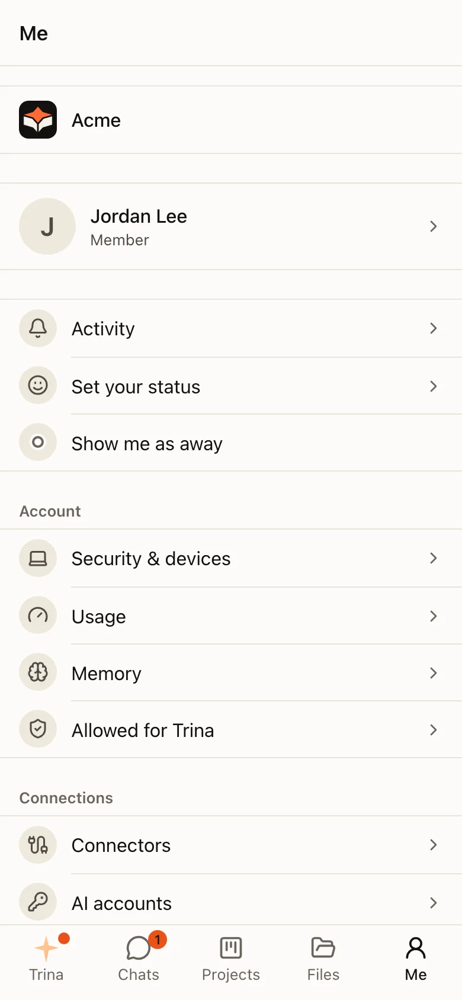
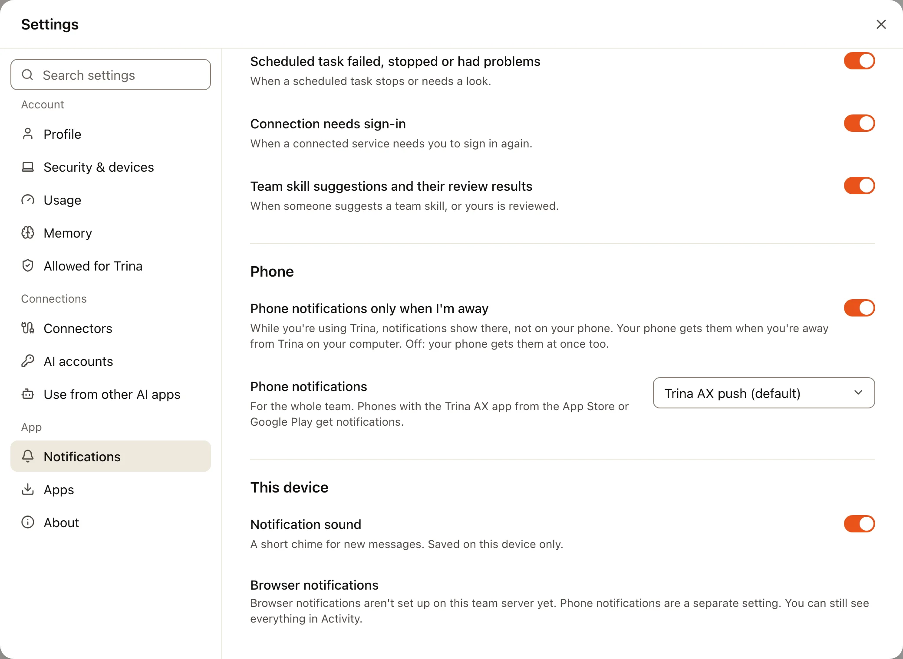
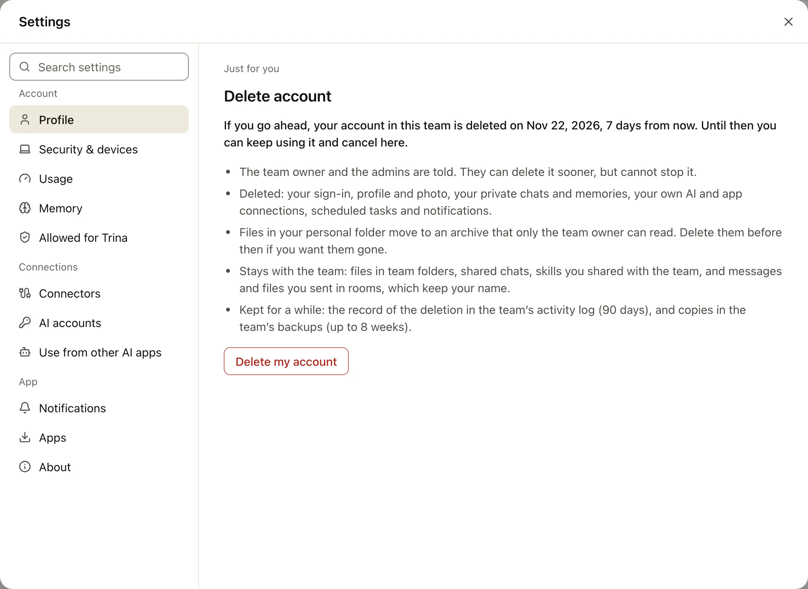
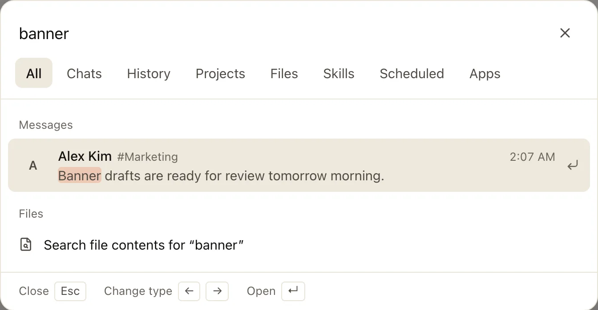

Everything about your own account is one click away: your photo at the bottom of the bar on the left.

## The account menu

Click your photo at the bottom of the bar on the left. On a phone, open the **Me** tab.

| Item | Does |
|---|---|
| **Show me as away** | Others see you as away until you turn it back |
| **Set your status** | A short status with an emoji, shown next to your name |
| **Settings** | Opens the Settings window, at your profile |
| **Sign out** | Ends this session |

Your usage is in **Settings › Usage**, and chats you deleted are in **Deleted history**, in the **⋯** menu next to **Trina history** in your Trina
list (on a phone, at the bottom of the **☰** menu on the **Trina** tab).

### Switching teams

In the desktop app, click your team's logo at the top of the bar on the left and pick **Switch
team**: it lists your teams, the same as the app's **Team** menu (⌘1–9). In the phone app it is in the **Me** tab, under
your team. In a web browser each team has its own address, so there is nothing to switch.

## The Settings window

Settings opens as a window over the page you are on. Links such as `/settings/usage` open it at that section.
Everything in it is just for you; what applies to the whole team is in Admin.

| Group | Sections |
|---|---|
| **Account** | Profile, Security & devices, Usage, Memory, Allowed for Trina (and Browser, see below) |
| **Connections** | Connectors, AI accounts (when the team lets members add their own accounts), Use from other AI apps |
| **App** | Notifications, Apps, About |

A [guest](guests.md) sees only their own sections, such as Profile and Notifications. A guest who uses their own sign-in connects their Claude or ChatGPT account in **AI accounts**.

**Connectors** holds your connections to other services: Google Drive, Gmail and the other Google apps, Slack, and the
listed services. Open one to connect it, see what the AI may do with it, or disconnect it; **Connectors** above its name
(on a phone **‹ Connectors**) goes back to the list. Older links such as `/connectors` open it too. See
[MCP connections](mcp.md).

:::steps
#### Find a section
Pick a section on the left, or type in **Search settings**.

#### Change what you need
Profile, language (English, 한국어, Bahasa Indonesia, 日本語, Español or 简体中文), theme (light, dark or the system's, in Profile), your default engine, notifications and more.

#### Close it
Press **Esc** or choose **✕**. You are back where you were.
:::

**Allowed for Trina** lists what you picked **Always allow** for on a confirmation card, and the room folders you
allowed new files in. Delete one and you are asked again next time.

**Browser** (in the desktop app, and on the web while **Allow all websites** is on) has **Allow all websites**. When it is on, the AI opens public websites without asking when you ask it, in your chats and in rooms. Scheduled tasks still ask. Addresses with long hard-to-read strings or a long query still ask, but that catches obvious tokens only: a hidden instruction in a document, page or room message can make the AI send anything it can read to any site. You can also turn it on from an address card ("Allow all websites (turn off in Settings)"). In the desktop app the same switch covers the app's own browser, which asks once more in its own window. The section is there while your team allows it.

On a phone, Settings fills the screen. The section list comes first, and **←** goes back to it.

## Notifications

**Settings › Notifications** chooses what reaches you: messages in conversations (direct and group conversations and
mentions, every new message, or nothing), replies in your threads, **Do not disturb** hours, scheduled tasks,
connections, team skills and **Chats shared with me**. Under **Phone**, **Phone notifications only when I'm away** keeps
your phone quiet while you use Trina on a computer. **This device** has the sound and, in a browser, **Browser
notifications**.

For the owner and admins, **Phone › Phone notifications** chooses where the whole team's phone notifications go:
**Trina AX push (default)**, **Off**, or **Custom**, the address of your own push service for your own build of the
phone app. Notifications on a phone never hold file or conversation content.

## Delete your account

**Settings › Profile › Delete account** deletes your account in this team 7 days after you ask, with your password. The
page says the date, what is deleted, what moves to the team owner's archive and what stays with the team. Until then you
can keep using your account and press **Keep my account**. The team owner and the admins are told; they can delete it
sooner but cannot stop it. The owner's own account cannot be deleted here: hand the team over first.

## Search with ⌘K

Press **⌘K** (Ctrl+K on Windows), or choose **Search** under **Ask Trina**.

- **Tabs** narrow the search: All, Chats, History, Projects, Files, Skills, Scheduled and Apps.
- **With nothing typed**, it shows what needs your attention, your recent chats and projects, and quick actions such as **New chat**.
- **Conversations and people** by name come first on the All tab: type part of a name, or a Korean name's initial consonants ("ㄱㅈ" finds "견적"). A conversation opens. A person opens your 1:1 chat with them; if you have none yet, the new-chat list opens with them ticked, and the chat starts only when you press its button.
- **Messages** in your conversations (team rooms, the everyone room, 1:1 and group chats) are found on the All tab, after your chats: who wrote it, where, when and the words around what you typed. Only what you would see by opening that conversation now is found. Choose one to open the conversation at that message (a reply opens its thread); **Jump to recent** takes you back to the newest. Part of a word works too: "견적" finds "견적서를".
- **Files sent in conversations** are found by name on the All and Files tabs, after your team's files: the file, who sent it, where and when. Only files of messages you can see are found. Choose one to open the conversation at the message it was sent with.
- **Every word counts**, in any order: "견적서 보내" finds "견적서를 보내드렸어요" in messages, chats and file names.
- **Keys:** ↑ and ↓ move, Enter opens, ← and → change the tab, Esc closes.

