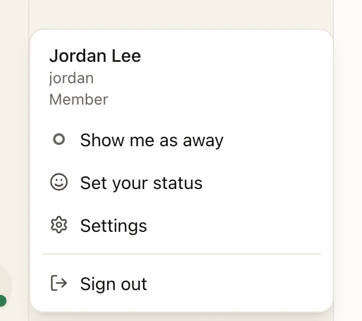
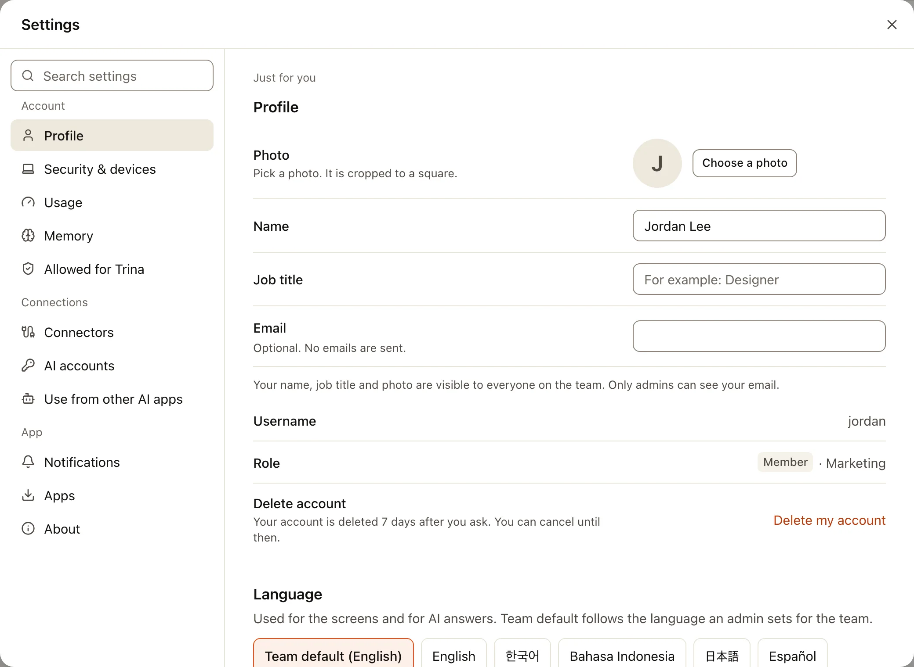
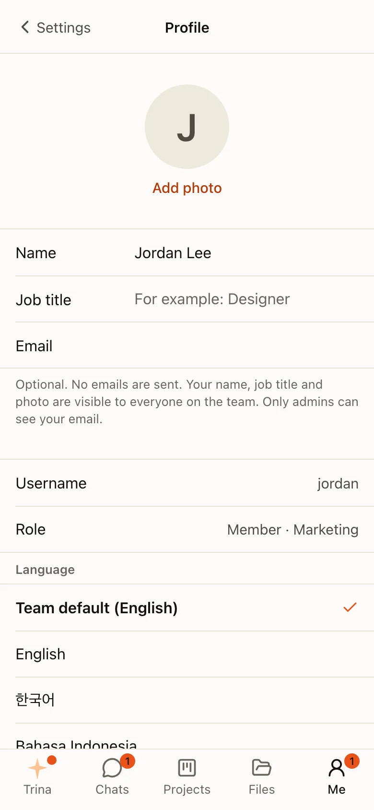
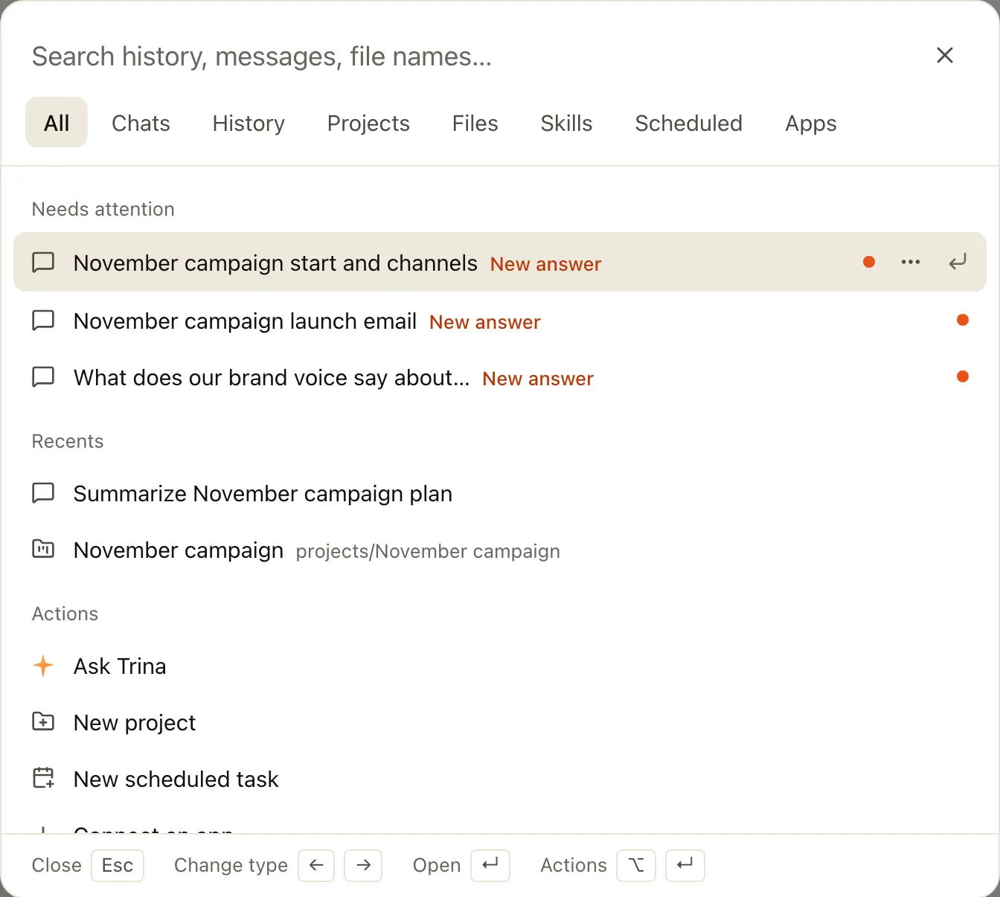

Everything about your own account is one click away, at the bottom of the sidebar.

## The account menu

Click your name at the bottom of the sidebar.

| Item | Opens |
|---|---|
| **Settings** | The Settings window, at your profile |
| **Usage** | Your own usage and limits |
| **Deleted chats** | Chats you deleted, to bring back |
| **Sign out** | Ends this session |

## The Settings window

Settings opens as a window over the page you are on. Links such as `/settings/usage` open it at that section.
Everything in it is just for you; what applies to the whole team is in Admin.

| Group | Sections |
|---|---|
| **Account** | Profile, Security & devices, Usage, Memory |
| **Connections** | Providers (when the team lets members add their own accounts), MCP, App connectors, AI apps |
| **App** | Notifications, Apps, About |

:::steps
#### Find a section
Pick a section on the left, or type in **Search settings**.

#### Change what you need
Profile, language, theme (light, dark or the system's, in Profile), your default engine, MCP connections, app connectors, notifications and more.

#### Close it
Press **Esc** or choose **✕**. You are back where you were.
:::

On a phone, Settings fills the screen. The section list comes first, and **←** goes back to it.

## Search with ⌘K

Press **⌘K** (Ctrl+K on Windows), or choose **Search** in the sidebar.

- **Tabs** narrow the search: All, Chats, Projects, Files, Skills, Scheduled and MCP.
- **With nothing typed**, it shows what needs your attention, your recent chats and projects, and quick actions such as **New chat**.
- **Conversations and people** by name come first on the All tab: type part of a name, or a Korean name's initial consonants ("ㄱㅈ" finds "견적"). A conversation opens. A person opens your 1:1 chat with them; if you have none yet, the new-chat list opens with them ticked, and the chat starts only when you press its button.
- **Messages** in your conversations (team rooms, the everyone room, 1:1 and group chats) are found on the All tab, after your chats: who wrote it, where, when and the words around what you typed. Only what you would see by opening that conversation now is found. Choose one to open the conversation at that message (a reply opens its thread); **Jump to recent** takes you back to the newest. Part of a word works too: "견적" finds "견적서를".
- **Files sent in conversations** are found by name on the All and Files tabs, after your team's files: the file, who sent it, where and when. Only files of messages you can see are found. Choose one to open the conversation at the message it was sent with.
- **Every word counts**, in any order: "견적서 보내" finds "견적서를 보내드렸어요" in messages, chats and file names.
- **Keys:** ↑ and ↓ move, Enter opens, ← and → change the tab, Esc closes.
