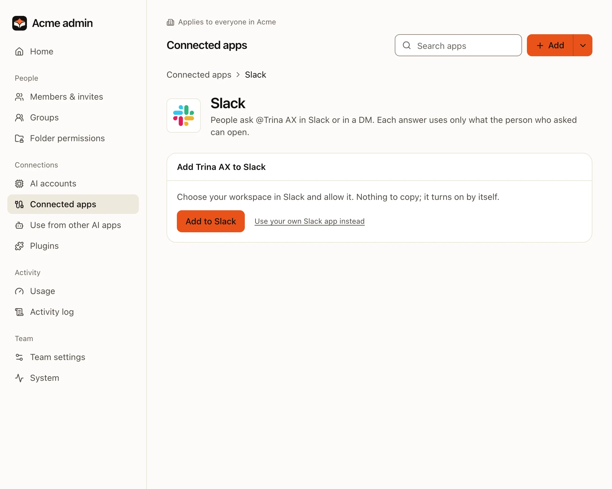
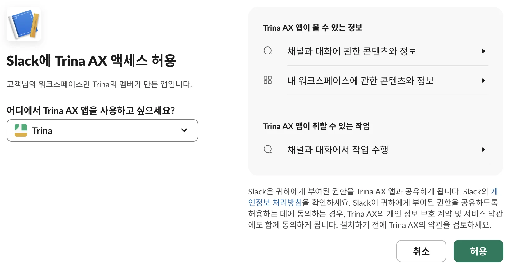
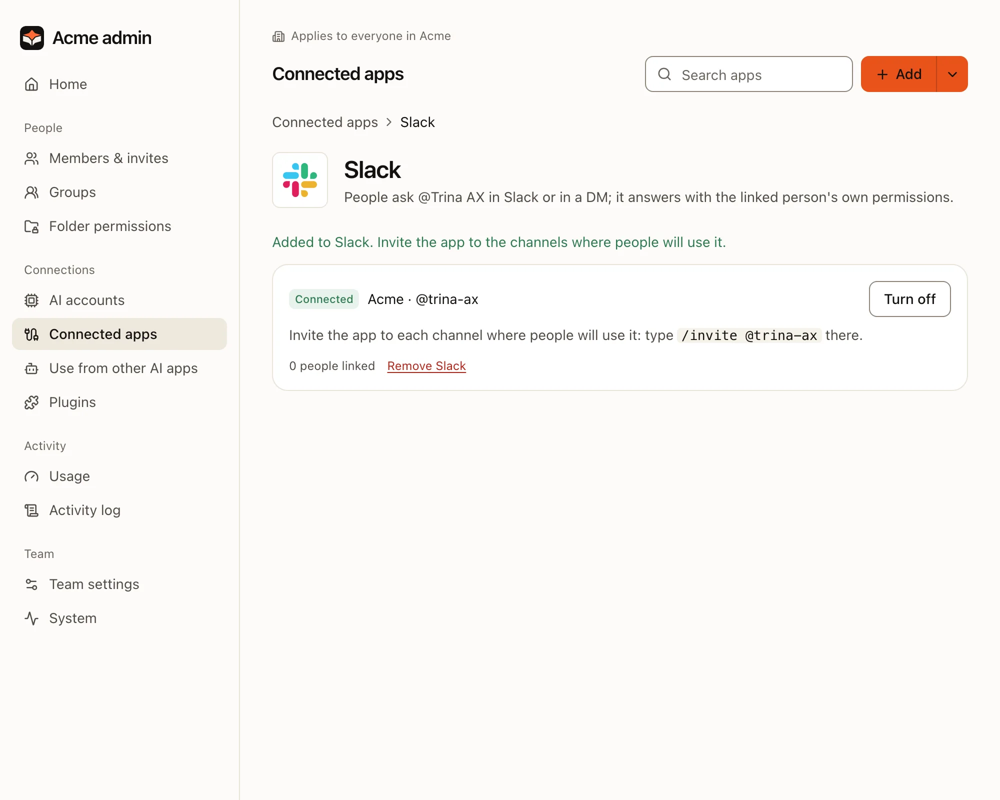
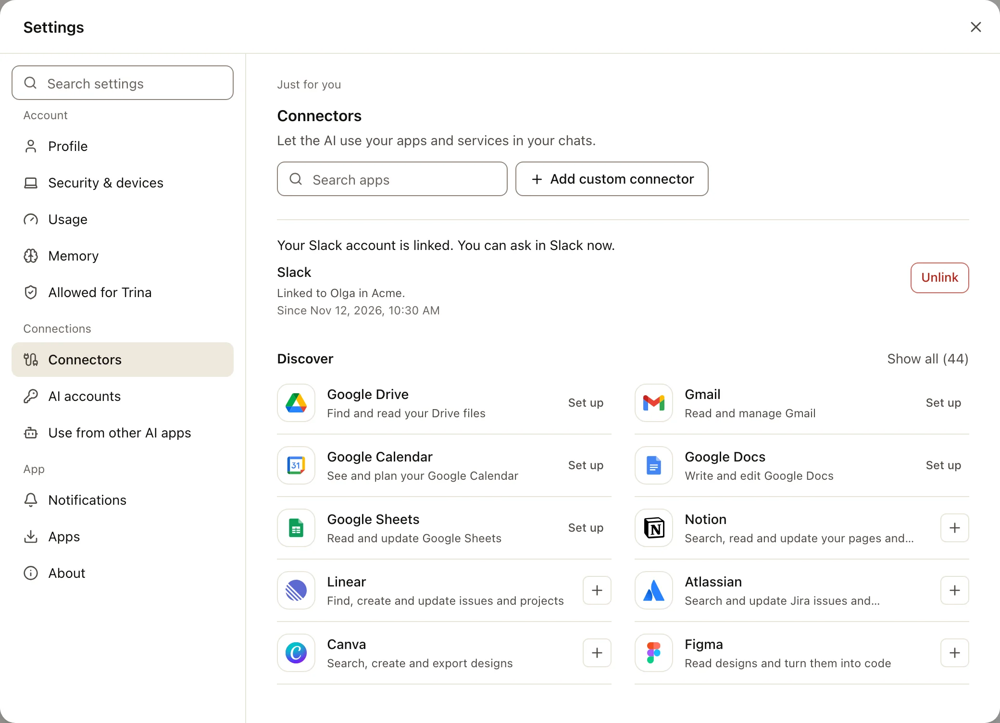
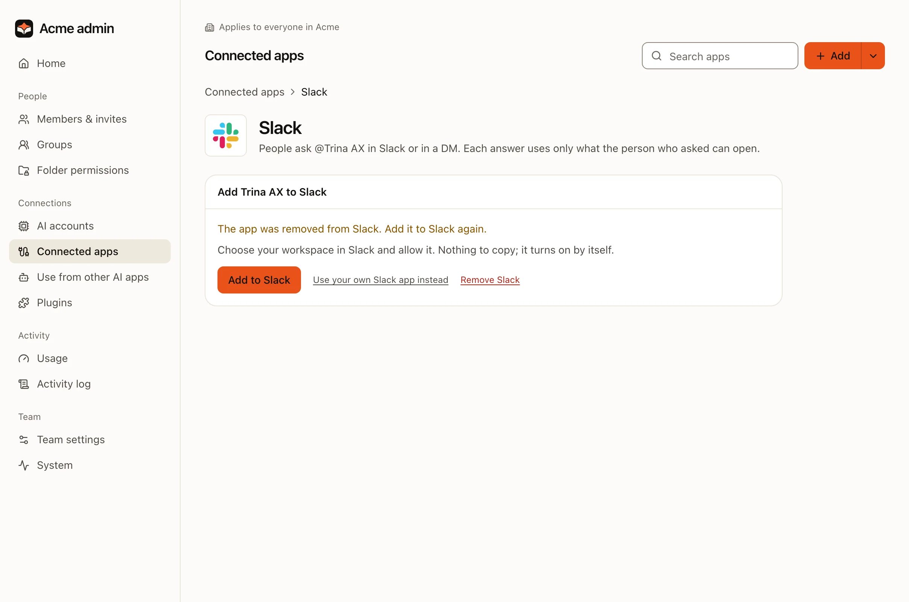

With Slack connected, people ask Trina AX without leaving Slack: mention **@Trina AX** in a channel, or send it a
direct message. Each question runs as the person who asked, with their own folder permissions, AI engine and limits,
and the whole answer is also kept as a chat in Trina AX.

It takes two short steps. The team's owner adds the app to Slack once, and each person links their own Slack account
once.

:::note
The screenshots on this page are from a team that uses Trina AX in Korean. The English names are in the text.
:::

## Add Trina AX to Slack (the owner)

:::steps
#### Open Admin › Slack
In **Admin**, under **Connections**, choose **Slack**. Only the team's owner has this page. It shows **Add Trina AX to
Slack**.



#### Press Add to Slack
**Add to Slack** (Slack에 추가) opens Slack's own page. It works on a phone too.

#### Choose your workspace and allow it
Check the workspace first: Slack opens on the workspace you used last, which may not be the one you mean. Then choose
**Allow**.



#### You're back in Admin › Slack
It says "Added to Slack. Invite the app to the channels where people will use it." The line shows your workspace and
the app, **Connecting** for a few seconds, then **Connected**. There is nothing to copy or paste.


:::

Only a Slack workspace admin or owner can add the app. Anyone else comes back to "A Slack workspace admin has to add
it. Ask an admin to do it.", and the app is taken off the workspace again.

### Invite the app to channels

Slack tells Trina AX only about the channels it is in. In each channel where people will ask, type:

```
/invite @trina-ax
```

Direct messages need no invite.

## Link your account and ask (everyone)

Each person links their own Slack account to their own Trina AX account, once. Nobody can link someone else.

:::steps
#### Ask in Slack
Mention **@Trina AX** in a channel it was invited to, or send it a direct message. For example: "@Trina AX summarize
last week's notes in shared/sales".

#### Connect your account the first time
The first time, Trina AX answers only you: "To ask Trina AX here, first connect your Trina AX account. The link works
once, for 10 minutes, and only for you." Choose **Connect Trina AX account**. Trina AX opens (sign in if it asks) and
shows both accounts. **Link** links them when your Slack account has the same e-mail as your Trina AX account. If it
doesn't, the page says why and offers **Sign in with Slack to link** instead.

#### Or link from Trina AX
**Connectors** in the sidebar has a **Slack** line: "Sign in with your Slack account of … to link it." **Link** takes
you to Slack and back, and the line then shows the account it is linked to.



#### Ask again
Go back to Slack and ask your question again. From now on Trina AX answers right away.
:::

### Where the answer comes

| Where you ask | What you get |
|---|---|
| **A channel** | "Working on it…" and then the answer, shown only to you, with **Post to channel**. Press it to post the answer to the thread, with "Asked by" and your name. |
| **A direct message** | The answer, in the thread of your message. |

- **Go on in the same thread.** Mention the app again in that thread, or reply in the DM thread: it continues the same
  chat. A new thread starts a new chat.
- **The whole answer is in Trina AX too.** A long answer is shortened in Slack, with a link to the rest. "Working
  on it…" also names the account it answers as, so you can tell it's yours.
- **Before you post.** If the answer used a place not everyone on the team can see, such as a group's folder or your
  own folder, **Post to channel** first asks you to confirm, with **Post anyway** and **Cancel**. In a channel shared
  with another organization, answers are never posted.

## If Add to Slack isn't there

**Add to Slack** appears where the Trina hosting service serves your server: a hosted team, or a server you installed
yourself that the hosting service has registered. Anywhere else, Admin › Slack shows **Connect a Slack app**
instead: four steps to make your team's own Slack app from our manifest and paste its keys. Follow
[Setting up the team's own app](../../SLACK.md#setting-up-the-teams-own-app-the-owner).

You also see the four steps when your team's own Slack app is set up already. To switch, remove it first (**Replace
tokens**, then **Remove Slack**), then press **Add to Slack**. If Admin › Slack isn't in your menu at all, you aren't
the team's owner: ask them.

## Remove or reconnect

Admin › Slack always says where things stand. When the app was removed in Slack, it offers **Add to Slack** again.



| What happened | What to do |
|---|---|
| **Someone removed the app in Slack** | Admin › Slack says "The app was removed from Slack. Add it to Slack again." Press **Add to Slack** again. People's links stay: added to the same workspace, nobody links again. |
| **You want it off for a while** | Press **Turn off**. Trina AX stops answering in Slack; links stay. **Turn on** brings it back. |
| **You want it gone** | Press **Remove Slack** and confirm. The app is taken out of your Slack workspace and everyone's account links are deleted. If you add it again later, everyone links again. |

Anyone can **Unlink** their own Slack account in **Connectors › Slack** at any time.

## FAQ

### Who can add Trina AX to Slack?

The team's owner presses **Add to Slack** in Trina AX, and in Slack it has to be allowed by an admin or owner of the
workspace. Admins of the team don't have Admin › Slack.

### Does each person have to sign in?

Yes, once. Until a person has linked their Slack account, Trina AX only sends them the link to connect. A person whose
Trina AX account is disabled or deleted is unlinked at once.

### What does Trina AX see in Slack?

Only messages that mention @Trina AX in channels it was invited to, and direct messages sent to it. It doesn't read
channel history, the earlier messages of a thread or files: the AI gets the text of your question only. To link
accounts and to say who asked, it reads people's names and e-mail addresses in the workspace. In a channel, an answer
is shown only to the person who asked until they post it.

### Whose permissions does an answer use?

The asker's: their folder permissions, their AI engine and their limits. The answer counts in their usage, as any chat
does.

### Can we connect more than one workspace?

No, one workspace per team. A workspace already connected to another team is refused: "This Slack workspace is
connected to another team. Remove it there, or remove the app in Slack, then try again." People of another
organization in a shared channel, and bots, get no answer.

Full details: [Slack connector](../../SLACK.md).
