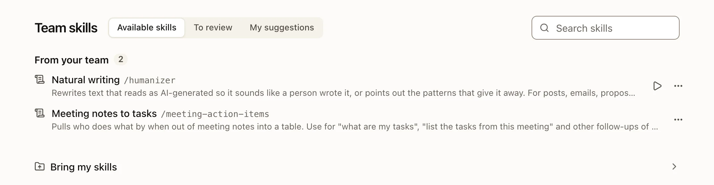

A skill is a reusable procedure in a `SKILL.md` file. It tells the AI how your team does a task. It does not train the model and never grants extra access.

## Use a skill

- In a chat, type `/` and pick a skill, or write `/skill-name` in your message.
- The AI can also find and load a skill by itself when it fits the request.
- **Team skills** in the sidebar lists the skills you can use.



## Skills every team has

Every team gets 19 ready-made skills without installing anything, in the team's language (Korean or English):

| Folder | Skills |
|---|---|
| `skills/general/` | Tasks from notes, Key points, Promo cards, Promo video, Company profile |
| `skills/marketing/` | Ad copy, Blog and social draft, Campaign plan, SEO brief, Competitor brief, Brand voice review, Weekly report |
| `skills/work/` | Meeting summary, Weekly roundup, Sales follow-up, Creative brief, Expense check, New hire guide, Natural writing |

They are your team's own files. Skill managers can edit, move or delete them. The server adds each one once. It never replaces an edited skill, never brings back one you deleted, and skips one whose name another team skill already uses.

**Natural writing** rewrites text that reads as AI-written so it sounds like a person wrote it, without changing any fact. The Korean version knows Korean genres (blog, Shorts titles, Instagram, proposals, notices); the English one is based on the open-source "humanizer" skill (MIT License, its notice is inside the skill).

### Optional: Korean HR documents

Owners and admins can add three more skills from **Available skills** with **Add 3 HR document skills (Korea)**: Employment contract, Employment certificate (employment, career, leaving) and Annual leave (days and a leave request). They follow the Korean Labor Standards Act and only make drafts: the company signs, stamps and decides. They read HR records only where the person asking may read them. They go under `skills/hr/` and are never added by themselves.

## Where skills live

| Location | Who sees it |
|---|---|
| `skills/<name>/SKILL.md` | Everyone who can read `skills/` (usually the whole team) |
| `skills/<folder>/<name>/SKILL.md` | Only people who can read that folder, for example `skills/finance/` |
| `groups/<group>/skills/<name>/SKILL.md` | Only the members of that group. Not the owner or admins outside it. |
| `users/<you>/skills/<name>/SKILL.md` | Only you. Not even the owner or admins. |

When two skills share a name, the closest one wins, for you only: your personal skill, then your group's, then the team's. If two of your groups have a skill with the same name, both are listed with their folder, and `/name` uses the one of the group whose name comes first.

## Group skills

Every group has its own skills in its folder: `groups/<group>/skills/`, next to the group's files. Only the members of the group see and use them: in **Team skills** (one section per group, under the group's name), in the `/` menu (marked with the group's name) and in what the AI knows. The owner and admins do not get a group's skills unless they are in the group.

- Any member of the group can add or change its skills, like the group's other files. The AI asks you on a card before it saves one there, like for team skills, and every change is recorded with the group's name.
- A member can suggest a skill to their group (**Suggest as skill**, then the group's folder); the group's members review it.
- Renaming a group keeps its folder; the section in **Team skills** shows the new name at once. Deleting a group removes its skills from its members' lists.

A group skill is written by the group's members, not by the team's skill managers: what one member saves there, every member's AI follows.

## Write a skill

:::steps
#### Make the folder
Create `skills/<name>/` in Files. The name uses `a`–`z`, `0`–`9` and hyphens, and matches the folder name.

#### Write SKILL.md
Start with a header, then the procedure.
```markdown
---
name: meeting-summary
description: Summarize permitted meeting notes into decisions, actions and open questions.
---

# Inputs
Ask for the source paths before reading.

# Procedure and output
Return decisions, an action table and open questions. Cite the source paths.
```

#### Check it loads
**Team skills** shows a clear reason when a skill cannot load. Fix the header and try again.
:::

[Read the full SKILL.md format](../agents/skills-format.md).

## Bring your skills from Claude Code or Codex

Owners and admins can bring the skills they already use to the team, in the setup steps or from a proposal link:

| From | Pick or drop | What is read |
|---|---|---|
| Claude Code | `~/.claude` (or a project's `.claude`) | `skills/`, `commands/*.md`, `CLAUDE.md` |
| Codex | `~/.codex`, and `~/.agents` for current personal skills | `skills/` (never `.system`), `prompts/*.md`, `AGENTS.md`, the remote servers in `config.toml` |

Or, once Claude Code or Codex is connected to the team ([the MCP connector](../agents/mcp-connector.md)), paste one line into it and it sends a proposal.

- Nothing else in those folders is opened. A skill that holds a key or token never leaves your computer; only its name is listed.
- The server checks every skill again and suggests the ones the whole team can use. Nothing reaches the team before you press **Share with the team**.
- The rule file becomes one team rule. Remote MCP servers become connection templates without keys: each member connects with their own.
- A skill with the same name as a team skill is merged in a chat that can only read the two and save the team skill, after you confirm.
- **To one of your groups instead.** On the proposal's page, **Share with** picks the whole team (the default) or one of your groups; Claude Code and Codex can name the group too. A proposal to a group adds skills only (no team rule, no connections) and never changes a team skill: a skill named like one of the group's is merged into it or kept beside it, and one named like a team skill becomes the group's own copy. The group's members see it under **Team skills › Review** (only what goes to the group) and any of them can add it to the group. The setup steps always share with the team.

## Who can change skills

**Skill managers** change team skills: the owner, admins, and people or groups an admin turns on with **Manages team skills**. Underneath, that is simply write access to `skills/` or a folder in it.

- Members can **suggest** a personal skill to the team. A skill manager of the target folder reviews it.
- Every change to `skills/` is recorded, and the owner and admins get a notice with a link to the version history.
- A group's skills are changed by the group's members (see [Group skills](#group-skills)); their changes are recorded and announced the same way.

## Members bring their own skills

After a member's first good result with the skill their invite opened, one line under the answer asks whether they want to bring the skills or files they use to the team too. **Bring them** opens one sheet on a computer:

- The member picks or drops their `.claude`, `.codex` or `.agents` folder, read the same way as above. A skill that holds a key never leaves their computer.
- Nothing is ticked first. They tick up to 10 skills and send them as suggestions; up to 20 of their suggestions can wait at a time. Rule files and MCP servers are not sent.
- The server checks every skill again (keys, scripts, size, names, paths on their computer) and keeps it outside the team files. No AI judges it.
- When they can write the team folder, the sheet also links to it for files. On a phone the line offers only that folder, and nothing when they cannot write one.

The owner and admins get one Inbox line per send ("Mina wants to bring 2 skills to the team"), which opens **Review**, grouped by person. Only the owner and admins see and approve such a skill: it is saved as `skills/<folder name>/` with its files, the member hears it, and the skill shows "Suggested by Mina" in the list. Approving never changes the skill the invite opens or the 7-day goal names. The line can be closed for good with ✕.

## Starter skills

The repository has six starter skills with fictional inputs: weekly report, sales follow-up, brand brief, expense review, new-hire guide and meeting summary. [See the examples](../../../examples/README.md).
