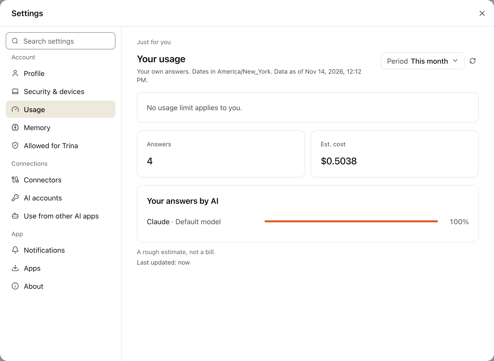
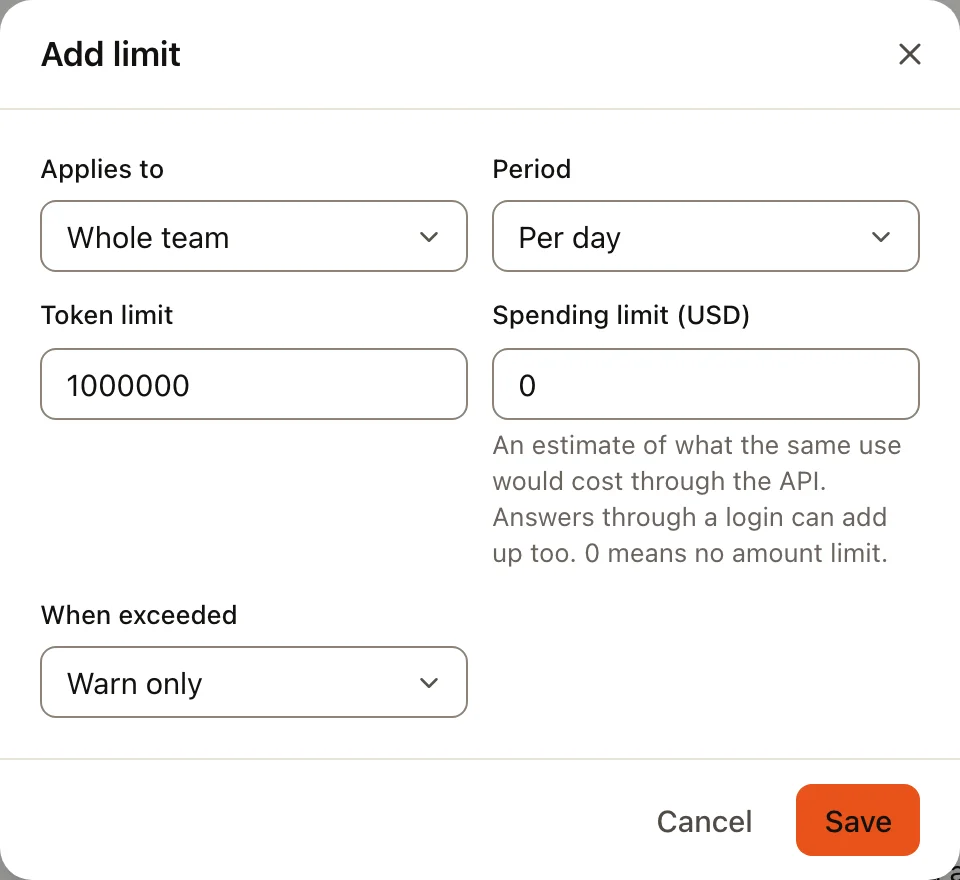

Trina AX counts every answer: who asked, which engine and model, how many tokens, and an estimated cost.

:::note
Costs are estimates of the equivalent API price, not bills. Subscription connections add 0 per request, but their tokens still count.
:::

## Your own usage

Open **Settings › Usage** (your photo at the bottom of the bar on the left › **Settings**; on a phone the **Me** tab). It shows your answers and estimated cost, which AI answered them, and how full each limit that applies to you is. You only ever see your own numbers.

:::note
Personal usage is new in 0.4.0. Before that, only admins see usage, in **Admin › Usage**.
:::

## The team's usage

Admins open **Admin › Usage**. It is laid out like the Claude Console's usage page.

- **Filters** at the top, each a small button that shows what is chosen:
  - **Group** (only when the team has groups) and **Range**: today, the last 7 or 30 days, this month, or a custom range.
  - **Person**, **Engine**, **Model** and **AI connection**, to look at one of them. **Clear filters** shows everything again.
  - **Group by** person, group, engine, model, day, AI connection or skill.
- **Cards** with the totals: tokens in, tokens out, answers and the estimated cost.
- **Token usage**: tokens per day as stacked bars, one colour per Group by value (the five biggest, the rest as "Other"). Point at a day, or focus the chart and use the arrow keys, to see that day's numbers.
- **Breakdown**: a row per Group by value with answers, tokens, its share and the estimated cost.
- The **download** button saves the breakdown as CSV.

Personal skills are never counted by name, so no admin sees what someone keeps privately. Group skills are counted like team skills.

## Set limits

There are no limits by default. A limit is counted in **tokens**: small pieces of text, roughly three quarters of an
English word each. Everything the AI reads (your question, the files it opens) and writes counts, so an answer that reads
long files uses many more tokens than a short reply. Like a monthly data plan on a phone, a limit caps how much can be
used in a day or a month.

To add a limit (owners and admins):

1. Open **Admin › Team settings** and scroll to **Usage limits**.
2. Press **Add limit**. A window opens.
3. **Applies to**: **Whole team**, a group or one person. **Period**: **Per day** or **Per month**.
4. **Token limit**: how many tokens, for example 1000000 for one million. **Spending limit (USD)** is optional: an
   estimate of what the same use would cost through the API; 0 means no amount limit.
5. **When exceeded**: **Warn only** lets answers go on and sends a notice; **Block** stops new answers until the period
   starts again.
6. Press **Save**.

The limit is now a row under **Usage limits**. Each person, group or the whole team can have one limit per period.

For one person, it is quicker from **Admin › Members & invites**: open their **…** menu and choose **Usage limit…**. The
dialog is already for that person and opens with the limit they have, with how much of it they used. Pick **Per day** or
**Per month** to see or set each one, and **Remove limit** to take one away. People with a limit show it in one quiet line
under their name, with **Over limit** once it is used up. On a phone, open the person and tap **Usage limit**.

| Limit for | Period |
|---|---|
| A person | per day or per month |
| A group | per day or per month |
| The whole team | per day or per month |

What happens at the limit depends on **When exceeded**:

- **Block**: the owner and admins get a notice at 80% and again at 100% (and the person too, when the limit is theirs).
  At 100% the people it covers cannot start new answers until the period resets: midnight for a day limit, the 1st of
  the month for a month limit, in the team's time zone. Their usage page says when that is.
- **Warn only**: answers go on. The owner and admins (and the person, when the limit is theirs) get one notice when it
  is used up.
