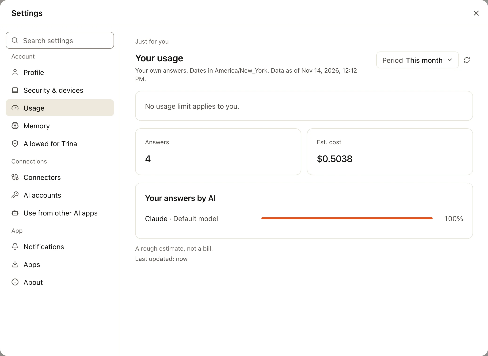
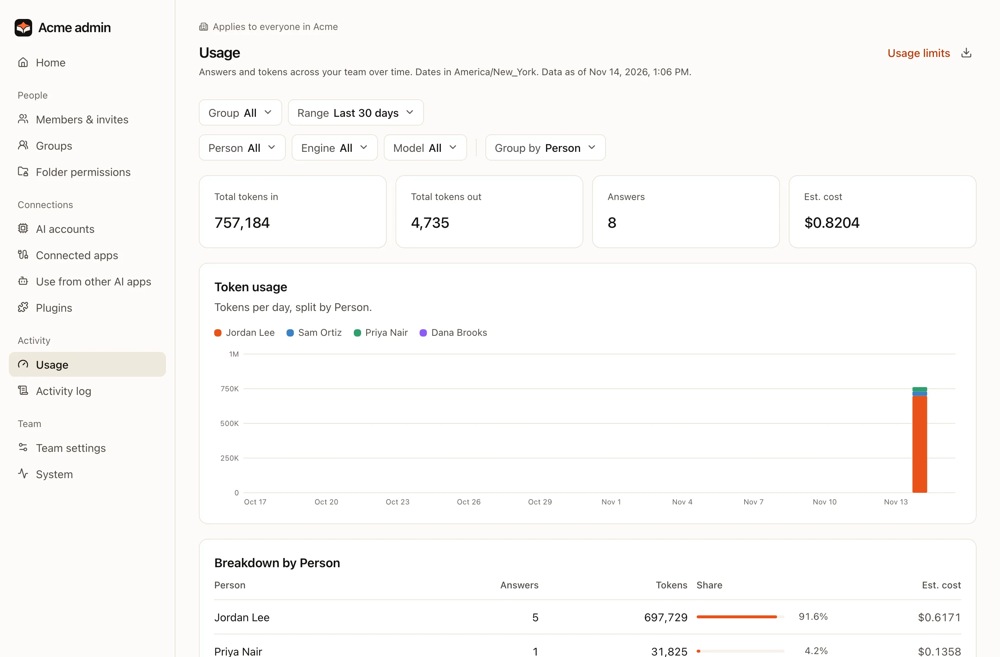

Trina AX counts every answer: who asked, which engine and model, how many tokens, and an estimated cost.

:::note
Costs are estimates of the equivalent API price, not bills. Subscription connections add 0 per request, but their tokens still count.
:::

## Your own usage

Open **Usage** from your account menu. It shows your answers, tokens and estimated cost, and how full each limit that applies to you is. You only ever see your own numbers.

:::note
Personal usage is new in 0.4.0. Before that, only admins see usage, in **Admin › Usage**.
:::

## The team's usage

Admins open **Admin › Usage**.

- **Group by** person, group, engine, model, day, AI connection or skill.
- Pick a date range.
- **Download CSV** to work with the numbers elsewhere.

Personal skills are never counted by name, so no admin sees what someone keeps privately.

## Set limits

There are no limits by default. Admins add them in **Admin › Team settings**, under **Usage limits**.

| Limit for | Period |
|---|---|
| A person | per day or per month |
| A group | per day or per month |
| The whole team | per day or per month |

When a limit is reached, the people it covers cannot start new answers until the period resets. Their usage page says when that is.
